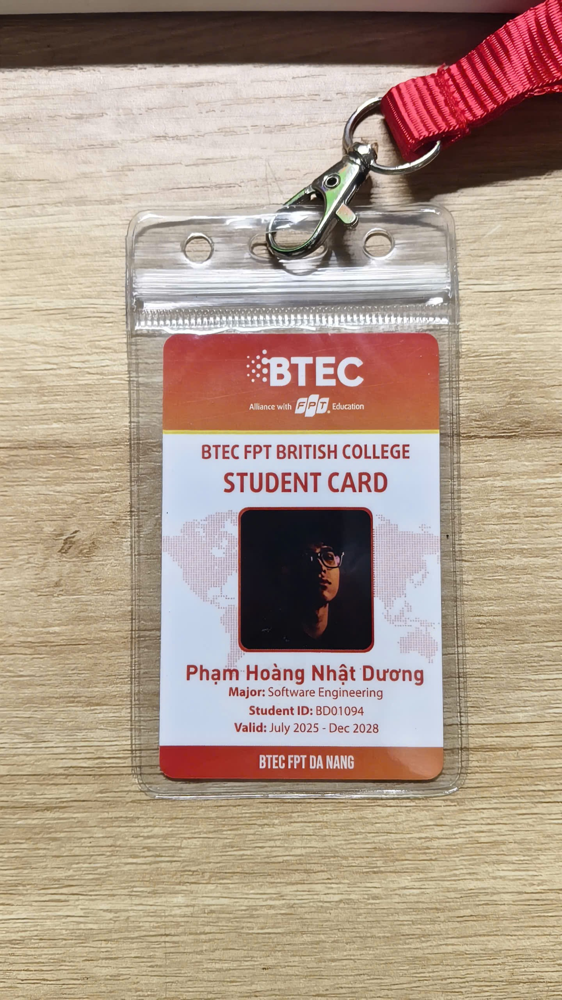

# Đọc thông tin thẻ sinh viên

> **Model:** `gpt-5-6` · **Created:** 2026-09-15 22:18:21 · **Updated:** 2026-09-15 22:18:35
> **ID:** `6aa961bc-0f84-83ec-839c-d56650c8198f`

---

### 👤 User · 2026-09-15 22:18:16

đọc thông tin giúp mình

---

### 🤖 ChatGPT `gpt-5-6` · 2026-09-15 22:18:25

Anh đọc được các thông tin trên thẻ như sau:

- **Trường:** BTEC FPT British College
- **Loại thẻ:** Student Card – Thẻ sinh viên
- **Họ và tên:** **Phạm Hoàng Nhật Dương**
- **Chuyên ngành:** **Software Engineering** – Kỹ thuật phần mềm
- **Student ID:** **BD01094**
- **Thời hạn:** **July 2025 – Dec 2028** (07/2025 – 12/2028)
- **Cơ sở:** **BTEC FPT Đà Nẵng**
- **Đơn vị:** BTEC – Alliance with FPT Education.

---

*2 messages · 3 nodes*
