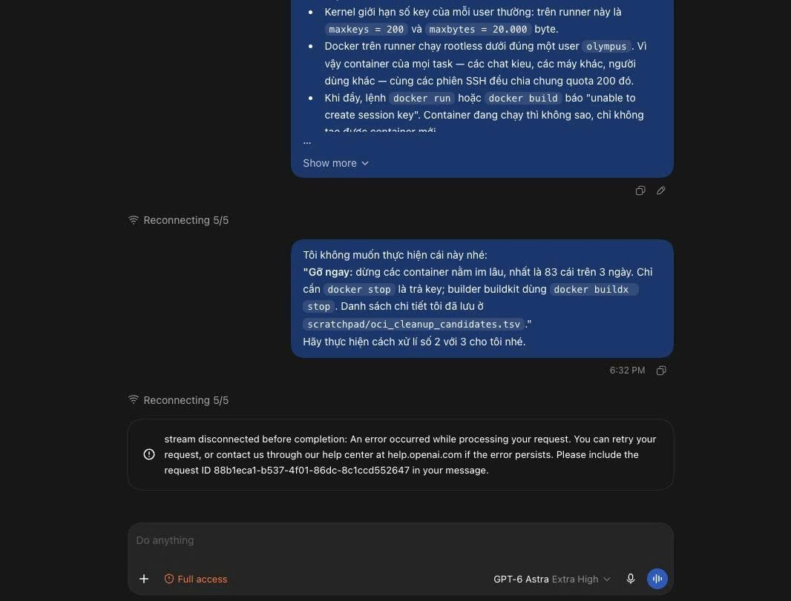

# Reset login ChatGPT

> **Model:** `gpt-5-6-thinking` · **Created:** 2026-09-16 23:50:50 · **Updated:** 2026-09-16 23:52:36
> **ID:** `6aaac8e8-9be4-83ec-b0b5-6d8862df53a5`

---

### 👤 User · 2026-09-16 23:51:23




mình reset lại login chatgpt trên app để fix lỗi này dc không


---

### 🤖 ChatGPT `gpt-5-6-thinking` · 2026-09-16 23:51:39

Được anh. **Đăng xuất rồi đăng nhập lại ChatGPT trên app là một bước nên thử** với lỗi trong hình:

> `Reconnecting 5/5` 
> `stream disconnected before completion`

OpenAI cũng liệt kê **sign out → sign in lại** trong các bước xử lý lỗi ChatGPT. ([OpenAI Help Center](https://help.openai.com/vi-vn/articles/7996703-troubleshooting-chatgpt-error-messages?utm_source=chatgpt.com)) 

Anh làm theo thứ tự này để sạch nhất:

1. **Copy lại nội dung prompt đang làm dở** nếu cần.
2. Vào **Settings → Log out**.
3. **Thoát hoàn toàn ChatGPT**, không chỉ bấm `X`.
 - Windows: mở **Task Manager → End task ChatGPT** nếu vẫn còn chạy.
4. Mở lại app.
5. Đăng nhập bằng **đúng phương thức cũ**: Google/Microsoft/Apple/email.
6. Mở lại cuộc chat rồi thử gửi một prompt ngắn trước.

**Việc logout/login không xóa lịch sử chat trên tài khoản**, nên anh có thể làm. Nó chủ yếu làm mới session/token đăng nhập.

Tuy nhiên, nhìn lỗi của anh thì **không chắc nguyên nhân nằm ở login**. `stream disconnected` thường liên quan đến kết nối app ↔ máy chủ, mạng/VPN/DNS hoặc lỗi tạm thời phía dịch vụ. OpenAI gần đây cũng vừa ghi nhận lỗi liên quan **ChatGPT Work Mode**, nhưng sự cố đó đã được đánh dấu khôi phục. ([OpenAI Status](https://status.openai.com/incidents/01M2GA8XTS6VB3QCDEGZ0HNAQ5?utm_source=chatgpt.com)) 

Nếu **logout/login vẫn bị đúng lỗi này**, em sẽ ưu tiên bước tiếp theo là **reset cache/session của ChatGPT Desktop mà không cần gỡ app**, rồi kiểm tra mạng. Anh muốn thì em hướng dẫn anh **reset sạch ChatGPT app trên Windows** từng bước luôn.

---

### 👤 User · 2026-09-16 23:51:56

trên app có file gì để lưu phiên ấy

---

### 🤖 ChatGPT `gpt-5-6-thinking` · 2026-09-16 23:52:24

Có anh. **Nếu anh đang dùng bản ChatGPT Desktop mới trên Windows như ảnh**, phiên đăng nhập không chỉ nằm ở một file cookie duy nhất.

Phần quan trọng nhất hiện nay thường nằm trong:

```text
%USERPROFILE%\.codex\
```

Trong đó đáng chú ý:

```text
auth.json
cap_sid
```

`auth.json` chứa trạng thái/xác thực ChatGPT của app; `cap_sid` cũng có thể liên quan tới session. Các báo cáo trên repo OpenAI cho thấy chỉ xóa cache của app đôi khi **không reset hoàn toàn phiên đăng nhập**, còn đổi tên hai file này sẽ buộc app tạo phiên đăng nhập mới. ([GitHub](https://github.com/openai/codex/issues/36525?utm_source=chatgpt.com)) 

Ngoài ra app còn có profile/cache tại:

```text
%LOCALAPPDATA%\Packages\OpenAI.Codex_2p2nqsd0c76g0\LocalCache\Roaming\Codex\
```

và dữ liệu web ở kiểu:

```text
...\Codex\web\Codex\Default\
```

bao gồm Local Storage/LevelDB. ([GitHub](https://github.com/openai/codex/issues/41179?utm_source=chatgpt.com)) 

### Nếu anh muốn reset phiên đăng nhập để thử sửa lỗi trong ảnh

Em khuyên **đừng xóa ngay**, chỉ đổi tên để có thể hoàn tác:

1. Thoát hoàn toàn ChatGPT.
2. Mở Task Manager, đảm bảo không còn `ChatGPT.exe` / `Codex.exe`.
3. `Win + R` → nhập:

```text
%USERPROFILE%\.codex
```

4. Đổi:

```text
auth.json
```

thành

```text
auth.json.bak
```

và nếu có:

```text
cap_sid
```

thành

```text
cap_sid.bak
```

5. Mở ChatGPT lại → app sẽ yêu cầu đăng nhập lại.

**Lưu ý quan trọng với anh:** nếu anh đang dùng **Codex CLI**, Desktop và CLI có thể cùng dùng `%USERPROFILE%\.codex`, nên thao tác trên có thể làm **Codex CLI đăng xuất theo**. ([GitHub](https://github.com/openai/codex/issues/39195?utm_source=chatgpt.com)) 

Nếu anh chỉ muốn thử cách ít ảnh hưởng nhất trước, OpenAI chính thức hỗ trợ **Windows Settings → Apps → Installed apps → ChatGPT → Advanced options → Reset**. ([OpenAI Help Center](https://help.openai.com/vi-vn/articles/9982051?utm_source=chatgpt.com)) 

Với lỗi `Reconnecting 5/5 / stream disconnected` của anh, em sẽ **không xóa cả thư mục `.codex`**, vì trong đó còn session Work/Codex, history, cấu hình và các dữ liệu khác. Chỉ reset `auth.json` + `cap_sid` trước là hợp lý hơn.

---


*4 messages · 21 nodes*
