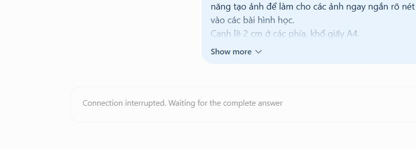

# Dịch câu tiếng Anh

> **Model:** `gpt-5-6` · **Created:** 2026-09-18 16:22:35 · **Updated:** 2026-09-18 16:22:41
> **ID:** `6aad02d9-960c-83ec-b1bd-17331ff4746b`

---

### 👤 User · 2026-09-18 16:22:33

dịch cho mình

---

### 🤖 ChatGPT `gpt-5-6` · 2026-09-18 16:22:37

Dạ anh, dòng tiếng Anh trong ảnh:

**“Connection interrupted. Waiting for the complete answer”**

Dịch là:

**“Kết nối bị gián đoạn. Đang chờ câu trả lời hoàn chỉnh.”**

Hoặc tự nhiên hơn trong giao diện:

**“Kết nối bị gián đoạn. Đang chờ phản hồi hoàn tất.”**

---

*2 messages · 3 nodes*
