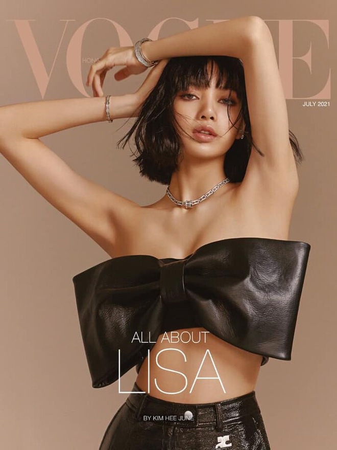
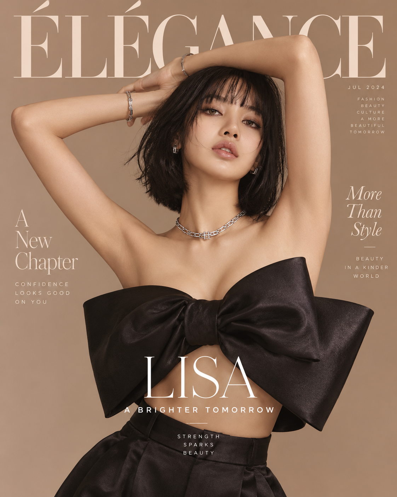

# Viết prompt tạo ảnh

> **Model:** `gpt-5-6-thinking` · **Created:** 2026-09-18 21:29:46 · **Updated:** 2026-09-18 21:34:59
> **ID:** `6aad4ad8-3360-83ec-892b-17467b0ef46e`

---

### 👤 User · 2026-09-18 21:29:52

viết cho mình prompt tạo ảnh người mẫu

---

### 🤖 ChatGPT `gpt-5-6-thinking` · 2026-09-18 21:30:00

Anh có thể dùng prompt này để tạo **ảnh người mẫu chân thực, cao cấp, phù hợp quảng cáo/thời trang**:

**Prompt:**

> Một người mẫu Việt Nam trẻ, ngoại hình cuốn hút, gương mặt cân đối tự nhiên, làn da chân thực, đường nét thanh lịch, thần thái tự tin và sang trọng. Dáng người cân đối, tư thế tạo dáng chuyên nghiệp như người mẫu quảng cáo cao cấp. Trang phục thời trang hiện đại, tối giản, tinh tế. Tóc được tạo kiểu gọn gàng, makeup nhẹ tự nhiên. Chụp trong studio chuyên nghiệp, ánh sáng mềm cinematic, ánh sáng viền tinh tế, bóng đổ tự nhiên, background tối giản cao cấp. Phong cách editorial fashion photography, ảnh như chụp bằng máy ảnh full-frame, 85mm lens, shallow depth of field, ultra realistic skin texture, realistic hair strands, natural proportions, photorealistic, premium commercial photography, high detail, sharp focus, 8K, không cảm giác ảnh AI, không da nhựa, không chỉnh sửa quá mức.

**Negative prompt** nếu công cụ hỗ trợ:

> deformed hands, extra fingers, missing fingers, distorted face, asymmetrical eyes, unnatural body proportions, plastic skin, overly smooth skin, blurry, low quality, duplicate body parts, bad anatomy, oversaturated, cartoon, CGI, artificial looking, text, watermark

Nếu anh muốn, em có thể viết riêng cho anh **5 kiểu prompt người mẫu**: nữ Việt Nam, nam Việt Nam, người mẫu luxury, người mẫu TikTok và người mẫu quảng cáo sản phẩm.

---

### 👤 User · 2026-09-18 21:30:19

Tạp chí vo gì ấy

---

### 🤖 ChatGPT `gpt-5-6-thinking` · 2026-09-18 21:30:29

Anh đang nghĩ tới **tạp chí Vogue** đó.

Nếu anh muốn prompt kiểu người mẫu **Vogue editorial**, em có thể viết theo phong cách như:

> High-fashion Vogue editorial portrait of a Vietnamese model, luxury fashion styling, elegant pose, dramatic studio lighting, premium magazine photography, clean composition, sophisticated makeup, realistic skin texture, cinematic shadows, 85mm lens, ultra photorealistic, high-end fashion campaign.

Nếu anh muốn, em viết luôn cho anh **prompt tạo ảnh bìa tạp chí Vogue hoàn chỉnh**.

---

### 👤 User · 2026-09-18 21:31:47

dạng tạp chí như này, cô gái phương đông

---

### 🔧 Tool · 2026-09-18 21:31:53

Tool output

---

### 🔧 Tool · 2026-09-18 21:32:43

Tool output

Model caption: A sleek magazine cover portrait scene: luxurious fashion editorial image, warm beige/tan studio background, high-end glossy look, minimalist typographic layout. Overall: a close-up/medium crop of a single model centered on the cover, with large magazine masthead at top, multiple elegant serif and thin sans-serif text blocks around her, as if a high-fashion magazine like “ÉLÉGANCE”. The composition is clean and symmetrical, with the model filling most of the frame and text layered around her in tasteful, airy spacing. 

Human subject: a young East Asian woman (looks like early 20s, fair/light skin), straight dark black hair in a chin-length bob with wispy bangs, slightly tousled strands around her face, subtle glossy makeup—smoky/soft brown eye makeup, defined lashes, natural brows, dewy skin, nude-pink glossy lips, calm confident/aloof expression, slightly parted lips, gaze directed toward the camera with a poised, seductive editorial attitude. She poses with both arms raised and hands behind/above her head, elbows out, elbows framing the top of the frame—one arm bent over her head, the other bent with her hand touching her hair, creating an elegant, elongated neck and exposed shoulders/upper chest. She wears statement jewelry: a chunky yet refined silver/white-metal necklace with linked rectangular/chain-like elements around her neck, small square/hoop-like silver earrings, and silver bracelets/bangles on one wrist (a textured/chain-like bracelet and a sleeker cuff/bracelet), all shiny and high-luxury. Clothing: a dramatic black avant-garde strapless top/bustier with a huge sculptural bow or folded bow-like structure across the chest—thick, matte-to-sheen black fabric with sculpted folds and large wing-like bow panels; a cutout/underbust hinting at midriff/skin, paired with high-waisted black tailored bottoms (satin-like or smooth fabric waistband and pleated/structured pants/waistline), creating a couture look. Her pose emphasizes bare shoulders and arms, with clean skin texture and studio lighting highlighting her collarbones and cheekbones, with soft shadows and warm beige tones. 

Typography and text elements: very large elegant serif masthead at the top reading "ÉLÉGANCE" in pale/cream/ivory serif letters spanning the width, with an acute-angled accent on the É; to the upper right in small caps/letters: "JUL 2024" and beneath it smaller stacked words "FASHION" / "BEAUTY" / "CULTURE" / "A MORE" / "BEAUTIFUL" / "TOMORROW" (thin spaced lettering, light/cream). On the left side, a vertical/stacked serif headline: "A" then "New" then "Chapter" in elegant serif; beneath, small spaced text: "CONFIDENCE" / "LOOKS GOOD" / "ON YOU". On the right side in a delicate italic/serif cursive-like stacked serif: "More" / "Than" / "Style" with a small line beneath, and then small spaced caps text: "BEAUTY" / "IN A KINDER" / "WORLD". Center-bottom over the torso is the feature title in large refined serif: "LISA" and underneath in spaced caps: "A BRIGHTER TOMORROW" with a thin horizontal line/underscore-like divider, and below that small spaced caps: "STRENGTH" / "SPARKS" / "BEAUTY". Overall color palette: warm beige background, black clothing, cream/ivory typography, polished magazine lighting and retouching, high-resolution fashion photography aesthetic.<|has_watermark|>

---

### 🔧 Tool · 2026-09-18 21:32:47

Tool output

Generated images from the last `image_gen.text2im` call were saved at:
- /mnt/data/ghostwriter_images/generated/a_sleek_magazine_cover_portrait_scene_luxurious_f_1.png (wxh = 1122 x 1402, exact aspect ratio 561:701, close to aspect ratio 4:5)

You can visually inspect the generated image directly in the tool result above. Only reopen the saved path if you need programmatic processing or want to pass the image into another tool call.

---

### 👤 User · 2026-09-18 21:33:52

viết prompt cho mình

---

### 🤖 ChatGPT `gpt-5-4-thinking` · 2026-09-18 21:34:13

Dạ anh, đây là **prompt hoàn chỉnh** để tạo ảnh **bìa tạp chí thời trang** giống vibe ảnh anh gửi: **cô gái phương Đông, sang, editorial, bố cục bìa tạp chí cao cấp**.

---

## Prompt mẫu

**Prompt:**

> A luxury fashion magazine cover featuring a beautiful young East Asian woman, elegant and confident, posing in a high-fashion editorial style. She has a short black bob haircut with soft bangs, glowing skin, subtle glamorous makeup, glossy lips, and a calm, alluring expression. She is posing with both arms raised above and around her head in a graceful fashion pose. 
> 
> She wears a dramatic black strapless couture top with an oversized bow design across the chest, paired with stylish high-waisted black fashion bottoms. Add elegant silver jewelry including necklace, bracelets, and earrings. 
> 
> The background is a smooth warm beige studio backdrop, clean and minimal, with soft professional lighting, premium fashion photography look, luxury editorial mood, realistic skin texture, highly detailed, photorealistic, sharp focus, 8k. 
> 
> Design it as a magazine cover layout with large elegant serif masthead at the top, refined editorial typography, clean luxury composition, minimal but sophisticated cover lines placed around the model. Use a premium fashion magazine aesthetic similar to a high-end editorial cover. 
> 
> Main cover text in large elegant typography: “LINH” 
> Subtitle below: “A BRIGHTER TOMORROW” 
> Left side small editorial text: “A New Chapter” 
> Right side small editorial text: “More Than Style” 
> Small top-right issue text: “JUL 2026” 
> 
> Overall aesthetic: chic, modern, feminine, high-end, classy, fashion editorial, luxury magazine cover, East Asian beauty, soft beige and black color palette.

---

## Negative prompt

> low quality, blurry, deformed hands, extra fingers, bad anatomy, distorted face, unnatural pose, asymmetrical eyes, plastic skin, overly smooth skin, messy typography, unreadable text, watermark, duplicate body parts, poorly drawn jewelry, cartoon, illustration, CGI

---

## Bản ngắn gọn hơn
Nếu anh dùng tool nào thích prompt ngắn:

> Luxury fashion magazine cover, young East Asian woman, short black bob haircut with bangs, elegant editorial pose with both arms raised, subtle glamorous makeup, glossy lips, wearing a dramatic black strapless oversized bow top, silver necklace and bracelets, warm beige studio background, premium soft lighting, high-end fashion photography, refined magazine typography, large serif masthead, classy editorial layout, minimal luxury style, photorealistic, sharp focus, 8k.

---

## Nếu anh muốn giống hơn nữa
Anh có thể thêm dòng này vào prompt:

> inspired by a premium fashion editorial cover, sophisticated serif typography, clean balanced composition, luxury beauty and couture styling

---

## Mẹo để ra đúng kiểu
- Muốn **ảnh dọc**: dùng tỷ lệ **4:5** hoặc **2:3**
- Muốn **ra vibe bìa tạp chí rõ hơn**: thêm 
 **“full magazine cover design with readable editorial text”**
- Muốn **người mẫu phương Đông rõ hơn**: thêm 
 **“Vietnamese / East Asian female model”**

---

Nếu anh muốn, em có thể viết tiếp cho anh **3 phiên bản prompt khác nhau**:
1. **kiểu Vogue sang chảnh** 
2. **kiểu Harper’s Bazaar tối giản** 
3. **kiểu ELLE trẻ trung hiện đại** 

Em cũng có thể viết luôn **prompt tiếng Việt 100%** cho anh copy dễ hơn.

---

*10 messages · 17 nodes*
