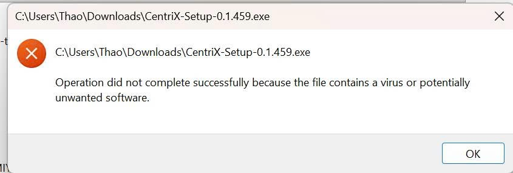

# Giải thích lỗi Defender

> **Model:** `gpt-5-6-thinking` · **Created:** 2026-09-19 15:29:03 · **Updated:** 2026-09-19 15:29:21
> **ID:** `6aae47cd-97d0-83ec-a5ef-3014b30eb87e`

---

### 👤 User · 2026-09-19 15:29:05

đây là lỗi gì

---

### 🤖 ChatGPT `gpt-5-6-thinking` · 2026-09-19 15:29:13

Đây là lỗi **Windows Security / Microsoft Defender đã chặn file cài đặt** `CentriX-Setup-0.1.459.exe` vì nó nhận diện file là **virus hoặc phần mềm có khả năng không mong muốn (PUA/PUP)**.

Thông báo trong ảnh là:

> “Operation did not complete successfully because the file contains a virus or potentially unwanted software.”

Điều này **chưa chắc file CentriX có virus**. Với app tự build, đặc biệt Electron/NSIS, các nguyên nhân phổ biến là: file `.exe` chưa ký số, bản build mới chưa có reputation với Microsoft SmartScreen, installer có hành vi cập nhật/tải file/chạy process khiến heuristic nghi ngờ, hoặc Defender báo nhầm (false positive).

Anh kiểm tra chính xác Defender đang bắt lỗi gì bằng cách vào:

**Windows Security → Virus & threat protection → Protection history**

Mở sự kiện liên quan `CentriX-Setup-0.1.459.exe` rồi xem dòng **Threat detected**, ví dụ có thể là:

`PUA:Win32/...` 
`Trojan:Win32/...` 
`Behavior:Win32/...`

Anh gửi em **ảnh màn hình Protection history hoặc tên Threat detected**, em có thể nói ngay khả năng là **false positive hay vấn đề thực sự trong bản build**.

Nếu đây là app CentriX do anh tự build, hướng xử lý lâu dài nên là **ký Code Signing cho file EXE + kiểm tra VirusTotal + gửi false-positive sample cho Microsoft**, thay vì hướng dẫn khách tắt Defender.

---

*2 messages · 4 nodes*
