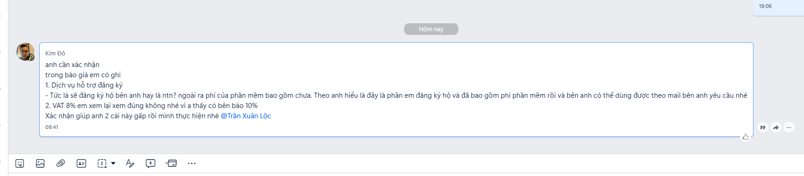

# Thuế VAT dịch vụ phần mềm

> **Model:** `gpt-5-6-thinking` · **Created:** 2026-09-09 11:21:33 · **Updated:** 2026-09-09 15:28:15
> **ID:** `6aa0deca-e730-83ec-8825-c580010f0650`

---

> ### 👤 User · 2026-09-09 11:21:53
>
> dịch vụ phần mềm VAT bao nhiêu %
>
> cung cấp dịch vụ nâng cấp, h ỗ trợ dịch vụ, tư vấn.. cho phần mềm

---

### 🤖 ChatGPT `gpt-5-6-thinking` · 2026-09-09 11:21:59

Với nhóm dịch vụ anh nêu, điểm quan trọng là phân biệt **“không chịu thuế GTGT”** với **thuế suất 0%/8%/10%**. Em kiểm tra theo quy định hiện hành để chốt đúng cho từng loại dịch vụ nâng cấp, hỗ trợ và tư vấn phần mềm.

---

### 🤖 ChatGPT `gpt-5-6-thinking` · 2026-09-09 11:22:28

Anh, với **dịch vụ liên quan trực tiếp đến phần mềm** như anh mô tả thì thông thường **KHÔNG CHỊU THUẾ GTGT (VAT)** — lưu ý là **không phải VAT 0%**.

Theo quy định hiện hành đến **09/09/2026**, khoản 21 Điều 5 Luật Thuế GTGT quy định **sản phẩm phần mềm và dịch vụ phần mềm theo quy định pháp luật thuộc đối tượng không chịu thuế GTGT**. ([xaydungchinhsach.chinhphu.vn](https://xaydungchinhsach.chinhphu.vn/van-ban-hop-nhat-114-vbhn-vpqh-hop-nhat-luat-thue-gia-tri-gia-tang-119260605094756577.htm)) 

Nghị định 71/2007/NĐ-CP định nghĩa dịch vụ phần mềm khá rộng, bao gồm trực tiếp hỗ trợ việc **cài đặt, khai thác, sử dụng, nâng cấp, bảo hành, bảo trì phần mềm**; đồng thời liệt kê các dịch vụ như **quản trị/bảo trì phần mềm, tư vấn phần mềm, tư vấn xây dựng dự án phần mềm, tích hợp hệ thống, phân phối/cung ứng sản phẩm phần mềm và các dịch vụ phần mềm khác**. ([Văn Bản Chính Phủ](https://vanban.chinhphu.vn/?docid=23938&pageid=27160&utm_source=chatgpt.com)) 

Vì vậy trường hợp của anh có thể hiểu như sau:

| Dịch vụ anh cung cấp | VAT |
|---|---:|
| Nâng cấp phần mềm | **Không chịu thuế GTGT** |
| Hỗ trợ kỹ thuật phần mềm | **Không chịu thuế GTGT** |
| Hướng dẫn khai thác/sử dụng phần mềm | **Không chịu thuế GTGT** nếu trực tiếp gắn với phần mềm |
| Bảo hành, bảo trì phần mềm | **Không chịu thuế GTGT** |
| Tư vấn triển khai phần mềm | **Không chịu thuế GTGT** |
| Tư vấn, đánh giá chất lượng phần mềm | **Không chịu thuế GTGT** |
| Tích hợp hệ thống/phần mềm | **Không chịu thuế GTGT** |

### Với CentriX, anh nên ghi hóa đơn thế này

Em khuyên anh ghi rõ bản chất dịch vụ, ví dụ:

**“Dịch vụ tư vấn, hướng dẫn sử dụng, nâng cấp và hỗ trợ kỹ thuật phần mềm [Tên phần mềm]”**

hoặc gọn hơn:

**“Dịch vụ tư vấn và hỗ trợ kỹ thuật phần mềm [Tên phần mềm]”**

Phần **thuế suất GTGT:** chọn **KCT / Không chịu thuế GTGT**.

Em **không khuyến nghị** chỉ ghi chung chung:

> “Dịch vụ tư vấn, hỗ trợ”

vì câu đó chưa thể hiện rõ đây là **dịch vụ phần mềm**, khi kiểm tra hồ sơ có thể bị hỏi dịch vụ tư vấn về lĩnh vực gì.

Một điểm cần chú ý: nếu trong cùng hợp đồng anh có cả **dịch vụ không phải dịch vụ phần mềm**, chẳng hạn tư vấn kinh doanh, marketing, đào tạo chung… thì nên **tách riêng từng hạng mục**. Phần thực sự là dịch vụ phần mềm mới áp dụng **không chịu thuế GTGT**. Luật cũng yêu cầu doanh nghiệp có nhiều loại hàng hóa/dịch vụ với chế độ VAT khác nhau phải xác định riêng. ([xaydungchinhsach.chinhphu.vn](https://xaydungchinhsach.chinhphu.vn/van-ban-hop-nhat-114-vbhn-vpqh-hop-nhat-luat-thue-gia-tri-gia-tang-119260605094756577.htm)) 

Nếu anh gửi em **nội dung dịch vụ thực tế CentriX đang bán và dòng anh đang định ghi trên hóa đơn**, em có thể chỉnh cho anh thành **tên hàng hóa/dịch vụ vừa đúng bản chất vừa an toàn về VAT**.

---

> ### 👤 User · 2026-09-09 11:23:18
>
> cho phần mềm nước ngoài thì sao bạn

---

### 🤖 ChatGPT `gpt-5-6-thinking` · 2026-09-09 11:23:33

Nếu là **phần mềm của hãng nước ngoài** như Microsoft, Adobe, OpenAI, Anthropic… thì **việc phần mềm có nguồn gốc nước ngoài không làm thay đổi bản chất VAT**. Quan trọng là **anh đang cung cấp dịch vụ gì**.

Theo khoản 21 Điều 5 Luật Thuế GTGT hiện hành, **sản phẩm phần mềm và dịch vụ phần mềm theo quy định pháp luật thuộc đối tượng không chịu thuế GTGT**. ([xaydungchinhsach.chinhphu.vn](https://xaydungchinhsach.chinhphu.vn/van-ban-hop-nhat-114-vbhn-vpqh-hop-nhat-luat-thue-gia-tri-gia-tang-119260605094756577.htm?utm_source=chatgpt.com)) Nghị định 71/2007/NĐ-CP cũng xác định dịch vụ phần mềm gồm hoạt động trực tiếp hỗ trợ việc **cài đặt, khai thác, sử dụng, nâng cấp, bảo hành, bảo trì phần mềm**, đồng thời bao gồm **tư vấn phần mềm và phân phối/cung ứng sản phẩm phần mềm**. ([Văn Bản Chính Phủ](https://vanban.chinhphu.vn/?docid=23938&pageid=27160&utm_source=chatgpt.com)) 

Vì vậy, nếu CentriX bán cho khách Việt Nam:

| Nội dung thực tế | VAT đầu ra |
|---|---:|
| Nâng cấp bản quyền/phần mềm nước ngoài | **Không chịu thuế GTGT** nếu đúng là sản phẩm/dịch vụ phần mềm |
| Cung ứng/phân phối phần mềm | **Không chịu thuế GTGT** |
| Hỗ trợ kỹ thuật sử dụng phần mềm | **Không chịu thuế GTGT** |
| Cài đặt/cấu hình phần mềm | **Không chịu thuế GTGT** |
| Tư vấn triển khai phần mềm | **Không chịu thuế GTGT** |
| Bảo trì/bảo hành phần mềm | **Không chịu thuế GTGT** |

Ví dụ anh mua quyền sử dụng một phần mềm nước ngoài rồi cung cấp cho khách, đồng thời hỗ trợ khách kích hoạt, cấu hình và sử dụng, hóa đơn CentriX có thể ghi theo bản chất:

> **Dịch vụ cung cấp, nâng cấp, tư vấn và hỗ trợ kỹ thuật phần mềm [Tên phần mềm]**

và phần thuế suất chọn **KCT – Không chịu thuế GTGT**, **không phải 0%**.

### Nhưng anh cần đặc biệt chú ý một trường hợp

Không phải cứ dịch vụ công nghệ nước ngoài là được coi là **dịch vụ phần mềm**.

Ví dụ **dịch vụ điện toán đám mây** có thể bị xác định là **dịch vụ viễn thông**, không phải dịch vụ phần mềm. Cục Thuế đã có hướng dẫn năm 2026 rằng một số dịch vụ cloud/online của Microsoft nếu thuộc dịch vụ điện toán đám mây theo Luật Viễn thông thì áp dụng **VAT 10%**, chứ không được áp dụng diện không chịu thuế của phần mềm. ([THƯ VIỆN PHÁP LUẬT](https://thuvienphapluat.vn/banan/tin-tuc/cong-van-296ct-cs-huong-dan-ve-thue-nha-thau-nuoc-ngoai-va-dich-vu-trung-tam-du-lieu-dien-toan-dam-m-20474.html)) 

Do đó với mô hình của anh, em sẽ chia:

**Microsoft 365 / phần mềm desktop / license phần mềm / ứng dụng SaaS thuần phần mềm** → có cơ sở xem xét **KCT**.

**Cloud server, hosting, storage, compute, hạ tầng cloud** → không nên tự động ghi KCT; có thể **10%** tùy bản chất.

**API/AI credit như OpenAI API, Claude API** → trường hợp này cần xem kỹ hơn, vì không nên chỉ đổi tên thành “dịch vụ phần mềm” để áp KCT nếu thực tế anh đang bán lại dịch vụ xử lý dữ liệu/API/cloud.

Nếu anh đang muốn xuất hóa đơn cho các gói **ChatGPT, Claude, Microsoft 365, Semrush, QuillBot, CetriX AI...**, anh gửi em danh sách khoảng 5–10 dịch vụ. Em có thể **phân từng dịch vụ: KCT / 8% / 10% và đề xuất chính xác tên hàng hóa dịch vụ nên ghi trên hóa đơn** cho anh.

---

> ### 👤 User · 2026-09-09 11:24:28
>
> Sao mình xem tài liệu vẫn chịu thuế 10% được giảm 8% mà

---

### 🤖 ChatGPT `gpt-5-6-thinking` · 2026-09-09 11:24:32

Anh xem vậy có thể **đúng**, vì điểm mấu chốt nằm ở việc dịch vụ của anh có được pháp luật xếp đúng là **“dịch vụ phần mềm”** hay chỉ là **dịch vụ hỗ trợ/tư vấn thông thường liên quan đến phần mềm**. Em kiểm tra lại quy định VAT đang áp dụng năm 2026 để tách rõ hai trường hợp này.

---

### 🤖 ChatGPT `gpt-5-6-thinking` · 2026-09-09 11:24:58

Đúng anh — tài liệu anh xem nói **10% và đang được giảm còn 8%** hoàn toàn có thể đúng. Câu trả lời trước của em đã gom nhóm “dịch vụ liên quan phần mềm” hơi rộng.

Điểm quyết định **không phải phần mềm Việt Nam hay nước ngoài**, mà là **dịch vụ anh bán có được pháp luật xác định là “dịch vụ phần mềm” hay không**.

**1. Nếu đúng là “sản phẩm phần mềm/dịch vụ phần mềm” theo pháp luật → KHÔNG CHỊU VAT.** Luật Thuế GTGT hiện hành vẫn quy định tại khoản 21 Điều 5 rằng sản phẩm phần mềm và dịch vụ phần mềm thuộc đối tượng không chịu thuế. ([xaydungchinhsach.chinhphu.vn](https://xaydungchinhsach.chinhphu.vn/van-ban-hop-nhat-114-vbhn-vpqh-hop-nhat-luat-thue-gia-tri-gia-tang-119260605094756577.htm)) Nghị định 71/2007/NĐ-CP liệt kê các dịch vụ phần mềm như quản trị/bảo trì phần mềm, tư vấn đánh giá chất lượng phần mềm, tư vấn dự án phần mềm, tích hợp hệ thống, phân phối/cung ứng sản phẩm phần mềm... ([Chính phủ](https://chinhphu.vn/default.aspx?docid=23938&pageid=27160)) 

**2. Nếu chỉ là dịch vụ thương mại, tư vấn, chăm sóc/hỗ trợ khách hàng liên quan đến một phần mềm của bên thứ ba nhưng không được xác định là “dịch vụ phần mềm” → thuế suất gốc 10%.** Hiện nay, từ **01/07/2025 đến 31/12/2026**, phần lớn hàng hóa/dịch vụ đang chịu VAT 10% được giảm xuống **8%**, trừ một số nhóm bị loại trừ. ([baochinhphu.vn](https://baochinhphu.vn/giam-thue-gia-tri-gia-tang-tu-01-7-2025-den-het-31-12-2026-10225070118590677.htm)) 

Cục Thuế năm 2026 cũng hướng dẫn rất rõ theo nguyên tắc này: ví dụ một sản phẩm như Clip Studio Paint, **nếu được xác định là sản phẩm/dịch vụ phần mềm thì KCT; nếu không đáp ứng định nghĩa pháp luật về phần mềm thì VAT 10%**. ([THƯ VIỆN PHÁP LUẬT](https://thuvienphapluat.vn/cong-van/Thue-Phi-Le-Phi/Cong-van-2965-CT-CS-2026-giai-dap-chinh-sach-thue-gia-tri-gia-tang-705155.aspx?utm_source=chatgpt.com)) 

Với trường hợp CentriX của anh, em sẽ nhìn như thế này:

| Anh thực tế bán | Cách nhìn VAT |
|---|---:|
| Bán/cung ứng license phần mềm đúng nghĩa | **KCT** |
| Bảo trì, quản trị phần mềm | **KCT** |
| Tư vấn xây dựng/triển khai dự án phần mềm | **KCT** |
| Tư vấn đánh giá/chất lượng phần mềm | **KCT** |
| Tích hợp hệ thống phần mềm | **KCT** |
| Dịch vụ CSKH, hướng dẫn thao tác, hỗ trợ tài khoản, xử lý đơn hàng | **thường 10% → hiện 8%** |
| Dịch vụ tư vấn chung về cách sử dụng công cụ để phục vụ công việc | **thường 10% → hiện 8%** |
| Cloud/điện toán đám mây thuộc dịch vụ viễn thông | **10%, không giảm 8%** |

Trường hợp cloud là ví dụ rất quan trọng: Cục Thuế đã hướng dẫn một số **dịch vụ cloud và trực tuyến của Microsoft nước ngoài**, nếu được xác định là dịch vụ viễn thông, thì từ 01/07/2025 chịu **VAT 10%**. ([THƯ VIỆN PHÁP LUẬT](https://thuvienphapluat.vn/chinh-sach-phap-luat-moi/vn/ho-tro-phap-luat/chinh-sach-moi/103674/cong-van-296-cuc-thue-tra-loi-vuong-mac-ve-chinh-sach-thue?utm_source=chatgpt.com)) Vì viễn thông nằm trong nhóm bị loại khỏi chương trình giảm 2%, nên không xuống 8%. ([baochinhphu.vn](https://baochinhphu.vn/giam-thue-gia-tri-gia-tang-tu-01-7-2025-den-het-31-12-2026-10225070118590677.htm)) 

### Trường hợp anh đang làm em nghĩ cần xem theo hướng 8%

Nếu hoạt động thực tế của CentriX là:

> CentriX mua/cung cấp dịch vụ của hãng nước ngoài, sau đó **tư vấn, hướng dẫn sử dụng, hỗ trợ kỹ thuật, hỗ trợ nâng cấp gói cho khách hàng**

nhưng CentriX **không phải đơn vị phát triển phần mềm, không thực hiện bảo trì mã nguồn, không làm dự án phần mềm** thì việc mặc định cho toàn bộ doanh thu là **“dịch vụ phần mềm – KCT” khá rủi ro**.

Nếu bản chất hợp đồng là một **dịch vụ tư vấn/hỗ trợ kỹ thuật thương mại**, phương án **VAT 10%, hiện áp dụng 8% nếu thuộc diện giảm theo Nghị định 174/2025/NĐ-CP** có thể là cách phù hợp hơn. Nghị định 174 có hiệu lực đến hết **31/12/2026**. ([Chính phủ](https://chinhphu.vn/default.aspx?classid=1&docid=214310&pageid=27160&utm_source=chatgpt.com)) 

Ví dụ tên hóa đơn:

**“Dịch vụ tư vấn, hướng dẫn sử dụng và hỗ trợ kỹ thuật phần mềm [Tên sản phẩm]” – VAT 8%**

thì về bản chất anh đang xuất **dịch vụ tư vấn/hỗ trợ của CentriX**, chứ không khẳng định CentriX đang bán một **“dịch vụ phần mềm” thuộc diện KCT**.

Nếu anh muốn, anh gửi em **chính xác CentriX đang cung cấp như ChatGPT, Claude, Microsoft 365, Semrush... theo quy trình nào**, em có thể phân tích từng loại và đề xuất cho anh **tên dòng hóa đơn + VAT 8%/10%/KCT** an toàn nhất.

---

> ### 👤 User · 2026-09-09 11:27:51
>
> **dịch vụ tư vấn/hỗ trợ kỹ thuật thương mại**, phương án **VAT 10%, hiện áp dụng 8% nếu thuộc diện giảm theo Nghị định 174/2025/NĐ-CP** có thể là cách phù hợp hơn. Nghị định 174 có hiệu lực đến hết **31/12/2026**. 
>
> Nó thuộc điều mấy khoản mấy giảm về 8%

---

### 🤖 ChatGPT `gpt-5-6-thinking` · 2026-09-09 11:27:59

Đúng căn cứ anh cần là **Điều 1 Nghị định 174/2025/NĐ-CP**.

Cụ thể:

- **Khoản 1 Điều 1**: giảm thuế GTGT đối với **các nhóm hàng hóa, dịch vụ đang áp dụng thuế suất 10%**, trừ các nhóm bị loại trừ như viễn thông, tài chính, ngân hàng, chứng khoán, bảo hiểm, bất động sản, một số sản phẩm kim loại/khoáng sản và hàng hóa, dịch vụ chịu thuế TTĐB. ([chinhsachonline.chinhphu.vn](https://chinhsachonline.chinhphu.vn/nhom-hang-hoa-dich-vu-duoc-giam-thue-gia-tri-gia-tang-81850.htm?utm_source=chatgpt.com)) 
- **Điểm a Khoản 2 Điều 1**: doanh nghiệp tính VAT theo phương pháp khấu trừ được **áp dụng thuế suất 8%** đối với hàng hóa, dịch vụ thuộc Khoản 1. ([Cổng Dữ Liệu Chính Phủ](https://datafiles.chinhphu.vn/cpp/files/vbpq/2025/7/174nd.signed.pdf?utm_source=chatgpt.com)) 
- **Khoản 1 Điều 2**: chính sách này áp dụng từ **01/07/2025 đến hết 31/12/2026**. ([chinhsachonline.chinhphu.vn](https://chinhsachonline.chinhphu.vn/can-cu-ap-muc-giam-thue-gia-tri-gia-tang-81890.htm?utm_source=chatgpt.com)) 

Vì vậy nếu dịch vụ của CentriX được xác định là:

> **“Dịch vụ tư vấn, hướng dẫn sử dụng và hỗ trợ kỹ thuật”**

và bản chất đây là **dịch vụ thông thường đang chịu VAT 10%**, đồng thời **không nằm trong Phụ lục I, II của Nghị định 174**, thì căn cứ để xuất **VAT 8%** chính là:

**Khoản 1 + Điểm a Khoản 2 Điều 1 Nghị định 174/2025/NĐ-CP.**

Có thể ghi trong hồ sơ/kế toán theo dạng:

> **Áp dụng thuế suất GTGT 8% theo Điểm a Khoản 2 Điều 1 Nghị định số 174/2025/NĐ-CP ngày 30/06/2025 của Chính phủ.**

### Nhưng có một điểm rất quan trọng với dịch vụ của anh

Nếu anh ghi và thực tế chứng minh dịch vụ đó là **“dịch vụ phần mềm” theo pháp luật CNTT** thì nó lại thuộc diện **không chịu VAT**, chứ không đi theo Nghị định 174 để giảm 10% → 8%.

Còn nếu CentriX thực tế cung cấp kiểu:

**“Dịch vụ tư vấn, hướng dẫn sử dụng và hỗ trợ kỹ thuật đối với phần mềm [ChatGPT/Microsoft 365/Claude…]”**

với bản chất là **dịch vụ tư vấn/hỗ trợ thương mại độc lập**, không phải cung cấp một “dịch vụ phần mềm” thuộc diện KCT, thì hướng **8%** có cơ sở hơn, với điều kiện mã ngành/sản phẩm dịch vụ của anh không rơi vào Phụ lục I hoặc II. Cơ quan thuế cũng hướng dẫn doanh nghiệp phải đối chiếu **Quyết định 43/2018/QĐ-TTg + Phụ lục I, II Nghị định 174** để xác định chính xác. ([chinhsachonline.chinhphu.vn](https://chinhsachonline.chinhphu.vn/can-cu-ap-muc-giam-thue-gia-tri-gia-tang-81890.htm?utm_source=chatgpt.com)) 

Nếu anh muốn, em có thể **tra chính xác mã ngành/mã sản phẩm cho “dịch vụ tư vấn, hướng dẫn sử dụng và hỗ trợ kỹ thuật phần mềm nước ngoài” của CentriX**, rồi chốt luôn cho anh **nên xuất 8%, 10% hay KCT** và căn cứ pháp lý đầy đủ.

---

> ### 👤 User · 2026-09-09 11:28:28
>
> Viết cho mình 1 đoạn văn gửi khách hàng

---

### 🤖 ChatGPT `gpt-5-6-thinking` · 2026-09-09 11:28:32

Anh có thể gửi khách hàng như sau:

:::writing{variant="chat_message" id="48317" title="Thông báo thuế VAT"}
Dạ đối với dịch vụ tư vấn, hướng dẫn sử dụng và hỗ trợ kỹ thuật bên em cung cấp, mức thuế GTGT áp dụng hiện tại là **8%**. Đây là nhóm dịch vụ có thuế suất thông thường 10% và đang được giảm còn 8% theo **Điểm a Khoản 2 Điều 1 Nghị định 174/2025/NĐ-CP**, áp dụng đến hết ngày **31/12/2026**. Bên em sẽ xuất hóa đơn VAT đầy đủ theo đúng quy định hiện hành ạ.
:::

Nếu anh muốn, em có thể viết thêm một bản **ngắn hơn, tự nhiên hơn kiểu nhắn Zalo cho khách**.

---

> ### 👤 User · 2026-09-09 11:29:00
>
>
> > 🖼️ *Image (1719x378)* — `file_0000000052a08207ae84f0a96…`
>
> Giải thích

> 

---

### 🤖 ChatGPT `gpt-5-6-thinking` · 2026-09-09 11:29:08

Anh Kim Đô đang yêu cầu anh **xác nhận 2 nội dung trước khi họ tiến hành**:

1. **“Dịch vụ hỗ trợ đăng ký” nghĩa là gì?** 
Anh ấy đang hiểu báo giá của CentriX là:
- CentriX sẽ **đăng ký/nâng cấp/kích hoạt phần mềm giúp bên khách**.
- **Giá trong báo giá đã bao gồm cả chi phí phần mềm/bản quyền**, không phải trả thêm.
- Phần mềm sẽ được đăng ký hoặc kích hoạt theo **email mà khách hàng cung cấp**.

Anh ấy muốn anh xác nhận cách hiểu này có đúng không.

2. **VAT 8% có đúng không?** 
Anh ấy thấy một số đơn vị khác báo **VAT 10%**, nên muốn CentriX kiểm tra và xác nhận lại vì sao báo giá của mình áp dụng **8%**.

Nếu đúng với dịch vụ của anh, em đề xuất trả lời khách như này:

> Dạ em xác nhận anh ạ. 
> **1. Về dịch vụ hỗ trợ đăng ký:** Bên em sẽ thực hiện đăng ký/nâng cấp và kích hoạt phần mềm theo email bên anh cung cấp. Chi phí trong báo giá **đã bao gồm chi phí phần mềm/bản quyền và dịch vụ hỗ trợ**, bên anh không phát sinh thêm khoản phí phần mềm nào ạ. 
> 
> **2. Về VAT:** Bên em đã kiểm tra lại, dịch vụ tư vấn, hướng dẫn sử dụng và hỗ trợ kỹ thuật bên em cung cấp thuộc nhóm dịch vụ có mức thuế suất thông thường 10% và hiện đang được **giảm còn 8% theo Nghị định 174/2025/NĐ-CP**, áp dụng đến hết 31/12/2026. Vì vậy bên em xuất VAT **8%** theo quy định hiện hành ạ. 
> 
> Em xác nhận lại 2 nội dung trên để bên anh tiện triển khai ạ.

Riêng câu **“đã bao gồm chi phí phần mềm/bản quyền”**, anh chỉ nên giữ nếu thực tế báo giá CentriX đã bao gồm khoản đó.

---

> ### 👤 User · 2026-09-09 13:25:53
>
> CentriX mua/cung cấp dịch vụ của hãng nước ngoài, sau đó **tư vấn, hướng dẫn sử dụng, hỗ trợ kỹ thuật, hỗ trợ nâng cấp gói cho khách hàng** 
>
> Vậy hóa đơn hợp lệ là gì

---

> ### 👤 User · 2026-09-09 13:26:25
>
> CentriX cung cấp dịch vụ thanh toán ư vấn, hướng dẫn sử dụng, hỗ trợ kỹ thuật, hỗ trợ nâng cấp gói cho khách hàng 

---

### 🤖 ChatGPT `gpt-5-6-thinking` · 2026-09-09 13:27:23

Nếu mô hình thực tế của CentriX là **nhận yêu cầu từ khách → hỗ trợ thực hiện thanh toán cho hãng nước ngoài → nâng cấp gói trên tài khoản/email của khách → tư vấn, hướng dẫn và hỗ trợ kỹ thuật**, thì em sẽ **không ghi trên hóa đơn là “dịch vụ thanh toán”**. Cụm này dễ bị hiểu sang hoạt động thanh toán/tài chính; trong khi nhóm hoạt động tài chính, ngân hàng cũng là nhóm không được giảm VAT theo Nghị định 174/2025/NĐ-CP. ([chinhsachonline.chinhphu.vn](https://chinhsachonline.chinhphu.vn/nhom-hang-hoa-dich-vu-duoc-giam-thue-gia-tri-gia-tang-81850.htm?utm_source=chatgpt.com)) 

Tên dịch vụ phù hợp hơn là:

> **Dịch vụ tư vấn, hướng dẫn sử dụng, hỗ trợ kỹ thuật và hỗ trợ đăng ký/nâng cấp phần mềm [Tên phần mềm]**

Hoặc nếu muốn ngắn gọn để xuất hóa đơn:

> **Dịch vụ hỗ trợ đăng ký/nâng cấp, tư vấn và hỗ trợ kỹ thuật phần mềm [Tên phần mềm]**

Nếu đây thực sự là **dịch vụ của CentriX**, thuộc nhóm dịch vụ thông thường chịu thuế suất 10% và không nằm trong các nhóm loại trừ của Nghị định 174, thì hiện được áp dụng **VAT 8% đến hết 31/12/2026** theo **Khoản 1 và Điểm a Khoản 2 Điều 1 Nghị định 174/2025/NĐ-CP**. ([chinhsachonline.chinhphu.vn](https://chinhsachonline.chinhphu.vn/nhom-hang-hoa-dich-vu-duoc-giam-thue-gia-tri-gia-tang-81850.htm?utm_source=chatgpt.com)) 

Tuy nhiên có một điểm rất quan trọng: nếu **900.000đ khách trả gồm 800.000đ tiền gói phần mềm + 100.000đ phí CentriX**, anh không nên chỉ đổi toàn bộ 900.000đ thành “phí tư vấn/hỗ trợ” để áp VAT 8%. Hóa đơn phải phản ánh đúng bản chất hàng hóa/dịch vụ thực tế; quy định hóa đơn hiện hành yêu cầu thể hiện tên hàng hóa, dịch vụ. ([Xây Dựng Chính Sách](https://xaydungchinhsach.chinhphu.vn/toan-van-nghi-dinh-so-254-2026-nd-cp-ve-hoa-don-dien-tu-chung-tu-dien-tu-119260713164251972.htm?utm_source=chatgpt.com)) 

Trường hợp CentriX **thực sự chỉ thanh toán hộ**, hồ sơ nên thể hiện rõ quan hệ thanh toán/chi hộ. Về nguyên tắc, khoản thu hộ không liên quan đến việc bán hàng hóa, dịch vụ của doanh nghiệp không phải là doanh thu dịch vụ chịu VAT; khi đó CentriX xuất hóa đơn **phần phí dịch vụ của mình**, còn khoản thanh toán hộ được xử lý bằng chứng từ thu/chi phù hợp. Cơ quan thuế trước đây cũng đã hướng dẫn theo nguyên tắc này. ([chinhsachonline.chinhphu.vn](https://chinhsachonline.chinhphu.vn/chi-ho-khach-hang-co-phai-ke-khai-thue-gtgt-22342.htm?utm_source=chatgpt.com)) 

**Với mô hình anh vừa mô tả, em nghiêng về cách ghi sau:**

> **Dịch vụ hỗ trợ đăng ký/nâng cấp, tư vấn, hướng dẫn sử dụng và hỗ trợ kỹ thuật phần mềm [ChatGPT/Canva/CapCut/...], thời hạn...**

**VAT: 8%** *nếu toàn bộ khoản anh xuất hóa đơn thực chất là phí dịch vụ CentriX và dịch vụ đó không thuộc nhóm loại trừ.*

Còn nếu **giá báo cho khách đã bao gồm cả tiền CentriX trả cho hãng nước ngoài**, anh cho em một ví dụ cụ thể như **Canva 3 tháng: khách trả 135.000đ/tháng, CentriX thanh toán hãng X đồng**, em sẽ chỉ anh cách tách **tiền gói + phí dịch vụ + VAT** sao cho hồ sơ và hóa đơn hợp lý nhất.

---

> ### 👤 User · 2026-09-09 13:43:33
>
> khách muốn xuất 10% là tên phải là phần mềm

---

### 🤖 ChatGPT `gpt-5-6-thinking` · 2026-09-09 13:43:46

Không anh. **Không phải khách muốn xuất 10% thì mình đổi tên hàng hóa thành “phần mềm” để xuất 10% được.** Thuế suất phải căn cứ vào **bản chất giao dịch thực tế**, không phụ thuộc khách yêu cầu hay cách đặt tên trên hóa đơn.

Thậm chí nếu anh ghi đúng bản chất là **“phần mềm” hoặc “dịch vụ phần mềm”** và nó đáp ứng quy định pháp luật về sản phẩm/dịch vụ phần mềm thì hiện thuộc **đối tượng không chịu thuế GTGT**, chứ không phải 10%. Khoản 21 Điều 5 Luật Thuế GTGT quy định sản phẩm phần mềm và dịch vụ phần mềm theo pháp luật là đối tượng không chịu thuế. ([Xây Dựng Chính Sách](https://xaydungchinhsach.chinhphu.vn/van-ban-hop-nhat-114-vbhn-vpqh-hop-nhat-luat-thue-gia-tri-gia-tang-119260605094756577.htm?utm_source=chatgpt.com)) 

Với trường hợp CentriX anh đang mô tả:

> **Tư vấn + hướng dẫn sử dụng + hỗ trợ kỹ thuật + hỗ trợ đăng ký/nâng cấp gói cho khách**

nếu bản chất được xác định là **dịch vụ tư vấn/hỗ trợ thông thường**, vốn chịu VAT 10% và **không thuộc nhóm bị loại khỏi chính sách giảm thuế**, thì từ 01/07/2025 đến hết 31/12/2026 phải áp **8%**, không nên xuất 10% chỉ vì khách yêu cầu. Khoản 1 Điều 1 Nghị định 174/2025/NĐ-CP quy định giảm VAT cho các hàng hóa, dịch vụ đang chịu 10%, trừ các nhóm loại trừ; Điểm a Khoản 2 Điều 1 quy định doanh nghiệp tính thuế theo phương pháp khấu trừ áp thuế suất **8%** cho nhóm này. ([chinhsachonline.chinhphu.vn](https://chinhsachonline.chinhphu.vn/nhom-hang-hoa-dich-vu-duoc-giam-thue-gia-tri-gia-tang-81850.htm?utm_source=chatgpt.com)) 

Ví dụ tên hóa đơn em thấy sát mô hình CentriX hơn:

> **Dịch vụ hỗ trợ đăng ký/nâng cấp, tư vấn, hướng dẫn sử dụng và hỗ trợ kỹ thuật phần mềm ChatGPT – thời hạn 03 tháng** 
> **Thuế GTGT: 8%**

Còn để **hợp pháp áp 10% trong năm 2026**, bản thân dịch vụ phải thuộc **nhóm đang chịu 10% nhưng bị loại khỏi chương trình giảm**, ví dụ một số dịch vụ viễn thông, tài chính, ngân hàng… ([chinhsachonline.chinhphu.vn](https://chinhsachonline.chinhphu.vn/nhom-hang-hoa-dich-vu-duoc-giam-thue-gia-tri-gia-tang-81850.htm?utm_source=chatgpt.com)) 

Vì vậy, với đúng mô hình anh mô tả, **khách yêu cầu 10% chưa phải là căn cứ để CentriX xuất 10%**. Hóa đơn sai thuế suất thì trách nhiệm trước tiên vẫn nằm ở bên xuất hóa đơn.

Nếu anh muốn trả lời khách, có thể nói:

> Dạ bên em đã kiểm tra lại chính sách thuế hiện hành. Thuế suất được xác định theo bản chất hàng hóa/dịch vụ chứ không theo yêu cầu của bên mua. Đối với dịch vụ tư vấn, hướng dẫn sử dụng, hỗ trợ kỹ thuật và hỗ trợ nâng cấp bên em cung cấp, nếu thuộc nhóm dịch vụ chịu thuế suất 10% và không thuộc nhóm loại trừ thì hiện được giảm còn **8% theo Nghị định 174/2025/NĐ-CP**, nên bên em cần xuất đúng mức 8% theo quy định ạ.

---

> ### 👤 User · 2026-09-09 13:44:58
>
> hỗ trợ đăng ký/nâng cấp gói cho khách
>
> khách nói phần này là 10%

---

### 🤖 ChatGPT `gpt-5-6-thinking` · 2026-09-09 13:45:18

Khách nói **“hỗ trợ đăng ký/nâng cấp gói là 10%”** thì chưa đủ căn cứ để kết luận anh. Cụm từ đó phải xét **bản chất dịch vụ thực tế**.

Có 2 trường hợp khác nhau:

| Bản chất CentriX cung cấp | Cách xử lý VAT |
|---|---|
| CentriX chỉ làm dịch vụ trung gian: tiếp nhận yêu cầu, hỗ trợ đăng ký, hỗ trợ thanh toán/nâng cấp tài khoản, CSKH… | Thuế suất thông thường **10%**, nhưng hiện tại nếu không thuộc nhóm loại trừ thì **giảm còn 8% đến 31/12/2026** |
| CentriX trực tiếp cung cấp **dịch vụ phần mềm**, tức hoạt động trực tiếp hỗ trợ khai thác, sử dụng, **nâng cấp phần mềm** | Có cơ sở thuộc **không chịu thuế GTGT** |

Điểm đáng chú ý là Nghị định 71/2007/NĐ-CP định nghĩa **dịch vụ phần mềm** bao gồm hoạt động trực tiếp hỗ trợ việc *cài đặt, khai thác, sử dụng, nâng cấp, bảo hành, bảo trì phần mềm*; Điều 9 còn liệt kê cả **dịch vụ phân phối, cung ứng sản phẩm phần mềm**. ([Văn Bản Chính Phủ](https://vanban.chinhphu.vn/?docid=23938&pageid=27160&utm_source=chatgpt.com)) Luật Thuế GTGT hiện hành lại quy định **sản phẩm phần mềm và dịch vụ phần mềm theo quy định pháp luật thuộc đối tượng không chịu VAT**. ([Xây Dựng Chính Sách](https://xaydungchinhsach.chinhphu.vn/van-ban-hop-nhat-114-vbhn-vpqh-hop-nhat-luat-thue-gia-tri-gia-tang-119260605094756577.htm)) 

Còn nếu hai bên xác định đây **không phải dịch vụ phần mềm**, mà chỉ là một dịch vụ hỗ trợ thương mại thông thường chịu 10%, thì Nghị định 174/2025/NĐ-CP quy định các dịch vụ đang chịu 10% được **giảm còn 8%**, trừ các nhóm như viễn thông, tài chính, ngân hàng, bảo hiểm, bất động sản… ([chinhsachonline.chinhphu.vn](https://chinhsachonline.chinhphu.vn/nhom-hang-hoa-dich-vu-duoc-giam-thue-gia-tri-gia-tang-81850.htm?utm_source=chatgpt.com)) 

Vì vậy, **khách không thể chỉ dựa vào chữ “hỗ trợ đăng ký/nâng cấp gói” để yêu cầu VAT 10%**. Nếu họ khẳng định 10%, anh có thể hỏi lại:

> Dạ anh/chị cho bên em xin căn cứ hoặc mã ngành/mã sản phẩm dịch vụ xác định hạng mục “hỗ trợ đăng ký/nâng cấp gói” thuộc nhóm **không được giảm thuế theo Nghị định 174/2025/NĐ-CP** giúp em ạ. Vì nếu đây là dịch vụ thông thường chịu thuế suất 10% và không thuộc nhóm loại trừ thì hiện tại thuế suất áp dụng là **8%** đến hết 31/12/2026.

Với mô hình anh mô tả trước đó của CentriX — **hỗ trợ khách đăng ký/nâng cấp gói của hãng nước ngoài + tư vấn + hướng dẫn + hỗ trợ kỹ thuật** — em sẽ **không tự xuất 10% chỉ theo yêu cầu của khách**. Cần xác định trước nó là **dịch vụ phần mềm (KCT)** hay **dịch vụ hỗ trợ thương mại (hiện 8%)**.

---

> ### 👤 User · 2026-09-09 13:55:49
>
> Vậy việc khách muốn mua gói đó ở web giá 500$ nhưng không lấy được hóa đơn VAT, centrix đúng ra hỗ trợ khách hàng mua, kê khai, đóng thuế và xuất VAT cho khách hàng. ngoài ra hỗ trợ việc đăng ký, kích hoạt, tư vấn, hướng dẫn sử dụng, hỗ trợ kỹ thuật

---

### 🤖 ChatGPT `gpt-5-6-thinking` · 2026-09-09 13:57:37

Đúng anh. Với mô hình anh vừa mô tả, cần phân biệt rất rõ **CentriX “mua rồi bán lại”** với **CentriX chỉ “thanh toán hộ”**. Hai mô hình này cho kết quả hóa đơn khác nhau.

Nếu CentriX **đứng ra mua gói từ nhà cung cấp nước ngoài, sau đó cung cấp/bán lại gói đó cho khách hàng Việt Nam**, đồng thời thực hiện đăng ký, kích hoạt, nâng cấp, tư vấn, hướng dẫn và hỗ trợ kỹ thuật, thì CentriX đang là **bên cung cấp dịch vụ cho khách**, không đơn thuần là bên thanh toán hộ. Khi bán dịch vụ, CentriX phải lập hóa đơn cho khách theo quy định về hóa đơn. ([THƯ VIỆN PHÁP LUẬT](https://thuvienphapluat.vn/van-ban/Ke-toan-Kiem-toan/Nghi-dinh-123-2020-ND-CP-quy-dinh-hoa-don-chung-tu-445980.aspx?utm_source=chatgpt.com)) 

Đặc biệt, với **ChatGPT và các ứng dụng AI**, hiện đã có hướng dẫn chính thức năm 2026 gần như đúng hoàn toàn trường hợp của anh. Thuế cơ sở 6 TP. Hà Nội trả lời trường hợp một công ty **mua ChatGPT/OpenAI và các ứng dụng AI từ nước ngoài để bán lại cho khách tại Việt Nam** rằng: **ChatGPT và ứng dụng AI không phải “dịch vụ phần mềm”**; nếu không thuộc đối tượng không chịu thuế hoặc thuế suất 5% thì **áp dụng VAT 10%**. ([baochinhphu.vn](https://baochinhphu.vn/mua-cac-ung-dung-tri-tue-nhan-tao-co-phai-chiu-thue-102260515163937416.htm)) 

Vì vậy, **nếu gói $500 anh đang nói là ChatGPT hoặc dịch vụ AI tương tự**, thì khách hàng nói **10% có căn cứ rất rõ**. Em cũng đính chính lại phần tư vấn 8% trước đó: với **trường hợp cụ thể mua ChatGPT/AI từ nước ngoài rồi bán lại trong nước**, em sẽ ưu tiên hướng dẫn chuyên biệt năm 2026 này và áp dụng **10%**.

### Cách em đề xuất CentriX xuất hóa đơn

Không nên ghi:

> “Dịch vụ thanh toán”

và cũng không nên ghi:

> “Dịch vụ phần mềm ChatGPT”

vì cơ quan thuế đã xác định ChatGPT/AI **không phải dịch vụ phần mềm** trong trường hợp nêu trên. ([baochinhphu.vn](https://baochinhphu.vn/mua-cac-ung-dung-tri-tue-nhan-tao-co-phai-chiu-thue-102260515163937416.htm)) 

Anh có thể ghi:

> **Gói dịch vụ ChatGPT Business – thời hạn 12 tháng, bao gồm hỗ trợ đăng ký/kích hoạt, nâng cấp, tư vấn, hướng dẫn sử dụng và hỗ trợ kỹ thuật**

**Thuế suất GTGT: 10%**

Hoặc ngắn gọn hơn:

> **Cung cấp và hỗ trợ sử dụng gói dịch vụ ChatGPT Business – 12 tháng** 
> **VAT: 10%**

Em thích cách đầu tiên hơn vì **thể hiện đầy đủ bản chất CentriX thực sự đang làm**.

Nếu tổng giá CentriX báo khách, ví dụ **500 USD + phí dịch vụ**, nhưng anh bán cho khách thành **một gói trọn gói**, không tách riêng từng hạng mục, thì việc để toàn bộ gói ở mức **10%** cũng thận trọng hơn. Luật GTGT quy định nếu cơ sở kinh doanh có nhiều loại hàng hóa/dịch vụ với mức thuế khác nhau mà **không xác định riêng được từng mức**, thì phải tính theo **mức thuế suất cao nhất**. ([baochinhphu.vn](https://baochinhphu.vn/khoan-phu-phi-ghi-tren-hoa-don-the-nao-102260527162616501.htm?utm_source=chatgpt.com)) 

Điểm quan trọng nhất là:

| Mô hình thực tế | CentriX xuất hóa đơn |
|---|---|
| CentriX **mua gói rồi bán/cung cấp lại cho khách** | Xuất hóa đơn **toàn bộ giá bán**; với ChatGPT/AI theo hướng dẫn trên: **VAT 10%** |
| Khách tự mua, CentriX chỉ **thanh toán hộ/chi hộ** | Không nên xuất VAT toàn bộ tiền gói; CentriX chỉ xuất hóa đơn cho **phí dịch vụ của mình** |

Ngoài ra, chuyện **thuế của nhà cung cấp nước ngoài** và **VAT đầu ra CentriX xuất cho khách** là hai việc khác nhau. Riêng OpenAI hiện đã đăng ký thuế tại Việt Nam; hướng dẫn thuế mới năm 2026 cho biết nếu nhà cung cấp đã tự đăng ký/kê khai thuế tại Việt Nam thì doanh nghiệp mua không mặc nhiên phải nộp thuế nhà thầu thay lần nữa. Đồng thời, chỉ có invoice nước ngoài và chứng từ ngân hàng thì doanh nghiệp mua không đủ điều kiện khấu trừ VAT đầu vào theo trường hợp được hướng dẫn. ([THƯ VIỆN PHÁP LUẬT](https://thuvienphapluat.vn/phap-luat/ho-tro-phap-luat/cong-van-4664khhqldn1-ke-khai-thue-doi-voi-dich-vu-do-nha-cung-cap-nuoc-ngoai-cung-cap-chi-tiet-nhu-288999.html?utm_source=chatgpt.com)) 

**Với mô hình CentriX của anh, em nghiêng hẳn về cách làm:** CentriX là **bên cung cấp lại gói dịch vụ cho khách**, giá đã bao gồm việc mua gói từ hãng + đăng ký/kích hoạt + hỗ trợ, sau đó **CentriX xuất hóa đơn VAT 10% cho toàn bộ giá bán** đối với ChatGPT/AI.

Nếu anh gửi em **tên chính xác gói $500 đó**, em có thể viết luôn cho anh **1 dòng tên hàng hóa trên báo giá + hợp đồng + biên bản nghiệm thu + hóa đơn**, để 4 chỗ thống nhất với nhau.

---

> ### 👤 User · 2026-09-09 14:07:52
>
> Xuất hóa đơn **toàn bộ giá bán**; với ChatGPT/AI theo hướng dẫn trên: **VAT 10%** 
>
> Vậy thì nên ghi như thế nào

---

### 🤖 ChatGPT `gpt-5-6-thinking` · 2026-09-09 14:08:08

Nếu CentriX **mua gói ChatGPT/AI từ hãng nước ngoài rồi cung cấp lại cho khách trong nước**, và giá bán đã bao gồm phần đăng ký/kích hoạt, tư vấn, hướng dẫn và hỗ trợ kỹ thuật, thì em khuyên anh ghi **một dòng trọn gói**, không ghi “dịch vụ thanh toán” và cũng không ghi “dịch vụ phần mềm”.

**Cách ghi em đề xuất:**

> **Cung cấp gói dịch vụ ứng dụng trí tuệ nhân tạo ChatGPT [Tên gói] – thời hạn [xx tháng], bao gồm hỗ trợ đăng ký, kích hoạt, nâng cấp, tư vấn, hướng dẫn sử dụng và hỗ trợ kỹ thuật.**

**Thuế suất GTGT: 10%**

Ví dụ:

> **Cung cấp gói dịch vụ ứng dụng trí tuệ nhân tạo ChatGPT Business – thời hạn 12 tháng, bao gồm hỗ trợ đăng ký, kích hoạt, nâng cấp, tư vấn, hướng dẫn sử dụng và hỗ trợ kỹ thuật.** 
> SL: 01 gói 
> Đơn giá chưa VAT: 100.000.000đ 
> VAT: **10% – 10.000.000đ** 
> Tổng thanh toán: **110.000.000đ**

Cách ghi này sát với hướng dẫn năm 2026 của cơ quan thuế đối với trường hợp doanh nghiệp **mua ChatGPT/OpenAI và ứng dụng AI từ nhà cung cấp nước ngoài để bán lại cho khách hàng Việt Nam**; hướng dẫn xác định các gói này không phải dịch vụ phần mềm thuộc diện không chịu VAT và, nếu không thuộc nhóm 5%/không chịu thuế, áp dụng **10%**. ([baochinhphu.vn](https://baochinhphu.vn/mua-cac-ung-dung-tri-tue-nhan-tao-co-phai-chiu-thue-102260515163937416.htm?utm_source=chatgpt.com)) 

Anh cũng có thể dùng bản ngắn hơn:

> **Cung cấp và hỗ trợ sử dụng gói dịch vụ ChatGPT Business – 12 tháng**

hoặc:

> **Gói dịch vụ ChatGPT Business – 12 tháng, kèm dịch vụ đăng ký, kích hoạt và hỗ trợ sử dụng**

Em **ưu tiên phương án đầu tiên**, vì thể hiện rõ CentriX đang **cung cấp một gói dịch vụ AI trọn gói**, chứ không phải “thanh toán hộ”.

Quan trọng nhất là **báo giá – hợp đồng – biên bản nghiệm thu – hóa đơn nên dùng cùng một cách mô tả**. Nếu anh muốn, em có thể viết cho anh luôn **4 dòng nội dung chuẩn tương ứng cho Báo giá / Hợp đồng / BBNT / Hóa đơn** để CentriX dùng thống nhất.

---

> ### 👤 User · 2026-09-09 14:09:53
>
> GitHub Copilot Pro+ 
> Shutterstock Unlimited Plus 
>  Pacdora Business 
>
> Đây là danh sách dịch vụ

---

### 🤖 ChatGPT `gpt-5-6-thinking` · 2026-09-09 14:11:07

Với đúng 3 dịch vụ này, em **không khuyên anh ghi chung là “phần mềm”**. Nên mô tả đúng bản chất từng gói như sau:

| Dịch vụ | Tên nên ghi trên hóa đơn |
|---|---|
| **GitHub Copilot Pro+** | **Cung cấp gói dịch vụ ứng dụng AI GitHub Copilot Pro+ – thời hạn …, bao gồm hỗ trợ đăng ký/kích hoạt, nâng cấp, hướng dẫn sử dụng và hỗ trợ kỹ thuật** |
| **Shutterstock Unlimited Plus** | **Cung cấp gói dịch vụ nội dung số Shutterstock Unlimited Plus – thời hạn …, bao gồm quyền truy cập và sử dụng kho nội dung theo gói, hỗ trợ đăng ký/kích hoạt và hướng dẫn sử dụng** |
| **Pacdora Business** | **Cung cấp gói dịch vụ Pacdora Business – công cụ thiết kế bao bì và mô phỏng 3D trực tuyến – thời hạn …, bao gồm hỗ trợ đăng ký/kích hoạt, hướng dẫn sử dụng và hỗ trợ kỹ thuật** |

GitHub mô tả Copilot Pro+ hiện là gói AI cho lập trình, có premium models và AI credits, nên gọi là **“dịch vụ ứng dụng AI”** sát bản chất hơn “phần mềm”. ([GitHub](https://github.com/features/copilot/plans?utm_source=chatgpt.com)) 

Shutterstock Unlimited Plus thực tế là quyền truy cập/tải ảnh, video, nhạc, hiệu ứng âm thanh và có thêm AI generation; vì vậy nên gọi **“dịch vụ nội dung số”**, không nên ghi “phần mềm Shutterstock”. ([Shutterstock](https://www.shutterstock.com/pricing?utm_source=chatgpt.com)) 

Pacdora thì khác: hãng mô tả gói Business có **3D modeling software, mockup generator, dieline generator, AI và workspace**, nên đây là trường hợp gần với dịch vụ/phần mềm thiết kế nhất trong 3 gói. ([Pacdora](https://www.pacdora.com/pricing?utm_source=chatgpt.com)) 

### Về VAT, có một điểm em cần sửa lại cho chính xác

Với **GitHub Copilot và các gói AI**, cơ quan thuế đã hướng dẫn ứng dụng AI thuộc nhóm chịu **thuế suất cơ bản 10%**, không phải dịch vụ phần mềm KCT. ([baochinhphu.vn](https://baochinhphu.vn/mua-cac-ung-dung-tri-tue-nhan-tao-co-phai-chiu-thue-102260515163937416.htm?utm_source=chatgpt.com)) Tuy nhiên trong thời gian Nghị định 174/2025/NĐ-CP còn hiệu lực, hàng hóa/dịch vụ chịu 10% **được giảm xuống 8% nếu không thuộc nhóm loại trừ**, áp dụng đến hết **31/12/2026**. ([chinhsachonline.chinhphu.vn](https://chinhsachonline.chinhphu.vn/nhom-hang-hoa-dich-vu-duoc-giam-thue-gia-tri-gia-tang-81850.htm?utm_source=chatgpt.com)) 

Vì vậy, em **không khuyên CentriX xuất 10% chỉ vì khách yêu cầu 10%**. Với thời điểm hiện tại tháng 9/2026:

- **GitHub Copilot Pro+**: cơ sở là **10% → xem xét áp dụng 8% theo NĐ 174**.
- **Shutterstock Unlimited Plus**: về bản chất là dịch vụ/nội dung số, không phải phần mềm; nếu không thuộc Phụ lục loại trừ thì **10% → 8%**.
- **Pacdora Business**: cần thận trọng hơn vì có cơ sở để xem là sản phẩm/dịch vụ phần mềm, nhưng lại bao gồm AI và nhiều dịch vụ trực tuyến. **Không nên tự chốt KCT hoặc 10% chỉ bằng tên thương mại**; nên căn cứ hợp đồng và bản chất gói.

Nếu mục tiêu của anh là **làm báo giá/hợp đồng/hóa đơn cho đúng cả 3 sản phẩm**, em sẽ dùng cách ghi trên và **không dùng chữ “dịch vụ thanh toán”**.

Ví dụ một dòng hoàn chỉnh:

> **Cung cấp gói dịch vụ ứng dụng AI GitHub Copilot Pro+ – 12 tháng, bao gồm hỗ trợ đăng ký/kích hoạt, nâng cấp, tư vấn, hướng dẫn sử dụng và hỗ trợ kỹ thuật.**

Nếu anh muốn, em có thể làm tiếp cho anh **bảng 3 sản phẩm gồm: Tên trên báo giá – Tên trên hợp đồng – Tên trên BBNT – Tên trên hóa đơn – VAT đề xuất**, để CentriX dùng thống nhất.

---

> ### 👤 User · 2026-09-09 14:11:43
>
> 12 tháng và khách yêu cầu dùng từ phần mềm

---

### 🤖 ChatGPT `gpt-5-6-thinking` · 2026-09-09 14:11:50

Nếu khách yêu cầu **bắt buộc dùng từ “phần mềm”** và thời hạn **12 tháng**, anh có thể ghi theo hướng này để vẫn khá sát bản chất:

- **Phần mềm GitHub Copilot Pro+ – thời hạn sử dụng 12 tháng, bao gồm hỗ trợ đăng ký, kích hoạt, nâng cấp, hướng dẫn sử dụng và hỗ trợ kỹ thuật.**
- **Phần mềm Shutterstock Unlimited Plus – thời hạn sử dụng 12 tháng, bao gồm hỗ trợ đăng ký, kích hoạt, nâng cấp, hướng dẫn sử dụng và hỗ trợ kỹ thuật.**
- **Phần mềm Pacdora Business – thời hạn sử dụng 12 tháng, bao gồm hỗ trợ đăng ký, kích hoạt, nâng cấp, hướng dẫn sử dụng và hỗ trợ kỹ thuật.**

Nếu muốn câu chữ **chuyên nghiệp và đồng nhất hơn trên báo giá/hóa đơn**, em đề xuất:

> **Cung cấp quyền sử dụng phần mềm GitHub Copilot Pro+ – 12 tháng, kèm dịch vụ hỗ trợ đăng ký, kích hoạt, nâng cấp, hướng dẫn sử dụng và hỗ trợ kỹ thuật.**

> **Cung cấp quyền sử dụng phần mềm Shutterstock Unlimited Plus – 12 tháng, kèm dịch vụ hỗ trợ đăng ký, kích hoạt, nâng cấp, hướng dẫn sử dụng và hỗ trợ kỹ thuật.**

> **Cung cấp quyền sử dụng phần mềm Pacdora Business – 12 tháng, kèm dịch vụ hỗ trợ đăng ký, kích hoạt, nâng cấp, hướng dẫn sử dụng và hỗ trợ kỹ thuật.**

Em nghiêng về cụm **“Cung cấp quyền sử dụng phần mềm…”** hơn chỉ ghi **“Phần mềm…”**, vì nó thể hiện rõ đây là **quyền sử dụng theo thời hạn 12 tháng**, không phải CentriX bán đứt bản quyền sở hữu phần mềm.

Lưu ý: **tên ghi có chữ “phần mềm” không tự quyết định VAT**; thuế suất vẫn phải căn cứ vào bản chất thực tế của từng dịch vụ/gói.

---

> ### 👤 User · 2026-09-09 14:13:48
>
> Tạo lại báo giá cho mình bằng file word như đã chốt dịch vụ phần mềm ở trên

> 📎 [BG-20260904-001_Centrix.pdf](../assets/6aa0deca-e730-83ec-8825-c580010f0650/BG-20260904-001_Centrix.pdf) `application/pdf`

---

### 🔧 Tool · 2026-09-09 14:13:51

Tool output

Make sure to include turn0file0 in your response to cite this file, or to surface it as a link. Replace the placeholder line range with the actual line range from the result that best fits the snippet you want to surface with the citation. If you cite multiple files, use a separate complete `filecite` marker for each file. Never put multiple `turnNfileM` targets inside a single `filecite` marker.
Use ref_id "turn0file0" to reference this file. For broad questions or unknown locations, retrieve relevant chunks with `files.search` scoped to this file. Use `files.find` only for exact text, and use `files.read` for a known range or to expand relevant results. Full file size: 3 pages, 4 file lines.
[L1] No text could be parsed from document 'BG-20260904-001_Centrix.pdf' which contains 3 pages.
[L2] <IMAGE FOR PAGE: 1 / 3>

> 🖼️ *Image (768x1024)* — `ab94883f640f5df#file_000000005…`

[L3] <IMAGE FOR PAGE: 2 / 3>

> 🖼️ *Image (768x1024)* — `db2a7d87ac767ef#file_000000005…`

[L4] <IMAGE FOR PAGE: 3 / 3>

> 🖼️ *Image (768x1024)* — `14f8cdb47aa1d8c#file_000000005…`

---

### 🤖 ChatGPT `gpt-5-6-thinking` · 2026-09-09 14:19:31

Mình đã tạo lại **báo giá Word 3 trang** dựa trên báo giá gốc, với các nội dung đã chốt:

- Dùng cụm **“Cung cấp quyền sử dụng phần mềm…”**
- GitHub Copilot Pro+, Shutterstock Unlimited Plus, Pacdora Business
- Thời hạn **12 tháng**
- Bao gồm đăng ký, kích hoạt, nâng cấp, tư vấn, hướng dẫn và hỗ trợ kỹ thuật
- VAT tạm tính **10%**
- Tổng trước chiết khấu: **120.840.000đ**
- Chiết khấu 5%: **6.042.000đ**
- Sau chiết khấu: **114.798.000đ**
- VAT 10%: **11.479.800đ**
- **Tổng thanh toán: 126.277.800đ**
- Số báo giá mới: **BG-20260909-001**

[**Tải file Word báo giá tại đây**](sandbox:/mnt/data/BG-20260909-001_CentriX_Quyen_su_dung_phan_mem.docx)

---

> ### 👤 User · 2026-09-09 14:58:30
>
> sửa lại báo giá cho mình chuẩn văn bản Việt Nam

> 📎 *BG-20260909-001_CentriX_Quyen_su_dung_phan_mem(1).docx* (`application/vnd.openxmlformats-officedocument.wordprocessingml.document`) — `file_000000006b28823…`

---

### 🔧 Tool · 2026-09-09 14:58:34

Tool output

Make sure to include turn1file0 in your response to cite this file, or to surface it as a link. Replace the placeholder line range with the actual line range from the result that best fits the snippet you want to surface with the citation. If you cite multiple files, use a separate complete `filecite` marker for each file. Never put multiple `turnNfileM` targets inside a single `filecite` marker.
Use ref_id "turn1file0" to reference this file. For broad questions or unknown locations, retrieve relevant chunks with `files.search` scoped to this file. Use `files.find` only for exact text, and use `files.read` for a known range or to expand relevant results. Full file size: 3 pages, 112 file lines.
[L1] <PARSED TEXT FOR PAGE: 1 / 3>
[L2] Báo giá có hiệu lực 30 ngày kể từ ngày phát hành.
[L3] Hotline: 0342.888.222 | Email: support@centrix.asia | Website: centrix.digital
[L4] CÔNG TY CỔ PHẦN CENTRIX
[L5] CENTRIX CORP
[L6] Mã số thuế: 0317433468
[L7] Địa chỉ: Số nhà 100, Đường N3A, Khu đô thị Sài Gòn Bình An, Phường Bình Trưng, TP Hồ Chí Minh, Việt Nam.
[L8] Điện thoại: 0342.888.222 | Email: support@centrix.asia
[L9] Số tài khoản: 999978888 - Ngân hàng Quân đội MB Bank - CN TP.HCM
[L10] BÁO GIÁ CUNG CẤP PHẦN MỀM
[L11] Ngày 9 tháng 9 năm 2026
[L12] Ký hiệu: BG26CEN
[L13] Số: BG-20260909-001
[L14] Họ tên người nhận: do.dinh-kim
[L15] Tên đơn vị: do.dinh-kim
[L16] Email: do.dinh-kim@gelex-electric.com
[L17] Hình thức thanh toán: Chuyển khoản
ST
T
[L20] Tên hàng hóa, dịch vụ ĐVT SL Thời hạn Đơn giá/tháng
(VNĐ)
Chiết
khấu
[L24] Thành tiền
(VNĐ)
1
[L27] Cung cấp quyền sử dụng phần mềm GitHub Copilot Pro+, kèm
[L28] hỗ trợ đăng ký, kích hoạt, nâng cấp, tư vấn, hướng dẫn sử dụng
[L29] và hỗ trợ kỹ thuật.
[L30] Gói 2 12 tháng 1.290.000 -5% 29.412.000
2
[L32] Cung cấp quyền sử dụng phần mềm Shutterstock Unlimited 
[L33] Plus, kèm hỗ trợ đăng ký, kích hoạt, nâng cấp, tư vấn, hướng 
[L34] dẫn sử dụng và hỗ trợ kỹ thuật.
[L35] Gói 2 12 tháng 2.070.000 -5% 47.196.000
3
[L37] Cung cấp quyền sử dụng phần mềm Pacdora Business, kèm hỗ 
[L38] trợ đăng ký, kích hoạt, nâng cấp, tư vấn, hướng dẫn sử dụng và
[L39] hỗ trợ kỹ thuật.
[L40] Gói 1 12 tháng 3.350.000 -5% 38.190.000
[L41] * Đơn giá đã bao gồm quyền sử dụng gói theo thời hạn và phí hỗ trợ đăng ký, kích hoạt, tư vấn, hướng dẫn sử dụng và hỗ trợ kỹ thuật của CentriX 
[L42] trong phạm vi đã thỏa thuận.
[L43] Tổng giá trị trước chiết khấu: 120.840.000
[L44] Chiết khấu đặc quyền (5%): -6.042.000
[L45] Giá trị sau chiết khấu: 114.798.000
[L46] Thuế suất GTGT (10%): 11.479.800
[L47] Tổng tiền thanh toán: 126.277.800
[L48] Số tiền viết bằng chữ: Một trăm hai mươi sáu triệu hai trăm bảy mươi bảy nghìn tám trăm đồng.
[L49] Ghi chú: Thuế GTGT 10% trong báo giá là mức tạm tính theo phương án đã thống nhất. Thuế suất chính thức áp dụng theo quy định
[L50] tại thời điểm xuất hóa đơn.
[L51] <PARSED TEXT FOR PAGE: 2 / 3>
[L52] Báo giá có hiệu lực 30 ngày kể từ ngày phát hành.
[L53] Hotline: 0342.888.222 | Email: support@centrix.asia | Website: centrix.digital
[L54] THÔNG BÁO QUAN TRỌNG
[L55] Cơ cấu đơn giá & phạm vi cung cấp
[L56] Đơn giá trong báo giá là giá CentriX cung cấp quyền sử dụng gói trong thời hạn 12 tháng, đã bao gồm các hoạt động hỗ trợ 
[L57] trong phạm vi thỏa thuận.
[L58] • Hỗ trợ đăng ký, kích hoạt trên tài khoản/email do khách hàng cung cấp.
[L59] • Hỗ trợ nâng cấp, theo dõi thời hạn sử dụng và gia hạn khi có yêu cầu.
[L60] • Tư vấn, hướng dẫn sử dụng và hỗ trợ kỹ thuật trong thời gian sử dụng.
[L61] • Tiếp nhận và phối hợp xử lý sự cố với nhà cung cấp khi cần thiết.
[L62] Thuế GTGT:
[L63] • Thuế GTGT trong báo giá được tạm tính 10% theo phương án đã thống nhất tại thời điểm lập báo giá.
[L64] • Mức thuế chính thức áp dụng theo quy định tại thời điểm xuất hóa đơn.
[L65] • Trường hợp chính sách thuế thay đổi, CentriX sẽ cập nhật theo quy định hiện hành.
[L66] Quy định Hợp đồng & Hóa đơn
[L67] Hợp đồng:
[L68] • Bắt buộc với đơn hàng từ 3.000.000đ trở lên.
[L69] • Tùy chọn với đơn hàng dưới 3.000.000đ.
[L70] • CentriX sẵn sàng ký theo yêu cầu của khách hàng.
[L71] Xuất hóa đơn VAT:
[L72] • Thời gian dự kiến: 2-4 ngày làm việc.
[L73] • Xuất theo thông tin doanh nghiệp/đơn vị đăng ký.
[L74] • Hỗ trợ xuất hóa đơn điện tử theo quy định.
[L75] Lưu ý: Báo giá có hiệu lực 30 ngày kể từ ngày phát hành. Liên hệ hotline 0342.888.222 để được tư vấn chi tiết.
[L76] ĐIỀU KHOẢN VÀ GHI CHÚ
[L77] 1. Ghi chú về Thuế VAT:
[L78] • Báo giá tạm tính VAT 10% theo phương án đã thống nhất tại thời điểm lập báo giá.
[L79] • Thuế VAT được tính trên giá trị sau chiết khấu (nếu có).
[L80] • Trường hợp cơ quan thuế/nhà nước điều chỉnh chính sách thuế hoặc xác định mức thuế khác, mức VAT sẽ được cập nhật theo quy định tại 
[L81] thời điểm xuất hóa đơn.
[L82] 2. Lưu ý về cơ cấu báo giá:
[L83] • Đơn giá trong báo giá đã bao gồm quyền sử dụng gói theo thời hạn 12 tháng và phí hỗ trợ đăng ký, kích hoạt, nâng cấp, tư vấn, hướng dẫn 
[L84] sử dụng và hỗ trợ kỹ thuật của CentriX trong phạm vi đã thỏa thuận.
[L85] 3. Ưu Đãi Đặc Quyền:
[L86] • Ưu Đãi Đặc Quyền là chương trình khuyến mãi dành riêng cho khách hàng doanh nghiệp, áp dụng trực tiếp vào báo giá. Thuế VAT được 
[L87] tính trên giá trị sau khi đã trừ ưu đãi.
[L88] <PARSED TEXT FOR PAGE: 3 / 3>
[L89] Báo giá có hiệu lực 30 ngày kể từ ngày phát hành.
[L90] Hotline: 0342.888.222 | Email: support@centrix.asia | Website: centrix.digital
[L91] PHẠM VI CUNG CẤP VÀ HỖ TRỢ KỸ THUẬT
[L92] Đơn giá báo giá đã bao gồm quyền sử dụng gói theo thời hạn 12 tháng và các hoạt động hỗ trợ của CentriX trong quá trình 
[L93] khách hàng sử dụng.
[L94] Phạm vi hỗ trợ bao gồm:
[L95] • Hỗ trợ đăng ký, kích hoạt và thiết lập ban đầu trên tài khoản/email do khách hàng chỉ định.
[L96] • Hỗ trợ tiếp nhận và phối hợp xử lý sự cố liên quan đến đăng nhập, kích hoạt, truy cập và sử dụng.
[L97] • Hỗ trợ theo dõi thời hạn sử dụng, gia hạn/nâng cấp gói, kiểm tra bất thường và hướng dẫn các biện pháp bảo mật như xác
[L98] thực hai bước (2FA) khi nền tảng hỗ trợ.
[L99] • Tư vấn và hướng dẫn sử dụng, tối ưu cách dùng cho doanh nghiệp và tư vấn điều chỉnh gói theo nhu cầu thực tế.
[L100] • Đầu mối hỗ trợ tại Việt Nam để tiếp nhận và phối hợp xử lý với nhà cung cấp nước ngoài, giúp rút ngắn thời gian phản 
hồi.
[L102] Ghi chú: Phần hỗ trợ kỹ thuật và vận hành nêu trên do CentriX cung cấp và đã được tính trong đơn giá báo giá.
[L103] Thông tin sử dụng:
[L104] • Thời hạn sử dụng: 12 tháng kể từ thời điểm kích hoạt/đăng ký theo thỏa thuận.
[L105] • Tài khoản/email sử dụng: theo thông tin do khách hàng cung cấp và xác nhận.
[L106] • Phạm vi tính năng, hạn mức và điều kiện sử dụng tuân theo gói tương ứng của nhà cung cấp tại từng thời điểm.
[L107] Người mua hàng
[L108] (Ký, ghi rõ họ tên)
[L109] Người bán hàng
[L110] (Ký, đóng dấu, ghi rõ họ tên)
[L111] Trần Xuân Lộc
[L112] Tổng Giám đốc

---

### 🤖 ChatGPT `gpt-5-6-thinking` · 2026-09-09 15:03:48

Mình đã sửa lại báo giá theo **bố cục văn bản doanh nghiệp Việt Nam**, dựa trên nội dung báo giá anh gửi và giữ nguyên danh mục, số lượng, đơn giá, chiết khấu, VAT 10% và tổng thanh toán.

Đã chỉnh:
- Khổ **A4**, font **Times New Roman**.
- Bổ sung **Quốc hiệu – Tiêu ngữ**, địa điểm và ngày lập.
- Tiêu đề, số báo giá, thông tin khách hàng theo bố cục hành chính.
- Bảng báo giá gọn, căn số tiền và đơn vị chuẩn hơn.
- Dùng thống nhất **“Cung cấp quyền sử dụng phần mềm…”**.
- Điều khoản, phạm vi hỗ trợ, hóa đơn và thuế được trình bày thành mục rõ ràng.
- Chữ ký **Đại diện khách hàng / Đại diện Công ty Cổ phần CentriX**.
- Tối ưu còn **2 trang**, đã kiểm tra không bị tràn hay vỡ bảng.

[**Tải file Word báo giá đã chỉnh chuẩn Việt Nam**](sandbox:/mnt/data/BG-20260909-001_CentriX_Bao_gia_chuan_VN.docx)

---

> ### 👤 User · 2026-09-09 15:27:58
>
>
>
> | |
> | --- |
>
> Cung cấp dịch vụ phần mềm GitHub Copilot Pro+ được không

---

### 🤖 ChatGPT `gpt-5-6-thinking` · 2026-09-09 15:28:05

Được về mặt câu chữ, nhưng **em không khuyên anh ghi “Cung cấp dịch vụ phần mềm GitHub Copilot Pro+”** nếu hóa đơn của anh đang áp **VAT 10%**.

Lý do là cụm **“dịch vụ phần mềm”** là một khái niệm pháp lý riêng về thuế và có thể khiến bên kế toán/thuế đặt câu hỏi vì nhiều **dịch vụ phần mềm thuộc diện không chịu VAT**.

Anh nên dùng:

> **Cung cấp quyền sử dụng phần mềm GitHub Copilot Pro+ – thời hạn 12 tháng**

Hoặc đầy đủ hơn:

> **Cung cấp quyền sử dụng phần mềm GitHub Copilot Pro+ – thời hạn 12 tháng, kèm hỗ trợ đăng ký, kích hoạt, nâng cấp, tư vấn, hướng dẫn sử dụng và hỗ trợ kỹ thuật.**

Nếu khách chỉ yêu cầu trên báo giá/hóa đơn **phải có chữ “phần mềm”**, thì phương án **“Cung cấp quyền sử dụng phần mềm…”** là em thấy **gọn, chuyên nghiệp và ít gây hiểu nhầm về loại hình thuế nhất**.

Tương tự 3 dòng của anh nên thống nhất:

- **Cung cấp quyền sử dụng phần mềm GitHub Copilot Pro+ – 12 tháng**
- **Cung cấp quyền sử dụng phần mềm Shutterstock Unlimited Plus – 12 tháng**
- **Cung cấp quyền sử dụng phần mềm Pacdora Business – 12 tháng**

---

*37 messages · 246 nodes*
