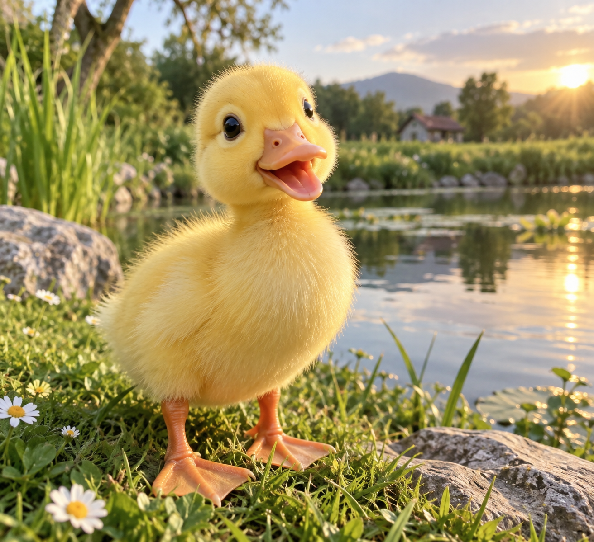

# Tạo ảnh con vịt

> **Model:** `gpt-5-6-thinking` · **Created:** 2026-09-09 11:48:15 · **Updated:** 2026-09-09 11:49:01
> **ID:** `6aa0e50d-1810-83ec-ad31-dcd60c15ed53`

---

> ### 👤 User · 2026-09-09 11:48:16
>
> tạo cho mình ảnh con vịt

---

### 🔧 Tool · 2026-09-09 11:48:19

Tool output

---

### 🔧 Tool · 2026-09-09 11:48:50

Tool output

Model caption: A bright, heartwarming, photorealistic/ultra-cute nature scene: a close-up, wide-aperture, shallow-depth-of-field image of a fluffy yellow duckling by a pond at golden-hour light, with a peaceful pastoral background. Overall scene: a small duckling stands on grassy ground near the edge of a calm pond or lake, with sparkling reflections of sunlight on the water, surrounded by natural elements like rocks, flowers, reeds, and a distant landscape with trees and a hint of a cottage or house and hills/mountains, with a warm sunset or sunrise glow in the sky. Main subject: a single duckling (baby duck), bright yellow downy fluff, standing in the foreground near the camera, facing slightly toward the viewer with an open beak as if “smiling” or chirping (mouth open), large dark shiny eyes, orange/pinkish-orange bill and orange webbed feet/legs visible, small rounded body, soft feathers catching the light; it looks cute, cheerful, curious, and is centered/foreground-left-to-center with its head turned slightly and beak open, giving an expressive, happy look. Objects and surroundings: the duckling stands on green grass with small white daisy-like flowers (white petals with yellow centers) and clover-like greenery; a rocky stone or boulder is visible nearby (foreground right and left-ish), and taller green reeds or grasses rise near the water’s edge on the left; the pond/lake behind the duckling shows gentle ripples and reflections of sky and nearby trees; in the right-to-center background, sunlight glows near the horizon, with warm golden tones and a bright sunlit area reflecting on the water; blurred trees and bushes line the far shore, with a small house/cottage-like building (with a roof, rustic look) in the distance, and rolling hills or a mountain silhouette beyond; lily-pad-like plants or floating greenery can be seen on the water; the composition uses shallow depth of field with the duckling sharply in focus and the background softly blurred, warm pastel sky with a few clouds, and a cozy countryside pond vibe with natural lighting and a dreamy, idyllic atmosphere.

---

### 🔧 Tool · 2026-09-09 11:48:54

Tool output

Generated images from the last `image_gen.text2im` call were saved at:
- /mnt/data/ghostwriter_images/generated/a_bright_heartwarming_photorealistic_ultra_cute_1.png (wxh = 1312 x 1199, exact aspect ratio 1312:1199)

You can visually inspect the generated image directly in the tool result above. Only reopen the saved path if you need programmatic processing or want to pass the image into another tool call.

---

*4 messages · 7 nodes*
