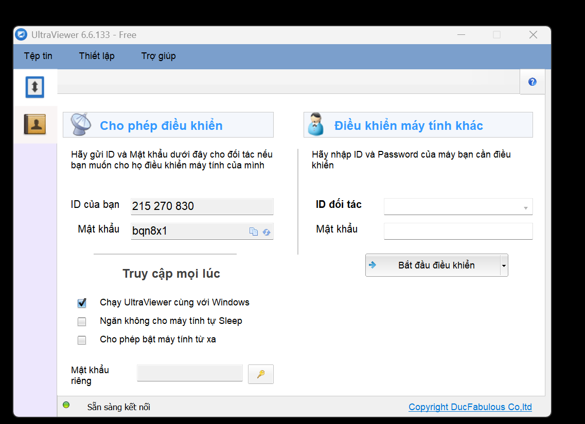
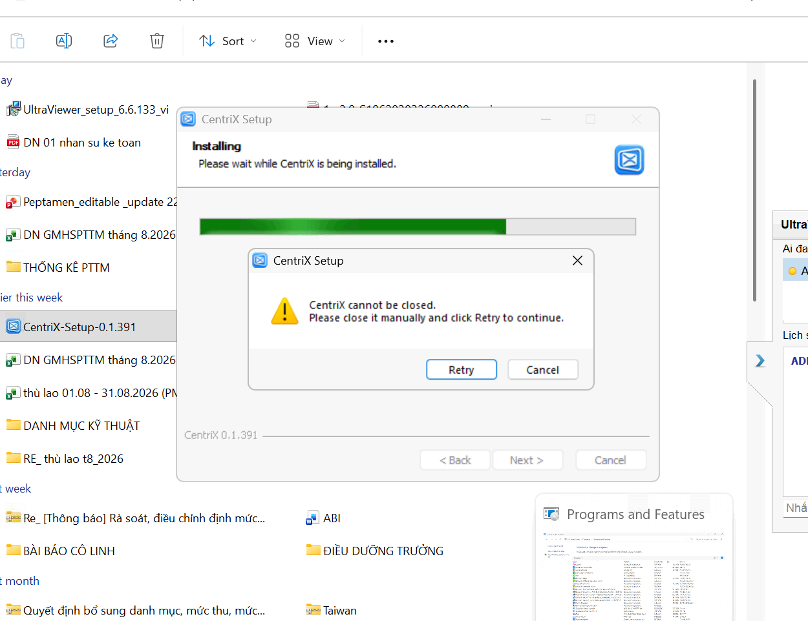
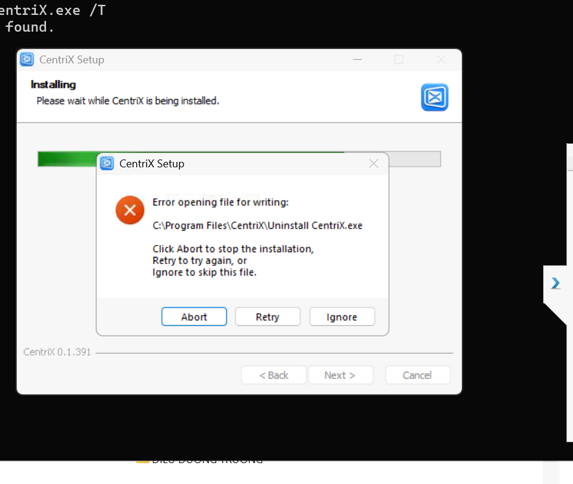
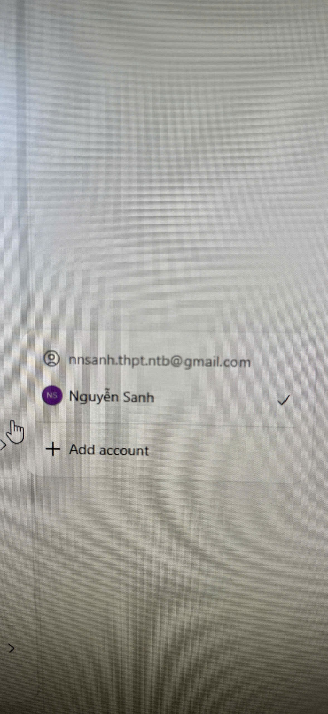

# Viết lại thông tin

> **Model:** `gpt-5-6` · **Created:** 2026-09-09 14:14:11 · **Updated:** 2026-09-09 15:32:53
> **ID:** `6aa10741-8a1c-83ec-92f1-cda4bf58093a`

<style>
blockquote {
  background-color: rgba(59, 130, 246, 0.08) !important;
  border-left: 4px solid #3b82f6 !important;
  padding: 12px 18px !important;
  border-radius: 8px !important;
  margin: 16px 0 !important;
  color: inherit !important;
}
blockquote h3 {
  margin-top: 0 !important;
  color: #60a5fa !important;
}
</style>

---

> ### 👤 User · 2026-09-09 14:14:10
>
>
> 
>
> viết lại cho mình

> 

---

### 🤖 ChatGPT `gpt-5-6-thinking` · 2026-09-09 14:14:17

UltraViewer 6.6.133 - Free

**ID của bạn:** 215 270 830 
**Mật khẩu:** bqn8x1

---

> ### 👤 User · 2026-09-09 14:17:52
>
>
> 
>
> làm sao để tắt toàn bộ app để cài lại bản mới b

> 

---

### 🤖 ChatGPT `gpt-5-6` · 2026-09-09 14:17:58

Được anh. Lỗi trong ảnh là **CentriX vẫn đang chạy nền**, nên bộ cài không thể đóng app để cập nhật.

Anh làm cách nhanh nhất như sau:

1. Nhấn **Ctrl + Shift + Esc** để mở **Task Manager**.
2. Trong **Processes** hoặc **Details**, tìm tất cả tiến trình liên quan đến:
 - `CentriX`
 - `CentriX.exe`
 - Nếu có nhiều tiến trình CentriX thì tắt **tất cả**.
3. Chuột phải → **End task**.
4. Quay lại cửa sổ cài đặt → bấm **Retry**.

Nếu muốn chắc chắn bằng lệnh, mở **Command Prompt (CMD) bằng Run as administrator** rồi chạy:

```bat
taskkill /F /IM CentriX.exe /T
```

Nếu không biết chính xác tên `.exe`, có thể kiểm tra bằng:

```bat
tasklist | findstr /I "CentriX"
```

Sau khi không còn tiến trình CentriX, bấm **Retry** là cài bản `0.1.391` tiếp được.

Nếu **End task xong mà CentriX tự bật lại**, khả năng app của anh có **background process / auto-start / updater**. Anh gửi em ảnh tab **Details trong Task Manager** khi tìm `CentriX`, em chỉ anh chính xác tiến trình nào cần kill.

---

> ### 👤 User · 2026-09-09 14:18:32
>
>
> 

> 

---

### 🤖 ChatGPT `gpt-5-6` · 2026-09-09 14:18:35

Lỗi này khác lúc nãy anh. CentriX đã tắt, nhưng bộ cài **không ghi đè được file**:

`C:\Program Files\CentriX\Uninstall CentriX.exe`

Khả năng cao là **thiếu quyền Administrator** hoặc file uninstall đang bị Windows giữ.

Anh làm theo cách này:

1. Bấm **Abort** để thoát bộ cài hiện tại.
2. Mở **CMD → Run as administrator**.
3. Chạy lần lượt:

```bat
taskkill /F /IM CentriX.exe /T
taskkill /F /IM "Uninstall CentriX.exe" /T
```

Nếu báo `not found` thì không sao.

Sau đó thử xóa file đang bị kẹt:

```bat
del /F /Q "C:\Program Files\CentriX\Uninstall CentriX.exe"
```

Rồi chuột phải file:

`CentriX-Setup-0.1.391.exe`

→ **Run as administrator** để cài lại.

Nếu lệnh `del` báo **Access is denied**, chạy thêm:

```bat
takeown /F "C:\Program Files\CentriX\Uninstall CentriX.exe"
icacls "C:\Program Files\CentriX\Uninstall CentriX.exe" /grant Administrators:F
del /F /Q "C:\Program Files\CentriX\Uninstall CentriX.exe"
```

**Không nên bấm Ignore**, vì sẽ bỏ qua việc cập nhật file uninstaller và có thể khiến bản cài CentriX bị lỗi về sau.

Nếu anh muốn **xóa sạch toàn bộ CentriX rồi cài mới hoàn toàn**, em có thể đưa anh một đoạn CMD duy nhất để kill toàn bộ process + xóa thư mục `Program Files\CentriX` + dọn bản cũ.

---

> ### 👤 User · 2026-09-09 15:25:53
>
>
> 
>
> viết lại email

> 

---

### 🤖 ChatGPT `gpt-5-6` · 2026-09-09 15:25:59

Email: **nnsanh.thpt.ntb@gmail.com**

---


*8 messages · 10 nodes*
