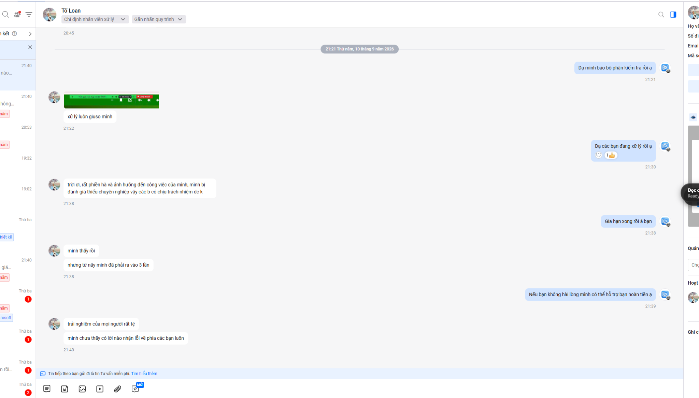
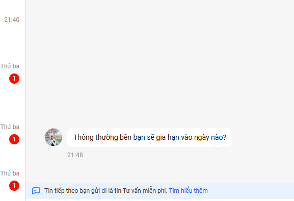
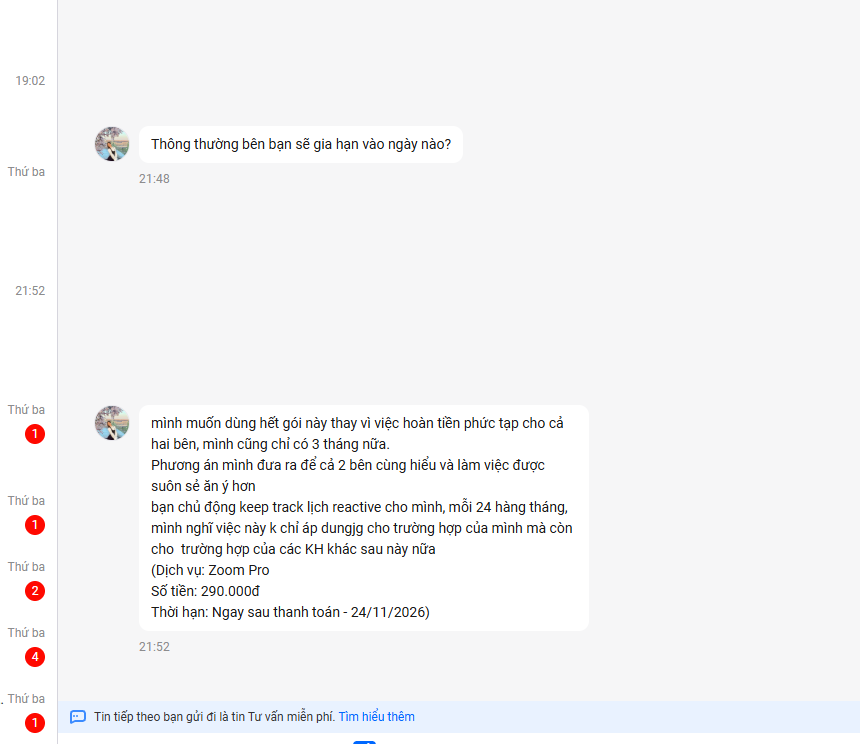
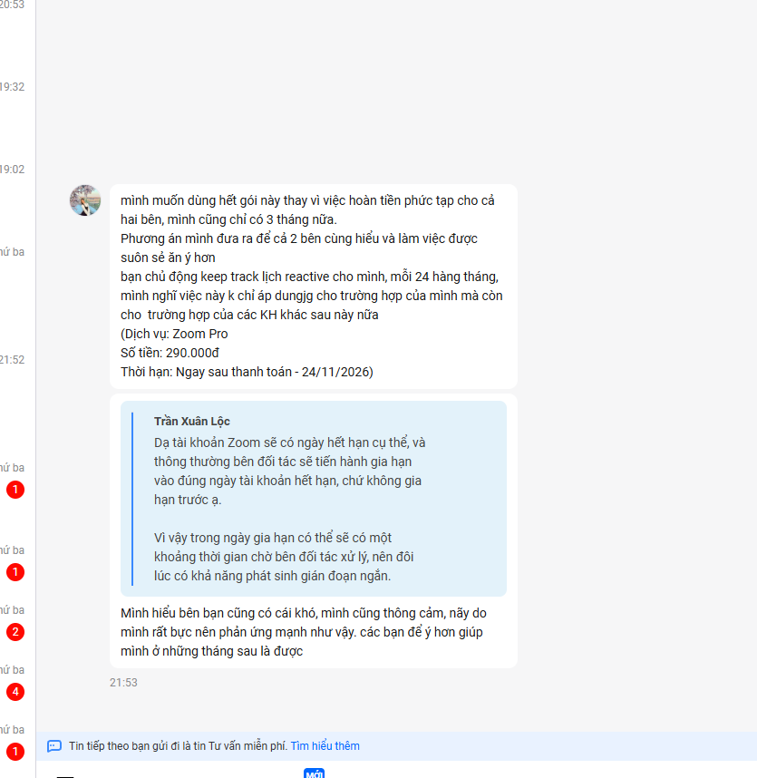

# Viết lời xin lỗi khách hàng

> **Model:** `gpt-5-6-thinking` · **Created:** 2026-09-10 21:41:49 · **Updated:** 2026-09-10 21:58:22
> **ID:** `6aa2c1aa-e174-83ec-adcd-604145dfd6ca`

---

### 👤 User · 2026-09-10 21:44:01

xin lỗi khách và bên mình sẽ đừng vĩnh dịch vụ nâng cấp trong tương lai để tránh làm ảnh hưởng đến bạn, vì bên minh cũng phụ thuộc vào đơn vị là cung cấp khác bên mình không chủ động nắm được. bên mình cũng có gắng hỗ trợ bạn sớm nhất khi nhận được yêu cầu từ bạn rồi, đó là những gì bên mình có thể làm được. thật sự bạn thấy dịch vụ không phù hợp với công việc của bạn và ảnh hưởng công việc của bạn thì bên mình sẽ hoàn tiền cho bạn 

viết gửi cho khách hàng

---

### 🤖 ChatGPT `gpt-5-6-thinking` · 2026-09-10 21:44:09

Anh có thể gửi khách theo hướng mềm mỏng, nhận trách nhiệm rõ ràng hơn như này:

> Dạ trước hết, bên mình **thành thật xin lỗi bạn về những bất tiện và ảnh hưởng đến công việc của bạn trong thời gian vừa qua**. Đây là trải nghiệm không tốt và bên mình xin nhận thiếu sót trong quá trình cung cấp dịch vụ.
>
> Do dịch vụ nâng cấp này có phụ thuộc vào đơn vị cung cấp bên thứ ba nên có những thời điểm bên mình không thể chủ động hoàn toàn về thời gian và quá trình xử lý. Tuy nhiên, bên mình hiểu rằng đây **không nên là lý do làm ảnh hưởng đến trải nghiệm của bạn**.
>
> Ngay khi nhận được yêu cầu, bên mình cũng đã cố gắng liên hệ và xử lý sớm nhất có thể trong khả năng của mình. Sau trường hợp này, bên mình cũng sẽ **ngừng cung cấp dịch vụ nâng cấp dạng này trong thời gian tới** để tránh phát sinh những tình huống tương tự và ảnh hưởng đến công việc của khách hàng.
>
> Nếu bạn cảm thấy dịch vụ hiện tại không còn phù hợp, hoặc những sự cố vừa rồi đã ảnh hưởng quá nhiều đến công việc của bạn, **bên mình xin hỗ trợ hoàn tiền cho bạn**.
>
> Một lần nữa, bên mình rất xin lỗi bạn về trải nghiệm lần này và cảm ơn bạn đã phản hồi thẳng thắn để bên mình nhìn nhận và cải thiện dịch vụ tốt hơn.

---

### 👤 User · 2026-09-10 21:46:57

Với dịch vụ này thì cứ 2 tuần sẽ gia hạn 1 lần, từ nhà cung cấp vì thế trong tương lai cũng sẽ có gián đoạn nên nhờ khách hàng cân nhắc

---

### 🤖 ChatGPT `gpt-5-6-thinking` · 2026-09-10 21:47:06

Anh có thể bổ sung và gửi khách như sau:

Dạ trước hết, bên mình **thành thật xin lỗi bạn về những bất tiện và ảnh hưởng đến công việc trong thời gian vừa qua**.

Bên mình cũng xin thông tin rõ hơn để bạn cân nhắc: với dịch vụ này, **cứ khoảng 2 tuần hệ thống sẽ cần được gia hạn lại từ phía nhà cung cấp**. Vì bên mình vẫn phụ thuộc vào quy trình xử lý của đơn vị cung cấp nên trong tương lai **vẫn có khả năng phát sinh thời gian gián đoạn**, và bên mình không thể chủ động hoàn toàn để đảm bảo dịch vụ luôn liên tục 100%.

Ngay khi nhận được yêu cầu từ bạn, bên mình đã cố gắng hỗ trợ và xử lý sớm nhất trong khả năng có thể. Tuy nhiên, bên mình hiểu rằng nếu công việc của bạn yêu cầu dịch vụ phải hoạt động ổn định và liên tục thì hình thức này có thể **không thực sự phù hợp**.

Vì vậy, bên mình muốn thông tin rõ để bạn cân nhắc trước khi tiếp tục sử dụng. Nếu bạn thấy việc gián đoạn có thể ảnh hưởng đến công việc và không muốn tiếp tục dịch vụ, **bên mình sẽ hỗ trợ hoàn tiền cho bạn**.

Một lần nữa, bên mình rất xin lỗi về trải nghiệm lần này và mong bạn thông cảm.

---

### 👤 User · 2026-09-10 21:47:35

mình gửi cụm trên rồi mình muốn viết riêng đoạn này để muốn khách hoàn tiền và tự mua trực tiếp ở website để chủ động cho công việc của khách

---

### 🤖 ChatGPT `gpt-5-6-thinking` · 2026-09-10 21:47:40

Anh có thể gửi riêng đoạn này:

Dạ với tính chất công việc của bạn cần sự ổn định và chủ động, bên mình nghĩ phương án phù hợp nhất là **bên mình hoàn tiền để bạn đăng ký trực tiếp trên website chính thức của nhà cung cấp**. Khi sử dụng trực tiếp, bạn sẽ chủ động hơn trong việc gia hạn, thanh toán và xử lý các vấn đề phát sinh, tránh trường hợp phải chờ bên mình hoặc đơn vị trung gian hỗ trợ làm ảnh hưởng đến công việc.

Bên mình cũng không muốn bạn tiếp tục sử dụng một dịch vụ mà trong tương lai vẫn có khả năng xảy ra gián đoạn như vừa rồi. Nếu bạn đồng ý, **bên mình sẽ hỗ trợ hoàn tiền để bạn chuyển sang mua trực tiếp**, như vậy sẽ phù hợp và an tâm hơn cho nhu cầu công việc lâu dài của bạn.

---

### 👤 User · 2026-09-10 21:49:35

thêm tài khoản zoom có ngày hết hạn và bên đối tác sẽ gia hạn vào ngày hôm đó

---

### 🤖 ChatGPT `gpt-5-6-thinking` · 2026-09-10 21:49:44

Anh có thể trả lời khách như này:

Dạ tài khoản Zoom sẽ có **ngày hết hạn cụ thể**, và thông thường bên đối tác sẽ tiến hành **gia hạn vào đúng ngày tài khoản hết hạn**, chứ không gia hạn trước ạ. Vì vậy trong ngày gia hạn có thể sẽ có một khoảng thời gian chờ bên đối tác xử lý, nên đôi lúc có khả năng phát sinh gián đoạn ngắn.

Nếu công việc của bạn cần sử dụng Zoom liên tục và cần chủ động tuyệt đối về thời gian gia hạn thì bên mình vẫn khuyến nghị bạn cân nhắc **mua trực tiếp trên website Zoom** để chủ động hơn ạ.

---

### 👤 User · 2026-09-10 21:57:36

Nếu tiếp tục, bạn là ngưởi sử dụng thường xuyên mong bạn chủ động báo cho mình nếu đối tác chưa gia hạn kịp lúc vì thời gian tối tác xữ lý chắc chắn có sự sê lệch và bên mình không đủ nguồn lực nhân sự để chủ động kiểm tra,. ví dụ ngày 18 hết nhưng zoom có thể kết thúc sớm hơn vào lúc 12h đêm 17 chặn hạng. Vì khách là người dùng thường xuyên sẽ chủ động hơn bên mình.l Còn không được vì cho bên mình hoàn tiền để bên mình ngừng kinh doanh dịch vụ này để tránh ảnh hưởng trải nghiệm xấu

---

### 🤖 ChatGPT `gpt-5-6-thinking` · 2026-09-10 21:57:46

Anh có thể gửi khách theo hướng rõ ràng, mềm nhưng vẫn thống nhất trách nhiệm như này:

Dạ nếu bạn vẫn muốn tiếp tục sử dụng hết thời hạn gói hiện tại thì bên mình rất sẵn sàng hỗ trợ. Tuy nhiên, bên mình xin thống nhất trước một điểm để hai bên phối hợp thuận tiện hơn ạ.

Do việc gia hạn phụ thuộc vào đối tác nên **thời điểm xử lý thực tế có thể có chênh lệch so với ngày hết hạn hiển thị trên tài khoản**. Ví dụ tài khoản hiển thị hết hạn ngày 18 nhưng Zoom có thể kết thúc quyền Pro từ cuối ngày 17 hoặc vào một thời điểm khác tùy hệ thống.

Vì bạn là người sử dụng Zoom thường xuyên và sẽ nhận biết tình trạng tài khoản sớm hơn bên mình, nên **nếu đến kỳ gia hạn mà tài khoản chưa được cập nhật hoặc có dấu hiệu chuyển về bản Free, mong bạn chủ động nhắn bên mình ngay**. Bên mình sẽ tiếp nhận và làm việc với đối tác để xử lý sớm nhất có thể.

Hiện tại bên mình không đủ nguồn lực nhân sự để kiểm tra trạng thái từng tài khoản liên tục mỗi ngày, nên việc bạn báo ngay khi phát hiện sẽ giúp bên mình xử lý nhanh hơn và hạn chế ảnh hưởng đến công việc của bạn.

Còn nếu phương án này vẫn chưa phù hợp với nhu cầu công việc của bạn, đặc biệt khi bạn cần Zoom **ổn định và liên tục tuyệt đối**, thì bên mình vẫn mong được **hoàn lại phần tiền dịch vụ cho bạn để bạn chủ động đăng ký trực tiếp với Zoom**. Bên mình cũng dự kiến ngừng cung cấp hình thức dịch vụ này để tránh những trải nghiệm không tốt tương tự trong tương lai.

Bên mình muốn trao đổi rõ từ đầu để bạn lựa chọn phương án phù hợp nhất với công việc của mình ạ.

---

### 👤 User · 2026-09-10 21:57:55

Viết ngắn gọn

---

### 🤖 ChatGPT `gpt-5-6-thinking` · 2026-09-10 21:58:07

Dạ nếu bạn tiếp tục dùng gói hiện tại, mong bạn **chủ động báo bên mình khi Zoom chưa được gia hạn kịp hoặc bị chuyển về Free** để bên mình làm việc với đối tác xử lý sớm nhất ạ.

Do thời điểm hết hạn thực tế có thể chênh lệch và bên mình không đủ nhân sự để theo dõi từng tài khoản liên tục.

Nếu phương án này không phù hợp với công việc của bạn, bên mình xin **hoàn tiền để bạn đăng ký trực tiếp với Zoom**, đồng thời bên mình cũng sẽ ngừng cung cấp dịch vụ này để tránh ảnh hưởng trải nghiệm khách hàng.

---

*12 messages · 18 nodes*
