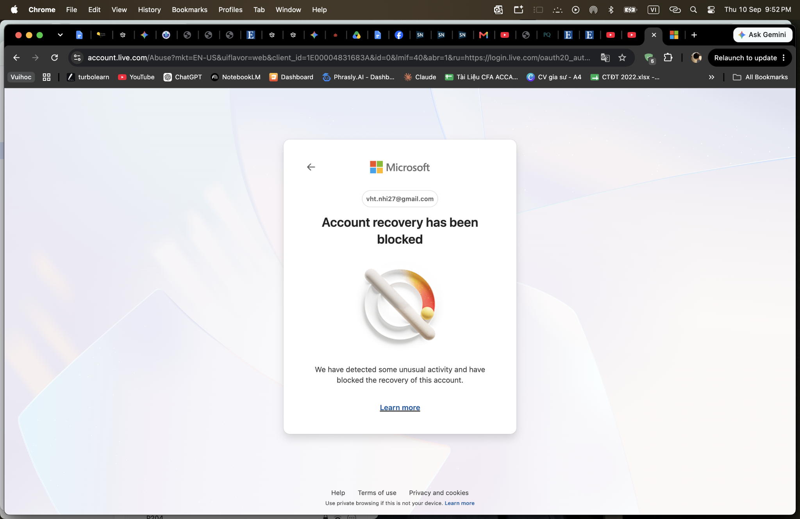

# Hướng dẫn khôi phục tài khoản Microsoft

> **Model:** `gpt-5-6-thinking` · **Created:** 2026-09-10 22:00:13 · **Updated:** 2026-09-10 22:01:02
> **ID:** `6aa2c5f4-10fc-83ec-be7a-c5503884dee9`

---

> ### 👤 User · 2026-09-10 22:00:17
>
>
> 
>
> hướng dẫn

> 

---

### 🤖 ChatGPT `gpt-5-6-thinking` · 2026-09-10 22:00:46

Anh đang gặp lỗi **“Account recovery has been blocked”** — Microsoft đã **chặn tạm thời quá trình khôi phục tài khoản vì phát hiện hoạt động bất thường**. Nguyên nhân thường là đổi IP/thiết bị, dùng VPN, đăng nhập nhiều nơi hoặc yêu cầu mã/xác minh quá nhiều lần. ([Hỗ Trợ Microsoft](https://support.microsoft.com/en-us/accounts-billing/security/what-happens-if-there-s-an-unusual-sign-in-to-your-account?utm_source=chatgpt.com)) 

Anh xử lý theo thứ tự này:

1. **Tạm ngưng thử khôi phục liên tục**, không bấm gửi mã hoặc recovery nhiều lần nữa. Microsoft xác nhận việc yêu cầu mã lặp lại có thể tiếp tục kích hoạt cơ chế chặn. ([Hỗ Trợ Microsoft](https://support.microsoft.com/en-us/accounts-billing/manage/troubleshoot-microsoft-verification-code-issues?utm_source=chatgpt.com)) 
2. **Tắt VPN/Proxy**, sau đó dùng **máy và mạng Wi-Fi mà tài khoản này thường đăng nhập trước đây**. Nếu có thiết bị cũ từng đăng nhập tài khoản thì ưu tiên dùng thiết bị đó.
3. Thử **đăng nhập Microsoft bình thường**. Nếu Microsoft cho lựa chọn gửi mã về email/số điện thoại bảo mật thì xác minh theo phương thức đó.
4. Nếu vẫn không vào được, sử dụng **Microsoft Sign-in Helper** trước; nếu cần thì tiếp tục bằng **Account Recovery Form**. Microsoft khuyến nghị điền biểu mẫu trên thiết bị và tại địa điểm từng dùng tài khoản trước đây. ([Hỗ Trợ Microsoft](https://support.microsoft.com/en-us/accounts-billing/manage/help-with-the-microsoft-account-recovery-form?utm_source=chatgpt.com)) 
 [Hướng dẫn khôi phục tài khoản Microsoft chính thức](https://support.microsoft.com/vi-vn/accounts-billing/manage/help-with-the-microsoft-account-recovery-form?utm_source=chatgpt.com) 
5. Khi điền Recovery Form, cung cấp càng chính xác càng tốt: **mật khẩu cũ, thông tin tài khoản, dịch vụ Microsoft từng dùng, email liên hệ có thể nhận thư**. Microsoft cho biết kết quả thường được gửi về email liên hệ trong vòng **24 giờ sau khi biểu mẫu được gửi thành công**. ([Hỗ Trợ Microsoft](https://support.microsoft.com/en-us/accounts-billing/manage/help-with-the-microsoft-account-recovery-form?utm_source=chatgpt.com)) 

**Quan trọng:** dòng trong ảnh không có nghĩa tài khoản đã bị khóa vĩnh viễn. Nếu đây là chặn do hoạt động/xác minh bất thường, Microsoft cho biết một số trường hợp sẽ **tự được gỡ sau một khoảng thời gian**, nhưng họ không công bố một thời gian cố định. Vì vậy không nên thử liên tục. ([Hỗ Trợ Microsoft](https://support.microsoft.com/en-us/accounts-billing/manage/troubleshoot-microsoft-verification-code-issues?utm_source=chatgpt.com)) 

Nếu tài khoản này đang dùng để **nhận Microsoft 365 Family**, thì đây là **lỗi bảo mật của tài khoản Microsoft**, không phải lỗi của link mời Family. Sau khi tài khoản đăng nhập lại bình thường mới tiếp tục nhận lời mời được.

---

*2 messages · 9 nodes*
