# Gợi ý tên sản phẩm

> **Model:** `gpt-5-6-thinking` · **Created:** 2026-09-11 01:40:39 · **Updated:** 2026-09-12 13:11:30
> **ID:** `6aa2f9a6-2f44-83ec-ae59-3929d29344c3`

---

### 👤 User · 2026-09-11 01:40:49

Claude API for Opus 5 - Sonnet 5

mình đặt tên sản phẩm này được không

---

### 🤖 ChatGPT `gpt-5-6-thinking` · 2026-09-11 01:40:59

Được anh, nhưng **“Claude API for Opus 5 - Sonnet 5”** nghe hơi giống câu mô tả hơn là tên sản phẩm, và chữ **“for”** chưa tự nhiên.

Em đề xuất đặt:

- **Claude API – Opus 5 & Sonnet 5** ← gọn, dễ hiểu nhất
- **Claude API Access – Opus 5 & Sonnet 5** ← phù hợp nếu CentriX cung cấp quyền truy cập API
- **Claude API Provider – Opus 5 & Sonnet 5** ← hợp với CetriX Code/Provider
- **Claude Models API – Opus 5 & Sonnet 5**

Nếu làm poster giống ảnh GPT-6 Astra anh gửi, em chọn:

**CLAUDE API** 
**Opus 5 & Sonnet 5** 
*API Access – 130.000đ/tháng*

Tên này nhìn chuyên nghiệp hơn và cũng hạn chế cảm giác CentriX đang tự nhận đây là sản phẩm chính thức do Anthropic trực tiếp bán. 

---

### 👤 User · 2026-09-11 01:41:51

**Claude API – Opus 5 & Sonnet 5**

---

### 🤖 ChatGPT `gpt-5-6-thinking` · 2026-09-11 01:41:54

Dạ anh, em chốt tên này là ổn nhất:

**Claude API – Opus 5 & Sonnet 5**

Nếu đưa lên poster/sản phẩm, em khuyên trình bày:

**CLAUDE API** 
**Opus 5 & Sonnet 5**

Ngắn, rõ, chuyên nghiệp và khách nhìn vào hiểu ngay đây là gói API hỗ trợ hai model.

---

### 👤 User · 2026-09-11 01:43:45

Opus 5 & Sonnet 5
*API Access – 130.000đ/tháng*

Vẽ cho mìnhf ảnh đại điện như ChatGPT, dùng tone trắng @Tạo hình ảnh 

---

### 🔧 Tool · 2026-09-11 01:43:52

Tool output

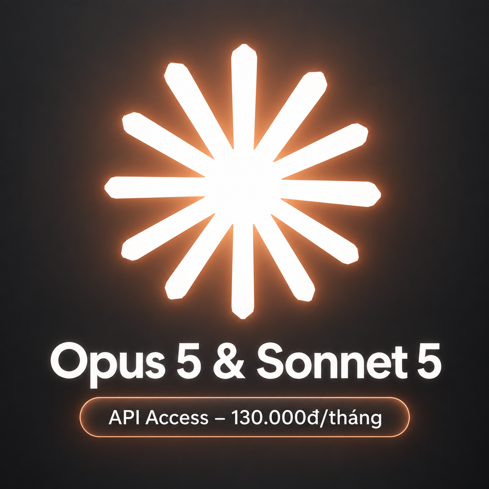

---

### 🔧 Tool · 2026-09-11 01:44:47

Tool output

Model caption: A clean modern promotional graphic / product card style image on a dark moody background, minimal, high-end, glowing UI/brand style. Overall scene: a square, high-resolution, poster-like UI/thumbnail with a centered, glowing starburst/sunburst icon and bold product title and pricing tag beneath, in a sleek, futuristic, premium design with soft lighting, subtle gradients, and a minimal interface feel. No people. A large, bright, white radial starburst emblem dominates the upper center, with warm orange glow halo behind it, like a stylized sun or asterisk logo with thick rounded/angled rays. The composition is vertically centered: icon at top/middle, then big headline text, then a rounded pill/badge with API pricing line. Background is a dark charcoal-to-warm gray gradient with soft vignette and delicate glow; the central emblem is crisp white with warm orange backlight bloom, giving depth and glow on the dark canvas. 

Salient objects/details: 
- At the top-center: a symmetrical radial starburst/sunburst emblem (like a multi-spoke asterisk), consisting of many thick elongated rays (appearing like ~12 spokes/segments) radiating from a bright circular center, each ray with slightly beveled/rounded polygon ends (hexagonal/angled tip feel), evenly spaced, glowing white with a soft warm orange halo around the rays and subtle bloom; the icon looks clean, geometric, modern, minimalist, with smooth gradients and strong glow. 
- The emblem is large, centered, and slightly above the text, with the glow gently illuminating nearby background in warm orange/copper tones, fading into dark charcoal corners. 
- Below the icon: large, bold, clean sans-serif title text reading exactly "Opus 5 & Sonnet 5" in white/near-white, with a modern geometric or neo-grotesque sans-serif look, heavy weight, centered, with slight soft glow/clean anti-aliased edges, occupying the middle lower area. 
- Under the title: a rounded pill/badge button-like element spanning horizontally, centered, with a subtle translucent dark fill and a thin warm orange-lit outline/glow; inside it is smaller but still prominent text reading exactly "API Access – 130.000đ/tháng" in white/light text. The dash is an en-dash/hyphen-like dash between "API Access" and the price. The price uses dot thousands separator and the Vietnamese đồng symbol "đ", followed by "/tháng" (monthly). The badge has a faint warm rim and inner glow, like a soft neon/orange rim highlight, with the pill edges rounded and slightly glossy/diffuse, and the text is centered inside. Typography: clean, modern, large headline, medium-weight for the pill text; spacing is airy and balanced, all centered. No other elements, no watermark, no people, no additional icons, in a minimalist premium AI/product branding style, 1:1 square composition, crisp, high-contrast, cinematic lighting, soft orange ambient glow around the white emblem and subtle gradient behind.<|has_watermark|>

---

### 🔧 Tool · 2026-09-11 01:44:50

Tool output

Generated images from the last `image_gen.text2im` call were saved at:
- /mnt/data/ghostwriter_images/generated/a_clean_modern_promotional_graphic_product_card_1.png (wxh = 1254 x 1254, exact aspect ratio 1:1, close to aspect ratio 1:1)

You can visually inspect the generated image directly in the tool result above. Only reopen the saved path if you need programmatic processing or want to pass the image into another tool call.

---

### 👤 User · 2026-09-11 01:45:35

.webp)

Opus 5 & Sonnet 5
*API Access – 130.000đ/tháng*

Vẽ cho mìnhf ảnh đại điện như ChatGPT, dùng tone trắng @Tạo hình ảnh giữ nguyên logo và màu 

.webp)

---

### 🔧 Tool · 2026-09-11 01:45:39

Tool output

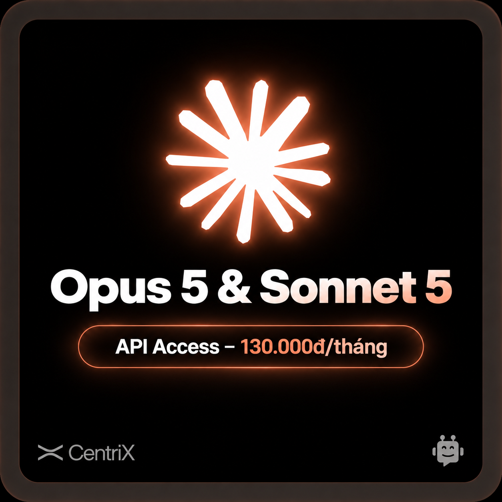

---

### 🔧 Tool · 2026-09-11 01:46:42

Tool output

Model caption: A clean, modern promotional product graphic/card with a dark black background and glowing orange accent, like a polished UI/app tile. Overall scene: a square image with rounded corners and a subtle dark border/frame, minimalistic, high-contrast, sleek tech/AI branding poster. The layout is centered and symmetrical, with a large glowing logo at top, big headline text in the middle, a rounded pill/badge price line beneath, and small branding elements in the bottom corners. No people are present. The style is modern, glossy/neon-like glow, with soft bloom/lighting, clean sans‑serif typography, and a premium app-card feel. Top/center: a large stylized starburst/sunburst icon (the same as Image B) — a white, multi-spoked asterisk-like burst with thick rounded/angled rays (about a dozen spokes) in solid white, with a warm orange/coral glow halo behind it, radiating softly into the black background. The burst is centered near the upper-middle of the card, with a soft orange glow and subtle light falloff. Middle: very large, bold, clean sans-serif headline text reading exactly “Opus 5 & Sonnet 5” (white to slightly warm/peach-tinted/gradient-ish look), centered horizontally; “Opus 5 & Sonnet 5” is in heavy weight, modern rounded/clean sans serif, with a slight warm tone on the right side or subtle gradient/orange tint, giving a premium illuminated feel. Below the headline: a long rounded capsule/pill button/label centered, with a thin glowing orange outline and soft inner dark fill, slightly glossy/neon edge glow; inside the pill is the text “API Access – 130.000đ/tháng” (with the dash/en dash/long hyphen), where “API Access –” is in white (or very light), and “130.000đ/tháng” is highlighted in warm orange/coral, matching the glow theme; the pill’s border and inner glow are orange, with the text centered and bold/clean sans serif, the numbers and currency/all lowercase Vietnamese “đ/tháng” included exactly, with dot grouping “130.000”. The background is near-black with a subtle vignette and soft orange ambient glow around the logo and the pill, giving depth and a premium neon UI aesthetic. Bottom-left: a light gray/soft-white logo and wordmark reading “CentriX” with a stylized X-like icon/mark to the left (curved crossed lines), placed near the lower-left corner, small and understated. Bottom-right: a small bot/robot/chat icon (rounded square-ish robot face or chatbot icon) in gray/light tone, with antenna-like dots and a smiling face, positioned near the lower-right corner. The entire card has a thick, dark rounded border/frame with a warm brownish/orange rim glow along the edges, and very soft corner rounding; the interior is mostly black with gentle glow rings, maintaining a clean centered composition and high contrast, like a product advertisement tile for AI models.<|has_watermark|><|has_borders|>

---

### 🔧 Tool · 2026-09-11 01:46:44

Tool output

Generated images from the last `image_gen.text2im` call were saved at:
- /mnt/data/ghostwriter_images/generated/a_clean_modern_promotional_product_graphic_card_w_1.png (wxh = 1254 x 1254, exact aspect ratio 1:1, close to aspect ratio 1:1)

You can visually inspect the generated image directly in the tool result above. Only reopen the saved path if you need programmatic processing or want to pass the image into another tool call.

---

### 👤 User · 2026-09-11 01:47:13

Mình muốn dùng nền sáng và logo Claude nguyên bản

---

### 🔧 Tool · 2026-09-11 01:47:18

Tool output

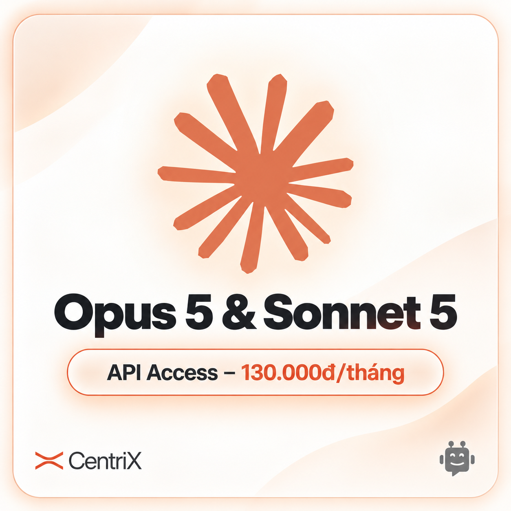

---

### 🔧 Tool · 2026-09-11 01:48:21

Tool output

Model caption: A clean, modern minimalist promotional graphic, square layout, like a product card/ad. Overall scene: a soft, warm, elegant UI-style poster on a rounded-corner card with light creamy/white background and warm orange accents, using the original Claude logo and premium typography/design, with subtle gradients, glows and shadows, in a clean centered composition. No humans. The canvas is a square image with a rounded border/frame and soft peach/orange ambient gradients and smooth abstract shapes, like a marketing tile.

Top/center: the Claude sunburst/starburst-like logo (the original Claude asterisk/sunburst with multiple thick rays) in a warm terracotta/orange color, centered near the upper-middle; it has a faint glow/soft halo behind it in a pale peach/orange, giving a gentle floating effect. The background is almost white/very light cream with soft curved wave-like shapes and gradients in the corners and edges, including a pale peach/orange curved blob/arc in the upper left and another curved wave or rounded shape in the lower right, creating a soft abstract backdrop.

Center: large bold headline text in a modern sans-serif, heavy weight, dark charcoal/blackish: “Opus 5 & Sonnet 5”. The ampersand is included; “Opus 5 & Sonnet 5” is centered beneath the logo, with subtle warm tint/gradient in the typography area (mostly dark, with crisp clean edges). 

Below the headline: a rounded pill/badge/button-like element spanning horizontally, with a thin orange outline and a soft inner glow/shadow and a light peach fill/gradient. Inside it is text: on the left in dark gray/black “API Access –” followed by the price in orange: “130.000đ/tháng”. The dash is an en-dash style “–”. The price portion “130.000đ/tháng” is colored in the same warm orange/terracotta as the logo and button outline, while “API Access –” is darker. The pill is centered and has subtle depth/shadow and glow, looking like a highlighted callout.

Bottom left: a small brand mark and text: an abstract “X”-like/curved cross mark in orange (CentriX logo), followed by the word “CentriX” in dark gray/black sans-serif, clean and modern, aligned near the lower-left corner. 

Bottom right: a small rounded robot/chatbot icon in gray (a cute bot face with two antenna dots and simple smiling face), like a little support/assistant emblem, in the lower-right corner.

The entire card has a thin warm border and rounded corners, with soft drop shadow and a gentle orange-tinted vignette around the edges. Style is clean, professional, minimal, high-end UI/marketing, with consistent warm orange and cream palette, crisp typography, and balanced centered layout.<|has_watermark|><|has_borders|>

---

### 🔧 Tool · 2026-09-11 01:48:25

Tool output

Generated images from the last `image_gen.text2im` call were saved at:
- /mnt/data/ghostwriter_images/generated/a_clean_modern_minimalist_promotional_graphic_sq_1.png (wxh = 1254 x 1254, exact aspect ratio 1:1, close to aspect ratio 1:1)

You can visually inspect the generated image directly in the tool result above. Only reopen the saved path if you need programmatic processing or want to pass the image into another tool call.

---

### 👤 User · 2026-09-11 01:49:25

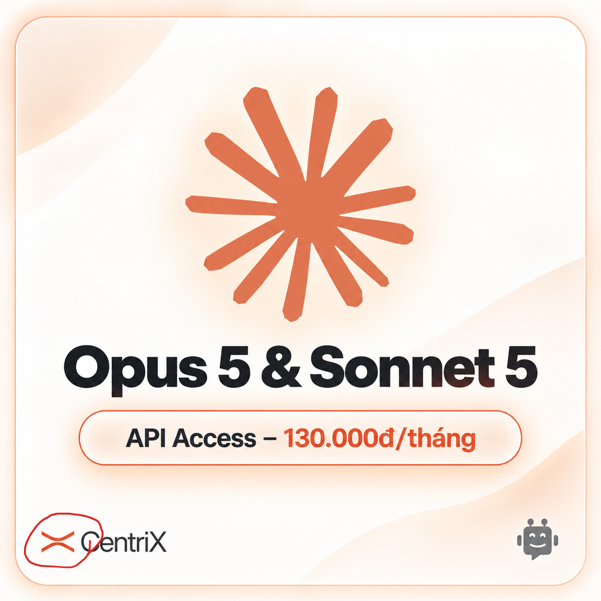

Màu logo centrix giữ nguyên bản

---

### 🔧 Tool · 2026-09-11 01:50:21

Tool output

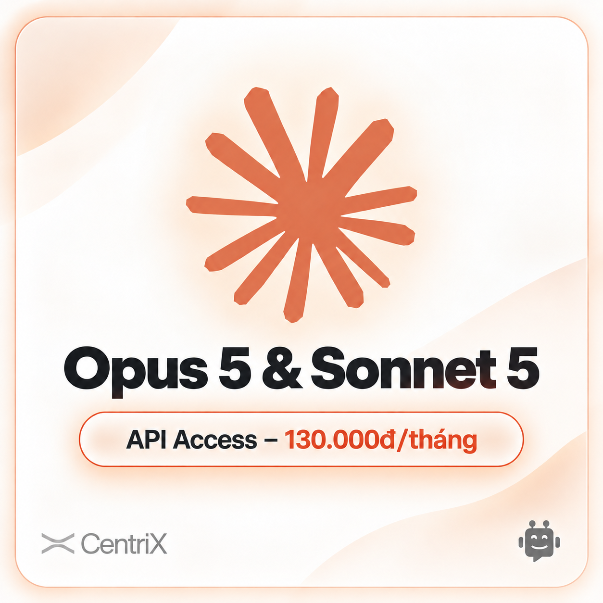

---

### 👤 User · 2026-09-11 01:54:34

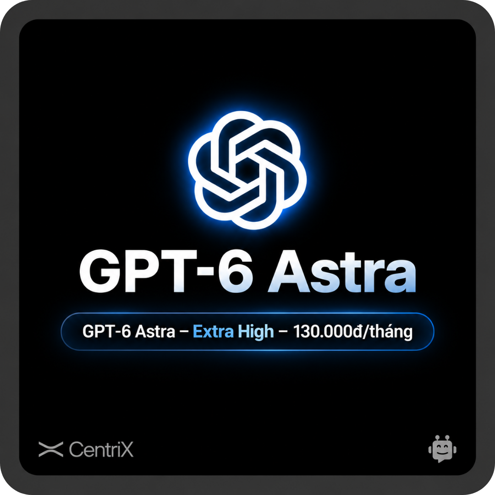

Grok-4.6 tương tự ChatGPT
Grok-4.6 - Extra High - 130.000đ/tháng

> 📎 *grok.svg* (`image/svg+xml`) — `file_000000008264820…`

---

### 🔧 Tool · 2026-09-11 01:55:16

Tool output

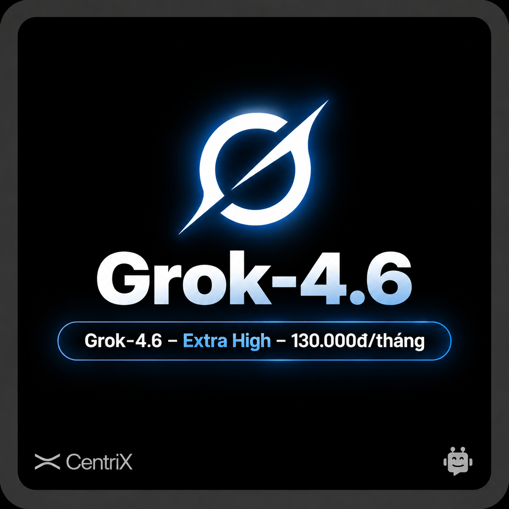

---

### 👤 User · 2026-09-11 01:57:47

size chữ grok cho hơn chatgpt rồi bạn, sửa lại cho bằng

---

### 🔧 Tool · 2026-09-11 01:57:50

Tool output

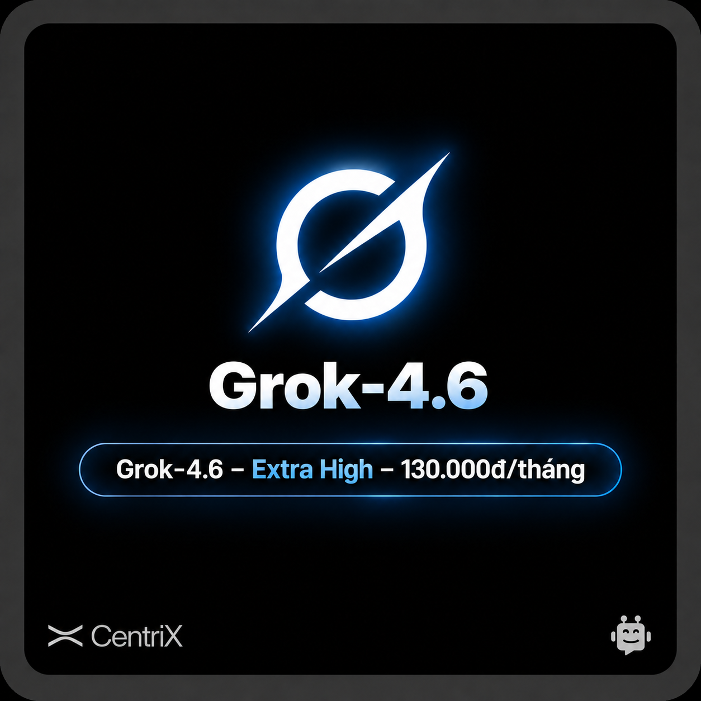

---

### 🔧 Tool · 2026-09-11 01:58:48

Tool output

Model caption: Square/portrait-like dark promo graphic on black background with rounded dark border/frame, styled like a product card or ad. Overall scene: a clean, minimal, high-contrast tech/AI promotional banner with neon-blue glow accents, matching the layout of the reference GPT-6 Astra example, but for Grok. The composition is centered and balanced, with the only change being the main title size reduced to match the reference’s proportions. No people present. Description of elements: 
- Background: solid deep black/dark charcoal with soft vignette glow around central elements, enclosed in a thick rounded-corner frame/border in dark gray/charcoal (like a rounded card UI). 
- Center top: a large glowing white/blue Grok-style logo: a circular ring with a diagonal slash/bolt-like streak cutting through it, white with a cool neon-blue outer glow, centered above the text. The logo is crisp vector-like, with a luminous halo. 
- Center middle: the main title text “Grok-4.6” in a clean, bold sans-serif (similar to modern UI/tech font), white to light bluish gradient, sized medium/large but reduced (not oversized), centered under the logo, matching the sizing and spacing of the reference image (comparable to “GPT-6 Astra” in the example). 
- Under the title: a rounded pill-shaped label/badge centered horizontally. It has a thin glowing neon-blue outline and soft inner/outer glow, with a dark/blackish fill area. Inside the pill, the text reads exactly: “Grok-4.6 – Extra High – 130.000đ/tháng”. “Grok-4.6” and “– 130.000đ/tháng” are in white/very light gray, while “Extra High” is highlighted in bright/cyan-blue, all in a clean sans-serif, matching the reference styling. The dash separators are en-dash style (“–”). The text is horizontally centered within the pill. 
- Bottom left: a small logo and text “CentriX” in light gray/white, with a stylized X-like mark to the left of the word. 
- Bottom right: a small cute robot/chatbot icon in light gray/white, like a minimal robot head/face with antenna-like dots, matching the original image’s small corner icon. 
Lighting and color: cool neon blue glow around the Grok logo and the pill outline, subtle bloom, crisp vector look, high contrast on black, minimal elements, clean spacing and alignment, with no other changes to layout or text.<|has_watermark|><|has_borders|>

---

### 🔧 Tool · 2026-09-11 01:58:50

Tool output

Generated images from the last `image_gen.text2im` call were saved at:
- /mnt/data/ghostwriter_images/generated/square_portrait_like_dark_promo_graphic_on_black_b_1.png (wxh = 1254 x 1254, exact aspect ratio 1:1, close to aspect ratio 1:1)

You can visually inspect the generated image directly in the tool result above. Only reopen the saved path if you need programmatic processing or want to pass the image into another tool call.

---

### 👤 User · 2026-09-11 02:01:37

# Gemini 3.8 Flash

# Gemini 3.8 Flash - High

Cũng 130k

> 📎 *gemini-color.svg* (`image/svg+xml`) — `file_0000000053a8821…`

---

### 🔧 Tool · 2026-09-11 02:02:14

Tool output

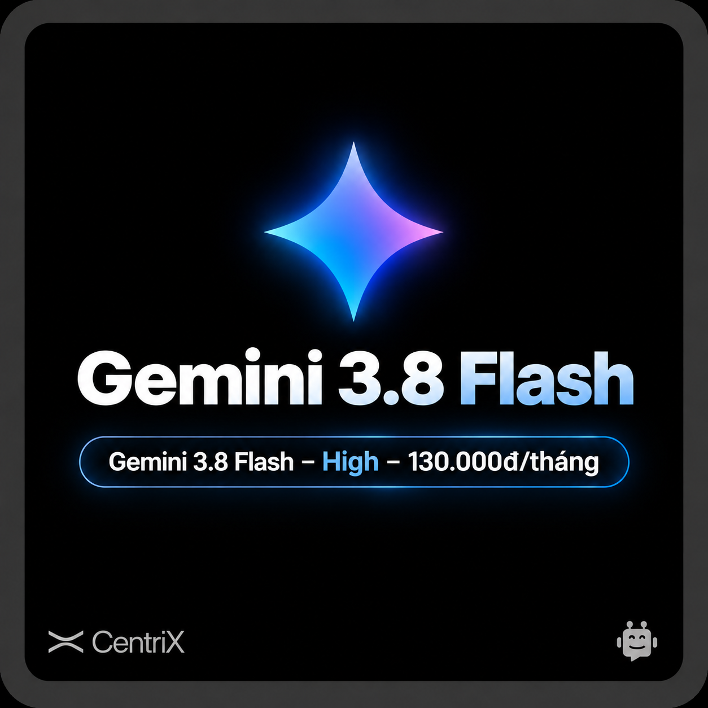

---

### 👤 User · 2026-09-11 02:04:29

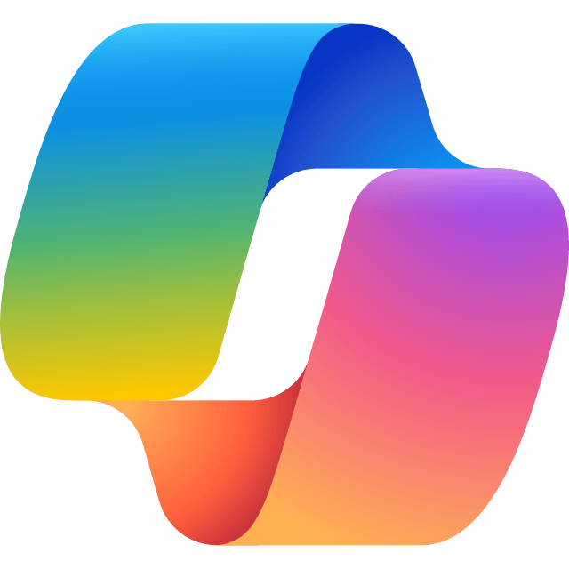

Tương tự copilot AI

---

### 🔧 Tool · 2026-09-11 02:04:33

Tool output

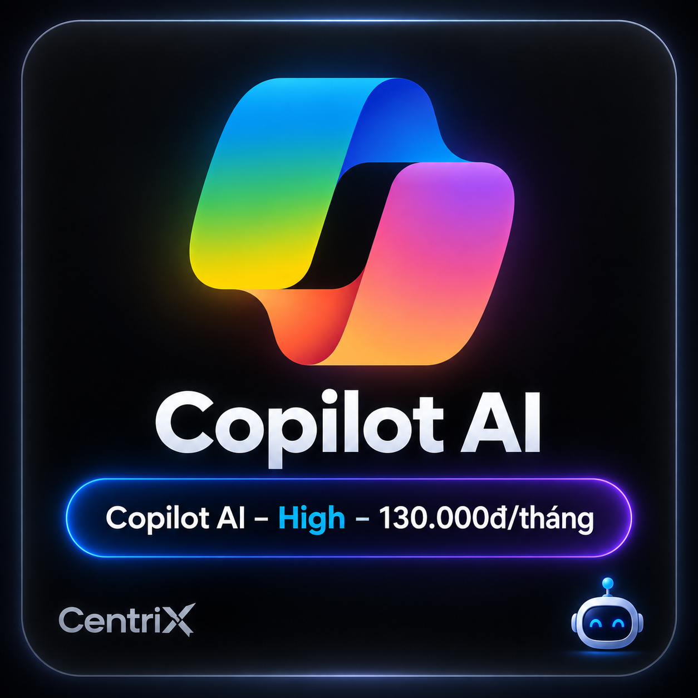

---

### 🔧 Tool · 2026-09-11 02:05:24

Tool output

Model caption: A sleek, high‑end promotional graphic / app card on a dark background. Overall scene: a glossy, modern, neon‑lit UI style card with rounded corners and a subtle glow, centered composition, like a product/subscription tile. The design is a square image with a dark, nearly black/charcoal panel with a soft rim and outer glow, futuristic neon accents, and clean typography, resembling a tech/AI subscription advertisement or marketplace card. No people are present. The layout is symmetrical and minimal, with the Copilot logo prominently at top, large title text, a glowing price/plan pill in the middle-lower area, and small branding and a cute robot icon at the bottom.

Top/center: a large, colorful Microsoft Copilot-like ribbon/loop logo (the official Copilot emblem) – a thick, folded ribbon/loop shape with smooth gradients and rounded corners. Colors blend like a vivid rainbow gradient: cyan/blue at the top, transitioning to green/yellow on the left, deep blue on the upper fold, and a pink/magenta/orange gradient on the right/lower ribbon, with realistic soft shading and glossy, smooth gradient transitions; the ribbon appears like two overlapping rounded panels forming a loop, with a central dark cutout/negative space. The logo floats with a subtle halo/glow behind it (soft colored illumination: blue/purple/amber hints) against the dark background, giving a neon photography/3D-vibrant app-icon look.

Center below the logo: massive bold sans‑serif title text in white/very light gray reading “Copilot AI”. The font is clean, modern, geometric/rounded sans (like a UI/marketing typeface), large and centered, with slight glow/contrast against the dark background.

Below the title: a wide rounded pill/button-like banner/label spanning across the card, outlined with neon glow (blue to purple neon rim), with a soft inner glow and subtle gradient fill (dark inner panel with luminous edge). Inside the pill: text reading “Copilot AI – High – 130.000đ/tháng”. The text styling: “Copilot AI” in white, a dash “–”, the word “High” in bright cyan/blue and slightly emphasized, another dash “–”, and the price “130.000đ/tháng” in white; the whole is centered in the pill with the “High” highlighted in vivid blue and the pill rim transitioning from electric blue on the left to purple on the right with neon glow. The pill is large, horizontally centered, with rounded capsule ends and a softly illuminated border/halo.

Bottom left: the wordmark “CentriX” in a light gray/silver modern sans font, with the “X” stylized and slightly angular, placed near the lower-left corner inside the panel, subtle and understated.

Bottom right: a small cute robot/assistant icon/mascot in a minimal 3D/flat 3D style: a rounded white/gray/blue head with a dark face screen showing two smiling blue arc eyes, a tiny antenna/ball on top with a glowing blue orb, and side ear-like shapes; it sits near the lower-right corner with a soft glow/shine and a small shadow/reflection underneath.

Background/frame: the entire image is a rounded rectangle card on a very dark almost-black background with a faint inner border and outer neon rim/edge glow, giving depth and a premium UI/3D app card appearance. Corners are heavily rounded, with subtle vignette and gradient lighting, crisp high-contrast, clean composition, minimal clutter, professional product-card render.<|has_watermark|><|has_borders|>

---

### 🔧 Tool · 2026-09-11 02:05:26

Tool output

Generated images from the last `image_gen.text2im` call were saved at:
- /mnt/data/ghostwriter_images/generated/a_sleek_high_end_promotional_graphic_app_card_o_1.png (wxh = 1254 x 1254, exact aspect ratio 1:1, close to aspect ratio 1:1)

You can visually inspect the generated image directly in the tool result above. Only reopen the saved path if you need programmatic processing or want to pass the image into another tool call.

---

### 👤 User · 2026-09-11 02:05:45

Logo, kích thước đồng bộ với các mẫu trước đó

---

### 🔧 Tool · 2026-09-11 02:05:49

Tool output

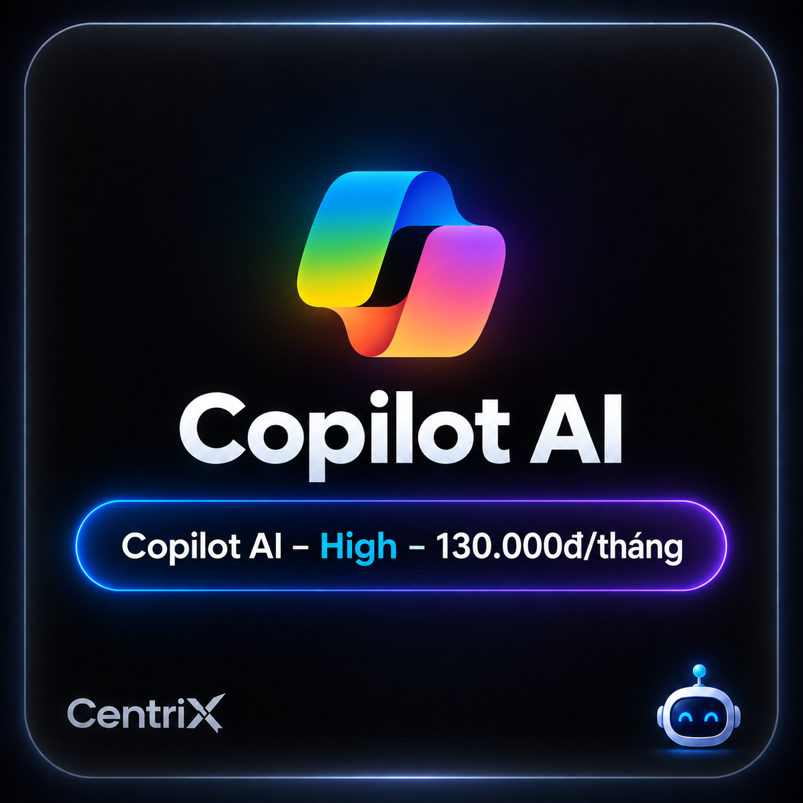

---

### 🔧 Tool · 2026-09-11 02:06:54

Tool output

Model caption: A dark, sleek, neon-glow promotional card/poster in a clean tech UI style with the same layout and elements as the original, but with the Copilot logo scaled smaller to match the reference size. Overall scene: a square (or near-square) graphic poster with a rounded rectangle card-like frame and neon edge glow on a very dark/black background, futuristic gradient lighting, centered composition, consistent spacing and proportions with the provided GPT-6 Astra sample. The layout: at the top-center a smaller, multicolor Copilot ribbon-like logo, followed by large title text, then a glowing rounded pill/outline button-like bar with pricing line, and bottom-left “CentriX” branding plus a small robot icon bottom-right. The design uses neon gradients (blue, purple, pink, cyan, yellow, orange) and soft glows, with clean sans-serif typography and smooth glossy neon lighting, like a modern UI advertisement tile.

Top/overall frame: a rounded rectangle border inset with a thin glowing neon outline (bluish-white/azure) around the card edges, with subtle vignette/dark gradient background inside; the card fill is deep charcoal/black with slight glow haze, giving a polished app-ad feel.

Icon/logo: centered near the top-middle is the Microsoft Copilot-style ribbon/loop logo, exactly like the original design but smaller and neatly scaled. It’s a smooth, folded ribbon/overlapping shape with bright gradient colors: cyan-blue at top, greenish-yellow to yellow on left-lower parts, deep blue/purple fold areas, and pink/magenta/orange/yellow gradients on the right/lower ribbon, with soft luminous bloom around it. It’s not oversized—balanced with ample space above the title, matching the reference sample’s proportions.

Title text: centered beneath the logo, large bold rounded sans-serif (similar to Segoe/modern UI font), colored bright white/silver with subtle glow; reads exactly “Copilot AI”. It is big and prominent, with slight soft shading, centered.

Price/plan pill: below the title is a horizontally elongated rounded capsule/bar with a neon gradient outline (left side cyan/blue, transitioning to purple/pink on the right), with inner dark fill matching the background. Inside it, centered in clean sans-serif text: “Copilot AI – High – 130.000đ/tháng”. The word “High” is highlighted in bright cyan/blue, while the rest of the text is white/light. The hyphen/dash separators are long/en dash style: “Copilot AI – High – 130.000đ/tháng”. The pill has a subtle glow halo and soft inner lighting, matching the neon UI aesthetic.

Bottom left: the wordmark “CentriX” in light gray/white with a stylized “X” (modern clean sans-serif), placed near the lower-left corner inside the card, small but visible. Bottom right: a cute small robot/assistant icon, rounded head with antenna dot, glowing blue/white gradients, dark face with bright smiling/closed-eye arcs (like two curved eyes), small ear-like sides, and a blue antenna ball; it sits near the bottom-right edge with a faint glow and subtle shadow/lighting beneath, matching the neon theme.

Color palette: deep black/dark navy background, neon outlines and glows in cyan, electric blue, purple, magenta, and warm yellow/orange; crisp clean composition, high contrast, minimal clutter, centered alignment, with realistic neon bloom and glossy gradient rendering. No people, no additional text besides those specified, no charts, no extraneous elements.<|has_watermark|><|has_borders|>

---

### 🔧 Tool · 2026-09-11 02:06:57

Tool output

Generated images from the last `image_gen.text2im` call were saved at:
- /mnt/data/ghostwriter_images/generated/a_dark_sleek_neon_glow_promotional_card_poster_i_1.png (wxh = 1254 x 1254, exact aspect ratio 1:1, close to aspect ratio 1:1)

You can visually inspect the generated image directly in the tool result above. Only reopen the saved path if you need programmatic processing or want to pass the image into another tool call.

---

### 👤 User · 2026-09-11 15:10:25

giữ lại nguyên bản thiết kế cho mình như sau

---

### 🔧 Tool · 2026-09-11 15:10:31

Tool output

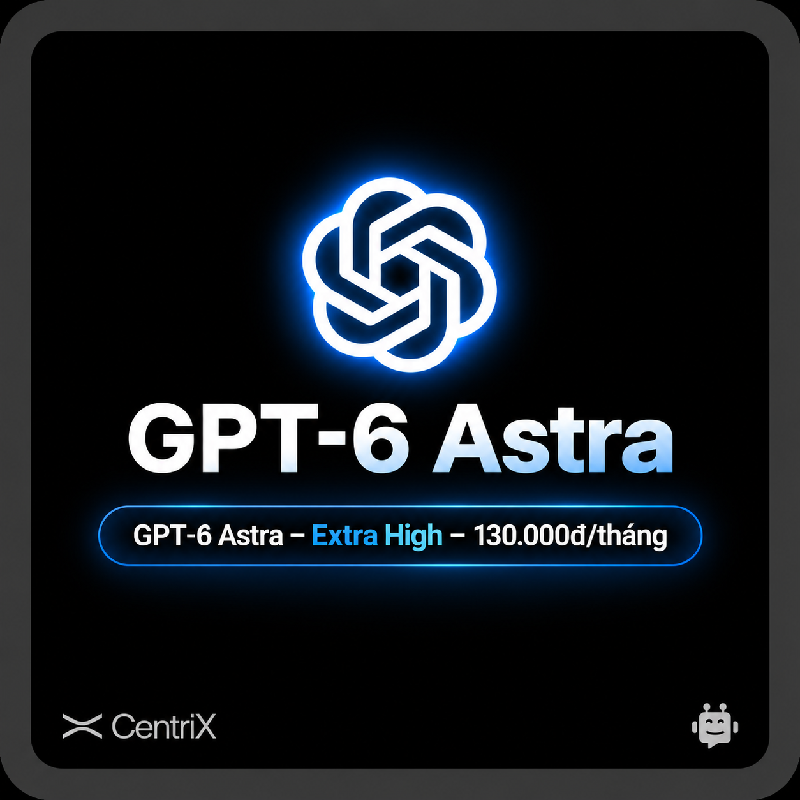

---

### 🔧 Tool · 2026-09-11 15:11:33

Tool output

Model caption: A clean, high‑contrast, square promotional graphic/poster on a black tech background with neon-blue glow accents, styled like a modern AI subscription ad, matching the reference template precisely. Overall scene: a centered, symmetrical, minimalist UI-like poster with a thick rounded dark-gray border/frame around a deep black inner panel, with glowing neon highlights and crisp typography, no humans, flat graphic design, high-resolution, clean vector-style/3D-glow look. The layout is identical to the reference image, with the same elements and text, just polished and crisp. 

Top center: a large, glowing OpenAI-like knot/hexagon emblem (interwoven loop logo) in pure white with strong cyan/blue outer glow halo, centered in the upper-middle area. The background is nearly black with subtle vignette, making the logo glow appear luminous and haloed in electric blue. 

Below the logo: huge bold sans-serif headline text centered, reading “GPT-6 Astra”. “GPT-6” is in bright white/near-white; “Astra” transitions to a cool light-blue/silver gradient with slight glow, all in a modern heavy sans-serif font, with crisp anti-aliased edges, large and centered. 

Under the headline: a long pill-shaped rounded rectangle button/badge across the center, with a neon blue outline and inner subtle glow, like a rounded capsule. Inside the pill is the text: “GPT-6 Astra – Extra High – 130.000đ/tháng” in clean sans-serif. The first part “GPT-6 Astra –” is white/light gray, “Extra High” is bright electric blue, and “– 130.000đ/tháng” is white/light gray. The capsule has a faint inner glow and outer blue neon rim, with the text centered horizontally. 

Bottom left corner inside the panel: a minimalist logo and wordmark “CentriX” in light gray; the mark is an abstract X-like swoosh symbol to the left and the word “CentriX” in a clean sans-serif (capital C, lowercase “entri”, capital X at end). 

Bottom right corner: a small cute robot/chatbot icon in light gray, simplified rounded rectangle/robot face with two antenna dots, smiling face, like a friendly bot badge. 

The whole card is framed by a thick rounded-corner dark charcoal/gray border with large corner radii; the inner panel is almost pure black with subtle depth, no other elements, lots of negative space, crisp glowing neon-blue accents, clean modern tech ad aesthetic, square 1:1 composition.<|has_watermark|><|has_borders|>

---

### 🔧 Tool · 2026-09-11 15:11:37

Tool output

Generated images from the last `image_gen.text2im` call were saved at:
- /mnt/data/ghostwriter_images/generated/a_clean_high_contrast_square_promotional_graphic_1.png (wxh = 1254 x 1254, exact aspect ratio 1:1, close to aspect ratio 1:1)

You can visually inspect the generated image directly in the tool result above. Only reopen the saved path if you need programmatic processing or want to pass the image into another tool call.

---

### 👤 User · 2026-09-11 21:58:26

Vẽ lại cho Copilot AI

---

### 🔧 Tool · 2026-09-11 21:58:29

Tool output

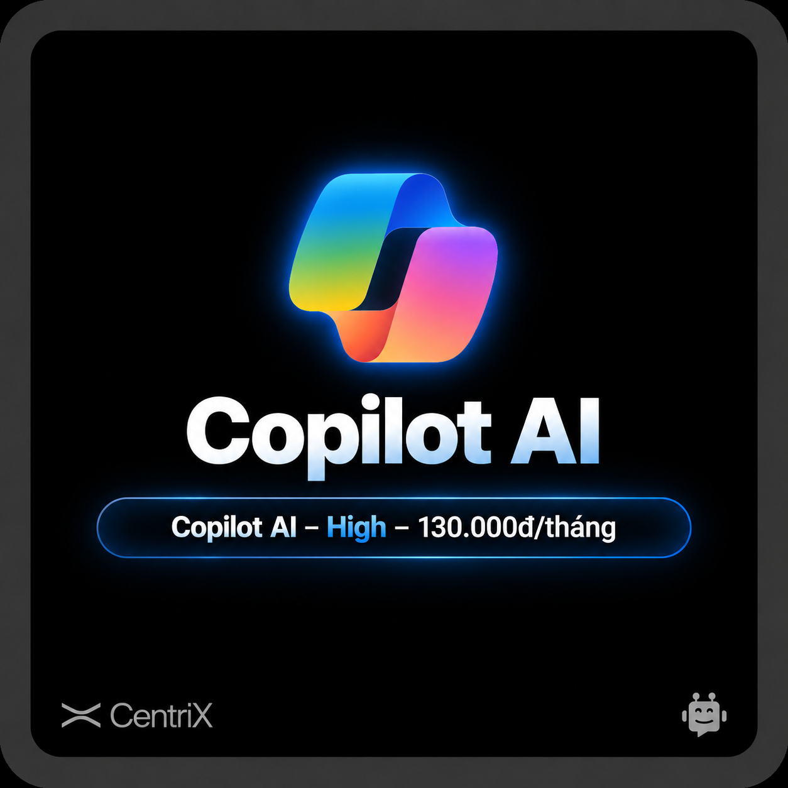

---

### 🔧 Tool · 2026-09-11 21:59:42

Tool output

Model caption: A clean, graphic promotional poster/thumbnail style image, overall scene: a dark, futuristic UI-like product card with glowing neon accents, centered layout, high contrast, minimalist design, like a tech subscription advertisement. Square image with rounded dark border/frame and a subtle vignette, black interior panel with a soft charcoal/gray rounded border and a slightly lighter outer rim, matching the style of the provided GPT-6 Astra example, but for Copilot AI.

Center/top area: a large, glossy, colorful Microsoft Copilot style logo (ribbon-like, looped, rounded geometric shape) with smooth gradient colors—cyan/blue at top left blending to green/yellow, then orange/red and pink/purple gradients on the right/lower segments—floating on a black background with a soft electric blue glow/aura halo around it. The logo is centered near the upper-middle, with luminous neon-like glow and subtle modern 3D/gradient vector look.

Below the logo: big bold sans-serif headline text in white to very light silver/blue tint reading “Copilot AI” (exactly), centered. The font is thick, clean, modern, with slight gradient or light reflection suggesting a glossy/metallic UI type style, large and prominent, with “Copilot” and “AI” on one line, not oversized, matching the reference composition.

Under the title: a rounded pill/button-like bar spanning horizontally, centered, with a thin neon blue outline and inner glow, dark/black-blue interior, like a UI CTA badge. Inside the pill is the exact text: “Copilot AI – High – 130.000đ/tháng” (use the en dash-like hyphen separators), with “Copilot AI” in white/light, the word “High” in bright blue (neon-like highlight), and the price “130.000đ/tháng” in white/light; text is centered vertically within the pill and uses a clean sans-serif font consistent with the headline but smaller, with the “High” segment distinctly bright blue to match the accent glow. The pill has a luminous blue rim glow and subtle inner shading, giving a futuristic UI button appearance.

Bottom-left corner: a small brand mark/wordmark “CentriX” in light gray/white with a stylized X-like symbol to the left (an abstract crossed curve/mark), placed near the lower left edge inside the panel. Bottom-right corner: a small gray/white chatbot/robot icon (rounded robot face with antenna dots and a speech-bubble-like silhouette), minimal and flat, matching the original sample. The background remains deep black with faint ambient blue lighting around the main elements, and lots of empty space to emphasize the centered composition. No people, just the clean digital UI poster layout.<|has_watermark|><|has_borders|>

---

### 🔧 Tool · 2026-09-11 21:59:46

Tool output

Generated images from the last `image_gen.text2im` call were saved at:
- /mnt/data/ghostwriter_images/generated/a_clean_graphic_promotional_poster_thumbnail_styl_1.png (wxh = 1254 x 1254, exact aspect ratio 1:1, close to aspect ratio 1:1)

You can visually inspect the generated image directly in the tool result above. Only reopen the saved path if you need programmatic processing or want to pass the image into another tool call.

---

### 👤 User · 2026-09-12 12:46:13

# Perplexity: Sonar Pro

# Perplexity: Sonar Pro - 130.000đ/tháng

Thay logo vào cho mình, dùng tone nền sáng cho mình @Tạo hình ảnh 

> 📎 *perplexity.svg* (`image/svg+xml`) — `file_0000000026a0822…`

---

### 🔧 Tool · 2026-09-12 12:46:16

Tool output

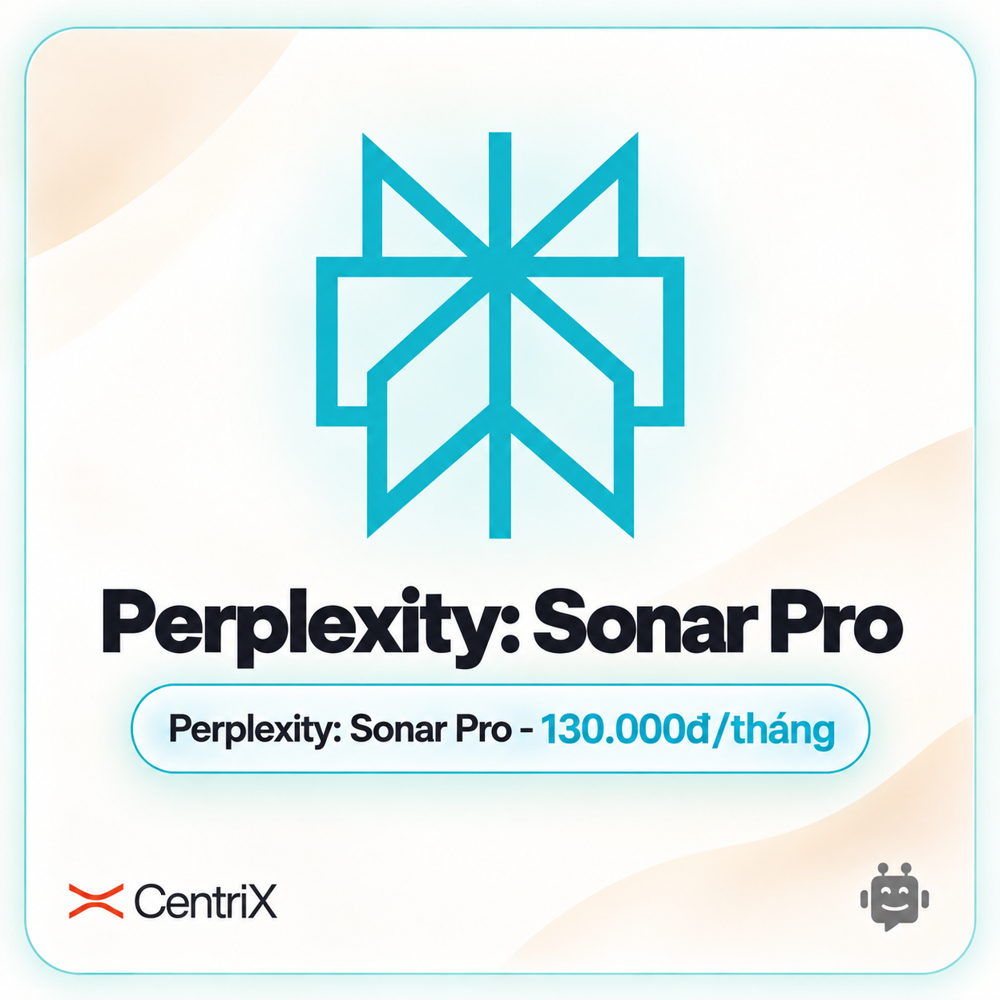

---

### 🔧 Tool · 2026-09-12 12:47:47

Tool output

Model caption: A clean modern promotional product card/graphic on a light cream background. Overall scene: a square/rectangular tile with rounded corners and a subtle teal-tinted border and soft gradients, centered layout, minimal modern UI/marketing aesthetic. The composition is a clean mockup poster: large geometric cyan logo at top, bold product title in the middle, a rounded pill price/label, and brand marks at the bottom. The background is off‑white/very pale cream with smooth, soft, rounded organic gradient shapes in light beige/peach in corners, with a subtle teal outline border and gentle shadow/glow, like a UI card. No people.

Top/center: a large teal/turquoise geometric emblem (Perplexity-like star/arrow/flower/box-like symbol) made of thick uniform strokes, symmetrical, with a central point and radial segments—an abstract star/flower/arrow/geometric shape with vertical and diagonal lines forming a multi-point emblem (exactly like the provided image), crisp vector style, centered, with a soft pale cyan glow or vignette behind it.

Middle: a big bold sans-serif headline in very dark charcoal/near-black reading “Perplexity: Sonar Pro” (the font is heavy, modern, rounded/clean sans-serif). The text is centered and large, beneath the logo.

Below that: a rounded pill-shaped badge/label spanning horizontally, with a thin teal border and light inner fill (very pale mint/blue tint), containing text: on the left/dominant portion “Perplexity: Sonar Pro - ” in dark charcoal, and the price part “130.000đ/tháng” in bright teal/blue (matching the logo color). The whole pill has subtle shadow/soft glow underneath and rounded capsule corners, centered on the card.

Bottom left: the CentriX branding: to the left a small red-orange stylized “X” or crossed mark, followed by the word “CentriX” in a clean sans-serif black/charcoal (capital C, rest lowercase, with a modern look), placed near the lower-left corner inside the card margin.

Bottom right: a small gray chatbot/robot icon (rounded face with antenna dots, smiling face) in dark gray, like a minimal chat bot illustration, near the lower-right corner.

Background details: rounded card with thin teal outline and soft drop/ambient glow, corner radii, subtle beige/peach curved shapes in top-left and bottom-right (and faint waves), very clean minimal composition, lots of whitespace, centered alignment, high-resolution vector/flat graphic design look. No additional text beyond what’s described.<|has_watermark|><|has_borders|>

---

### 🔧 Tool · 2026-09-12 12:47:48

Tool output

Generated images from the last `image_gen.text2im` call were saved at:
- /mnt/data/ghostwriter_images/generated/a_clean_modern_promotional_product_card_graphic_on_2.png (wxh = 1254 x 1254, exact aspect ratio 1:1, close to aspect ratio 1:1)

You can visually inspect the generated image directly in the tool result above. Only reopen the saved path if you need programmatic processing or want to pass the image into another tool call.

---

### 👤 User · 2026-09-12 12:50:50

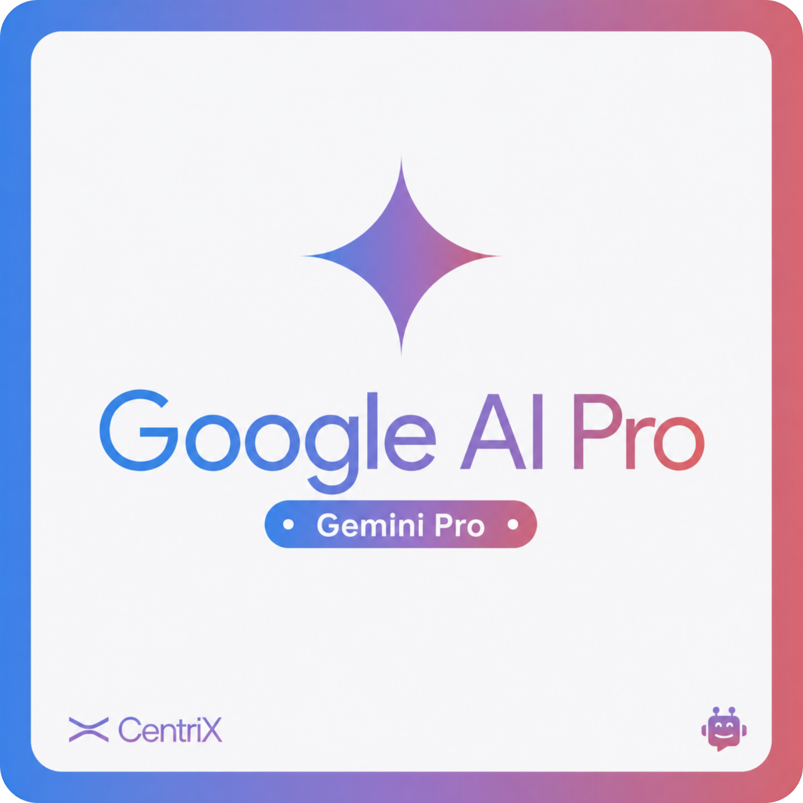

Sửa lại logo centrix mà gốc và size chữ phù hợp cho mình

---

### 🔧 Tool · 2026-09-12 12:50:56

Tool output

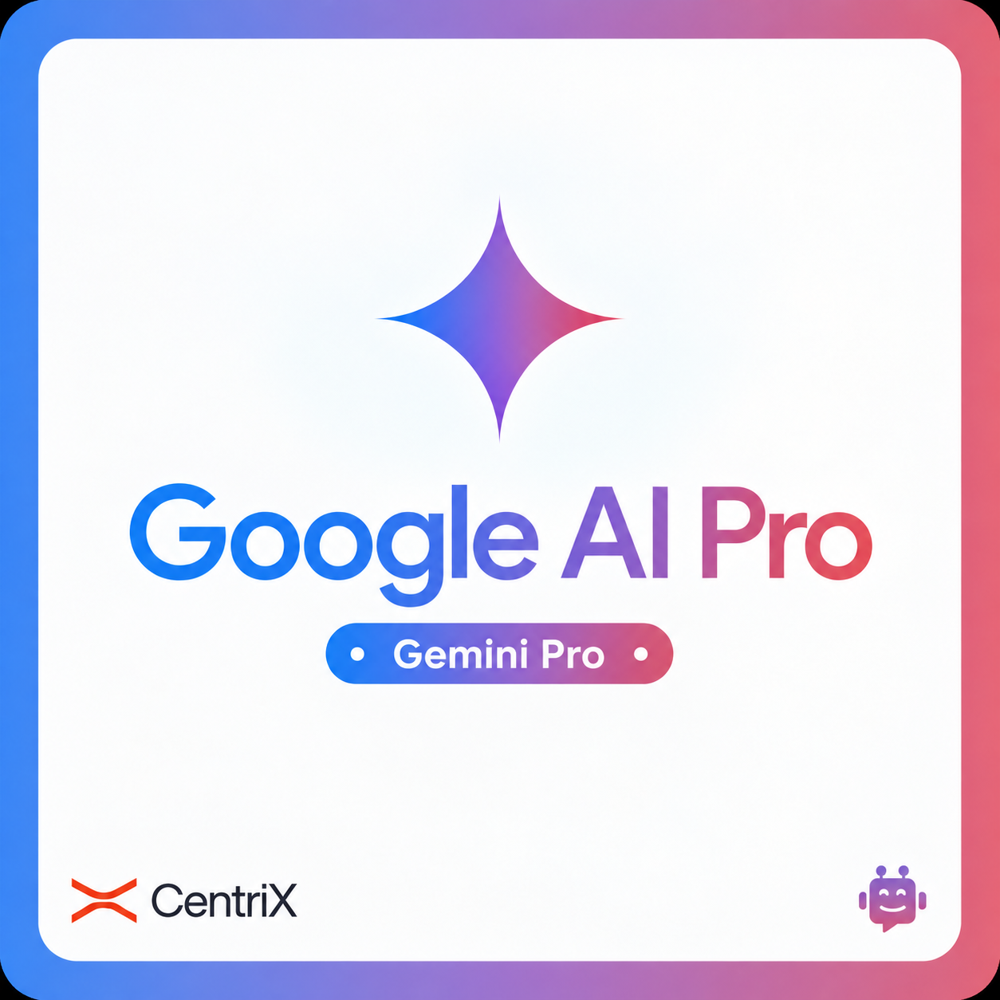

---

### 🔧 Tool · 2026-09-12 12:51:57

Tool output

Model caption: A clean, modern graphic design poster/card image (square, like a social media/branding card) with a minimalist, polished UI-style layout. Overall scene: a centered, light, gradient-accented promotional graphic with the same layout, elements, and composition as the original, but corrected and balanced for brand accuracy and typography; no people, just vector/logotype UI elements and text. The card has a rounded-rectangle white/very pale panel with a subtle outer border gradient and soft shadows/clean flat look, like a marketing tile for Google AI Pro / Gemini Pro, with correct CentriX branding at bottom-left in orange-red plus dark text and a small robot icon at bottom-right. The overall aesthetic is clean, high-resolution, minimal, with smooth gradients, large readable sans-serif type, and proportional spacing.

Background & frame: a square canvas with a thick rounded-corner border-like margin area filled with blue-to-purple-to-pink gradient (top left cooler blue, blending to purple and pink at top-right and right side; bottom edge continues gradient toward purple/pink), with an inner large rounded rectangle card area in very light off-white/white with faint soft gradient/lighting, giving a subtle card-on-background look and smooth rounded corners. No photography, all flat/vector graphics, crisp anti-aliased edges, soft modern UI style.

Central graphic: near the upper-middle, a star/diamond-like four-point sparkle/stellar shape (Google Gemini-style symbol), centered, with a smooth gradient blend of blue → purple → pink/red, like a rounded diamond/starburst with curved edges (top and bottom points elongated, left and right points horizontal), a glossy-ish flat gradient icon.

Main title text: centered beneath the icon, large clean sans-serif wordmark. Text reads exactly: "Google AI Pro". “Google” in a cool blue-to-indigo gradient or solid Google-like blue tone, “AI” in purple, and “Pro” in reddish/pink shade—overall a smooth gradient feel across the words, with crisp, modern sans-serif type, similar to Google’s product branding, heavy/semibold weight, large and centered. The spacing is balanced and readable, occupying the central upper-middle area.

Sub-label: below the main title, a rounded pill/badge button centered, with horizontal pill shape and gradient fill (blue on left blending through purple to pink/red on right). Inside the pill is the text "Gemini Pro" in white or very light, rounded sans-serif, medium-bold, with small white circular dot markers on both sides (one dot on the left and one dot on the right) like: "• Gemini Pro •". The pill is proportionally sized and centered under the title.

Bottom-left branding: near the lower-left corner inside the card, the CentriX logo: a stylized orange/red/orange-red mark/icon (an abstract X-like or curved crossing mark, two arched strokes forming an X-like symbol) followed by the word "CentriX" in dark gray/charcoal, clean sans-serif, with the X capitalized at the end. The mark is to the left of the word, aligned baseline, with crisp vector look.

Bottom-right: a small chatbot/robot/chat icon in the corner, rounded and friendly, in a purple-to-pink gradient (matching the Gemini/Google palette), with a smiling face and antenna-like dots/ears; looks like a small mascot/chatbot bubble/robot head, minimal flat icon, aligned near the bottom-right margin inside the card.

Colors: gradients in blue/purple/pink/red across the border and logo elements; background interior is very pale/near white; typography is clean, geometric sans-serif; elements are centered and balanced with ample whitespace. No people, no extra charts, no extra text besides the ones mentioned. The overall composition is identical to the provided original but with corrected CentriX logo at bottom-left (orange-red mark + dark gray “CentriX”) and refined, slightly adjusted typography sizing for a harmonious, professional layout.<|has_watermark|>

---

### 🔧 Tool · 2026-09-12 12:52:01

Tool output

Generated images from the last `image_gen.text2im` call were saved at:
- /mnt/data/ghostwriter_images/generated/a_clean_modern_graphic_design_poster_card_image_1.png (wxh = 1254 x 1254, exact aspect ratio 1:1, close to aspect ratio 1:1)

You can visually inspect the generated image directly in the tool result above. Only reopen the saved path if you need programmatic processing or want to pass the image into another tool call.

---

### 👤 User · 2026-09-12 13:09:39

# Deepseek

# Deepseek Pro - Miễn phí

Thay logo vào cho mình, dùng tone nền sáng cho mình @Tạo hình ảnh 

> 📎 *deepseek-color.svg* (`image/svg+xml`) — `file_000000004320823…`

---

### 🔧 Tool · 2026-09-12 13:09:42

Tool output

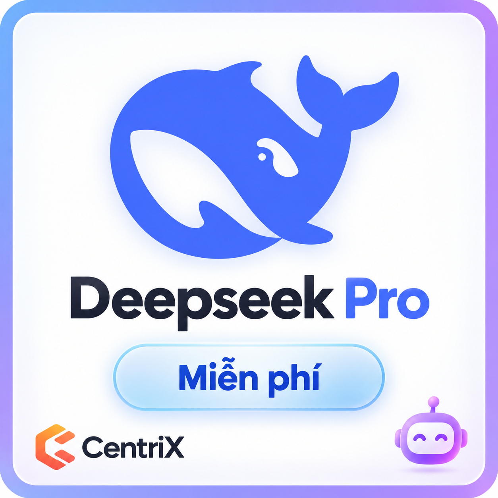

---

### 🔧 Tool · 2026-09-12 13:11:11

Tool output

Model caption: Square app/marketing-style graphic on a clean white/light background, a minimal modern UI card with gradients and soft shadows, no people, centered branding layout. Overall: a clean, rounded-corner square card with a subtle gradient border and soft glow, like a promotional app tile. The composition is centered and balanced: large whale logo at top, title, a pill-shaped badge in the middle, and small branding elements bottom left and a cute robot icon bottom right. Very smooth, modern, flat+soft-shadow illustration style in pastel blues/purples, with crisp vector shapes and gentle gradients and rounded corners. 

Background and frame: outer rounded-square card with a thick soft gradient border/rim (blue-to-purple gradient) and rounded corners; inside is a white panel with gentle off-white/light gradient shading and delicate drop shadows; lots of whitespace, slightly blurred soft ambient light. Card edges have a soft violet/blue glow. 

Top/center: a large solid blue whale logo (the Deepseek whale), identical in shape to the reference: stylized whale/whale icon in vivid periwinkle/royal blue (#4f6fff-ish), with smooth curves, a white interior belly/negative space, a small eye dot and ear/marking shape; the whale faces right/up, with a big curved body, tail fins up-right, and a wave-like inner cutout representing the belly/whale mouth area. The whale is centered near the top, with a faint soft shadow/glow behind it for depth, on the light background. 

Middle: directly beneath the whale is the product name in large, bold, clean sans-serif: “Deepseek Pro”. “Deepseek” in very dark charcoal/near-black, and “Pro” in bright blue matching the whale (or close), in a modern rounded/clean geometric sans font, large and centered. 

Below that: a wide rounded pill/button with soft blue gradient fill (light icy blue to slightly deeper blue), with an inner subtle glow/shine, soft shadow and light border highlights. Inside the pill, centered text reads “Miễn phí” in a strong medium/large blue sans-serif, with Vietnamese diacritics, crisp and centered. The pill has a soft elevated look and gentle inner lighting. 

Bottom-left: the “CentriX” brand mark: an orange-to-red/orange geometric icon resembling a stylized “C” / angular hex-like or ribbon-like shape, followed by the text “CentriX” in dark charcoal/black/gray, clean sans-serif, with capital C and capital X at the end (“CentriX”). Positioned near the lower-left corner, aligned inside the card. 

Bottom-right: a cute small robot/chatbot mascot icon, rounded robot head/face with a glossy purple-to-pink gradient body, white face panel with simple smiling eyes (curved arcs), small antenna dot on top, and soft shadow under it; the robot is cute, friendly, in pink-purple-violet gradients, sitting near the lower-right corner. 

No other text. Bright, minimal, polished UI/marketing aesthetic with soft shadows, gradients, and clean spacing, high-resolution vector-like illustration.<|has_watermark|><|has_borders|>

---

### 🔧 Tool · 2026-09-12 13:11:12

Tool output

Generated images from the last `image_gen.text2im` call were saved at:
- /mnt/data/ghostwriter_images/generated/square_app_marketing_style_graphic_on_a_clean_whit_2.png (wxh = 1254 x 1254, exact aspect ratio 1:1, close to aspect ratio 1:1)

You can visually inspect the generated image directly in the tool result above. Only reopen the saved path if you need programmatic processing or want to pass the image into another tool call.

---

*54 messages · 89 nodes*
