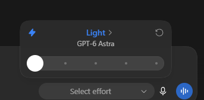
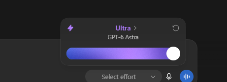

# Giải thích effort ChatGPT

> **Model:** `gpt-5-6-thinking` · **Created:** 2026-09-11 17:34:21 · **Updated:** 2026-09-11 17:35:01
> **ID:** `6aa3d92b-9364-83ec-84d6-187f1dc22e59`

---

> ### 👤 User · 2026-09-11 17:34:36
>
>
> 
>
>
> 
>
> list effort của chatgpt là gì vậy bạn

> 

> 

---

### 🤖 ChatGPT `gpt-5-6-thinking` · 2026-09-11 17:34:51

Đúng rồi anh. Với **GPT-6 Astra** như giao diện anh gửi, danh sách **Reasoning Effort** từ nhẹ → mạnh là:

1. **Light**
2. **Medium**
3. **High**
4. **Extra High**
5. **Ultra**

Nếu anh đang cần **map sang API cho CetriX**, GPT-6 Astra hiện hỗ trợ 5 giá trị `reasoning.effort`: `low`, `medium`, `high`, `xhigh`, `max`. ([OpenAI Developers](https://developers.openai.com/api/docs/models/gpt-6-astra?utm_source=chatgpt.com)) 

Có thể bố trí UI như sau:

| Hiển thị trên UI | Giá trị API |
|---|---|
| ⚡ **Light** | `low` |
| **Medium** | `medium` |
| **High** | `high` |
| **Extra High** | `xhigh` |
| ✦ **Ultra** | `max` |

**Ultra** là mức cao nhất trên slider kiểu giao diện anh đang làm; còn phía API thì giá trị cao nhất được OpenAI gọi là **`max`**.

Nếu anh muốn làm giống ảnh ChatGPT thì em đề xuất giữ đúng **Light → Medium → High → Extra High → Ultra**, nhìn dễ hiểu hơn `Low/XHigh/Max`.

---

*2 messages · 10 nodes*
