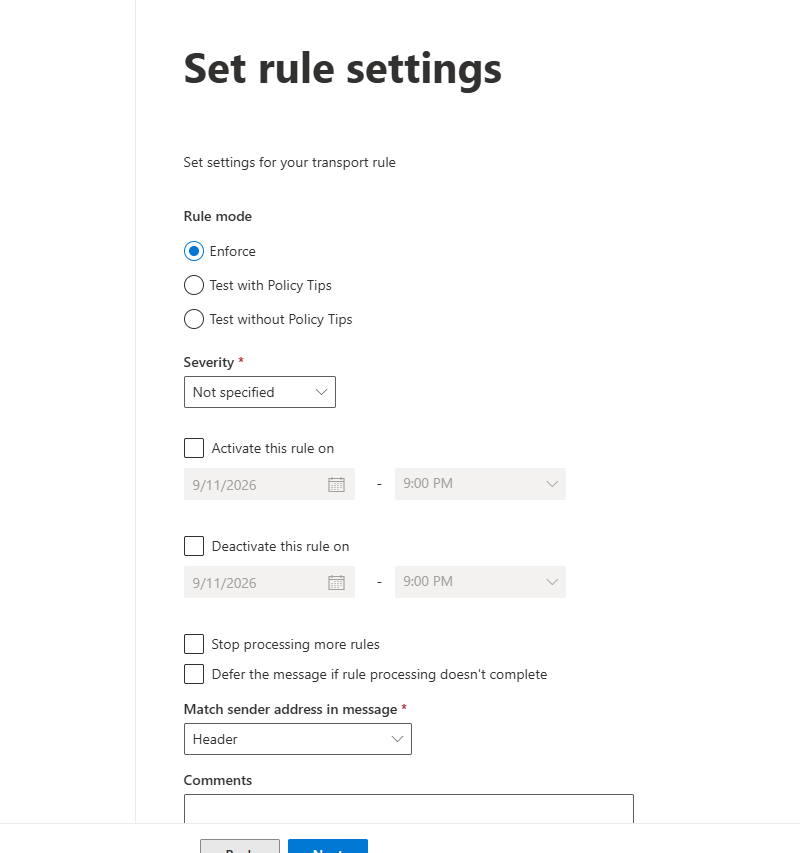

# Đặt email phòng IT

> **Model:** `gpt-5-6-thinking` · **Created:** 2026-09-11 19:28:09 · **Updated:** 2026-09-18 20:20:34
> **ID:** `6aa3f3d6-982c-83ec-8edb-0cd61ac97646`

<style>
blockquote {
  background-color: rgba(59, 130, 246, 0.08) !important;
  border-left: 4px solid #3b82f6 !important;
  padding: 12px 18px !important;
  border-radius: 8px !important;
  margin: 16px 0 !important;
  color: inherit !important;
}
blockquote h3 {
  margin-top: 0 !important;
  color: #60a5fa !important;
}
</style>

---

> ### 👤 User · 2026-09-11 19:28:32
>
> Viết cho mình user và tên 12 email để đăng ký sử dụng chatgpt cho phòng IT phù hợp với chức năng

---

### 🤖 ChatGPT `gpt-5-6-thinking` · 2026-09-11 19:28:39

Được anh. Nếu dùng để đăng ký **12 tài khoản ChatGPT cho phòng IT**, em đề xuất đặt theo **chức năng** thay vì tên cá nhân để sau này dễ bàn giao và quản lý:

| STT | User email | Tên hiển thị |
|---:|---|---|
| 1 | `it.manager@domain.com` | IT Manager |
| 2 | `it.support@domain.com` | IT Support |
| 3 | `it.system@domain.com` | System Administrator |
| 4 | `it.network@domain.com` | Network Administrator |
| 5 | `it.security@domain.com` | IT Security |
| 6 | `it.cloud@domain.com` | Cloud Infrastructure |
| 7 | `it.devops@domain.com` | DevOps Engineer |
| 8 | `it.developer@domain.com` | Software Development |
| 9 | `it.testing@domain.com` | QA & Testing |
| 10 | `it.database@domain.com` | Database Administrator |
| 11 | `it.data@domain.com` | Data & Analytics |
| 12 | `it.automation@domain.com` | IT Automation |

Nếu dùng domain CentriX thì có thể thành dạng **`it.manager@centrix.digital`**, **`it.security@centrix.digital`**, **`it.devops@centrix.digital`**... Cách đặt này nhìn chuyên nghiệp và mỗi tài khoản ChatGPT cũng có **vai trò rõ ràng**, dễ theo dõi chi phí và người sử dụng.

---

> ### 👤 User · 2026-09-11 21:11:23
>
> xóa chữ IT đi

---

### 🤖 ChatGPT `gpt-5-6-thinking` · 2026-09-11 21:11:27

Được anh, bỏ chữ **IT** thì danh sách sẽ gọn hơn như này:

| STT | User email | Tên hiển thị |
|---:|---|---|
| 1 | `manager@domain.com` | Manager |
| 2 | `support@domain.com` | Support |
| 3 | `system@domain.com` | System Administrator |
| 4 | `network@domain.com` | Network Administrator |
| 5 | `security@domain.com` | Security |
| 6 | `cloud@domain.com` | Cloud Infrastructure |
| 7 | `devops@domain.com` | DevOps Engineer |
| 8 | `developer@domain.com` | Software Development |
| 9 | `testing@domain.com` | QA & Testing |
| 10 | `database@domain.com` | Database Administrator |
| 11 | `data@domain.com` | Data & Analytics |
| 12 | `automation@domain.com` | Automation |

Nếu anh muốn, em có thể đổi tiếp sang kiểu **ngắn và đồng bộ hơn để làm username**, ví dụ `manager01`, `support01`, `devops01`...

---

> ### 👤 User · 2026-09-11 21:14:49
>
> Thêm cho mình.tranh@cix.vn

---

### 🤖 ChatGPT `gpt-5-6-thinking` · 2026-09-11 21:14:55

Được anh, em thêm đuôi **`.tranh@cix.vn`** như sau:

| STT | Email | Tên hiển thị |
|---:|---|---|
| 1 | `manager.tranh@cix.vn` | Manager |
| 2 | `support.tranh@cix.vn` | Support |
| 3 | `system.tranh@cix.vn` | System Administrator |
| 4 | `network.tranh@cix.vn` | Network Administrator |
| 5 | `security.tranh@cix.vn` | Security |
| 6 | `cloud.tranh@cix.vn` | Cloud Infrastructure |
| 7 | `devops.tranh@cix.vn` | DevOps Engineer |
| 8 | `developer.tranh@cix.vn` | Software Development |
| 9 | `testing.tranh@cix.vn` | QA & Testing |
| 10 | `database.tranh@cix.vn` | Database Administrator |
| 11 | `data.tranh@cix.vn` | Data & Analytics |
| 12 | `automation.tranh@cix.vn` | Automation |

---

> ### 👤 User · 2026-09-11 21:16:59
>
> support.tranh@signs.onmicrosoft.com

---

### 🤖 ChatGPT `gpt-5-6-thinking` · 2026-09-11 21:17:05

Được anh, em đổi toàn bộ sang domain **`signs.onmicrosoft.com`**:

| STT | Email | Tên hiển thị |
|---:|---|---|
| 1 | `manager.tranh@signs.onmicrosoft.com` | Manager |
| 2 | `support.tranh@signs.onmicrosoft.com` | Support |
| 3 | `system.tranh@signs.onmicrosoft.com` | System Administrator |
| 4 | `network.tranh@signs.onmicrosoft.com` | Network Administrator |
| 5 | `security.tranh@signs.onmicrosoft.com` | Security |
| 6 | `cloud.tranh@signs.onmicrosoft.com` | Cloud Infrastructure |
| 7 | `devops.tranh@signs.onmicrosoft.com` | DevOps Engineer |
| 8 | `developer.tranh@signs.onmicrosoft.com` | Software Development |
| 9 | `testing.tranh@signs.onmicrosoft.com` | QA & Testing |
| 10 | `database.tranh@signs.onmicrosoft.com` | Database Administrator |
| 11 | `data.tranh@signs.onmicrosoft.com` | Data & Analytics |
| 12 | `automation.tranh@signs.onmicrosoft.com` | Automation |

---

> ### 👤 User · 2026-09-11 21:17:09
>
> xuất excel cho mình

---

### 🤖 ChatGPT `gpt-5-6-thinking` · 2026-09-11 21:17:15

Anh muốn file Excel từ danh sách 12 email hiện tại. Em sẽ giữ 3 cột **STT – Email – Tên hiển thị**, định dạng gọn để anh dùng luôn.

---

### 🤖 ChatGPT `gpt-5-6-thinking` · 2026-09-11 21:17:41

Xong anh. Em đã xuất file Excel gồm **12 email + tên hiển thị**, có định dạng sẵn để anh dùng.

[Download file Excel](sandbox:/mnt/data/danh_sach_12_email_chatgpt_phong_IT.xlsx)

---

> ### 👤 User · 2026-09-11 21:22:10
>
>
>
> | [manager.tranh@signs.onmicrosoft.com](mailto\:manager.tranh@signs.onmicrosoft.com) |
> | ------------------------------------------------------------------------------------------------------------------------------------------------------------------------------------------------------- |
> | [support.tranh@signs.onmicrosoft.com](mailto\:support.tranh@signs.onmicrosoft.com) |
> | [system.tranh@signs.onmicrosoft.com](mailto\:system.tranh@signs.onmicrosoft.com) |
> | [network.tranh@signs.onmicrosoft.com](mailto\:network.tranh@signs.onmicrosoft.com) |
> | [security.tranh@signs.onmicrosoft.com](mailto\:security.tranh@signs.onmicrosoft.com) |
> | [cloud.tranh@signs.onmicrosoft.com](mailto\:cloud.tranh@signs.onmicrosoft.com) |
> | [devops.tranh@signs.onmicrosoft.com](mailto\:devops.tranh@signs.onmicrosoft.com) |
> | [developer.tranh@signs.onmicrosoft.com](mailto\:developer.tranh@signs.onmicrosoft.com) |
> | [testing.tranh@signs.onmicrosoft.com](mailto\:testing.tranh@signs.onmicrosoft.com) |
> | [database.tranh@signs.onmicrosoft.com](mailto\:database.tranh@signs.onmicrosoft.com) |
> | [data.tranh@signs.onmicrosoft.com](mailto\:data.tranh@signs.onmicrosoft.com) |
> | [automation.tranh@signs.onmicrosoft.com](mailto\:automation.tranh@signs.onmicrosoft.com)<br><br>mình muốn viết rule để toàn bộ email này chuyển tiếp về email của mình thì sao<br>setup như nào ở admin |

---

### 🤖 ChatGPT `gpt-5-6-thinking` · 2026-09-11 21:22:18

Anh làm **1 rule duy nhất** trong Exchange Admin Center là gọn nhất, không cần cấu hình từng mailbox. Em kiểm tra theo giao diện Microsoft 365 hiện tại để chỉ đúng từng bước cho anh.

---

### 🤖 ChatGPT `gpt-5-6-thinking` · 2026-09-11 21:22:30

Được anh. Với 12 email này, cách gọn nhất là tạo **1 Mail Flow Rule trong Exchange Admin Center** để mọi email gửi vào 12 địa chỉ đều được chuyển về một email của anh.

### Cách em khuyên dùng

Nếu anh vẫn muốn **12 mailbox nhận và lưu email bình thường**, đồng thời anh cũng nhận được một bản sao, hãy dùng:

**Add recipients → to the Bcc box**

Không nên dùng **Redirect** trong trường hợp này, vì Redirect sẽ khiến email **không còn được giao vào 12 mailbox gốc**. Microsoft xác nhận hành vi này của `RedirectMessageTo`; còn Bcc sẽ thêm người nhận mà người gửi/người nhận gốc không thấy. ([Microsoft Learn](https://learn.microsoft.com/en-us/exchange/security-and-compliance/mail-flow-rules/mail-flow-rule-actions?utm_source=chatgpt.com)) 

### Setup trong Admin

Vào **Exchange Admin Center → Mail flow → Rules → Add a rule → Create a new rule**. ([Microsoft Learn](https://learn.microsoft.com/en-ca/exchange/security-and-compliance/mail-flow-rules/manage-mail-flow-rules?preserve-view=true&utm_source=chatgpt.com)) 

Anh có thể vào thẳng trang Rules:

 [Exchange Admin Center – Mail Flow Rules](https://admin.exchange.microsoft.com/?utm_source=chatgpt.com#/transportrules) 

Đặt:

**Name:**
`Forward ChatGPT IT Accounts`

**Apply this rule if:**

`The recipient → is this person`

Sau đó chọn cả 12 email:

```text
manager.tranh@signs.onmicrosoft.com
support.tranh@signs.onmicrosoft.com
system.tranh@signs.onmicrosoft.com
network.tranh@signs.onmicrosoft.com
security.tranh@signs.onmicrosoft.com
cloud.tranh@signs.onmicrosoft.com
devops.tranh@signs.onmicrosoft.com
developer.tranh@signs.onmicrosoft.com
testing.tranh@signs.onmicrosoft.com
database.tranh@signs.onmicrosoft.com
data.tranh@signs.onmicrosoft.com
automation.tranh@signs.onmicrosoft.com
```

Điều kiện **The recipient → is this person** có thể áp dụng cho nhiều mailbox cụ thể và kiểm tra người nhận trong To/Cc/Bcc. ([Microsoft Learn](https://learn.microsoft.com/en-us/exchange/security-and-compliance/mail-flow-rules/conditions-and-exceptions?utm_source=chatgpt.com)) 

Sau đó:

**Do the following:**

`Add recipients → to the Bcc box`

→ chọn **email chính của anh**.

Cuối cùng để:

`Rule mode: Enforce`

rồi **Save**.

### Rule sẽ hoạt động như này

Ví dụ OpenAI gửi:

```text
To: support.tranh@signs.onmicrosoft.com
```

thì:

```text
support.tranh@signs.onmicrosoft.com
 ↓
 vẫn nhận mail

 +

email-cua-anh@domain.com
 ↓
 nhận một bản BCC
```

Như vậy đăng ký 12 tài khoản ChatGPT bằng 12 email khác nhau nhưng anh chỉ cần kiểm tra **một hộp thư trung tâm**.

**Nếu email nhận tập trung của anh cũng nằm trong tenant `signs.onmicrosoft.com` thì setup rất đơn giản.** Nếu anh muốn chuyển về một email **bên ngoài Microsoft 365**, ví dụ Gmail hoặc domain khác, em khuyên tạo **Mail Contact** cho email đó trước; Microsoft 365 cũng có các chính sách hạn chế automatic external forwarding nên cần kiểm tra thêm nếu dùng forwarding ra ngoài tenant. ([Microsoft Learn](https://learn.microsoft.com/en-us/defender-office-365/outbound-spam-policies-external-email-forwarding?utm_source=chatgpt.com)) 

Nếu anh gửi cho em **email đích mà anh muốn 12 email này chuyển về**, em có thể viết luôn cho anh **lệnh PowerShell `New-TransportRule` hoàn chỉnh**, chỉ cần copy chạy một lần là xong.

---

> ### 👤 User · 2026-09-11 21:27:08
>
> **Except if thì sao**

---

### 🤖 ChatGPT `gpt-5-6-thinking` · 2026-09-11 21:27:23

Trong trường hợp của anh, **`Except if` có thể để trống**.

Rule nên là:

- **Apply this rule if:** Recipient là 1 trong 12 email `*.tranh@signs.onmicrosoft.com`
- **Do the following:** Add email của anh vào **Bcc**
- **Except if:** **Không cần chọn gì**

`Except if` chỉ dùng khi anh muốn loại trừ một số trường hợp. Ví dụ: “không chuyển tiếp nếu người gửi là email của chính anh”, “không chuyển tiếp email nội bộ”, hoặc “không áp dụng cho một mailbox cụ thể”. Microsoft Exchange cho phép dùng exception để bỏ qua rule khi điều kiện ngoại lệ khớp. ([Microsoft Learn](https://learn.microsoft.com/en-us/exchange/policy-and-compliance/mail-flow-rules/signatures?utm_source=chatgpt.com)) 

Với nhu cầu **toàn bộ mail gửi đến 12 tài khoản đều gom về 1 email**, anh cứ để **Except if trống** là đúng nhất.

Nếu anh chụp màn hình phần rule đang setup hiện tại, em có thể chỉ anh **từng mục cần chọn chính xác**.

---

> ### 👤 User · 2026-09-11 21:27:43
>
>
> 

> 

---

### 🤖 ChatGPT `gpt-5-6-thinking` · 2026-09-11 21:27:51

Đúng màn hình này rồi anh. Với rule mục tiêu là **mọi email gửi đến 12 tài khoản đều BCC về email chính của anh**, em đề xuất để như sau:

| Mục | Thiết lập |
|---|---|
| **Rule mode** | ✅ **Enforce** |
| **Severity** | **Not specified** |
| **Activate this rule on** | ❌ Không chọn |
| **Deactivate this rule on** | ❌ Không chọn |
| **Stop processing more rules** | ❌ Không chọn |
| **Defer the message if rule processing doesn't complete** | ❌ Không chọn |
| **Match sender address in message** | **Header** |
| **Comments** | Có thể để trống |

Trong trường hợp này, **Header** cứ giữ nguyên vì rule của anh đang kiểm tra **recipient**, không phải sender nên mục này gần như không ảnh hưởng.

Phần quan trọng nhất trước màn hình này nên là:

**Apply this rule if**
→ `The recipient is...`
→ chọn 12 email.

**Do the following**
→ `Add recipients`
→ `to the Bcc box`
→ chọn email chính của anh.

**Except if**
→ để trống.

Sau đó anh bấm **Next → Finish/Save** là được.

Nếu anh muốn **12 email gốc vẫn nhận mail + email chính cũng nhận**, thì **BCC là đúng lựa chọn**. Đừng chọn Redirect.

Sau khi Save, Exchange có thể mất vài phút mới áp dụng rule. Anh nên gửi thử 1 email từ Gmail vào `support.tranh@signs.onmicrosoft.com` để kiểm tra cả mailbox support và mailbox chính đều nhận.

---

> ### 👤 User · 2026-09-14 12:22:30
>
> Đặt cho mình thêm 8 email nữa

---

### 🤖 ChatGPT `gpt-5-6-thinking` · 2026-09-14 12:22:34

Được anh. Em bổ sung thêm 8 email theo cùng format:

| STT | Email | Tên hiển thị |
|---:|---|---|
| 13 | `architect.tranh@signs.onmicrosoft.com` | Solution Architect |
| 14 | `infrastructure.tranh@signs.onmicrosoft.com` | Infrastructure |
| 15 | `platform.tranh@signs.onmicrosoft.com` | Platform Engineering |
| 16 | `integration.tranh@signs.onmicrosoft.com` | System Integration |
| 17 | `monitoring.tranh@signs.onmicrosoft.com` | System Monitoring |
| 18 | `backup.tranh@signs.onmicrosoft.com` | Backup & Recovery |
| 19 | `deployment.tranh@signs.onmicrosoft.com` | Deployment |
| 20 | `operations.tranh@signs.onmicrosoft.com` | Technical Operations |

Như vậy anh sẽ có **20 email theo chức năng**, khá đồng bộ và dễ quản lý. Nếu anh muốn, em có thể viết lại **đầy đủ cả 20 email thành một danh sách copy-paste thẳng vào Exchange Admin**.

---

> ### 👤 User · 2026-09-16 10:40:02
>
> đặt cho mình 12 email mới

---

### 🤖 ChatGPT `gpt-5-6-thinking` · 2026-09-16 10:40:12

Được anh, em đặt **12 email mới hoàn toàn**, không trùng với 20 email trước:

| STT | Email | Tên hiển thị |
|---:|---|---|
| 21 | `helpdesk.tranh@signs.onmicrosoft.com` | Helpdesk |
| 22 | `engineering.tranh@signs.onmicrosoft.com` | Engineering |
| 23 | `application.tranh@signs.onmicrosoft.com` | Application Services |
| 24 | `endpoint.tranh@signs.onmicrosoft.com` | Endpoint Management |
| 25 | `identity.tranh@signs.onmicrosoft.com` | Identity Management |
| 26 | `access.tranh@signs.onmicrosoft.com` | Access Management |
| 27 | `compliance.tranh@signs.onmicrosoft.com` | Compliance |
| 28 | `reliability.tranh@signs.onmicrosoft.com` | Site Reliability |
| 29 | `release.tranh@signs.onmicrosoft.com` | Release Management |
| 30 | `api.tranh@signs.onmicrosoft.com` | API Services |
| 31 | `tools.tranh@signs.onmicrosoft.com` | Developer Tools |
| 32 | `service.tranh@signs.onmicrosoft.com` | Service Management |

Các tên này vẫn theo hướng **phòng kỹ thuật/IT**, nhìn tự nhiên khi dùng làm tài khoản ChatGPT và không bị kiểu `user01`, `user02`.

---


*22 messages · 50 nodes*
