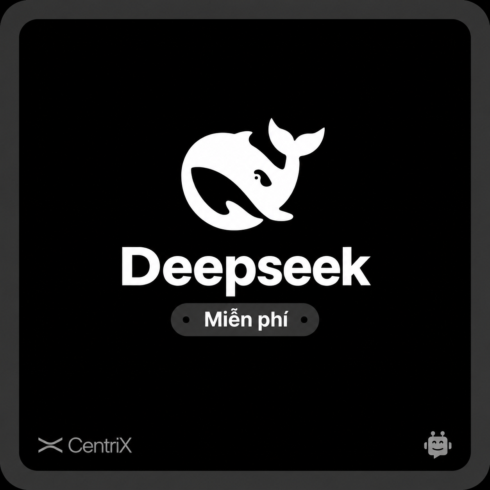

# Thiết kế logo Deepseek

> **Model:** `gpt-5-6-thinking` · **Created:** 2026-09-12 13:12:51 · **Updated:** 2026-09-12 13:13:55
> **ID:** `6aa4ed62-1b2c-83ec-ac1e-736c94330744`

---

### 👤 User · 2026-09-12 13:12:53

.webp)

Vẽ cho mình Logo và thông tin Deepseek vào khung này thay cho mình @Tạo hình ảnh 

.webp)

---

### 🔧 Tool · 2026-09-12 13:12:57

Tool output

---

### 🔧 Tool · 2026-09-12 13:13:45

Tool output

Model caption: A clean, minimal, dark-themed app/brand card graphic. Overall scene: a centered, square, high-contrast black UI-style tile with a thick rounded dark-gray frame/border, like a promotional card or splash screen. The composition is symmetric and minimal, with white graphic and text elements on a black background, matching the original template’s layout and style, with only the central branding changed to Deepseek. No people are present. The style is modern, flat, monochrome, vector-like, with smooth rounded shapes and crisp sans-serif typography, resembling a tech product card or logo tile.

Central area: a large, simple, bold white icon above the title: a stylized whale/sea creature logo in flat vector form, circular/rounded composition. The whale is abstract and modern, formed by smooth curves and negative space: a chunky whale body/curve forming almost a circle, with a small rounded eye/dot-like mark, a curled belly/underbody shape, and a tail fin pointing upward/right; the icon is entirely white and centered near the top-middle, on the black background, giving a clean minimal brand mark.

Below the whale icon, a large, bold, rounded sans-serif wordmark in white reads exactly “Deepseek” (capital “D”, rest lowercase), centered. The font is heavy, clean, geometric/sans-serif, with large size and strong weight, occupying the central mid area.

Under the wordmark is a pill-shaped dark-gray badge/pill button centered, with subtle darker/flat shading, rounded ends, and tiny circular dot accents on the left and right ends (like small black/darker circles). Inside the pill is white text “Miễn phí” (Vietnamese for “Free”), with proper diacritics: “Miễn phí”. The badge has a consistent monochrome UI look, with the text centered and bold/medium weight. The dots on either side are small and circular, providing a badge-like decoration.

Bottom corners: in the lower-left corner, there is a light gray/white CentriX branding: a small stylized “X”-like or bow/twisted ribbon symbol (thin, modern mark) followed by the word “CentriX” in a light gray/white sans-serif (capital “C”, lowercase rest, with a capital “X” at the end). It sits close to the inner edge. In the lower-right corner, a small light-gray chatbot/robot icon (rounded robot face with antenna dots, friendly simple emoji-like outline) appears, matching the template’s small corner icon styling.

The background is solid deep black inside the card, with no textures, and the entire image has a thick, rounded, dark charcoal/near-black border/frame with very rounded corners (like an app card or widget). Everything is centered and balanced, with the whale logo near upper center, “Deepseek” large below it, the “Miễn phí” pill beneath, and the “CentriX” and robot icon as subtle lower-left and lower-right accents. No people, no additional objects, no additional text. High contrast black-and-white/gray palette, minimal, premium UI/branding graphic.<|has_watermark|><|has_borders|>

---

### 🔧 Tool · 2026-09-12 13:13:48

Tool output

Generated images from the last `image_gen.text2im` call were saved at:
- /mnt/data/ghostwriter_images/generated/a_clean_minimal_dark_themed_app_brand_card_graph_2.png (wxh = 1254 x 1254, exact aspect ratio 1:1, close to aspect ratio 1:1)

You can visually inspect the generated image directly in the tool result above. Only reopen the saved path if you need programmatic processing or want to pass the image into another tool call.

---

*4 messages · 9 nodes*
