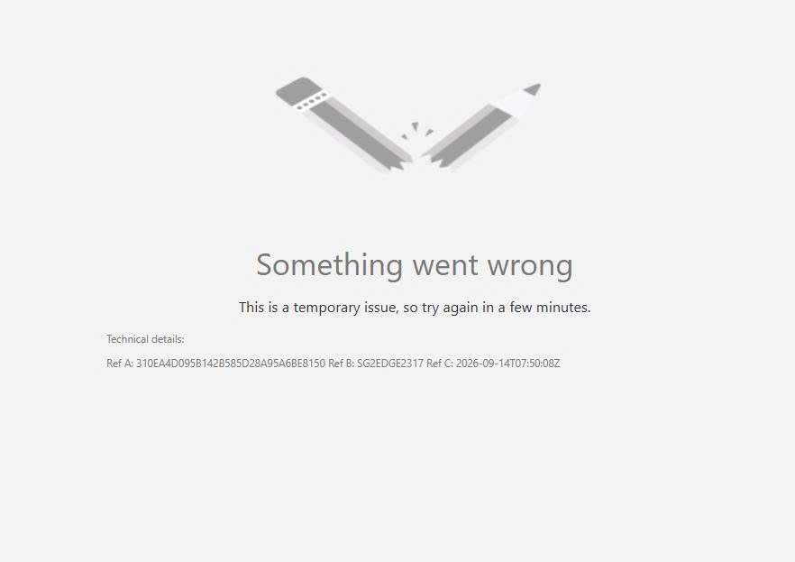

# Giải thích lỗi hệ thống

> **Model:** `gpt-5-6-thinking` · **Created:** 2026-09-14 14:51:14 · **Updated:** 2026-09-14 14:51:35
> **ID:** `6aa7a76f-3b60-83ec-b239-698743a73bfb`

---

### 👤 User · 2026-09-14 14:51:14

đây là lỗi gì

---

### 🤖 ChatGPT `gpt-5-6-thinking` · 2026-09-14 14:51:25

Đây là **lỗi tạm thời từ phía hệ thống/server**, anh nhé. Trong ảnh hệ thống ghi rõ:

> **“Something went wrong – This is a temporary issue, so try again in a few minutes.”**

Nó thường xảy ra khi **dịch vụ đang quá tải, máy chủ/edge gặp sự cố, phiên đăng nhập lỗi hoặc request bị gateway/CDN xử lý lỗi**. Các mã `Ref A`, `Ref B`, `Ref C` là mã truy vết để bên kỹ thuật tra log; **không phải mã lỗi do máy tính của anh**.

Anh thử theo thứ tự: **F5/Ctrl+F5 → đăng xuất đăng nhập lại → mở tab ẩn danh → thử trình duyệt hoặc mạng khác → chờ 5–15 phút rồi thử lại**.

Nếu vẫn lỗi sau 30–60 phút, anh gửi cho Support nguyên phần **Technical details** trong ảnh để họ tra log.

Nếu anh cho em biết **đây là trang nào/dịch vụ nào** (Microsoft 365, Copilot, Outlook, ChatGPT Business…), em có thể xác định cụ thể nguyên nhân và cách xử lý hơn.

---

*2 messages · 4 nodes*
