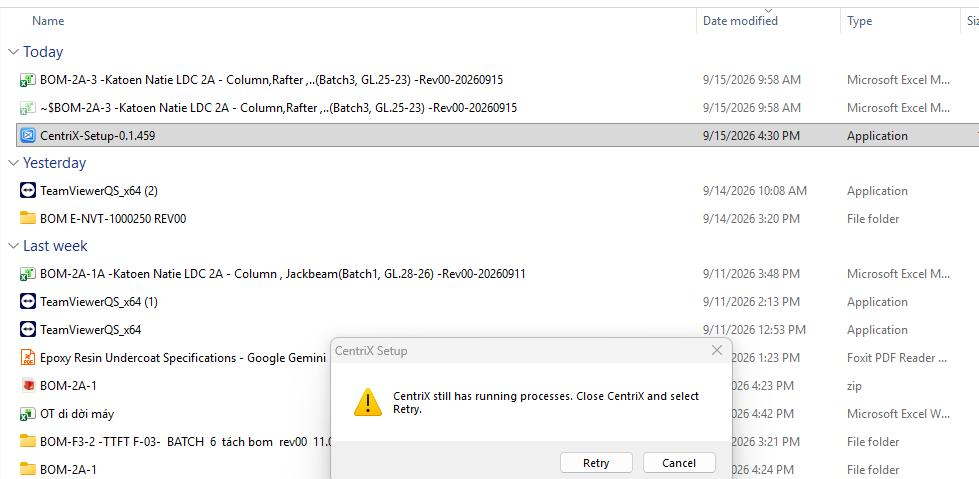

# Viết lại thông tin ngân hàng

> **Model:** `gpt-5-6` · **Created:** 2026-09-15 16:33:47 · **Updated:** 2026-09-15 16:38:50
> **ID:** `6aa910fa-0410-83ec-8298-e4cd73b1234e`

<style>
blockquote {
  background-color: rgba(59, 130, 246, 0.08) !important;
  border-left: 4px solid #3b82f6 !important;
  padding: 12px 18px !important;
  border-radius: 8px !important;
  margin: 16px 0 !important;
  color: inherit !important;
}
blockquote h3 {
  margin-top: 0 !important;
  color: #60a5fa !important;
}
</style>

---

> ### 👤 User · 2026-09-15 16:33:48
>
>
> 
>
> viết lại

> 

---

### 🤖 ChatGPT `gpt-5-6` · 2026-09-15 16:33:51

Thông tin trong ảnh:

**Ngân hàng:** Vietcombank 
**Chủ tài khoản:** TRAN THI AN BINH 
**Số tài khoản:** 0161001716419 
**Chi nhánh:** Trụ sở CN Huế

---

> ### 👤 User · 2026-09-15 16:37:55
>
>
> 
>
> đây là gì vậy bạn

> 

---

### 🤖 ChatGPT `gpt-5-6` · 2026-09-15 16:37:59

Đây là thông báo của **bộ cài CentriX**:

> **“CentriX still has running processes. Close CentriX and select Retry.”** 
> → **CentriX vẫn còn tiến trình đang chạy. Hãy đóng CentriX rồi chọn Retry.**

Có nghĩa là dù anh đã đóng cửa sổ CentriX, **một hoặc nhiều process của CentriX vẫn đang chạy ngầm**, nên `CentriX-Setup-0.1.459` chưa thể tiếp tục cài/cập nhật.

Anh xử lý nhanh như sau:

1. Nhấn **Ctrl + Shift + Esc** mở **Task Manager**.
2. Trong **Processes** hoặc **Details**, tìm các tiến trình như `CentriX`, `CentriX.exe` hoặc tiến trình liên quan.
3. Chuột phải → **End task**.
4. Quay lại cửa sổ **CentriX Setup** → bấm **Retry**.

Nếu **không thấy CentriX trong Task Manager mà nó vẫn báo lỗi**, anh gửi em ảnh tab **Details** của Task Manager, em chỉ anh process nào cần tắt.

---

> ### 👤 User · 2026-09-15 16:38:31
>
> làm sao để tắt hết

---

### 🤖 ChatGPT `gpt-5-6` · 2026-09-15 16:38:33

Anh có thể **tắt sạch toàn bộ tiến trình CentriX** trên Windows bằng cách nhanh nhất này:

Mở **Command Prompt (CMD) bằng quyền Administrator**, rồi chạy:

```bat
taskkill /F /IM "CentriX.exe" /T
```

Nếu không chắc tên process chính xác, dùng PowerShell sẽ tiện hơn. Mở **PowerShell → Run as administrator** rồi chạy:

```powershell
Get-Process | Where-Object {$_.ProcessName -like "*CentriX*"} | Stop-Process -Force
```

Lệnh này sẽ tìm **tất cả process có chữ `CentriX`** và tắt cưỡng chế.

Sau đó quay lại **CentriX Setup → Retry**.

Nếu vẫn báo **“CentriX still has running processes”**, có khả năng app Electron của anh còn **process con mang tên khác**. Anh mở **Task Manager → Details**, chụp màn hình gửi em, em xác định chính xác process cần kill.

---


*6 messages · 7 nodes*
