# Xử lý mật khẩu WiFi sai

> **Model:** `gpt-5-6-thinking` · **Created:** 2026-09-15 18:17:46 · **Updated:** 2026-09-19 10:39:44
> **ID:** `6aa92957-02c4-83ec-a533-92459ca5ee79`

---

> ### 👤 User · 2026-09-15 18:17:58
>
>
> 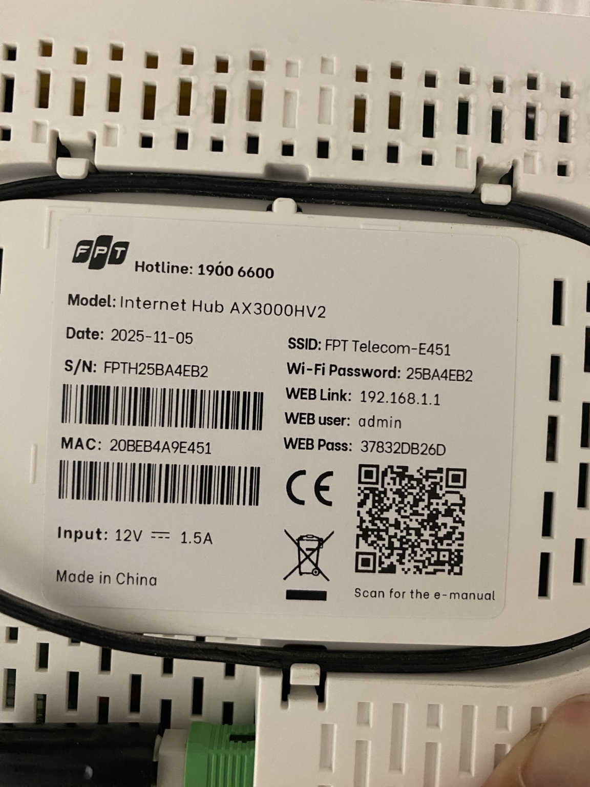
>
> Mật khẩu này mình nhập vào báo sai thì mình cần làm gì

> 

---

### 🤖 ChatGPT `gpt-5-6-thinking` · 2026-09-15 18:18:08

Anh lưu ý trên tem có **2 loại mật khẩu khác nhau**:

- **Mật khẩu Wi-Fi:** `25BA4EB2` → dùng để kết nối mạng **FPT Telecom-E451**.
- **Mật khẩu quản trị modem:** `37832DB26D` → dùng tại `192.168.1.1`, tài khoản là `admin`.

Nếu anh nhập `25BA4EB2` mà Wi-Fi vẫn báo sai, khả năng cao **mật khẩu Wi-Fi đã được đổi sau khi lắp đặt**, nên mật khẩu in dưới modem không còn hiệu lực.

Anh thử theo thứ tự:
1. Trên iPhone vào **Cài đặt → Wi-Fi → bấm (i) → Quên mạng này**, rồi kết nối lại và nhập `25BA4EB2`.
2. Nếu vẫn sai, thử đăng nhập `192.168.1.1` bằng **admin / 37832DB26D** để xem hoặc đổi mật khẩu Wi-Fi.
3. Nếu tài khoản quản trị cũng không vào được, dùng ứng dụng **Hi FPT** để đổi mật khẩu hoặc gọi **FPT 1900 6600**.

**Không nên bấm nút RESET modem lúc này**, vì reset cứng có thể làm mất cấu hình Internet của FPT.

Nếu anh muốn, anh chụp cho em **màn hình đang báo “sai mật khẩu”** hoặc trang `192.168.1.1`, em chỉ anh từng bước để lấy/đổi lại mật khẩu.

---

> ### 👤 User · 2026-09-15 18:18:45
>
> Có thể reset modum không

---

### 🤖 ChatGPT `gpt-5-6-thinking` · 2026-09-15 18:18:53

Có anh, nhưng mình nên phân biệt 2 kiểu:

- **Khởi động lại modem**: rút nguồn khoảng 30 giây rồi cắm lại. Cách này an toàn, **không mất cấu hình**.
- **Factory Reset** bằng nút/lỗ `RESET`: có thể đưa modem về mặc định, nhưng **có nguy cơ mất cấu hình Internet của FPT** như PPPoE/VLAN hoặc cấu hình nhà mạng. Khi đó Wi-Fi có thể có nhưng Internet lại không vào được.

Nếu mục đích của anh chỉ là vì **mật khẩu Wi-Fi hiện tại không đúng**, em khuyên **chưa reset cứng**. Nên thử đổi mật khẩu qua Hi FPT hoặc gọi **1900 6600** trước.

Nếu FPT xác nhận modem này có thể tự nhận lại cấu hình sau reset, lúc đó mới giữ nút `RESET` khoảng **10–15 giây** cho modem khởi động lại.

Nếu anh muốn, em có thể hướng dẫn anh **cách lấy lại/đổi mật khẩu Wi-Fi của con AX3000HV2 này mà không cần reset**.

---

> ### 👤 User · 2026-09-15 18:19:54
>
> Mình cần vào 2. 168.1.1 bằng admin / 37832DB26D để cấu hình cho ip tĩnh

---

### 🤖 ChatGPT `gpt-5-6-thinking` · 2026-09-15 18:20:00

Được anh. Nếu mục đích là vào modem để cấu hình IP tĩnh thì anh làm như sau:

Trước tiên kết nối điện thoại/máy tính vào Wi-Fi của modem, rồi mở trình duyệt vào:

**http://192.168.1.1**

Theo tem modem:
- User: `admin`
- Password: `37832DB26D`

Sau khi đăng nhập, có 2 trường hợp “IP tĩnh” khác nhau:

- Nếu anh muốn **một máy tính/server/NAS trong mạng luôn nhận cùng một IP**, nên tìm mục **LAN → DHCP → Static DHCP / Address Reservation / DHCP Binding**, rồi gán **MAC Address → IP**, ví dụ `192.168.1.100`. Đây là cách em khuyên dùng.
- Nếu anh muốn cấu hình **IP tĩnh Internet/WAN do FPT cấp**, thì cần IP, Gateway, Subnet Mask, DNS/VLAN do FPT cung cấp. Không nên tự chuyển WAN sang Static IP nếu chưa có thông số từ FPT vì có thể mất Internet.

Nếu anh nhập `admin / 37832DB26D` mà báo **sai mật khẩu**, khả năng mật khẩu quản trị đã được FPT hoặc người cài đặt đổi. **Khởi động lại modem không đưa mật khẩu này về mặc định.** Factory Reset có thể đưa thông tin đăng nhập về tem, nhưng cũng có nguy cơ mất cấu hình mạng của FPT.

Nếu anh nói cho em anh đang muốn **IP tĩnh cho máy/server nội bộ** hay **IP WAN tĩnh của FPT**, em hướng dẫn chính xác từng mục cần chỉnh.

---

> ### 👤 User · 2026-09-15 18:20:42
>
>
> 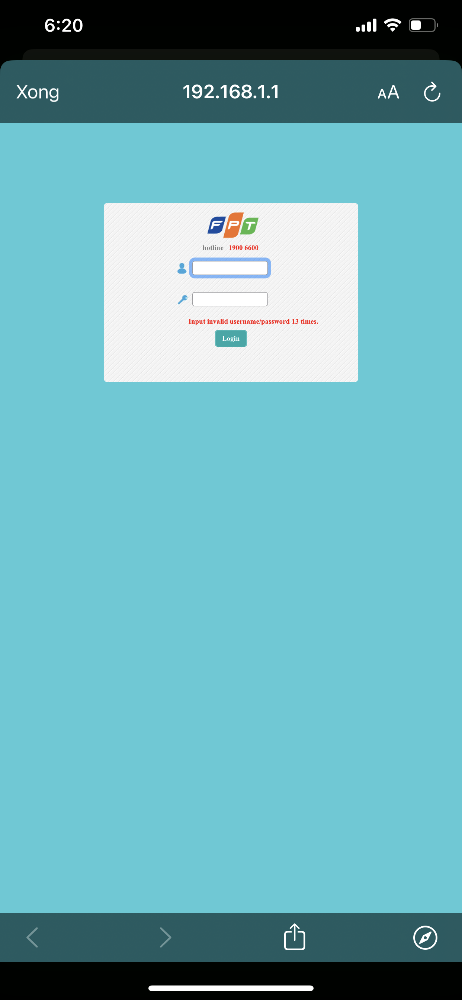
>
> Vẫn báo sai

> 

---

### 🤖 ChatGPT `gpt-5-6-thinking` · 2026-09-15 18:21:10

Đúng rồi anh, ảnh này cho thấy **anh đã vào đúng trang quản trị `192.168.1.1`**, nhưng modem đang từ chối tài khoản/mật khẩu. Dòng đỏ ghi **“Input invalid username/password 13 times”**, tức là đã nhập sai 13 lần.

Với trường hợp này, em khuyên **không thử tiếp nhiều lần và chưa reset modem**. FPT cũng hướng dẫn rằng nếu không đăng nhập được username/password thì nên liên hệ hỗ trợ kỹ thuật và **không tự ý reset modem**. ([FPT Telecom](https://fpt.vn/en/personal/support/information-support/faqs/internet?utm_source=chatgpt.com)) 

Mật khẩu `WEB Pass` in dưới modem về lý thuyết chính là mật khẩu dùng cho `192.168.1.1`; tài liệu FPT cũng hướng dẫn account mặc định xem dưới đáy modem. ([FPT Telecom](https://fpt.vn/storage/upload/files/documents/setting-guides/cig-g97rg6m/huong_dan_cai_dat_wifi_doi_mat_khau_wifi_doi_ten_wifi_modem_g97rg6m_cua_fpt_telecom.pdf?utm_source=chatgpt.com)) Vì mật khẩu trên tem của anh không còn vào được, khả năng cao **mật khẩu quản trị đã được đổi/provision lại sau khi FPT cấu hình thiết bị**.

Cách an toàn nhất bây giờ là gọi **1900 6600**, nói rõ:

> “Em cần đăng nhập giao diện quản trị modem AX3000HV2 tại 192.168.1.1 để cấu hình IP LAN tĩnh/DHCP Reservation. Mật khẩu WEB Pass dưới modem không đăng nhập được. Nhờ kỹ thuật cấp lại hoặc reset mật khẩu quản trị modem giúp em nhưng giữ nguyên cấu hình Internet.”

FPT có thể hỗ trợ từ xa hoặc hướng dẫn reset đúng cách. Hi FPT hiện cũng quản lý được modem và thiết bị kết nối, nhưng các thiết lập nâng cao như DHCP reservation/IP tĩnh có thể vẫn cần giao diện web. ([Hi FPT](https://hi.fpt.vn/support/quan-ly-dich-vu-internet/toi-co-the-quan-ly-modem-hay-wi-fi-voi-hi-fpt-khong?utm_source=chatgpt.com)) 

**Nếu anh buộc phải factory reset:** FPT cho biết sau reset mật khẩu quản trị sẽ trở về mặc định, nhưng cũng cảnh báo có trường hợp cấu hình xác thực Internet bị mất/lỗi và phải nhờ FPT xử lý lại. ([FPT Telecom](https://fpt.vn/tin-tuc/cach-reset-modem-wifi-9597.html?utm_source=chatgpt.com)) Vì vậy em chỉ reset khi anh chấp nhận khả năng **mất Internet tạm thời**.

Nếu mục đích của anh là **gán IP cố định cho server/máy tính, ví dụ `192.168.1.100`**, nói em biết thiết bị gì; em có thể chỉ anh **cách đặt IP tĩnh ngay trên thiết bị mà chưa cần đăng nhập modem**.

---

> ### 👤 User · 2026-09-15 19:07:52
>
>
> 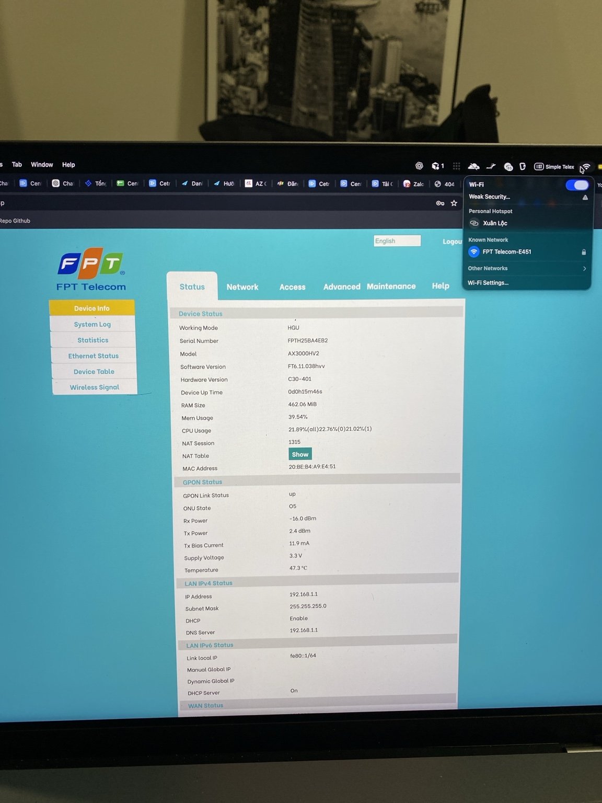
>
> Mình vừa reset lại wifi và hiện tại mình đang không dùng được

> 

---

### 🤖 ChatGPT `gpt-5-6-thinking` · 2026-09-15 19:08:21

Đúng rồi anh — nhìn ảnh này thì **reset modem đã thành công**, nhưng rất có khả năng **cấu hình Internet/WAN đã bị xóa**, nên anh vẫn kết nối được Wi-Fi nhưng **không ra Internet**.

Điểm quan trọng trong ảnh của anh:

- **GPON Link Status: `up`**
- **ONU State: `O5`**
- **Rx Power: `-16.0 dBm`**
- LAN IP: `192.168.1.1`
- DHCP: `Enable`

=> **Đường cáp quang và tín hiệu FPT đang bình thường.** Không giống lỗi đứt cáp/LOS. Vấn đề nhiều khả năng nằm ở **cấu hình WAN sau khi Factory Reset**.

FPT cũng lưu ý Factory Reset có thể xóa thông số kết nối Internet/PPPoE và khi đó cần khai báo lại hoặc nhờ FPT đổ cấu hình từ xa. ([FPT Telecom](https://fpt.vn/tin-tuc/cach-reset-modem-wifi-9597.html?utm_source=chatgpt.com)) 

### Anh làm như này trước

Trong giao diện đang mở, chọn:

**Network → WAN**

Sau đó chụp màn hình trang đó gửi em.

Em cần xem hiện tại có dòng kết nối kiểu:

`INTERNET / Route / PPPoE`

hay không, và nó đang **Connected / Disconnected** hoặc có WAN IP chưa.

**Đừng tự tạo hoặc sửa WAN lúc này**, vì nếu nhập sai VLAN, PPPoE hoặc Service Type thì càng khó khôi phục.

### Cách nhanh nhất nếu WAN đã mất hoàn toàn

Anh gọi **FPT 1900 6600** hoặc vào Hi FPT yêu cầu kỹ thuật và nói:

> “Em vừa Factory Reset modem AX3000HV2. GPON đang Up, ONU State O5 nhưng không có Internet. Nhờ kỹ thuật đổ lại cấu hình WAN/Internet cho modem từ xa giúp em.”

FPT chính thức cũng hướng dẫn trường hợp **sau reset vẫn không vào Internet** thì có thể cần kỹ thuật hỗ trợ cấu hình lại từ xa. ([FPT Telecom](https://fpt.vn/tin-tuc/cach-reset-modem-wifi-9597.html?utm_source=chatgpt.com)) 

Anh **không cần reset thêm lần nữa**.

Sau khi Internet hoạt động trở lại, em sẽ hướng dẫn anh tiếp phần **gán IP tĩnh cho máy/server** mà anh cần lúc đầu.

**Anh bấm `Network → WAN` rồi chụp ảnh gửi em**, em xem chính xác đang thiếu mục nào.

---

> ### 👤 User · 2026-09-15 19:10:04
>
>
> 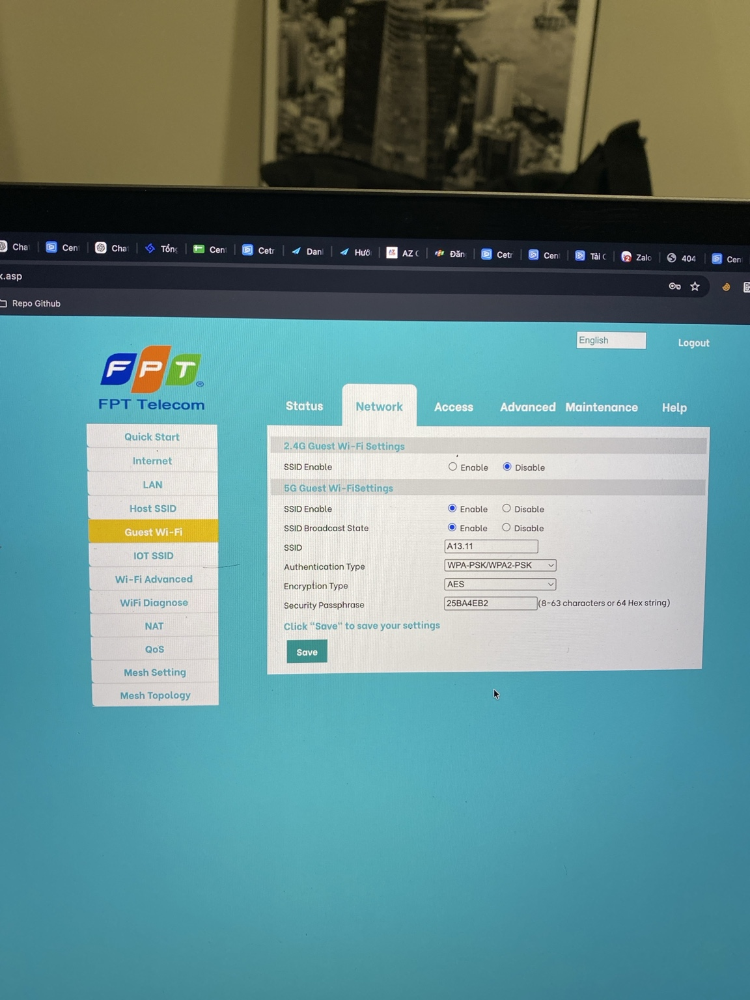
>
>
> 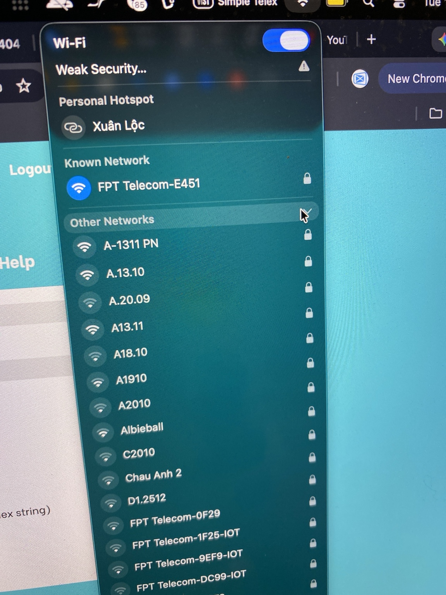
>
> A13.11 mình vào không có mạng

> 

> 

---

### 🤖 ChatGPT `gpt-5-6-thinking` · 2026-09-15 19:10:19

Em thấy vấn đề rồi anh. **`A13.11` hiện đang được tạo trong mục `Guest Wi-Fi`**, tức là mạng khách 5 GHz, không phải Wi-Fi chính của modem.

Anh kiểm tra nhanh theo 2 trường hợp:

1. **Kết nối thử `FPT Telecom-E451`**
 - Nếu `FPT Telecom-E451` **cũng không có Internet** → sau khi reset, phần **WAN/Internet của FPT chưa được khôi phục**.
 - Lúc này anh vào **Network → Internet** rồi chụp màn hình gửi em. Em xem giúp anh WAN đang thiếu gì.
 - **Chưa chỉnh VLAN, PPPoE hay xóa profile nào.**

2. Nếu `FPT Telecom-E451` **có Internet**, nhưng riêng `A13.11` không có → lỗi nằm ở cấu hình **Guest Wi-Fi**.
 - Nếu anh muốn `A13.11` là Wi-Fi sử dụng bình thường, em khuyên vào **Network → Host SSID** rồi đặt SSID thành `A13.11` ở đó, thay vì Guest Wi-Fi.
 - Guest Wi-Fi thường được tách riêng và có các chính sách hạn chế/isolated.

### Việc cần làm ngay
Anh bấm:

**Network → Internet**

rồi gửi em **ảnh toàn bộ trang Internet**. Từ ảnh đó em có thể nói chính xác cần chỉnh chỗ nào để Internet hoạt động lại.

Với ảnh trước của anh, **GPON = Up và ONU = O5**, nên đường quang FPT vẫn tốt; em nghi nhiều nhất là **WAN configuration bị mất sau khi factory reset**, không phải lỗi cáp quang.

---

> ### 👤 User · 2026-09-15 19:10:36
>
>
> 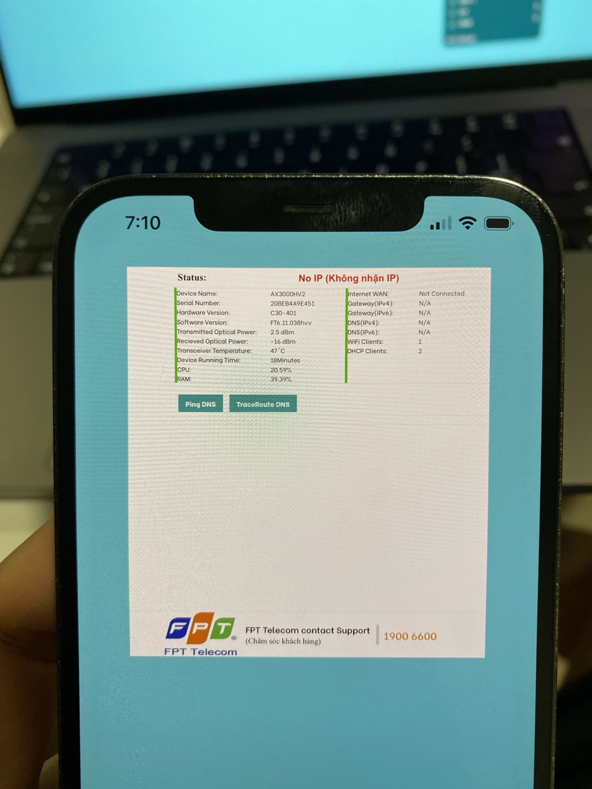

> 

---

### 🤖 ChatGPT `gpt-5-6-thinking` · 2026-09-15 19:10:49

Ảnh này xác nhận khá rõ rồi anh: **modem đang không có kết nối WAN sau khi Factory Reset**.

Các dòng quan trọng là:

- **Status: `No IP (Không nhận IP)`**
- **Internet WAN: `Not Connected`**
- Gateway IPv4: `N/A`
- DNS IPv4: `N/A`
- Received Optical Power: **-16 dBm** → tín hiệu quang vẫn ổn.

Vì vậy **không phải lỗi Wi-Fi A13.11**. Anh có đổi sang `FPT Telecom-E451` hay SSID khác thì hiện tại cũng sẽ không có Internet, vì modem chưa thiết lập được kết nối với mạng FPT.

### Cách xử lý nhanh nhất

Anh liên hệ FPT **1900 6600** hoặc tạo yêu cầu trên Hi FPT và nói đúng câu này:

> **“Em vừa factory reset modem AX3000HV2. Hiện GPON/ONU vẫn lên nhưng Internet WAN báo Not Connected, No IP. Nhờ kỹ thuật đổ lại cấu hình WAN/Internet từ xa cho modem giúp em.”**

Thông thường họ có thể provision/đẩy cấu hình lại từ hệ thống mà không cần kỹ thuật đến nhà.

### Nếu anh muốn tự cấu hình

Anh đang đăng nhập được modem rồi nên có thể vào:

**Network → Internet**

Chụp **toàn bộ trang Internet** gửi em. Em sẽ xem modem đang còn profile WAN nào không và chỉ anh từng ô.

Quan trọng: **chưa tự nhập PPPoE, VLAN ID, Bridge/Route hoặc xóa WAN profile**, vì các thông số này phụ thuộc cấu hình đường truyền FPT của anh; nhập sai sẽ vẫn không nhận IP.

Sau khi WAN hiện **Connected** và có Gateway/DNS, lúc đó `A13.11` cũng có Internet bình thường.

---

> ### 👤 User · 2026-09-15 19:11:17
>
> Mình tự cấu hình được không

---

### 🤖 ChatGPT `gpt-5-6-thinking` · 2026-09-15 19:11:47

Được anh, **anh có thể tự cấu hình lại Internet**. Với tình trạng hiện tại GPON vẫn lên nhưng WAN `Not Connected`, anh cần tạo lại kết nối WAN.

Theo hướng dẫn chính thức của FPT cho dòng Internet Hub AX3000 có giao diện tương tự, vào **Network → Internet** và cấu hình PPPoE. FPT hướng dẫn dùng thông tin PPPoE của hợp đồng; tài liệu của họ ghi mật khẩu PPPoE là **7 ký tự cuối của hợp đồng**. ([FPT Telecom](https://fpt.vn/storage/upload/files/documents/huong-dan-cai-dat-va-cau-hinh-ax3000hi.pdf)) 

Anh điền theo hướng này:

| Mục | Thiết lập |
|---|---|
| IP Version | `IPv4/IPv6` |
| Connection Type | **PPPoE** |
| 802.1q | **Untag** |
| NAT Status | **Enable** |
| PPPoE Username | **Tên đăng nhập đường truyền FPT của anh** |
| PPPoE Password | **Mật khẩu PPPoE** |
| PPPoE Connection Mode | **Always On** |
| MTU | Để mặc định |
| IPTV | Để mặc định/Disable nếu không dùng |

Sau đó **Save** và đợi khoảng 30–60 giây. Cấu hình PPPoE + `Untag` + NAT Enable cũng đúng với tài liệu cấu hình AX3000 của FPT. ([FPT Telecom](https://fpt.vn/storage/upload/files/documents/huong-dan-cai-dat-va-cau-hinh-ax3000hi.pdf?utm_source=chatgpt.com)) 

Điểm khó duy nhất là **PPPoE Username**. Nó **không phải** `admin`, không phải tên Wi-Fi và cũng không phải password dưới modem. Đó là tài khoản Internet gắn với hợp đồng FPT.

Nếu anh còn **mã hợp đồng/tài khoản đường truyền**, mình có thể thử khôi phục theo hướng dẫn FPT. Tuy nhiên em không khuyên đoán username/password nhiều lần.

**Anh bấm `Network → Internet` rồi chụp cho em đúng màn hình đó.** Em sẽ nhìn giao diện AX3000HV2 của anh và chỉ chính xác **từng ô phải chọn gì**, để mình tự cấu hình mà không cần gọi kỹ thuật trước.

---

> ### 👤 User · 2026-09-15 19:15:06
>
>
> 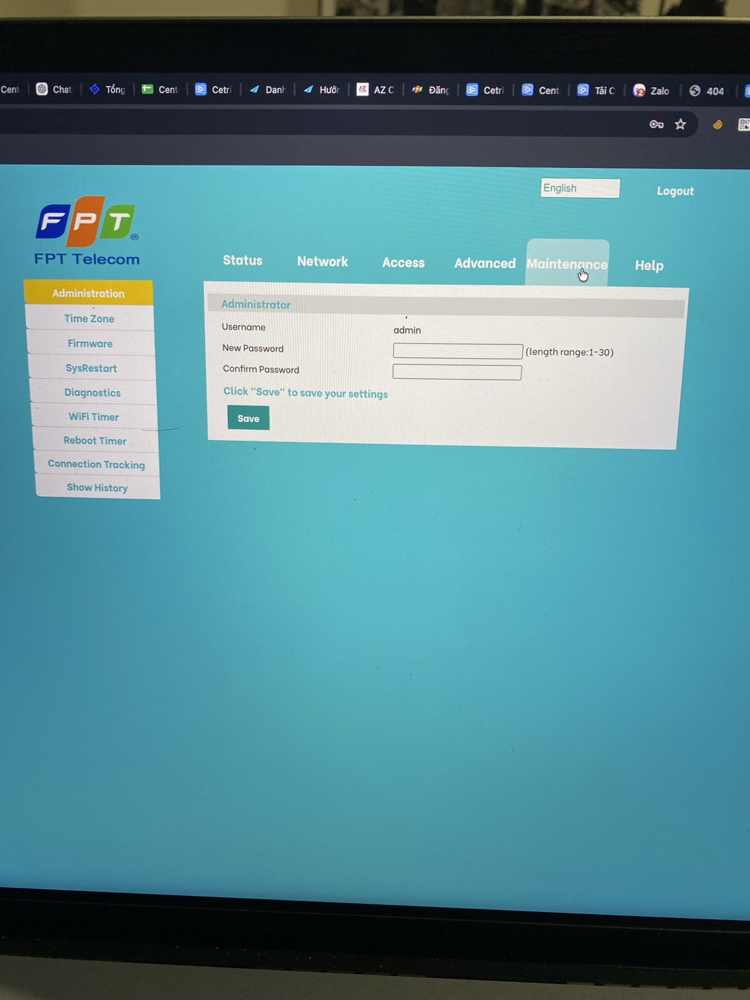
>
>
> 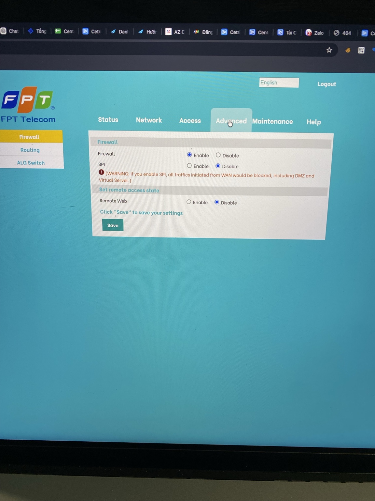
>
>
> 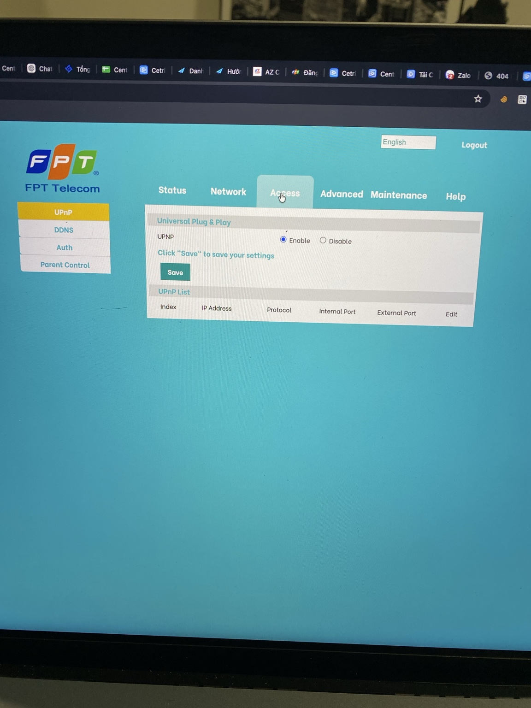
>
>
> 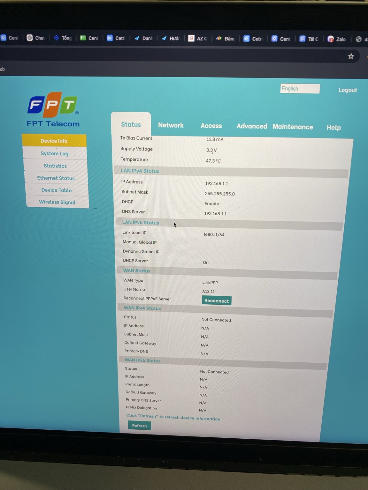
>
>
> .png)
>
>
> 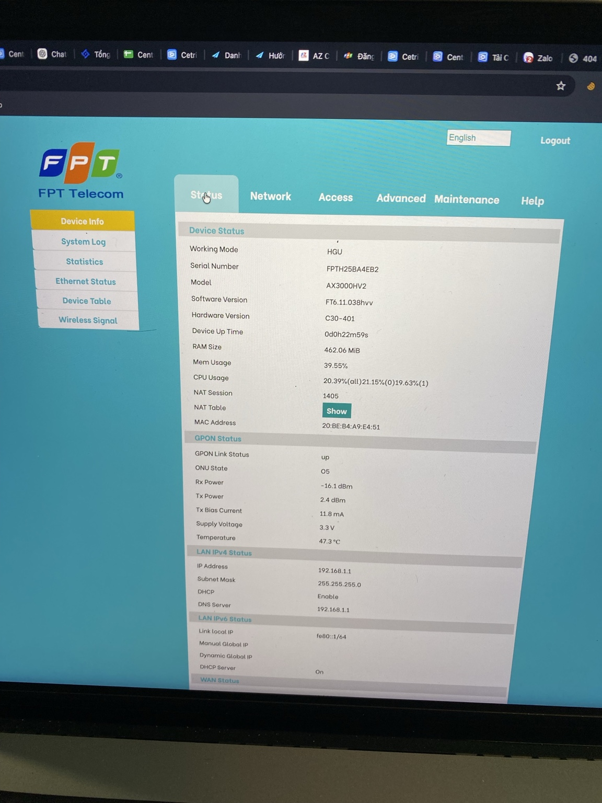
>
> Hướng dẫn lại cho mình

> 

> 

> 

> 

> .png)

> 

---

### 🤖 ChatGPT `gpt-5-6-thinking` · 2026-09-15 19:15:46

Được anh. Nhìn toàn bộ ảnh anh gửi thì em thấy **nguyên nhân chính rồi**:

Trong **Status → WAN Status**, modem đang hiện:

- WAN Type: `LinkPPP`
- **User Name: `A13.11`**
- Status: `Not Connected`
- IP Address/Gateway/DNS: `N/A`

Trong khi `A13.11` chính là **tên Wi-Fi Guest anh vừa đặt**. Đây không phải tài khoản PPPoE. Tức là anh đã nhập **SSID Wi-Fi vào ô PPPoE Username**, nên modem không thể kết nối Internet.

### Anh làm lại đúng như sau

Vào:

**Network → Internet**

Không cần chỉnh `Maintenance`, `Access` hay `Advanced`.

Ở màn hình **Internet**, đặt:

| Mục | Chọn |
|---|---|
| IP Version | `IPv4/IPv6` |
| Connection Type | **PPPoE** |
| 802.1q | **Untag** |
| NAT Status | **Enable / tick ✓** |
| PPPoE Username | **Tên đăng nhập Internet trên hợp đồng FPT** |
| PPPoE Password | **7 ký tự cuối của số hợp đồng** |
| PPPoE Connection Mode | **Always On** |
| MTU | **để mặc định** |
| Sau cùng | **Save** |

Đây cũng là cấu hình WAN mà tài liệu chính thức của FPT hướng dẫn cho dòng Internet Hub AX3000HI: `Network → Internet`, dùng PPPoE; username là tên đăng nhập của hợp đồng và password là 7 ký tự cuối hợp đồng. ([FPT Telecom](https://fpt.vn/storage/upload/files/documents/huong-dan-cai-dat-va-cau-hinh-ax3000hi.pdf)) 

**Quan trọng:** `A13.11` chỉ là tên Wi-Fi, **không được nhập vào PPPoE Username**.

### Anh cần tìm PPPoE Username ở đâu?

Anh cần tìm trong hợp đồng FPT dòng kiểu:

**Tên đăng nhập / Username / Account Internet**

Nó không phải:

- `admin`
- `A13.11`
- `FPT Telecom-E451`
- Serial modem `FPTH25BA4EB2`
- WEB Password dưới modem

FPT xác nhận sau khi Factory Reset, thông số PPPoE có thể bị xóa và phải khai báo lại username/password hoặc nhờ kỹ thuật đổ cấu hình. ([FPT Telecom](https://fpt.vn/tin-tuc/cach-reset-modem-wifi-9597.html?utm_source=chatgpt.com)) 

Nếu anh không biết **PPPoE Username**, đừng đoán. Anh gọi `1900 6600` và nói:

> “Em vừa factory reset modem AX3000HV2. Nhờ cung cấp lại tên đăng nhập PPPoE của hợp đồng hoặc đổ lại cấu hình WAN giúp em.”

### Sau khi Save

Chờ khoảng **30–60 giây**, rồi vào:

**Status → Device Info**

Phần WAN phải chuyển từ:

`Not Connected / N/A`

thành đại loại:

`Connected` 
`IP Address: xxx.xxx.xxx.xxx` 
`Default Gateway:...` 
`Primary DNS:...`

Khi đó Internet sẽ hoạt động trở lại.

**Anh chụp cho em màn hình `Network → Internet`**, em sẽ chỉ trực tiếp **từng ô trong đúng giao diện modem AX3000HV2 của anh nên điền gì**, để tránh nhập nhầm lần nữa.

---

> ### 👤 User · 2026-09-15 19:16:16
>
>
> 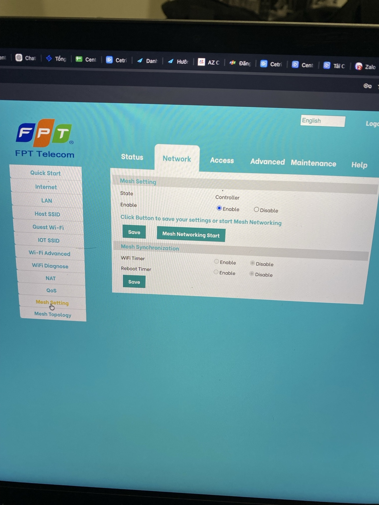
>
>
> 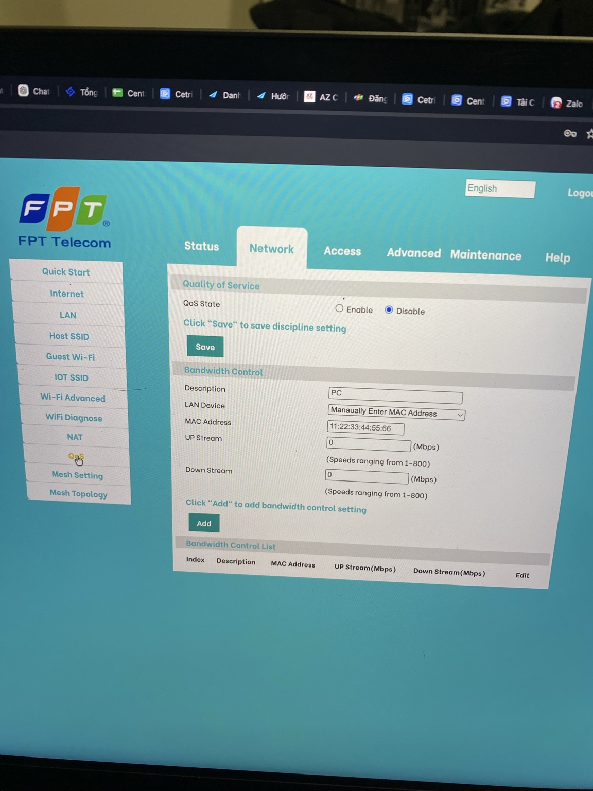
>
>
> 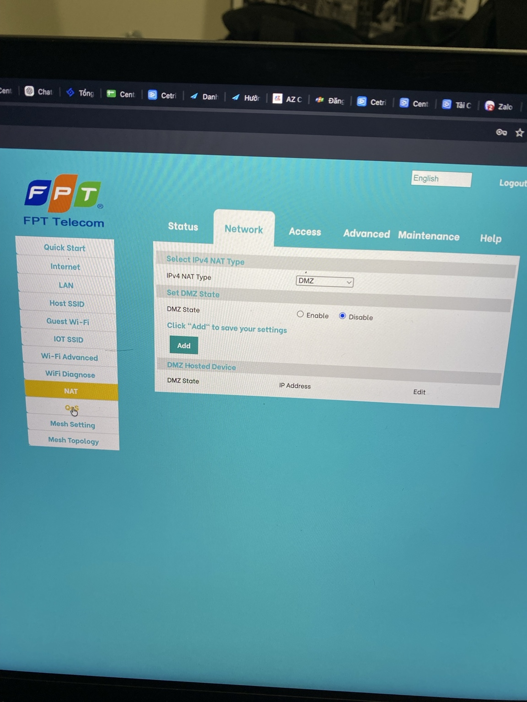
>
>
> 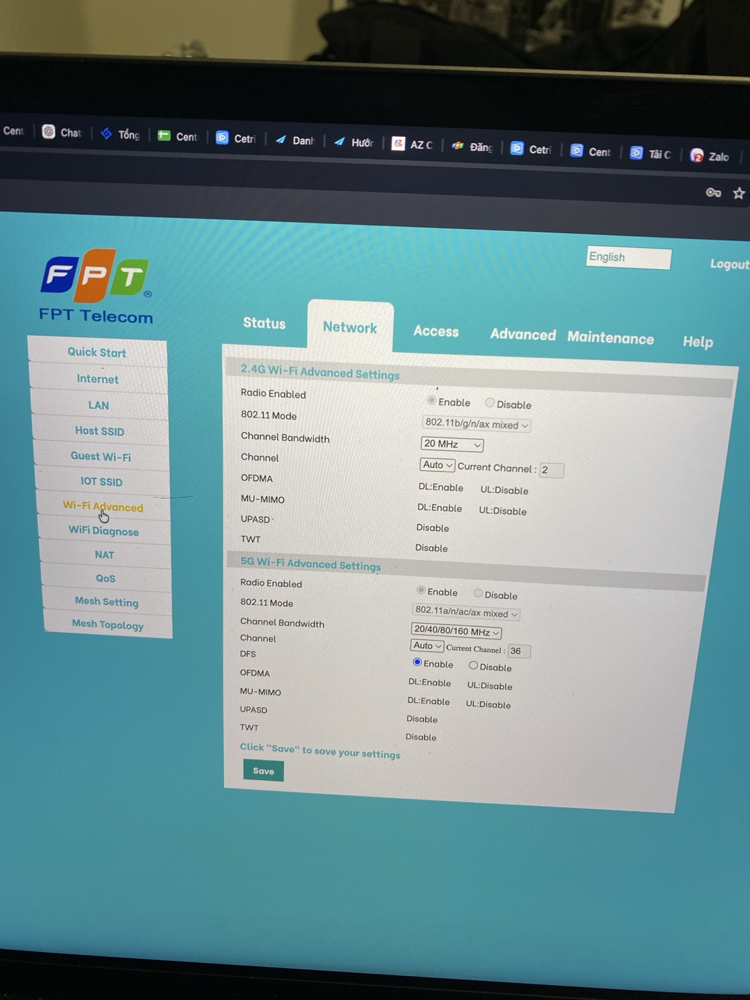
>
>
> 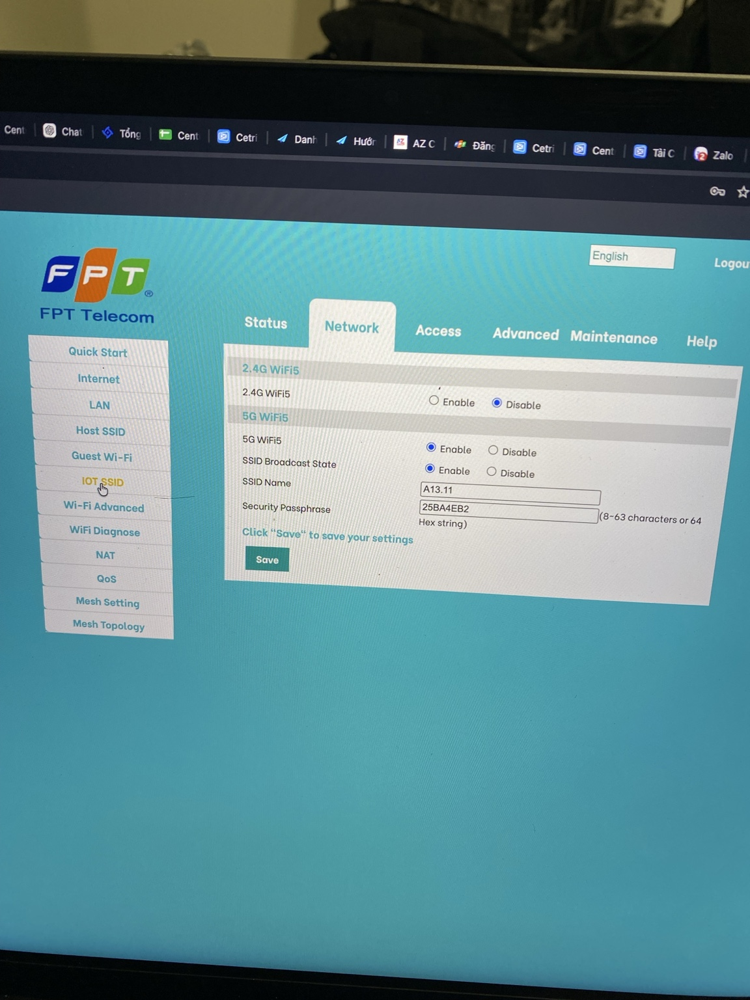
>
>
> 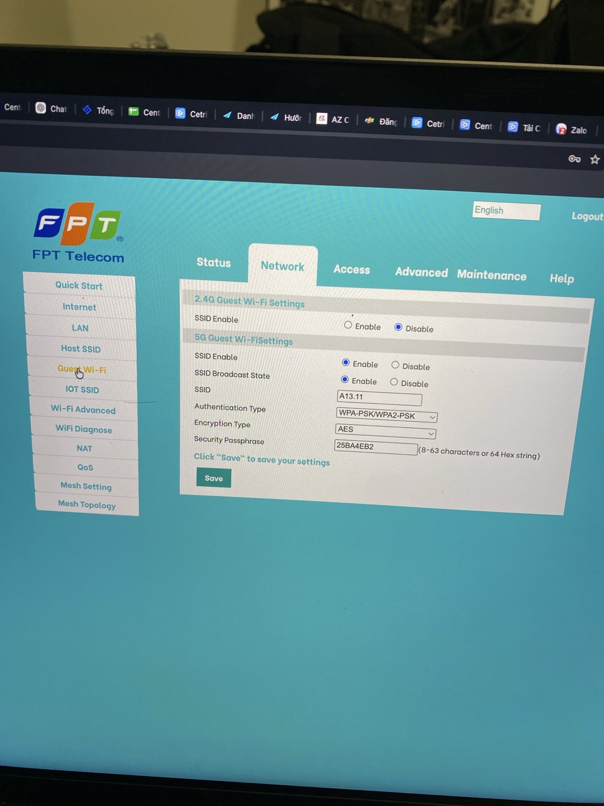
>
>
> 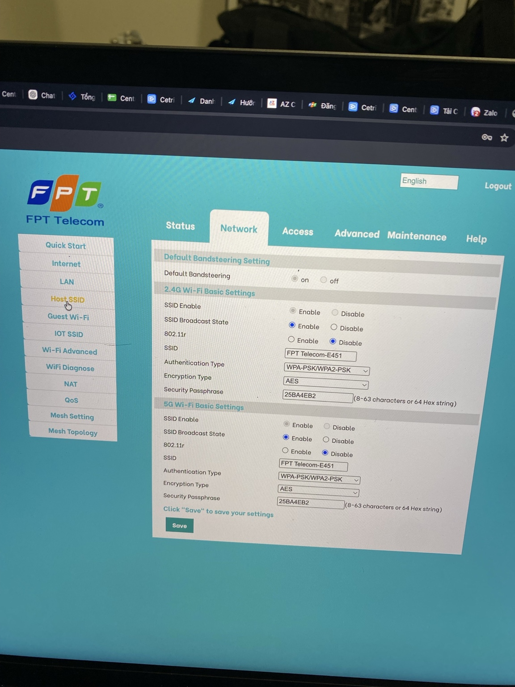
>
>
> 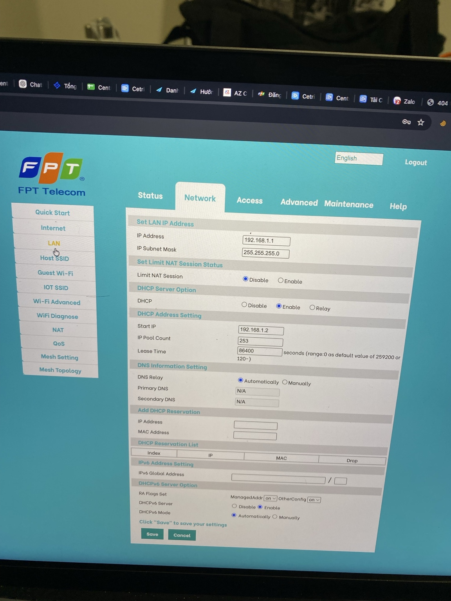
>
>
> 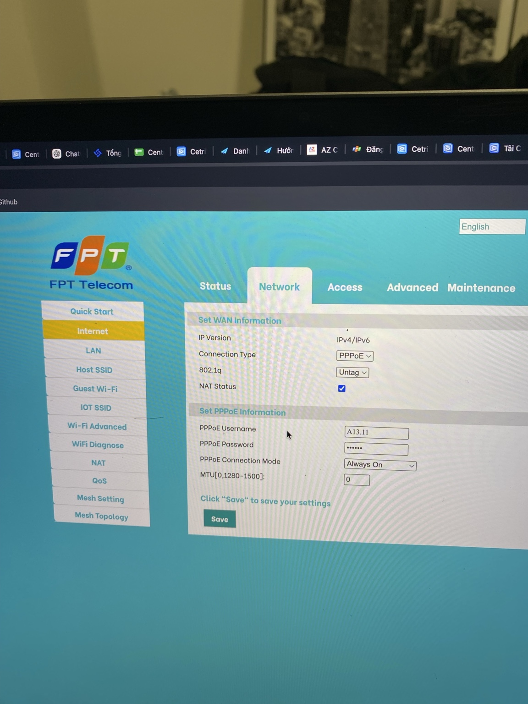

> 

> 

> 

> 

> 

> 

> 

> 

> 

---

### 🤖 ChatGPT `gpt-5-6-thinking` · 2026-09-15 19:16:35

Đúng màn hình cần chỉnh rồi anh. Ảnh cuối **Network → Internet** cho thấy nguyên nhân rất rõ:

**PPPoE Username đang là `A13.11` → sai.** 
`A13.11` là tên Wi-Fi anh đang đặt, không phải tài khoản Internet FPT.

Anh cấu hình như sau:

| Mục | Thiết lập |
|---|---|
| IP Version | `IPv4/IPv6` |
| Connection Type | `PPPoE` |
| 802.1q | `Untag` |
| NAT Status | ✅ bật |
| PPPoE Username | **Tài khoản PPPoE FPT thực tế** |
| PPPoE Password | **Mật khẩu PPPoE FPT thực tế** |
| PPPoE Connection Mode | `Always On` |
| MTU | để `0` trước, modem sẽ dùng mặc định |

Sau đó bấm **Save**, chờ khoảng 30–60 giây rồi vào:

**Status → Device Info → Refresh**

Nếu thành công, phần WAN sẽ từ:

`Not Connected` 
`IP Address: N/A` 
`Gateway: N/A`

chuyển thành:

`Connected` 
`IP Address: x.x.x.x` 
`Default Gateway:...` 
`Primary DNS:...`

### Vấn đề hiện tại là lấy PPPoE Username/Password

Anh **không dùng** các thông tin sau làm PPPoE:

- `A13.11` ❌
- `admin` ❌
- `25BA4EB2` (mật khẩu Wi-Fi) ❌
- `37832DB26D` (WEB Pass) ❌
- Serial modem `FPTH25BA4EB2` ❌

Nếu anh không còn thông tin PPPoE, cách nhanh nhất là gọi **1900 6600** và nói:

> “Em factory reset modem AX3000HV2. GPON đang O5 nhưng WAN PPPoE mất cấu hình. Nhờ cung cấp lại tài khoản PPPoE hoặc đẩy lại cấu hình Internet cho modem.”

Họ chỉ cần cấp đúng **username/password PPPoE** hoặc provision từ xa là anh có Internet lại.

Ngoài ra, em thấy anh đang đặt `A13.11` cho cả **Guest Wi-Fi** và **IoT SSID**. Sau khi Internet chạy lại, nên tắt hai mạng này và đặt `A13.11` ở **Network → Host SSID** nếu đó là Wi-Fi chính của anh.

Và phần **IP tĩnh nội bộ** anh cần ban đầu thì em đã thấy đúng chỗ rồi: **Network → LAN → Add DHCP Reservation**. Khi Internet chạy lại, em có thể hướng dẫn anh gán cố định, ví dụ `192.168.1.100`, cho server/máy tính.

---

> ### 👤 User · 2026-09-15 19:19:10
>
> Có trên modem không bạn

---

### 🤖 ChatGPT `gpt-5-6-thinking` · 2026-09-15 19:19:19

Không anh. Trên tem modem anh chụp **không có tài khoản PPPoE**.

Tem chỉ có:

- **SSID:** `FPT Telecom-E451`
- **Wi-Fi Password:** `25BA4EB2`
- **WEB Link:** `192.168.1.1`
- **WEB user:** `admin`
- **WEB Pass:** `37832DB26D`
- Serial/MAC của modem

Còn **PPPoE Username + PPPoE Password** là thông tin riêng của đường truyền FPT và thường **không in trên modem**.

Vì anh vừa factory reset nên modem đang mất cấu hình PPPoE. Cách nhanh nhất là liên hệ FPT và yêu cầu:

> “Cho em xin lại username/password PPPoE của đường truyền hoặc đẩy lại cấu hình WAN cho modem AX3000HV2.”

Nếu anh có **hợp đồng FPT hoặc mã khách hàng**, gửi ảnh phần thông tin hợp đồng cho em, em xem thử có username đường truyền trong đó không.

---

> ### 👤 User · 2026-09-15 19:21:46
>
> Cái này mặt định trong wifi có không bạn

---

### 🤖 ChatGPT `gpt-5-6-thinking` · 2026-09-15 19:21:51

Không anh, **PPPoE Username/Password không phải là thông tin “mặc định chung” có sẵn trong Wi-Fi/modem** kiểu như `admin` hay mật khẩu Wi-Fi.

Với modem FPT:

- Modem có thể được FPT **đẩy sẵn cấu hình PPPoE riêng của đường truyền** khi lắp đặt.
- Cấu hình này được lưu trong modem và có thể không cho anh xem rõ mật khẩu.
- Khi **factory reset**, phần cấu hình WAN/PPPoE đó có thể bị xóa.
- Một số trường hợp modem sẽ **tự nhận lại cấu hình từ hệ thống FPT**, nhưng không phải lúc nào cũng tự phục hồi ngay.

Nên hiện tại anh thấy `PPPoE Username = A13.11` thì chắc chắn **đó không phải tài khoản mặc định của modem**, mà là giá trị đang được nhập vào.

Nếu anh muốn, em có thể chỉ anh cách kiểm tra xem **modem AX3000HV2 này còn lưu PPPoE cũ ở System Log/backup/config hay không** trước khi gọi FPT.

---

> ### 👤 User · 2026-09-15 19:22:26
>
> Xem giúp mình

---

### 🤖 ChatGPT `gpt-5-6-thinking` · 2026-09-15 19:22:54

Em xem toàn bộ ảnh anh gửi rồi. Với **AX3000HV2 của anh**, hiện tại em **không thấy mục Backup/Restore Configuration** nào trong giao diện. Sau khi Factory Reset thì tài khoản PPPoE cũ nhiều khả năng đã bị xóa. FPT cũng khuyến cáo phải lưu PPPoE trước khi reset vì thông tin này thường nằm trong hợp đồng. ([FPT Telecom](https://fpt.vn/tin-tuc/cach-reset-modem-wifi-9597.html?utm_source=chatgpt.com)) 

Tuy nhiên mình còn **2 cách kiểm tra trước khi gọi FPT**:

1. Vào **Status → System Log** và chụp toàn bộ màn hình gửi em. Có thể log cho biết PPPoE đang xác thực bằng tài khoản nào hoặc lỗi cụ thể, nhưng thường **không hiện password**.

2. Quan trọng hơn: ở trang **Network → Internet**, ô **PPPoE Password của anh đang hiện dấu `••••••`**. Mình có thể kiểm tra xem modem có thực sự gửi mật khẩu xuống trình duyệt hay chỉ hiển thị dấu giả.

Trên Chrome Mac anh làm:
- Vào **Network → Internet**.
- Nhấp chuột phải ngay ô **PPPoE Password** → **Inspect / Kiểm tra**.
- Chrome sẽ mở Developer Tools và tô sáng một dòng dạng `<input type="password"...>`.
- Tìm `type="password"` rồi đổi chữ `password` thành `text` và nhấn Enter.

Nếu modem đang gửi mật khẩu thật cho trình duyệt, nó sẽ hiện ra ngay trong ô. **Nếu vẫn chỉ hiện `******`, trống hoặc một giá trị giả thì không lấy lại được bằng cách này.**

Lưu ý: username hiện tại của anh là **`A13.11`**, chắc chắn không phải tài khoản PPPoE gốc — đó là tên SSID anh vừa đặt. Vì vậy ngay cả khi lấy được password trong ô này thì chưa chắc đó là password cũ nếu anh đã Save sau reset.

Anh có thể **chụp màn hình `Status → System Log` gửi em trước**, em đọc giúp anh xem có dấu vết tài khoản PPPoE cũ không.

---

> ### 👤 User · 2026-09-15 19:29:14
>
>
> 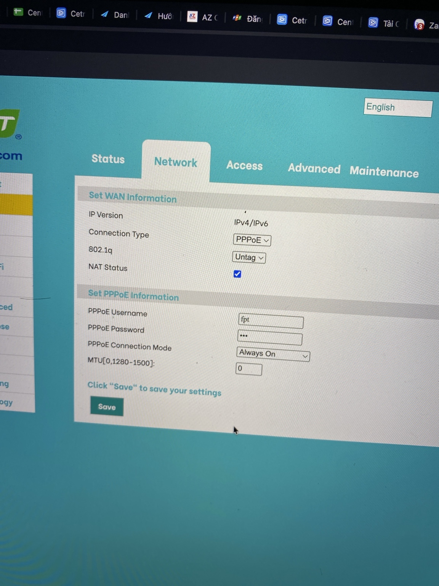
>
> Đây là mặc định của fpt

> 

---

### 🤖 ChatGPT `gpt-5-6-thinking` · 2026-09-15 19:29:25

Đúng anh. Nếu sau khi **Factory Reset** trang `Network → Internet` tự hiện:

- PPPoE Username: **`fpt`**
- PPPoE Password: **3 dấu `•••`**
- PPPoE / Untag / NAT bật / Always On

thì đây gần như là **cấu hình WAN mặc định của firmware FPT**, chứ **không phải tài khoản PPPoE riêng của đường truyền nhà anh**.

Vì vậy để `fpt / •••` như vậy thì modem thường sẽ vẫn báo:

**WAN: Not Connected → IP: N/A**

Anh không cần chỉnh Wi-Fi, NAT, Mesh hay LAN nữa. Phần đang thiếu chính là **PPPoE Username + Password thực tế của hợp đồng**, hoặc FPT phải **provision lại cấu hình từ xa** cho modem.

Một lưu ý: 3 dấu `•••` không nhất thiết có nghĩa mật khẩu thật chỉ có 3 ký tự; giao diện modem có thể chỉ hiển thị chuỗi che mặc định.

Nếu anh muốn, em có thể hướng dẫn anh **kiểm tra trong Developer Tools xem `fpt/•••` là placeholder hay modem thực sự đang lưu một password**, mất khoảng 1 phút.

---

> ### 👤 User · 2026-09-15 19:31:41
>
> Làm sao để kích hoạt mạng

---

### 🤖 ChatGPT `gpt-5-6-thinking` · 2026-09-15 19:32:00

Được anh. Với tình trạng modem hiện tại, **không có nút “Activate Internet” riêng**. Muốn mạng hoạt động lại sau Factory Reset, anh phải **xác thực lại PPPoE**.

Ngay trên màn hình anh đang có, vào **Network → Internet** và để:

| Mục | Cấu hình |
|---|---|
| IP Version | `IPv4/IPv6` |
| Connection Type | `PPPoE` |
| 802.1q | `Untag` |
| NAT Status | ✅ |
| PPPoE Username | **Username đường truyền FPT** |
| PPPoE Password | **Password PPPoE** |
| Connection Mode | `Always On` |
| MTU | `0` / mặc định |

**Không dùng `fpt` làm username**, vì đó chỉ là giá trị mặc định sau reset, không phải tài khoản riêng của đường truyền.

Theo tài liệu cấu hình AX3000 của FPT, Username là **tên đăng nhập của hợp đồng** và Password được hướng dẫn là **7 ký tự cuối của hợp đồng**. ([FPT Telecom](https://fpt.vn/storage/upload/files/documents/huong-dan-cai-dat-va-cau-hinh-ax3000hi.pdf?utm_source=chatgpt.com)) 

Sau đó:
1. Bấm **Save**.
2. Chờ khoảng 30–60 giây.
3. Vào **Status → Device Info → Refresh**.
4. Nếu thấy `WAN Status = Connected` và xuất hiện `IP Address / Gateway / DNS` thì Internet đã lên.

Nếu vẫn `Not Connected`, **đừng reset thêm**. FPT xác nhận sau Factory Reset modem có thể mất cấu hình xác thực PPPoE; lúc này có thể yêu cầu kỹ thuật **đổ lại cấu hình từ xa** qua Hi FPT hoặc gọi **1900 6600**. ([FPT Telecom](https://fpt.vn/tin-tuc/cach-reset-modem-wifi-9597.html?utm_source=chatgpt.com)) 

Anh có thể nói với tổng đài đúng câu:

> “Em vừa factory reset modem AX3000HV2. GPON đang Up/O5 nhưng WAN PPPoE Not Connected. Nhờ đẩy lại cấu hình Internet/PPPoE từ xa cho modem.”

**Đường quang của anh đang lên O5 nên hiện giờ chủ yếu chỉ thiếu phần xác thực PPPoE.** Anh không cần chỉnh LAN, NAT, Mesh hay Wi-Fi thêm.

---

> ### 👤 User · 2026-09-15 19:43:23
>
>

> 📎 [BIEN_BAN-DIEN-TU-4e3080f1af1664b1026793a52edcde4f.pdf](../assets/6aa92957-02c4-83ec-a533-92459ca5ee79/BIEN_BAN-DIEN-TU-4e3080f1af1664b1026793a52edcde4f.pdf) `application/pdf`

---

### 🔧 Tool · 2026-09-15 19:43:30

Tool output

Make sure to include turn0file0 in your response to cite this file, or to surface it as a link. Replace the placeholder line range with the actual line range from the result that best fits the snippet you want to surface with the citation. If you cite multiple files, use a separate complete `filecite` marker for each file. Never put multiple `turnNfileM` targets inside a single `filecite` marker.
Use ref_id "turn0file0" to reference this file. For broad questions or unknown locations, retrieve relevant chunks with `files.search` scoped to this file. Use `files.find` only for exact text, and use `files.read` for a known range or to expand relevant results. Full file size: 19 pages, 838 file lines.
[L1] <PARSED TEXT FOR PAGE: 1 / 19>
1
[L3] CÔNG TY CỔ PHẦN VIỄN THÔNG FPT
[L4] HĐ số: /FTEL-DVVT
[L5] CỘNG HOÀ XÃ HỘI CHỦ NGHĨA VIỆT NAM
[L6] Độc lập - Tự do - Hạnh phúc
[L7] -----o0o-----
[L8] HỢP ĐỒNG CUNG CẤP VÀ SỬ DỤNG DỊCH VỤ
[L9] - Căn cứ Luật Viễn thông số 41/2009/QH12 ngày 23/11/2009;
[L10] - Căn cứ Nghị định số 25/2011/NĐ-CP ngày 06/04/2011 được sửa đổi, bổ sung một số
[L11] điều bởi Nghị định số 81/2016/NĐ-CP ngày 01/07/2016;
[L12] - Căn cứ Luật Bảo vệ Quyền lợi Người tiêu dùng ngày 17/11/2010;
[L13] - Căn cứ Nghị định số 99/2011/NĐ-CP ngày 27/10/2011;
[L14] - Căn cứ Nghị định 72/2013/NĐ-CP ngày 15/07/2013 được sửa đổi, bổ sung bởi Nghị
[L15] định 27/2018/NĐ-CP ngày 01/3/2018;
[L16] - Căn cứ Thông tư 39/2016/TT-BTTTT ngày 26/12/2016 được sửa đổi, bổ sung bởi Thông
[L17] tư 16/2018/TT-BTTTT ngày 05/12/2018;
[L18] - Căn cứ Nghị định 06/2016/NĐ-CP ngày 18/01/2016;
[L19] - Căn cứ Thông tư 24/2016/TT-BTTTT ngày 15/11/2016;
[L20] - Căn cứ Luật Giao dịch điện tử và các văn bản hướng dẫn thi hành;
[L21] - Căn cứ Nghị định 13/2023/NĐ-CP ngày 17/4/2023 của Chính phủ;
[L22] - Căn cứ Nghị định 06/2016/NĐ-CP ngày 18/01/2016 được sửa đổi, bổ sung bởi Nghị
[L23] định 71/2022/NĐ-CP ngày 01/10/2022,;
[L24] - Căn cứ Thông tư 18/2016/TT-BTTTT ngày 28/6/2016,
[L25] Hợp Đồng1
[L26] này được ký ngày:, giữa:
[L27] Bên sử dụng dịch vụ (Bên A):
[L28] Người đại diện:
[L29] Ngày sinh: Địa chỉ:
[L30] Số CMND/CCCD/Hộ chiếu: Ngày cấp: Tại:
[L31] Số tài khoản: Tại ngân hàng:
[L32] GCN ĐKKD số (dành cho 
DN):
[L34] Ngày cấp: Cấp tại:
[L35] Email: SĐT Giao dịch, liên hệ: SĐT Liên hệ khác (nếu có):
[L36] Địa chỉ trên hóa đơn:
[L37] Địa chỉ lắp đặt:
[L38] Bên cung cấp dịch vụ (Bên B): 
[L39] Người đại diện: Quyết định ủy quyền số:
[L40] Địa chỉ:
[L41] SĐT: 1900 6600 Fax: Mã số thuế: 
[L42] Số tài khoản: Tại ngân hàng: 
[L43] GCN ĐKKD số: Ngày cấp: Cấp tại:
[L44] Giấy phép cung cấp Dịch vụ Viễn 
[L45] thông số: 255/GP-CVT do Cục Viễn thông cấp ngày 07/11/2022
[L46] 1 Đối với các nội dung để trống trong Hợp Đồng, ngoài phần thông tin riêng của các bên do mỗi bên tự điền, các nội 
[L47] dung để trống khác trong Hợp Đồng sẽ được bổ sung theo thỏa thuận cụ thể giữa hai bên tại thời điểm giao kết Hợp 
[L48] Đồng phù hợp với quy định của pháp luật.
[L49] [FORM FIELD] Contract: SGAEV7914
[L50] [FORM FIELD] DateConfirm: 28/12/2025
[L51] [FORM FIELD] FullName: TRẦN XUÂN LỘC
[L52] [FORM FIELD] Birthday: 21/04/2000
[L53] [FORM FIELD] Location: Lô A, T.13, P.A.13.11, BCC Lumiere Boulevard - B7, Nguyễn Xiển, Phường Long Bình, Thành phố Hồ Chí Minh
[L54] [FORM FIELD] CMND: 082200005471
[L55] [FORM FIELD] Location_Phone: 0342888222
[L56] [FORM FIELD] BillTo: Lô A, T.13, P.A.13.11, BCC Lumiere Boulevard - B7, Nguyễn Xiển, Phường Long Bình, Thành phố Hồ Chí Minh
[L57] [FORM FIELD] NameBranch: CHI NHÁNH CÔNG TY CỔ PHẦN VIỄN THÔNG FPT
[L58] [FORM FIELD] PlaceOfIssue: TP Hồ Chí Minh
[L59] [FORM FIELD] NameDD: Nguyễn Ngọc Khánh
[L60] [FORM FIELD] Decision: 350/QĐ-FTEL
[L61] [FORM FIELD] Office: Lô 37-39A, Đường số 19, Khu chế xuất Tân Thuận, Phường Tân Thuận, Thành phố Hồ Chí Minh, Việt Nam
[L62] [FORM FIELD] BillTo_TaxIdFPT: 0101778163-001
[L63] [FORM FIELD] OpenBank: Ngân hàng TMCP Tiên Phong (TienPhongBank)
[L64] [FORM FIELD] GCNDKKD: 0101778163-001
[L65] [FORM FIELD] DateOfIssue: 13/09/2005
[L66] [FORM FIELD] AccountNumber: 00019592001

[L68] <IMAGE FOR PAGE: 1 / 19>

> 🖼️ *Image (768x1024)* — `3f591473cd8f936#file_00000000f…`

[L69] <PARSED TEXT FOR PAGE: 2 / 19>
2
[L71] Hai Bên thoả thuận ký Hợp đồng cung cấp và sử dụng dịch vụ này (“Hợp Đồng”) với các điều khoản 
sau:
[L73] ĐIỀU 1: NỘI DUNG CUNG CẤP DỊCH VỤ
[L74] 1.1. Bên A đồng ý và đăng ký sử dụng các dịch vụ (“Dịch Vụ”) do Bên B cung cấp như được nêu tại 
[L75] Phụ lục Hợp đồng kèm theo Hợp Đồng này. Trường hợp Bên A đăng ký sử dụng dịch vụ truy nhập 
[L76] Internet, Bên A cam kết liên tục sử dụng Dịch Vụ này của Bên B và thanh toán đầy đủ cước sử 
[L77] dụng Dịch vụ cho Bên B trong thời hạn tối thiểu là 24 tháng kể từ ngày ký Hợp Đồng (“Thời Hạn 
[L78] Cam Kết”).
[L79] Trường hợp Bên A chấm dứt Hợp Đồng trước Thời Hạn Cam Kết, Bên A sẽ thực hiện nghĩa vụ 
[L80] theo quy định tại Điểm 5.1.3 Khoản 5.1 Điều 5 của Hợp Đồng. 
[L81] 1.2. Thời điểm cung cấp Dịch Vụ là thời điểm Hợp Đồng này được ký kết và có thời hạn là 02 (hai) 
[L82] năm (“Thời hạn”). Khi Thời hạn của Hợp đồng kết thúc, nếu các Bên vẫn tiếp tục thực hiện Hợp 
[L83] Đồng mà không có bất kỳ yêu cầu thay đổi nào thì Hợp Đồng được tự động gia hạn thêm 02 (hai) 
[L84] năm và không hạn chế số lần tự động gia hạn.
[L85] 1.3. Trường hợp Bên A có nhu cầu thay đổi gói Dịch Vụ đã lựa chọn, chuyển đổi chủ sở hữu, tạm 
[L86] ngưng, khôi phục dịch vụ, thay đổi địa điểm sử dụng Dịch Vụ thì Bên A phải thông báo cho Bên B 
[L87] và có sự đồng ý của Bên B. Trường hợp Bên B có khả năng cung cấp theo nhu cầu thay đổi của 
[L88] Bên A, Bên A phải thanh toán phí chuyển đổi theo thực tế phát sinh (nếu có). Số tiền chuyển đổi 
[L89] này sẽ được quy định theo chính sách của Bên B theo từng thời điểm phù hợp với quy định pháp 
[L90] luật và sẽ được công bố công khai trên website http://www.fpt.vn để Bên A biết thông tin. Nếu Bên 
[L91] A không đồng ý thì có quyền chấm dứt Hợp Đồng theo các quy định tại Điều 5.1.2.
[L92] 1.4. Các Bên đồng ý thực hiện việc ký kết Hợp Đồng, các giao dịch liên quan đến các dịch vụ được 
[L93] cung cấp hoặc các thay đổi trong Hợp Đồng (ví dụ: đổi địa chỉ lắp đặt, tạm dừng hoặc khôi phục 
[L94] dịch vụ) này bằng phương thức giao dịch điện tử (ví dụ: tin nhắn, email, qua website 
[L95] http://www.fpt.vn, ứng dụng Hi FPT; gọi tắt là “Phương thức giao dịch điện tử”). Trường hợp 
[L96] Bên A có yêu cầu, Các Bên sẽ thực hiện các giao dịch bằng văn bản tại quầy của Bên B hoặc tại địa 
[L97] chỉ của Bên A. Để làm rõ, tất cả các phương thức giao dịch này là các phương thức giao dịch chính 
[L98] thức giữa hai Bên.
[L99] 1.5. Thông tin Trung tâm Chăm sóc Hỗ trợ Khách hàng của Bên B: 
[L100] Địa chỉ: vui lòng xem chi tiết địa chỉ theo từng khu vực được niêm yết công khai trên website 
[L101] http://www.fpt.vn
[L102] Tổng đài hỗ trợ: 1900 6600; Email: hotrokhachhang@fpt.com Website: http://www.fpt.vn
[L103] Ứng dụng trên thiết bị di động: Hi FPT
[L104] ĐIỀU 2: GIÁ DỊCH VỤ VÀ PHƯƠNG THỨC THANH TOÁN
[L105] 2.1. Giá Dịch Vụ được thông báo cho Khách hàng và được Hai Bên thống nhất bằng văn bản hoặc 
[L106] Phương thức giao dịch điện tử theo quy định pháp luật về giao dịch điện tử tại thời điểm ký kết 
[L107] Hợp Đồng.
[L108] 2.2. Trường hợp Bên A không sử dụng Dịch Vụ đầy đủ số ngày trong tháng hoàn tất thủ tục chấm dứt 
[L109] Hợp Đồng, giá sử dụng Dịch Vụ sẽ được tính trên số ngày Bên A thực tế sử dụng (trừ các gói 
[L110] Truyền hình phụ trợ sẽ được tính theo tháng sử dụng).
[L111] <PARSED TEXT FOR PAGE: 3 / 19>
3
[L113] 2.3. Bên B sẽ gửi thông báo trực tiếp cho Bên A (qua địa chỉ email Bên A đăng ký tại Hợp Đồng hoặc 
[L114] hình thức khác như tin nhắn /gọi điện thoại/gửi văn bản) về những thay đổi về giá, tiền dịch vụ thu 
[L115] cước, thông tin gói Dịch Vụ (nếu có) cho Bên A 05 ngày trước ngày áp dụng. Nếu Bên A không 
[L116] đồng ý những thay đổi này, Bên A có quyền chấm dứt Hợp Đồng sau khi thực hiện các nghĩa vụ 
[L117] quy định tại Điều 5.1.
[L118] 2.4. Bên B gửi thông báo chi tiết cước (bằng Phương thức giao dịch điện tử/gọi điện thoại/gửi văn bản) 
[L119] cho Bên A để yêu cầu thanh toán tiền cước trước ngày 15 của tháng kế tiếp của tháng phát sinh 
[L120] cước, Bên A phải thanh toán tiền cước cho Bên B chậm nhất là 05 ngày kể từ ngày nhận được 
[L121] thông báo của Bên B. Quá thời hạn này mà Bên A chưa thanh toán hoặc thanh toán không đủ tiền 
[L122] cước, Bên B có quyền tạm dừng hoặc chấm dứt Hợp Đồng theo quy định tại Hợp đồng này.
[L123] 2.5. Hình thức thanh toán: Bên A lựa chọn thanh toán theo hình thức thanh toán quy định tại Phụ lục 
[L124] Hợp đồng.
[L125] 2.6. Khi Bên A hoàn tất thanh toán, Bên A tra cứu xác nhận thanh toán hoặc nhận hóa đơn điện tử bằng 
[L126] cách truy cập vào một trong các website http://www.fpt.vn, https://fpt.vn/pay/, https://id.fpt.vn/
[L127] hoặc trên ứng dụng Hi FPT.
[L128] ĐIỀU 3: QUYỀN VÀ NGHĨA VỤ CỦA BÊN A
[L129] 3.1. Quyền và nghĩa vụ chung:
[L130] a. Được quyền yêu cầu Bên B cung cấp Dịch Vụ và các dịch vụ giá trị gia tăng đi kèm cùng thông tin 
[L131] liên quan đến việc sử dụng Dịch Vụ theo quy định tại Điều 1 của Hợp Đồng và Phụ lục Hợp Đồng 
[L132] kèm theo;
[L133] b. Được sử dụng Dịch Vụ, thuê các thiết bị đầu cuối thuê bao, bao gồm một hoặc một vài thiết bị sau 
[L134] (sau đây gọi chung là “Thiết bị đầu cuối”): Modem, router, Bộ giải mã truyền hình và các thiết bị 
[L135] đi kèm và được Bên B cung cấp thông tin đầy đủ khi ký Hợp Đồng theo đúng chất lượng và giá 
[L136] thỏa thuận trong Hợp Đồng này;
[L137] c. Được quyền chấm dứt Hợp Đồng hoặc từ chối sử dụng một phần hay toàn bộ dịch vụ viễn thông 
[L138] phù hợp với quy định của Hợp Đồng;
[L139] d. Được khiếu nại về giá cước, chất lượng Dịch Vụ; được hoàn trả giá cước và bồi thường thiệt hại 
[L140] trực tiếp khác do lỗi của Bên B hoặc đại lý dịch vụ của Bên B gây ra;
[L141] e. Được đảm bảo bí mật thông tin cá nhân của Bên A ghi trong Hợp Đồng;
[L142] f. Đảm bảo các thông tin mà Bên A cung cấp nêu tại Hợp Đồng này là đầy đủ và chính xác;
[L143] g. Cung cấp đầy đủ, chính xác các thông tin về Bên A như được ghi trong Hợp Đồng;
[L144] h. Thanh toán đầy đủ, đúng hạn tiền cước sử dụng Dịch Vụ và các loại phí, lệ phí đi kèm (nếu có) 
[L145] theo quy định tại Hợp Đồng, Phụ lục hợp đồng hoặc các văn bản thỏa thuận (nếu có).
[L146] i. Bồi thường thiệt hại trực tiếp do lỗi mình gây ra cho Bên B hoặc đại lý của Bên B; 
[L147] j. Chịu trách nhiệm về nội dung thông tin truyền, đưa và lưu trữ trên mạng viễn thông;
[L148] k. Được quyền thiết kế, lắp đặt hoặc thuê tổ chức, cá nhân khác thiết kế, lắp đặt thiết bị mạng nội bộ 
[L149] trong phạm vi địa điểm mà mình sử dụng cho đến điểm kết cuối của mạng viễn thông của Bên B. 
[L150] Bên A không được tự ý lắp đặt và kết nối trực tiếp các thiết bị đặc biệt mà có khả năng gây ảnh 
[L151] hưởng đến khả năng cung cấp dịch vụ và chất lượng dịch vụ của Bên B; 
[L152] <PARSED TEXT FOR PAGE: 4 / 19>
4
[L154] l. Không được sử dụng hạ tầng viễn thông của Bên B hoặc Dịch Vụ đã đăng ký để kinh doanh dịch 
[L155] vụ viễn thông dưới mọi hình thức; không được sử dụng gói Dịch Vụ cho cá nhân dùng cho đối 
[L156] tượng doanh nghiệp, tổ chức và ngược lại.
[L157] m. Có trách nhiệm bảo quản hóa đơn, chứng từ thanh toán, các thiết bị kỹ thuật mà Bên B cho Bên A 
thuê;
[L159] n. Tự chịu trách nhiệm về các giao dịch điện tử đã thực hiện với Bên B hoặc các giao dịch điện tử có 
[L160] liên quan đến Hợp Đồng này dưới mọi hình thức;
[L161] o. Chịu trách nhiệm bảo mật tên truy cập và mật khẩu của mình, tự chịu trách nhiệm trước pháp luật 
[L162] nếu để cho địa chỉ và quyền truy cập của mình bị người khác lợi dụng để thực hiện các hành động 
[L163] phạm pháp.
[L164] 3.2. Quyền và nghĩa vụ đối với dịch vụ Internet:
[L165] a. Không được sử dụng Dịch Vụ để đặt máy chủ lưu trữ các loại hình trò chơi trực tuyến; 
[L166] b. Cung cấp thông tin cần thiết và tạo điều kiện cho Bên B đo thử, kiểm tra lắp đặt mạng lưới và Thiết 
[L167] bị đầu cuối thuê bao mà Bên B cho Bên A thuê khi kết nối mạng Internet băng thông rộng.
[L168] 3.3. Quyền và nghĩa vụ đối với dịch vụ Truyền hình Trả tiền:
[L169] a. Không được sao chép, ghi lại để phát tán các nội dung truyền hình dưới bất kỳ hình thức nào và 
[L170] thực hiện các hành vi xâm phạm quyền sở hữu trí tuệ khác của Bên B hoặc một bên thứ ba nào 
[L171] khác theo quy định của pháp luật Việt Nam trong quá trình sử dụng Dịch Vụ;
[L172] b. Bên A được quyền chủ động sở hữu thiết bị đầu cuối (trừ trường hợp thiết bị đầu cuối và hoặc Bộ 
[L173] giải mã truyền hình do Bên B cung cấp cho Bên A theo Hợp Đồng này);
[L174] c. Bên A được lựa chọn dịch vụ phát thanh, truyền hình quảng bá của các đơn vị cung cấp dịch vụ 
[L175] theo yêu cầu.
[L176] ĐIỀU 4: QUYỀN VÀ NGHĨA VỤ CỦA BÊN B
[L177] 4.1. Quyền và nghĩa vụ chung:
[L178] a. Đảm bảo cung cấp Dịch Vụ cho Bên A, cho Bên A thuê Thiết bị đầu cuối theo đúng nội dung đã 
[L179] thỏa thuận, đảm bảo chất lượng dịch vụ cung cấp cho Bên A theo đúng chất lượng dịch vụ mà Bên 
[L180] B đã công bố và thường xuyên kiểm tra chất lượng Dịch Vụ;
[L181] b. Chịu trách nhiệm cung cấp và giữ quyền sở hữu toàn bộ vật tư, thiết bị bao gồm dây thuê bao, đầu 
[L182] nối, cáp LAN… để phục vụ kết nối đường truyền dẫn từ tập điểm đến điểm kết nối cuối cùng của 
[L183] mạng viễn thông của Bên B là địa điểm sử dụng dịch vụ Internet của Bên A. Các vật tư, thiết bị này 
[L184] là một phần cấu thành nên mạng viễn thông của Bên B, Bên B có toàn quyền thu hồi khi Bên A 
[L185] ngừng sử dụng dịch vụ;
[L186] c. Bảo mật thông tin của Bên A theo Hợp Đồng này, chỉ được chuyển giao thông tin cho bên thứ ba 
[L187] khi có được sự đồng ý của Bên A trừ các trường hợp khác theo quy định của pháp luật;
[L188] d. Trừ trường hợp các bên có thỏa thuận khác, không được yêu cầu Bên A thanh toán bất kỳ khoản 
[L189] tiền nào trước khi dịch vụ được cung cấp đến Bên A;
[L190] e. Trường hợp Bên A thông báo sự cố hoặc khiếu nại về chất lượng dịch vụ, Bên B sẽ kịp thời kiểm 
[L191] tra, giải quyết. Khiếu nại của Bên A sẽ được xử lý theo thời hạn do pháp luật quy định kể từ ngày 
[L192] nhận được khiếu nại.
[L193] <PARSED TEXT FOR PAGE: 5 / 19>
5
[L195] f. Không được từ chối cung cấp Dịch Vụ, tạm dừng hoặc chấm dứt Hợp Đồng trừ trường hợp quy 
[L196] định tại Điều 2.4 và Điều 5.2 của Hợp Đồng và phù hợp với quy định tại Điều 26 của Luật Viễn 
[L197] thông hiện hành. Trường hợp cần sửa chữa, bảo trì hoặc vì lý do nào khác bắt buộc phải ngừng 
[L198] cung cấp dịch vụ, Bên B phải thông báo trước cho Bên A chậm nhất là 03 (ba) ngày làm việc trước 
[L199] ngày dừng cung cấp dịch vụ;
[L200] g. Thông báo cho Bên A trong trường hợp Bên B ngừng kinh doanh Dịch Vụ ít nhất 30 (ba mươi) 
[L201] ngày trước khi chính thức ngừng kinh doanh Dịch Vụ;
[L202] h. Được quyền yêu cầu Bên A cung cấp thông tin cần thiết liên quan đến việc cung cấp các Dịch Vụ 
[L203] tại Hợp Đồng và Phụ lục Hợp đồng kèm theo.
[L204] i. Được quyền yêu cầu Bên A thanh toán đầy đủ, đúng hạn tiền sử dụng Dịch Vụ và các khoản phải
[L205] thanh toán theo quy định tại Hợp Đồng; Yêu cầu Bên A bồi thường các mất mát, hư hỏng của các 
[L206] thiết bị kỹ thuật mà Bên B cho Bên A thuê do lỗi của Bên A theo quy định của pháp luật (nếu có);
[L207] j. Bên A đồng ý cho Bên B thu thập và xử lý dữ liệu cá nhân của Bên A liên quan đến việc cung cấp 
[L208] và sử dụng Dịch Vụ được quy định tại Hợp Đồng này theo quy định của pháp luật về bảo vệ dữ liệu 
[L209] cá nhân và quy định của pháp luật có liên quan;
[L210] k. Bên B được phép chia sẻ thông tin của Bên A cho các doanh nghiệp viễn thông khác đã có thỏa 
[L211] thuận bằng văn bản với Bên B về việc trao đổi cung cấp thông tin liên quan đến người sử dụng dịch 
[L212] vụ viễn thông để phục vụ cho việc tính giá cước, lập hóa đơn và ngăn chặn hành vi trốn tránh thực 
[L213] hiện nghĩa vụ theo hợp đồng theo quy định tại Điểm b Khoản 4 Điều 6 của Luật Viễn thông hiện 
hành.
[L215] l. Bên B đảm bảo cung cấp hóa đơn, chứng từ hợp lệ cho Bên A theo đúng quy định của pháp luật. 
[L216] 4.2. Quyền và nghĩa vụ đối với dịch vụ Internet:
[L217] Chịu trách nhiệm cài đặt, bảo trì dịch vụ và Thiết bị đầu cuối mà Bên B cho Bên A thuê. 
[L218] 4.3. Quyền và nghĩa vụ đối với dịch vụ Truyền hình Trả tiền:
[L219] 4.3.1. Bên B được quyền thay đổi các thiết bị kĩ thuật (trừ thiết bị Bộ giải mã truyền hình) để phù hợp 
[L220] với hiện trạng sử dụng của Bên A khi Bên A đăng ký sử dụng thêm Bộ giải mã truyền hình hoặc 
[L221] chấm dứt dịch vụ trên một số Bộ giải mã truyền hình.
[L222] 4.3.2. Bên B đảm bảo cung cấp các gói Dịch Vụ truyền hình theo các điều kiện phù hợp với quy định 
[L223] của pháp luật hiện hành. Trong đó, Bên B đảm bảo Bên A được cung cấp gói dịch vụ cơ bản với 
[L224] các kênh chương trình cụ thể như sau: 
[L225] (i) Kênh chương trình phục vụ nhiệm vụ chính trị, thông tin tuyên truyền thiết yếu của quốc 
[L226] gia: gồm 07 kênh theo quy định của pháp luật được cung cấp cho Bên A tại mọi thời điểm 
[L227] Bên A sử dụng dịch vụ;
[L228] (ii) Kênh chương trình phục vụ nhiệm vụ chính trị, thông tin tuyên truyền thiết yếu của địa 
[L229] phương: tại mọi thời điểm sử dụng Dịch Vụ, Bên A được cung cấp kênh chương trình phục 
[L230] vụ nhiệm vụ chính trị, thông tin tuyên truyền thiết yếu của địa phương theo địa bàn hành 
[L231] chính của Bên A; 
[L232] (iii) Kênh chương trình nước ngoài và kênh chương trình trong nước khác: do Bên B quyết định 
[L233] và cung cấp tại từng thời điểm phù hợp với quy định của pháp luật về truyền hình trả tiền 
[L234] và các quy định nêu tại Khoản 4.3.4 Điều 4 của Hợp Đồng này. 
[L235] <PARSED TEXT FOR PAGE: 6 / 19>
6
[L237] 4.3.3. Ngoài gói dịch vụ cơ bản theo quy định tại Khoản 4.3.2 trên đây, Bên B, tùy theo quyết định và 
[L238] khả năng của mình, có thể cung cấp các gói dịch vụ khác phù hợp với quy định của pháp luật và 
[L239] Bên A có quyền lựa chọn các gói dịch vụ mà Bên B cung cấp theo nhu cầu sử dụng của mình. 
[L240] 4.3.4. Thay đổi chi tiết dịch vụ Truyền hình Trả tiền
[L241] a. Trong quá trình cung cấp dịch vụ, Bên B được thay đổi chi tiết dịch vụ theo quy định sau:
[L242] (i) Bổ sung danh mục kênh chương trình truyền hình trong gói Dịch Vụ. 
[L243] (ii) Thay đổi gói cước như giá gói, danh mục kênh chương trình truyền hình và các nội dung 
[L244] khác trong trường hợp có quy định của pháp luật hoặc quyết định, chỉ đạo, thủ tục của cơ 
[L245] quan nhà nước có thẩm quyền mà không do lỗi của Bên B.
[L246] (iii) Thay đổi danh mục kênh chương trình truyền hình trong trường hợp: Đơn vị cấp quyền 
[L247] khai thác, sử dụng các kênh truyền hình dừng cấp quyền khai thác các kênh chương trình 
[L248] truyền hình cho Bên B. 
[L249] (iv) Thay đổi danh mục kênh chương trình truyền hình trong gói Dịch Vụ trong trường hợp xảy 
[L250] ra sự kiện bất khả kháng quy định tại Điều 6 của Hợp Đồng dẫn đến Bên B không thể tiếp 
[L251] tục cung cấp dịch vụ theo quy định tại Hợp Đồng. 
[L252] b. Trong trường hợp phát sinh bất kỳ sự kiện thay đổi nào được quy định tại Điểm a Khoản 4.3.4 
[L253] này, Bên B sẽ thông báo tới Bên A thông qua số điện thoại Bên A sử dụng để đăng ký Dịch Vụ 
[L254] hoặc email mà Bên A cung cấp nêu tại phần chủ thể của Hợp Đồng này. Ngoài ra, Bên B sẽ thông 
[L255] báo công khai các thay đổi trên website http://ww.fpt.vn để Bên A biết thông tin. Trong vòng 05 
[L256] ngày làm việc kể từ ngày Bên A nhận được thông báo của Bên B, nếu Bên A không có bất kỳ 
[L257] phản hồi nào về các nội dung thay đổi hoặc Bên A tiếp tục sử dụng dịch vụ sau khi kết thúc thời 
[L258] hạn nêu trên thì được xem là Bên A đồng ý với toàn bộ nội dung thay đổi của Bên B.
[L259] c. Trong trường hợp Bên A phản hồi không đồng ý với các thay đổi của Bên B thì Bên A được 
[L260] quyền chấm dứt Hợp Đồng theo quy định tại Khoản 5.1.2 Điều 5 của Hợp Đồng.
[L261] ĐIỀU 5: TẠM DỪNG VÀ ĐƠN PHƯƠNG CHẤM DỨT HỢP ĐỒNG
[L262] 5.1. Bên A tạm dừng hoặc chấm dứt Hợp Đồng
[L263] 5.1.1.Bên A có quyền tạm dừng sử dụng một hoặc toàn bộ Dịch Vụ đã đăng ký sau khi thông báo cho 
[L264] Bên B trước 7 (bảy) ngày và thanh toán cước sử dụng Dịch Vụ cho thời gian đã sử dụng tính đến 
[L265] thời điểm tạm dừng.
[L266] 5.1.2.Bên A có quyền chấm dứt một Dịch Vụ hoặc toàn bộ Dịch Vụ bằng thông báo cho Bên B sau khi 
[L267] thực hiện tất cả nghĩa vụ sau: (i) thanh toán tiền cước cho phần Dịch Vụ đã sử dụng; (ii) hoàn trả 
[L268] cho Bên B thiết bị do Bên B cho Bên A thuê (nếu làm mất hoặc làm hư hỏng thì phải bồi thường 
[L269] theo thiệt hại thực tế phát sinh). 
[L270] 5.1.3.Trường hợp Bên A tạm dừng hoặc chấm dứt trước thời hạn cam kết theo Hợp Đồng, ngoài nghĩa vụ 
[L271] quy định tại Điểm 5.1.2, Bên A có nghĩa vụ thanh toán chi phí lắp đặt ban đầu cho Bên B như quy 
[L272] định tại Phụ lục Hợp đồng (nếu có) và hoàn trả cho Bên B toàn bộ giá trị ưu đãi, khuyến mại mà 
[L273] Bên A được hưởng trong thời gian sử dụng Dịch Vụ (nếu có); Bên A được hoàn trả các khoản tiền 
[L274] trả trước chưa sử dụng sau khi đã khấu trừ các phần nghĩa vụ theo Hợp Đồng với Bên B.
[L275] 5.1.4.Điều khoản áp dụng riêng với dịch vụ truyền hình: 
[L276] Bên A tạm dừng hoặc chấm dứt Dịch Vụ truyền hình trên một phần hoặc toàn bộ số thiết bị Bộ giải 
[L277] mã truyền hình đã đăng ký sử dụng thì Bên A phải hoàn trả thiết bị Bộ giải mã truyền hình tạm 
[L278] <PARSED TEXT FOR PAGE: 7 / 19>
7
[L280] dừng/chấm dứt sử dụng Dịch Vụ đó cho Bên B hoặc thanh toán cho Bên B số tiền như quy định tại 
[L281] Phụ lục Hợp đồng;
[L282] 5.2. Bên B tạm dừng hoặc chấm dứt Hợp Đồng
[L283] 5.2.1.Bên B có quyền tạm dừng cung cấp một hoặc toàn bộ Dịch Vụ cho Bên A trong trường hợp sau:
[L284] a. Bên A vi phạm một trong các quy định của pháp luật và/hoặc Hợp Đồng. Bên B sẽ xem xét cung 
[L285] cấp lại Dịch Vụ nếu Bên A khắc phục vi phạm trong vòng 30 (ba mươi) ngày kể từ ngày nhận được 
[L286] thông báo của Bên B;
[L287] b. Theo yêu cầu của cơ quan nhà nước có thẩm quyền; hoặc xảy ra sự kiện bất khả kháng theo quy 
[L288] định tại Điều 6 Hợp Đồng này;
[L289] c. Bên B thực hiện nâng cấp, tu bổ, sửa chữa mạng lưới được công khai tại website http://www.fpt.vn
[L290] và theo thông báo cho Bên A;
[L291] 5.2.2.Khi tạm dừng cung cấp một hoặc nhiều Dịch Vụ, Bên B sẽ gửi thông báo qua tin nhắn điện thoại 
[L292] hoặc gửi email hoặc gửi văn bản đến địa chỉ của Bên A trước ít nhất 03 (ba) ngày làm việc (trừ 
[L293] trường hợp do Bên A nợ tiền thanh toán Dịch Vụ của Bên B) và Bên A không phải thanh toán tiền 
[L294] sử dụng Dịch Vụ bị tạm dừng trong khoảng thời gian tạm dừng này, tuy nhiên, Bên A vẫn đảm bảo 
[L295] hoàn tất nghĩa vụ thanh toán phần Dịch Vụ đã sử dụng đến thời điểm tạm dừng Dịch Vụ theo quy 
[L296] định tại Hợp Đồng này.
[L297] 5.2.3.Bên B có quyền đơn phương chấm dứt một hoặc toàn bộ Dịch Vụ ngay khi gửi thông báo cho Bên 
[L298] A trong các trường hợp sau:
[L299] a. Phát hiện Bên A sử dụng Dịch Vụ đã đăng ký tại Hợp Đồng vào mục đích kinh doanh lại và/hoặc 
[L300] bằng bất kỳ mục đích nào khác nhằm phát sinh khoản thu trực tiếp từ Dịch Vụ cho Bên A và/hoặc 
[L301] Bên A sử dụng gói dịch vụ cho cá nhân dùng cho đối tượng doanh nghiệp, tổ chức và ngược lại.
[L302] b. Phát hiện Bên A sử dụng Dịch Vụ đã đăng ký để đặt máy chủ lưu trữ các loại hình trò chơi trực 
[L303] tuyến;
[L304] c. Bên A gây rối, phá hoại hệ thống thiết bị, cản trở việc cung cấp các Dịch Vụ của Bên B;
[L305] d. Trong trường hợp Bên A sử dụng từ hai Dịch Vụ, hai hợp đồng trở lên, nếu Bên A không hoàn 
[L306] thành nghĩa vụ thanh toán cước cho một trong các Dịch Vụ, hợp đồng sử dụng theo quy định tại 
[L307] Điều 2.4 của Hợp Đồng này, Bên B có quyền tạm dừng hoặc chấm dứt cung cấp các Dịch Vụ, hợp 
[L308] đồng còn lại cho Bên A.
[L309] e. Có yêu cầu của cơ quan nhà nước có thẩm quyền hoặc xảy ra sự kiện bất khả kháng;
[L310] f. Quá thời hạn tạm dừng ở mục a Điều 5.2.1 mà Bên A không khắc phục vi phạm;
[L311] g. Khi Bên B thay đổi chính sách dẫn đến không cung cấp gói Dịch Vụ mà Bên A đã đăng ký và Bên 
[L312] A không đồng ý chuyển đổi sang gói Dịch Vụ khác trong vòng 07 ngày kể từ ngày Bên A nhận 
[L313] được thông báo từ Bên B.
[L314] h. Bên A vi phạm Điều 3.3 của Hợp Đồng này.
[L315] i. Việc cung cấp Dịch Vụ được cơ quan quản lý chuyên ngành về viễn thông xác nhận bằng văn bản 
[L316] là không khả thi về kinh tế - kỹ thuật;
[L317] 5.2.4.Khi Bên B chấm dứt một hoặc nhiều Dịch Vụ, Bên A phải thực hiện tất cả các nghĩa vụ sau: (i) 
[L318] thanh toán tiền cước sử dụng Dịch Vụ bị chấm dứt tính tới ngày chấm dứt; (ii) hoàn trả Bên B thiết 
[L319] bị mà Bên B cho thuê (nếu làm mất hoặc hư hỏng thì phải bồi thường theo thực tế phát sinh); (iii) 
[L320] <PARSED TEXT FOR PAGE: 8 / 19>
8
[L322] thanh toán tiền bồi thường hoặc vi phạm Hợp Đồng (nếu có). Bên A được hoàn trả các khoản tiền 
[L323] trả trước chưa sử dụng sau khi đã khấu trừ các phần nghĩa vụ theo Hợp Đồng với Bên B.
[L324] ĐIỀU 6: SỰ KIỆN BẤT KHẢ KHÁNG
[L325] 6.1. Sự kiện bất khả kháng là sự kiện xảy ra một cách khách quan không thể lường trước được và không 
[L326] thể khắc phục được mặc dù đã áp dụng mọi biện pháp cần thiết và khả năng cho phép, bao gồm các 
[L327] sự kiện chiến tranh, sự thay đổi của pháp luật và chính sách của Nhà nước, đình công, các thiên tai, 
[L328] đứt cáp quang, các sự kiện bất khả kháng khác theo quy định pháp luật hoặc theo yêu cầu của cơ 
[L329] quan nhà nước có thẩm quyền mà không phải do lỗi của Bên B. 
[L330] 6.2. Trong trường hợp xảy ra sự kiện bất khả kháng, Bên phải tạm ngừng thực hiện một phần hoặc toàn 
[L331] bộ nghĩa vụ của mình theo quy định trong Hợp Đồng không phải bồi thường thiệt hại cho Bên còn 
[L332] lại nhưng có trách nhiệm gửi thông báo bằng văn bản hoặc Phương thức giao dịch điện tử cho Bên 
[L333] kia và áp dụng mọi biện pháp cần thiết để giảm bớt ảnh hưởng của sự kiện bất khả kháng đến việc 
[L334] thực hiện nghĩa vụ theo Hợp Đồng. 
[L335] 6.3. Nếu sự kiện bất khả kháng không thể khắc phục trong vòng 30 (ba mươi) ngày, thì một Bên có 
[L336] quyền đơn phương chấm dứt Hợp Đồng bằng văn bản hoặc Phương thức giao dịch điện tử ít nhất 
[L337] 30 ngày trước thời điểm dự định chấm dứt.
[L338] ĐIỀU 7: ĐIỀU KHOẢN CHUNG
[L339] 7.1. Các Bên thỏa thuận Hợp Đồng chỉ có hiệu lực kể từ khi Hai Bên đã ký vào Hợp Đồng và Bên A 
[L340] nhận xác nhận thanh toán tiền lắp đặt và/hoặc tiền sử dụng dịch vụ (áp dụng trong trường hợp hai 
[L341] Bên thỏa thuận thanh toán khoản này tại thời điểm ký kết Hợp Đồng) qua tin nhắn /email/phiếu 
[L342] thu/hóa đơn hợp lệ do Bên B cung cấp.
[L343] 7.2. Màu in của Hợp Đồng có thể thay đổi nhưng đảm bảo nền giấy và màu mực tương phản nhau theo 
[L344] quy định của pháp luật bảo vệ quyền lợi người tiêu dùng.
[L345] 7.3. Nếu có tranh chấp xảy ra thì Hai Bên sẽ giải quyết thông qua thương lượng. Thời gian thương 
[L346] lượng tối đa là trong 20 ngày làm việc kể từ khi phát sinh tranh chấp hoặc theo thỏa thuận giữa hai 
[L347] bên. Trong trường hợp không thương lượng được, một trong các Bên có quyền yêu cầu toà án nhân 
[L348] dân có thẩm quyền để giải quyết tranh chấp theo quy định của pháp luật. 
[L349] 7.4. Hợp Đồng này có thể được lập và ký thành nhiều bản, mỗi bản đều được xem là bản gốc và có giá 
[L350] trị pháp lý như nhau. Trường hợp Hợp Đồng được ký kết bằng Phương thức giao dịch điện tử theo 
[L351] quy định của pháp luật về giao dịch điện tử, bản điện tử của Hợp Đồng sẽ có giá trị pháp lý đầy đủ 
[L352] như bản gốc.
[L353] ĐẠI DIỆN BÊN A
[L354] (Ký và ghi rõ họ tên)
[L355] ĐẠI DIỆN BÊN B
[L356] (Ký và ghi rõ họ tên)
 
[L358] <PARSED TEXT FOR PAGE: 9 / 19>
[L359] PHỤ LỤC HỢP ĐỒNG
[L360] (Kèm Theo Hợp đồng Cung cấp và Sử dụng Dịch vụ 
[L361] số:. ký ngày: )
[L362] Phụ lục Hợp đồng1 này được ký ngày giữa Hai Bên với các điều khoản sau:
[L363] Điều 1. Bên A lựa chọn nội dung dịch vụ do Bên B cung cấp như sau:
[L364] 1.1. Bên A đồng ý sử dụng các dịch vụ (“Dịch Vụ”)2 sau: 
[L365] Dịch vụ truy nhập Internet:
[L366] Bên A lựa chọn gói dịch vụ như sau:
[L367] (Tốc độ tải lên/tải xuống tối đa của đường truyền truy nhập Internet mà bên B cung cấp:
)
[L369] Tốc độ tải lên/tải xuống tối đa thực tế được xác định theo năng lực của thiết bị đầu cuối hoặc thiết bị sử 
[L370] dụng truy cập Internet của bên A, nhưng không quá tốc độ ở trên.
[L371] Gói tính cước:
[L372] Mô tả dịch vụ và chất lượng dịch vụ truy nhập Internet được diễn giải và công bố công khai trên website 
[L373] http://www.fpt.vn và được Bên B cung cấp cho Bên A trước khi ký kết Hợp đồng.
[L374] Dịch vụ Truyền hình Trả tiền (FPT Play) 
[L375] Bên A lựa chọn gói Dịch Vụ như sau:
[L376] Gói tính cước:
[L377] Chi tiết gói Dịch Vụ tại thời điểm ký kết:
[L378] - Mô tả dịch vụ và chất lượng dịch vụ truyền hình được diễn giải và công bố công khai trên website
[L379] http://www.fpt.vn và được Bên B cung cấp cho Bên A trước khi ký kết Hợp đồng.
[L380] - Danh sách kênh chương trình của gói Dịch Vụ: được quy định tại Danh mục kênh chương trình kèm
[L381] theo Phụ lục này.
[L382] Dịch vụ khác:
[L383] Ngoài các Dịch Vụ nêu trên, trường hợp Bên A đăng ký sử dụng Dịch vụ truy nhập Internet, Bên A đồng 
[L384] ý thuê và Bên B đồng ý cho Bên A thuê Thiết bị đầu cuối. Giá cả cho thuê Thiết bị đầu cuối mà Bên B 
[L385] cho Bên A thuê được diễn giải và công bố công khai trên website http://www.fpt.vn và được Bên B cung 
[L386] cấp trực tiếp cho Bên A đầy đủ khi ký Hợp Đồng.
[L387] 1.2. Địa chỉ lắp đặt Dịch Vụ:
[L388] 1.3. Giá Dịch Vụ:
[L389] - Tổng Giá Dịch Vụ tại thời điểm ký kết: VNĐ
[L390] Giá chi tiết từng Dịch Vụ: Theo thông tin đơn hàng đã cung cấp cho Bên A. Bảng thông tin 
[L391] đơn hàng là một phần không tách rời của Hợp đồng.
[L392] - Các chi phí khác (nếu có): Được diễn giải và công bố công khai trên website http://www/fpt.vn
[L393] tại từng thời điểm
[L394] Điều 2. Hình thức thanh toán
[L395] 2.1. Bên A lựa chọn hình thức thanh toán sau:
[L396] 2.2. Trước khi hết thời hạn sử dụng gói dịch vụ, Bên B sẽ có thông báo cho Bên A về việc kết thúc thời 
[L397] hạn sử dụng dịch vụ. Trường hợp Bên A không gia hạn sử dụng gói dịch vụ đó và không có thông 
[L398] báo về việc chấm dứt dịch vụ thì được xem là Bên A đồng ý chuyển đổi sang gói Dịch Vụ
[L399] 1 Đối với các nội dung để trống trong Phụ lục Hợp đồng, ngoài phần thông tin riêng của các bên do mỗi bên tự điền, 
[L400] các nội dung để trống khác trong Phụ lục Hợp đồng sẽ được bổ sung theo thỏa thuận cụ thể giữa hai bên tại thời điểm 
[L401] giao kết Hợp Đồng và Phụ lục Hợp đồng phù hợp với quy định của pháp luật.
[L402] 2 Tên gói Dịch Vụ có thể thay đổi tùy từng thời điểm theo chính sách của Bên B và sẽ được công bố công khai để Bên 
[L403] A chủ động biết thông tin.
1
[L405] [FORM FIELD] Contract_04d36bb41471: SGAEV7914
[L406] [FORM FIELD] PackageNet: Sky F1
[L407] [FORM FIELD] DateConfirm_e8a29875e247: 28/12/2025
[L408] [FORM FIELD] SpeedNet: 300 Mbps/ 1000 Mbps
[L409] [FORM FIELD] Net: On
[L410] [FORM FIELD] Equiment: On
[L411] [FORM FIELD] DescLocalType: Sky F1-6T
[L412] [FORM FIELD] AddressMainVN: Lô A, T.13, P.A.13.11, BCC Lumiere Boulevard - B7, Nguyễn Xiển, Phường Long Bình, Thành phố Hồ Chí Minh
[L413] [FORM FIELD] FullMoney: 1,829,000
[L414] [FORM FIELD] StrPaymentAddress: Qua Ngân hàng(ATM/Chuyển khoản/SMS/Tại quầy ngân hàng...). Địa chỉ thanh toán: Lô A, T.13, P.A.13.11, BCC Lumiere Boulevard - B7, Nguyễn Xiển, Phường Long Bình, Thành phố Hồ Chí Minh

[L416] <PARSED TEXT FOR PAGE: 10 / 19>
[L417] (là gói dịch vụ bao gồm các dịch vụ với giá cước, chất lượng và mô tả dịch vụ giống với gói Dịch 
[L418] Vụ mà Bên A đã đăng ký theo Hợp đồng nhưng có hình thức thanh toán hàng tháng) bao gồm các 
[L419] dịch vụ kèm theo đã được Bên A đăng ký sử dụng. Bên A tra cứu xác nhận thanh toán hoặc nhận hóa 
[L420] đơn điện tử bằng cách truy cập vào một trong các website http://www.fpt.vn, https://fpt.vn/pay/,
[L421] https://id.fpt.vn/ hoặc trên ứng dụng Hi FPT.
[L422] Điều 3. Bảo đảm thực hiện Hợp Đồng
[L423] 3.1. Số tiền là: VNĐ
[L424] Trường hợp Bên A vi phạm thời hạn cam kết sử dụng Dịch Vụ hoặc không thanh toán các khoản tiền 
[L425] theo Hợp Đồng, Bên B được quyền tự động khấu trừ khoản tiền bảo đảm thực hiện hợp đồng này vào 
[L426] các khoản phải thanh toán của Bên A. Trường hợp Bên A đã sử dụng và thanh toán đầy đủ theo thời 
[L427] hạn cam kết, số tiền bảo đảm thực hiện hợp đồng này sẽ được hoàn trả cho Bên A
[L428] VNĐ/tháng tính từ tháng đầu tiên sau khi hết thời hạn cam kết sử dụng cho đến khi hết số tiền bảo 
[L429] đảm trên.
[L430] 3.2. Trong trường hợp Bên A chấm dứt Hợp Đồng, Bên A sẽ được hoàn trả số tiền bảo đảm còn lại sau 
[L431] khi đã hoàn tất thủ tục thanh lý với Bên B.
[L432] Điều 4. Hoàn trả thiết bị trong trường hợp Bên A chấm dứt Hợp Đồng
[L433] 4.1. Bên A cam kết sử dụng dịch vụ Internet đã đăng ký theo đúng thời hạn cam kết sử dụng Dịch Vụ tối 
[L434] thiểu quy định tại Điều 1.1 của Hợp Đồng.
[L435] 4.2. Trường hợp Bên A chỉ sử dụng dịch vụ Internet và muốn tạm ngưng/chấm dứt Hợp Đồng thì Bên A 
[L436] phải hoàn trả cho Bên B các Thiết bị đầu cuối và các thiết bị, vật tư khác thuộc sở hữu của Bên B.
[L437] 4.3. Trường hợp Bên A sử dụng Truyền hình FPT (FPT Play) và muốn tạm ngưng/chấm dứt Hợp Đồng 
[L438] thì Bên A phải hoàn trả thiết bị Bộ giải mã truyền hình hoặc bồi thường số tiền 550,000 VNĐ/Bộ giải 
[L439] mã truyền hình nếu Bên A không hoàn trả thiết bị cho Bên B hoặc hoàn trả thiết bị trong tình trạng 
[L440] bị hư hỏng. Bên B không có nghĩa vụ thanh toán hoặc hoàn trả cho Bên A bất kỳ khoản tiền nào mà 
[L441] Bên A đã thanh toán cho thiết bị Bộ giải mã truyền hình. Giá trị thanh toán tiền thiết bị sẽ theo giá 
[L442] niêm yết thiết bị của Bên B tại website http://www.fpt.vn hoặc tại quầy giao dịch và được cung cấp 
[L443] cho Bên A khi ký Hợp đồng.
[L444] Điều 5. Bảo quản và thu hồi thiết bị
[L445] 5.1. Thiết bị đầu cuối, vật tư thiết bị mà Bên B đã lắp đặt để phục vụ kết nối đường truyền dẫn từ tập điểm 
[L446] đến điểm kết nối cuối cùng của mạng viễn thông của Bên B là địa điểm sử dụng dịch vụ Internet của 
[L447] Bên A là tài sản của Bên B và sẽ được thu hồi khi hợp đồng giữa Bên B và Bên A chấm dứt.
[L448] 5.2. Trong trường hợp Thiết bị đầu cuối bị mất hoặc bị hư hỏng do lỗi của Bên A, thì Bên A phải thanh 
[L449] toán cho Bên B giá trị của thiết bị theo giá niêm yết thiết bị của Bên B tại website http://www.fpt.vn
[L450] hoặc tại quầy giao dịch và được cung cấp cho Bên A khi ký Hợp Đồng.
[L451] 5.3. Đối với thiết bị do Bên A tự trang bị, thiết bị của Bên A phải tương thích với thiết bị của Bên B và 
[L452] Bên B sẽ không chịu trách nhiệm bảo hành thiết bị cho Bên A trong quá trình sử dụng Dịch Vụ.
[L453] Điều 6. Số bản
[L454] Phụ lục Hợp đồng này có thể được lập và ký thành nhiều bản, mỗi bản đều được xem là bản gốc và 
[L455] có giá trị pháp lý như nhau. Trường hợp Phụ lục Hợp đồng được ký kết bằng Phương thức giao dịch 
[L456] điện tử theo quy định của pháp luật về giao dịch điện tử, bản điện tử của Phụ lục Hợp đồng sẽ có giá 
[L457] trị pháp lý đầy đủ như bản gốc.
2
[L459] [FORM FIELD] BillingPostPaid: Sky F1-1T
[L460] [FORM FIELD] Advance: 0
[L461] [FORM FIELD] Deduction: 0

[L463] <PARSED TEXT FOR PAGE: 11 / 19>
[L464] Chính sách xử lý dữ liệu cá nhân
1
[L466] CHÍNH SÁCH XỬ LÝ DỮ LIỆU CÁ NHÂN
[L467] Công ty cổ phần Viễn thông FPT (“FPT Telecom”) xây dựng Chính sách Xử lý Dữ Liệu 
[L468] Cá Nhân này (“Chính sách”) để Quý Khách hàng hiểu rõ hơn về mục đích, phạm vi thông tin mà 
[L469] chúng tôi xử lý, các biện pháp chúng tôi áp dụng để bảo vệ thông tin và quyền của Quý Khách 
[L470] hàng đối với các hoạt động này.
[L471] Chính sách này là một phần không thể tách rời của bản Hợp đồng, Điều khoản sử dụng, 
[L472] Chính sách và các thỏa thuận sử dụng khác của FPT Telecom, được công bố trên các Kênh giao 
[L473] dịch của FPT Telecom trong từng thời kỳ.
[L474] Điều 1.Định Nghĩa
[L475] 1.1. FPT Telecom: là Công ty cổ phần Viễn thông FPT, mã số thuế 0101778163. Trụ sở chính 
[L476] tại Tầng 2, Tòa nhà FPT Cầu Giấy, Số 17 Phố Duy Tân, Phường Cầu Giấy, Tp. Hà Nội, 
[L477] Việt Nam.
[L478] 1.2. Khách hàng: là Khách hàng cá nhân (người Việt Nam hoặc nước ngoài), với thông tin 
[L479] trao cho FPT Telecom khi đăng ký, sử dụng sản phẩm dịch vụ mà FPT Telecom đang 
[L480] cung cấp trên lãnh thổ Việt Nam.
[L481] 1.3. Dữ liệu cá nhân: là thông tin dưới dạng ký hiệu, chữ viết, chữ số, hình ảnh, âm thanh 
[L482] hoặc dạng tương tự trên môi trường điện tử gắn liền với một con người cụ thể hoặc giúp 
[L483] xác định một con người cụ thể. Dữ liệu cá nhân bao gồm dữ liệu cá nhân cơ bản và dữ 
[L484] liệu cá nhân nhạy cảm.
[L485] 1.4. Dữ liệu cá nhân cơ bản bao gồm:
[L486] (a) Họ, chữ đệm và tên khai sinh, tên gọi khác (nếu có);
[L487] (b) Ngày, tháng, năm sinh; ngày, tháng, năm chết hoặc mất tích;
[L488] (c) Giới tính;
[L489] (d) Nơi sinh, nơi đăng ký khai sinh, nơi thường trú, nơi tạm trú, nơi ở hiện tại, quê 
[L490] quán, địa chỉ liên hệ;
[L491] (e) Quốc tịch;
[L492] (f) Hình ảnh của cá nhân;
[L493] (g) Số điện thoại, số chứng minh nhân dân, số định danh cá nhân, số hộ chiếu, số 
[L494] giấy phép lái xe, số biển số xe, số mã số thuế cá nhân, số bảo hiểm xã hội, số thẻ 
[L495] bảo hiểm y tế;
[L496] (h) Tình trạng hôn nhân;
[L497] (i) Thông tin về mối quan hệ gia đình (cha mẹ, con cái);
[L498] (j) Thông tin về tài khoản số của cá nhân; dữ liệu cá nhân phản ánh hoạt động, lịch 
[L499] sử hoạt động trên không gian mạng;
[L500] (k) Các thông tin khác gắn liền với một con người cụ thể hoặc giúp xác định một con 
[L501] người cụ thể không thuộc Dữ liệu cá nhân nhạy cảm.
[L502] (l) Các dữ liệu khác theo quy định pháp luật hiện hành.
[L503] <PARSED TEXT FOR PAGE: 12 / 19>
[L504] Chính sách xử lý dữ liệu cá nhân
2
[L506] 1.5. Dữ liệu cá nhân nhạy cảm dữ liệu cá nhân gắn liền với quyền riêng tư của cá nhân mà 
[L507] khi bị xâm phạm sẽ gây ảnh hưởng trực tiếp tới quyền và lợi ích hợp pháp của cá nhân 
gồm:
[L509] (a) Quan điểm chính trị, quan điểm tôn giáo;
[L510] (b) Tình trạng sức khỏe và đời tư được ghi trong hồ sơ bệnh án, không bao gồm thông 
[L511] tin về nhóm máu;
[L512] (c) Thông tin liên quan đến nguồn gốc chủng tộc, nguồn gốc dân tộc;
[L513] (d) Thông tin về đặc điểm di truyền được thừa hưởng hoặc có được của cá nhân;
[L514] (e) Thông tin về thuộc tính vật lý, đặc điểm sinh học riêng của cá nhân;
[L515] (f) Thông tin về đời sống tình dục, xu hướng tình dục của cá nhân;
[L516] (g) Dữ liệu về tội phạm, hành vi phạm tội được thu thập, lưu trữ bởi các cơ quan thực 
[L517] thi pháp luật;
[L518] (h) Thông tin khách hàng của tổ chức tín dụng, chi nhánh ngân hàng nước ngoài, tổ 
[L519] chức cung ứng dịch vụ trung gian thanh toán, các tổ chức được phép khác, gồm: 
[L520] thông tin định danh khách hàng theo quy định của pháp luật, thông tin về tài khoản, 
[L521] thông tin về tiền gửi, thông tin về tài sản gửi, thông tin về giao dịch, thông tin về tổ 
[L522] chức, cá nhân là bên bảo đảm tại tổ chức tín dụng, chi nhánh ngân hàng, tổ chức 
[L523] cung ứng dịch vụ trung gian thanh toán;
[L524] (i) Dữ liệu về vị trí của cá nhân được xác định qua dịch vụ định vị;
[L525] (j) Dữ liệu cá nhân khác được pháp luật quy định là đặc thù và cần có biện pháp bảo 
[L526] mật cần thiết.
[L527] 1.6. Bảo vệ dữ liệu cá nhân: là hoạt động phòng ngừa, phát hiện, ngăn chặn, xử lý hành vi vi 
[L528] phạm liên quan đến dữ liệu cá nhân theo quy định của pháp luật.
[L529] 1.7. Xử lý dữ liệu cá nhân: là một hoặc nhiều hoạt động tác động tới dữ liệu cá nhân, như: 
[L530] thu thập, ghi, phân tích, xác nhận, lưu trữ, chỉnh sửa, công khai, kết hợp, truy cập, truy 
[L531] xuất, thu hồi, mã hóa, giải mã, sao chép, chia sẻ, truyền đưa, cung cấp, chuyển giao, xóa, 
[L532] hủy dữ liệu cá nhân hoặc các hành động khác có liên quan.
[L533] 1.8. Kênh giao dịch FPT Telecom: bao gồm Kênh giao dịch điện tử FPT Telecom (website 
[L534] fpt.vn, zalo, ….) hoặc các Kênh giao dịch khác tùy theo từng thời kỳ do FPT Telecom cung 
[L535] cấp cho Khách hàng.
[L536] Điều 2. Loại Dữ Liệu Được Xử Lý
[L537] 2.1. FPT Telecom xử lý các loại Dữ liệu cá nhân sau đây của Khách hàng:
[L538] (a) Họ, chữ đệm và tên khai sinh, tên gọi khác (nếu có);
[L539] (b) Ngày, tháng, năm sinh; ngày, tháng, năm chết hoặc mất tích;
[L540] (c) Giới tính;
[L541] (d) Nơi sinh, nơi đăng ký khai sinh, nơi thường trú, nơi tạm trú, nơi ở hiện tại, quê 
[L542] quán, địa chỉ liên hệ;
[L543] <IMAGE FOR PAGE: 12 / 19>

> 🖼️ *Image (512x1024)* — `d9bb73f9409c8d2#file_00000000f…`

[L544] <PARSED TEXT FOR PAGE: 13 / 19>
[L545] Chính sách xử lý dữ liệu cá nhân
3
[L547] (e) Quốc tịch;
[L548] (f) Hình ảnh của cá nhân, bao gồm cả hình ảnh Khách hàng cung cấp khi đăng ký sử 
[L549] dụng dịch vụ, hình ảnh Khách hàng đăng tải trên ứng dụng/website của FPT trong 
[L550] quá trình sử dụng dịch vụ;
[L551] (g) Số điện thoại, số chứng minh nhân dân, số định danh cá nhân, số hộ chiếu, số 
[L552] giấy phép lái xe, số biển số xe, số mã số thuế cá nhân, số bảo hiểm xã hội, số thẻ 
[L553] bảo hiểm y tế;
[L554] (h) Tình trạng hôn nhân;
[L555] (i) Thông tin về mối quan hệ gia đình (cha mẹ, con cái);
[L556] (j) Thông tin về tài khoản số của cá nhân; dữ liệu cá nhân phản ánh hoạt động, lịch 
[L557] sử hoạt động trên không gian mạng;
[L558] (k) Các dữ liệu về hành vi tiêu dùng viễn thông: call, sms, data, vas;
[L559] (l) Cấu hình điện thoại, thông tin phiên bản của các ứng dụng trên điện thoại;
[L560] (m) Dữ liệu cá nhân nhạy cảm bao gồm: Thông tin định danh khách hàng theo quy 
[L561] định của pháp luật, thông tin về tài khoản, thông tin về giao dịch.
[L562] 2.2. Các Dữ liệu cá nhân được xử lý bao gồm các dữ liệu Khách hàng cung cấp cho FPT 
[L563] Telecom khi đăng ký sử dụng dịch vụ và cả dữ liệu phát sinh trong quá trình Khách hàng 
[L564] sử dụng dịch vụ của FPT Telecom.
[L565] Điều 3. Nguyên Tắc Bảo Mật Dữ Liệu Của FPT Telecom
[L566] 3.1. Dữ liệu cá nhân của Khách hàng được cam kết bảo mật tối đa theo quy định của FPT 
[L567] Telecom và quy định của pháp luật. Việc xử lý Dữ liệu cá nhân của mỗi Khách hàng chỉ 
[L568] được thực hiện khi có sự đồng ý của Khách hàng, trừ trường hợp pháp luật có quy định 
khác.
[L570] 3.2. FPT Telecom không sử dụng, chuyển giao, cung cấp hay chia sẻ cho bên thứ ba nào về
[L571] Dữ liệu cá nhân của Khách hàng khi không có sự đồng ý của Khách hàng, trừ trường hợp 
[L572] pháp luật có quy định khác.
[L573] 3.3. Các nguyên tắc khác theo quy định pháp luật hiện hành.
[L574] Điều 4. Mục Đích Xử Lý
[L575] 4.1. Khách hàng đồng ý cho phép FPT Telecom xử lý Dữ liệu cá nhân của Khách hàng và chia 
[L576] sẻ kết quả xử lý dữ liệu cho các mục đích sau:
[L577] a) Cung cấp sản phẩm, hàng hóa, dịch vụ cho Khách hàng theo hợp đồng (Không 
[L578] thuộc trường hợp phải xin sự đồng ý theo quy định tại Điểm b Khoản 3 Điều 18 
[L579] Luật Bảo vệ quyền lợi người tiêu dùng 2023)
[L580] b) Thực hiện các nghĩa vụ của Công ty theo quy định pháp luật (Không thuộc trường 
[L581] hợp phải xin sự đồng ý theo quy định tại Điểm c Khoản 3 Điều 18 Luật Bảo vệ 
[L582] quyền lợi người tiêu dùng 2023)
[L583] 4.2. Trường hợp cần xử lý Dữ liệu cá nhân của Khách hàng cho các mục đích khác hoặc theo 
[L584] yêu cầu của Khách hàng, FPT Telecom sẽ thông báo cho Khách hàng thông qua các Kênh 
[L585] giao dịch của FPT Telecom để Khách hàng thể hiện sự đồng ý trước khi thực hiện.
[L586] <PARSED TEXT FOR PAGE: 14 / 19>
[L587] Chính sách xử lý dữ liệu cá nhân
4
[L589] Điều 5. Tổ Chức Được Xử Lý Dữ Liệu Cá Nhân
[L590] 5.1. Công ty cổ phần Viễn thông FPT, mã số thuế 0101778163. Trụ sở chính tại Tầng 2, Tòa 
[L591] nhà FPT Cầu Giấy, Số 17 Phố Duy Tân, Phường Cầu Giấy, Tp. Hà Nội, Việt Nam.
[L592] 5.2. FPT Telecom sẽ thực hiện việc chia sẻ hoặc cùng xử lý dữ liệu cá nhân với các tổ chức, 
[L593] cá nhân sau:
[L594] a) Tập đoàn FPT và các Công ty thành viên trực thuộc Tập đoàn FPT.
[L595] b) Các Công ty thành viên mà FPT Telecom trực tiếp hoặc gián tiếp sở hữu.
[L596] c) Các nhà thầu, đại lý, đối tác, các nhà cung cấp dịch vụ vận hành của FPT Telecom.
[L597] d) Các chi nhánh, đơn vị kinh doanh và các cán bộ nhân viên làm việc tại các chi 
[L598] nhánh, đơn vị kinh doanh, đại lý của FPT Telecom.
[L599] e) Các doanh nghiệp kinh doanh viễn thông trong trường hợp Khách hàng vi phạm 
[L600] nghĩa vụ thanh toán cước dịch vụ.
[L601] f) Các cửa hàng thương mại và nhà bán lẻ liên quan tới việc thực hiện các chương 
[L602] trình khuyến mại của FPT Telecom.
[L603] g) Các cố vấn chuyên nghiệp của FPT Telecom như kiểm toán, luật sư,… theo quy 
[L604] định của pháp luật.
[L605] h) Tòa án, các cơ quan nhà nước có thẩm quyền phù hợp với quy định của pháp luật 
[L606] và/hoặc khi được yêu cầu và pháp luật cho phép.
[L607] FPT Telecom cam kết việc chia sẻ hoặc cùng xử lý dữ liệu cá nhân chỉ thực hiện trong 
[L608] trường hợp cần thiết để thực hiện các Mục Đích Xử Lý được nêu tại Điều 4 của Chính 
[L609] sách này hoặc theo quy định của pháp luật. Các tổ chức, cá nhân nhận được dữ liệu cá 
[L610] nhân của Khách hàng sẽ phải tuân thủ theo nội dung quy định tại Chính sách này và quy 
[L611] định của pháp luật về bảo vệ dữ liệu cá nhân liên quan.
[L612] Mặc dù FPT Telecom sẽ thực hiện mọi nỗ lực để đảm bảo rằng các thông tin Khách hàng 
[L613] được ẩn danh/mã hóa, nhưng không thể loại trừ hoàn toàn rủi ro các dữ liệu này có thể bị 
[L614] tiết lộ trong một số trường hợp bất khả kháng.
[L615] 5.3. Trong trường hợp có sự tham gia của các tổ chức xử lý dữ liệu cá nhân khác được nêu 
[L616] tại Điều này, Khách hàng đồng ý FPT Telecom sẽ thông báo cho Khách hàng thông qua 
[L617] các Kênh giao dịch của FPT Telecom trước khi FPT Telecom thực hiện.
[L618] Điều 6. Xử Lý Dữ Liệu Cá Nhân Trong Một Số Trường Hợp Đặc Biệt
[L619] FPT Telecom đảm bảo thực hiện xử lý dữ liệu cá nhân của Khách hàng đáp ứng đầy đủ 
[L620] các yêu cầu của pháp luật trong các trường hợp đặc biệt nêu sau:
[L621] 6.1. Đoạn phim của máy quay giám sát (CCTV), trong trường hợp cụ thể, cũng có thể được 
[L622] sử dụng cho các muc đích sau đây: 
[L623] a) cho các mục đích đảm bảo chất lượng; 
[L624] b) cho mục đích an ninh công cộng và an toàn lao động; 
[L625] c) phát hiện và ngăn chặn việc sử dụng đáng ngờ, không phù hợp hoặc không được 
[L626] phép của các tiện ích, sản phẩm, dịch vụ và/hoặc cơ sở của FPT Telecom; 
[L627] <IMAGE FOR PAGE: 14 / 19>

> 🖼️ *Image (512x1024)* — `dfeb811da1d8087#file_00000000f…`

[L628] <PARSED TEXT FOR PAGE: 15 / 19>
[L629] Chính sách xử lý dữ liệu cá nhân
5
[L631] d) phát hiện và ngăn chặn hành vi phạm tội; và/hoặc 
[L632] e) tiến hành điều tra các sự cố.
[L633] 6.2. FPT Telecom luôn tôn trọng và bảo vệ dữ liệu cá nhân của trẻ em. Ngoài các biện pháp 
[L634] bảo vệ dữ liệu cá nhân được quy định theo pháp luật, trước khi xử lý dữ liệu cá nhân của 
[L635] trẻ em, FPT Telecom sẽ thực hiện xác minh tuổi của trẻ em và yêu cầu sự đồng ý của:
[L636] a) trẻ em và/hoặc
[L637] b) cha, mẹ hoặc người giám hộ của trẻ em theo quy định của pháp luật.
[L638] 6.3. Bên cạnh tuân thủ theo các quy định pháp luật có liên quan khác, đối với việc xử lý dữ liệu 
[L639] cá nhân liên quan đến dữ liệu cá nhân của người bị tuyên bố mất tích/ người đã chết, FPT
[L640] Telecom sẽ phải được sự đồng ý của một trong số những người có liên quan theo quy 
[L641] định của pháp luật hiện hành.
[L642] Điều 7. Lưu Trữ Dữ Liệu Cá Nhân
[L643] FPT Telecom cam kết sẽ chỉ lưu trữ dữ liệu cá nhân của Khách hàng trong trường hợp 
[L644] liên quan đến các mục đích được nêu trong Chính sách này. FPT Telecom cũng có thể cần lưu 
[L645] trữ dữ liệu cá nhân của quý khách trong một giai đoạn thời gian, chẳng hạn như khi pháp luật hiện 
[L646] hành yêu cầu.
[L647] Điều 8. Quyền của Khách Hàng
[L648] 8.1. Khách hàng có quyền được biết về hoạt động xử lý dữ liệu cá nhân của mình, trừ trường 
[L649] hợp pháp luật có quy định khác.
[L650] 8.2. Khách hàng được đồng ý hoặc không đồng ý cho phép xử lý dữ liệu cá nhân của mình, 
[L651] trừ trường hợp luật có quy định khác.
[L652] 8.3. Khách hàng được quyền truy cập để xem, chỉnh sửa hoặc yêu cầu chỉnh sửa Dữ liệu cá 
[L653] nhân của mình bằng văn bản gửi đến FPT Telecom, trừ trường hợp luật có quy định khác.
[L654] 8.4. Khách hàng có quyền rút lại sự đồng ý của mình bằng văn bản gửi đến FPT Telecom, trừ 
[L655] trường hợp pháp luật có quy định khác.
[L656] Việc rút lại sự đồng ý không ảnh hưởng đến tính hợp pháp của việc xử lý dữ liệu đã được 
[L657] Khách hàng đồng ý với FPT Telecom trước khi rút lại sự đồng ý.
[L658] 8.5. Khách hàng được quyền xóa hoặc yêu cầu xóa dữ liệu cá nhân của mình bằng văn bản 
[L659] gửi đến FPT Telecom, trừ trường hợp luật có quy định khác.
[L660] 8.6. Khách hàng được quyền yêu cầu hạn chế xử lý Dữ liệu cá nhân của mình bằng văn bản 
[L661] gửi đến FPT Telecom, trừ trường hợp luật có quy định khác.
[L662] Việc hạn chế xử lý dữ liệu sẽ được FPT Telecom thực hiện trong 72 giờ sau khi có yêu 
[L663] cầu của Khách hàng, với toàn bộ Dữ liệu cá nhân mà Khách hàng yêu cầu hạn chế, trừ 
[L664] trường hợp luật có quy định khác.
[L665] 8.7. Khách hàng được quyền yêu cầu FPT Telecom cung cấp cho bản thân Dữ liệu cá nhân 
[L666] của mình bằng văn bản gửi đến FPT Telecom, trừ trường hợp luật có quy định khác.
[L667] <IMAGE FOR PAGE: 15 / 19>

> 🖼️ *Image (512x1024)* — `8951025fb62c313#file_00000000f…`

[L668] <PARSED TEXT FOR PAGE: 16 / 19>
[L669] Chính sách xử lý dữ liệu cá nhân
6
[L671] 8.8. Khách hàng được quyền phản đối FPT Telecom, Tổ chức được xử lý dữ liệu cá nhân quy 
[L672] định tại Điều 5 Chính sách này xử lý dữ liệu cá nhân của mình bằng văn bản gửi đến FPT 
[L673] Telecom nhằm ngăn chặn hoặc hạn chế tiết lộ Dữ liệu cá nhân hoặc sử dụng cho mục 
[L674] đích quảng cáo, tiếp thị, trừ trường hợp luật có quy định khác.
[L675] FPT Telecom sẽ thực hiện yêu cầu của Khách hàng trong 72 giờ sau khi nhận được yêu 
[L676] cầu, trừ trường hợp luật có quy định khác.
[L677] 8.9. Khách hàng có quyền khiếu nại, tố cáo hoặc khởi kiện theo quy định của pháp luật.
[L678] 8.10. Khách hàng có quyền yêu cầu bồi thường đối với thiệt hại thực tế theo quy định của pháp 
[L679] luật nếu FPT Telecom có hành vi vi phạm quy định về bảo vệ Dữ liệu cá nhân của mình, 
[L680] trừ trường hợp các bên có thỏa thuận khác hoặc luật có quy định khác.
[L681] 8.11. Khách hàng có quyền tự bảo vệ theo quy định của Bộ luật Dân sự, luật khác có liên quan, 
[L682] hoặc yêu cầu cơ quan, tổ chức có thẩm quyền thực hiện các phương thức bảo vệ quyền 
[L683] dân sự theo quy định tại Điều 11 Bộ luật Dân sự.
[L684] 8.12. Các quyền khác theo quy định của pháp luật hiện hành.
[L685] 8.13. Phương thức thực hiện quyền: bằng văn bản gửi đến FPT Telecom hoặc gọi tới số đường 
[L686] dây nóng 19006600 hoặc gửi email theo địa chỉ hotrokhachhang@fpt.com để được hướng 
dẫn.
[L688] Điều 9. Nghĩa vụ của Khách Hàng
[L689] 9.1. Tuân thủ các quy định của pháp luật, quy định, hướng dẫn của FPT Telecom liên quan 
[L690] đến xử lý Dữ liệu cá nhân của Khách hàng.
[L691] 9.2. Cung cấp đầy đủ, trung thực, chính xác Dữ liệu cá nhân, các thông tin khác theo yêu cầu 
[L692] của FPT Telecom khi đăng ký và sử dụng dịch vụ của FPT Telecom và khi có thay đổi về 
[L693] các thông tin này. FPT Telecom sẽ tiến hành bảo mật Dữ liệu cá nhân của Khách hàng 
[L694] căn cứ trên thông tin Khách hàng đã đăng ký, do đó nếu có bất kỳ thông tin sai lệch nào 
[L695] FPT Telecom sẽ không chịu trách nhiệm trong trường hợp thông tin đó làm ảnh hưởng 
[L696] hoặc hạn chế quyền lợi của Khách hàng. Trường hợp không thông báo, nếu có phát sinh 
[L697] rủi ro, tổn thất thì Khách hàng chịu trách nhiệm về những sai sót hay hành vi lợi dụng, lừa 
[L698] đảo khi sử dụng dịch vụ do lỗi của mình hoặc do không cung cấp đúng, đầy đủ, chính xác, 
[L699] kịp thời sự thay đổi thông tin; bao gồm cả thiệt hại về tài chính, chi phí phát sinh do thông 
[L700] tin cung cấp sai hoặc không thống nhất.
[L701] 9.3. Phối hợp với FPT Telecom, cơ quan nhà nước có thẩm quyền hoặc bên thứ ba trong 
[L702] trường hợp phát sinh các vấn đề ảnh hưởng đến tính bảo mật Dữ liệu cá nhân của Khách 
hàng.
[L704] 9.4. Tự bảo vệ dữ liệu cá nhân của mình; chủ động áp dụng các biện pháp nhằm bảo vệ Dữ 
[L705] liệu cá nhân của mình trong quá trình sử dụng dịch vụ của FPT Telecom; thông báo kịp 
[L706] thời cho FPT Telecom khi phát hiện thấy có sai sót, nhầm lẫn về Dữ liệu cá nhân của mình 
[L707] hoặc nghi ngờ Dữ liệu cá nhân của mình đang bị xâm phạm.
[L708] 9.5. Tự chịu trách nhiệm đối với những thông tin, dữ liệu, chấp thuận mà mình tạo lập, cung 
[L709] cấp trên môi trường mạng; tự chịu trách nhiệm trong trường hợp dữ liệu cá nhân bị rò rỉ, 
[L710] xâm phạm do lỗi của mình.
[L711] 9.6. Thường xuyên cập nhật các Quy định, Chính sách bảo vệ Dữ liệu cá nhân của FPT
[L712] Telecom trong từng thời kỳ được thông báo tới Khách hàng hoặc đăng tải trên Kênh giao 
[L713] dịch của FPT Telecom. Thực hiện các hành động theo hướng dẫn của FPT Telecom để 
[L714] thể hiện rõ việc chấp thuận hoặc không chấp thuận đối với các mục đích xử lý Dữ liệu cá 
[L715] nhân mà FPT Telecom thông báo tới Khách hàng trong từng thời kỳ.
[L716] <PARSED TEXT FOR PAGE: 17 / 19>
[L717] Chính sách xử lý dữ liệu cá nhân
7
[L719] 9.7. Tôn trọng, bảo vệ dữ liệu cá nhân của người khác.
[L720] 9.8. Tham gia tuyên truyền, phổ biến kỹ năng bảo vệ dữ liệu cá nhân.
[L721] 9.9. Các trách nhiệm khác theo quy định của pháp luật.
[L722] Điều 10. Quyền của FPT Telecom
[L723] 10.1 Xử lý dữ liệu cá nhân của Khách hàng theo đúng mục đích, phạm vi và các nội dung khác 
[L724] đã thỏa thuận với Khách hàng và/hoặc được Khách hàng đồng ý.
[L725] 10.2 Được phép sửa đổi, bổ sung nội dung hoặc thay thế Chính sách này theo từng thời kỳ và 
[L726] bảo đảm Khách hàng được thông báo thông qua các Kênh giao dịch của FPT Telecom 
[L727] trước khi áp dụng. Nếu Khách hàng tiếp tục sử dụng các sản phẩm, dịch vụ, thực hiện, 
[L728] giao kết các giao dịch với FPT Telecom sau thời điểm FPT Telecom thông báo được hiểu 
[L729] là Khách hàng chấp nhận toàn bộ các sửa đổi, bổ sung, thay thế Chính sách này của FPT 
[L730] Telecom.
[L731] 10.3 Có quyền từ chối những yêu cầu không hợp pháp của Khách hàng hoặc vì lý do hạ tầng, 
[L732] kĩ thuật hay công nghệ không thể đáp ứng.
[L733] 10.4 Quyết định áp dụng các biện pháp phù hợp để bảo vệ Dữ liệu cá nhân của Khách hàng.
[L734] 10.5 Được miễn trừ mọi nghĩa vụ và trách nhiệm về các rủi ro có thể xảy ra trong quá trình Xử 
[L735] lý dữ liệu cá nhân, bao gồm nhưng không giới hạn thất thoát dữ liệu do lỗi hệ thống, do 
[L736] các nguyên nhân khách quan nằm ngoài tầm kiểm soát của FPT Telecom.
[L737] 10.6 Các quyền khác được quy định tại Chính sách này và theo quy định của pháp luật.
[L738] Điều 11. Nghĩa vụ của FPT Telecom
[L739] 11.1. Tuân thủ các quy định của pháp luật trong quá trình xử lý dữ liệu cá nhân của Khách hàng.
[L740] 11.2. Áp dụng các biện pháp bảo mật thông tin phù hợp để tránh việc truy cập, thay đổi, sử 
[L741] dụng, tiết lộ trái phép dữ liệu cá nhân của Khách hàng.
[L742] a. Mã hóa dữ liệu cá nhân khi lưu trữ và khi truyền tải bằng các thuật toán mã hóa mạnh 
[L743] được công nhận.
[L744] b. Áp dụng kiểm soát truy cập chặt chẽ, chỉ cho phép những cá nhân, bộ phận có thẩm quyền 
[L745] được truy cập dữ liệu cá nhân.
[L746] c. Thiết lập cơ chế sao lưu định kỳ, đảm bảo khả năng phục hồi dữ liệu khi xảy ra sự cố hoặc 
[L747] mất mát dữ liệu.
[L748] d. Tự động xóa hoặc ẩn danh hóa dữ liệu cá nhân sau thời gian lưu trữ theo quy định pháp 
[L749] luật và chính sách công ty.
[L750] e. Giám sát và ghi nhận nhật ký truy cập dữ liệu, phát hiện và cảnh báo các hành vi truy cập 
[L751] trái phép hoặc bất thường.
[L752] f. Sử dụng tường lửa ứng dụng, phát hiện xâm nhập và các công cụ giám sát an ninh hệ 
[L753] thống.
[L754] 11.3. Thực hiện đúng theo các yêu cầu hợp pháp của Khách hàng liên quan đến Dữ liệu cá 
[L755] nhân của Khách hàng.
[L756] <PARSED TEXT FOR PAGE: 18 / 19>
[L757] Chính sách xử lý dữ liệu cá nhân
8
[L759] 11.4. Bảo đảm có cơ chế cho phép Khách hàng thực hiện các quyền liên quan đến Dữ liệu cá 
[L760] nhân của mình.
[L761] 11.5. Phối hợp với cơ quan nhà nước có thẩm quyền và các tổ chức, cá nhân có liên quan khác 
[L762] để giảm thiểu tối đa thiệt hại khi phát hiện hành vi vi phạm pháp luật đối với Dữ liệu cá 
[L763] nhân của Khách hàng.
[L764] 11.6. Các nghĩa vụ khác được quy định tại Chính sách này và theo quy định của pháp luật.
[L765] Điều 12. Cách Thức Xử Lý Dữ Liệu
[L766] FPT Telecom áp dụng một hoặc nhiều hoạt động tác động tới dữ liệu cá nhân như: thu 
[L767] thập, ghi, phân tích, xác nhận, lưu trữ, chỉnh sửa, công khai, kết hợp, truy cập, truy xuất, thu hồi, 
[L768] mã hóa, giải mã, sao chép, chia sẻ, truyền đưa, cung cấp, chuyển giao, xóa, hủy dữ liệu cá nhân 
[L769] hoặc các hành động khác có liên quan.
[L770] Điều 13. Hậu Quả, Thiệt Hại Không Mong Muốn Có Khả Năng Xảy Ra
[L771] 13.1 FPT Telecom sử dụng nhiều công nghệ bảo mật thông tin khác nhau nhằm bảo vệ Dữ liệu 
[L772] cá nhân của Khách hàng không bị truy lục, sử dụng hoặc chia sẻ ngoài ý muốn. Tuy nhiên, 
[L773] không một dữ liệu nào có thể được bảo mật 100%. Do vậy, FPT Telecom cam kết sẽ bảo 
[L774] mật một cách tối đa Dữ liệu cá nhân của Khách hàng.
[L775] Một số hậu quả, thiệt hại không mong muốn có thể xảy ra bao gồm nhưng không giới hạn:
[L776] (a) Lỗi phần cứng, phần mềm trong quá trình xử lý dữ liệu làm mất dữ liệu của Khách 
hàng;
[L778] (b) Lỗ hổng bảo mật nằm ngoài khả năng kiểm soát của FPT Telecom, hệ thống bị 
[L779] hacker tấn công gây lộ lọt dữ liệu;
[L780] (c) Khách hàng tự làm lộ lọt dữ liệu cá nhân do: bất cẩn hoặc bị lừa đảo; truy cập các 
[L781] website/tải các ứng dụng có chứa phần mềm độc hại...
[L782] 13.2 FPT Telecom khuyến cáo Khách hàng bảo mật các thông tin liên quan đến mật khẩu đăng 
[L783] nhập vào tài khoản của Khách hàng, mã OTP và không chia sẻ mật khẩu đăng nhập, mã 
[L784] OTP này với bất kỳ người nào khác.
[L785] 13.3 Khách hàng nên bảo quản thiết bị điện tử trong quá trình sử dụng, Khách hàng nên khóa, 
[L786] đăng xuất, hoặc thoát khỏi tài khoản trên website hoặc Ứng dụng của FPT Telecom khi 
[L787] không có nhu cầu sử dụng nữa.
[L788] 13.4 Trong trường hợp máy chủ lưu trữ dữ liệu bị hacker tấn công dẫn đến mất mát Dữ liệu cá 
[L789] nhân của Khách hàng, FPT Telecom sẽ có trách nhiệm thông báo vụ việc cho cơ quan 
[L790] chức năng điều tra xử lý kịp thời và thông báo cho Khách hàng được biết.
[L791] Điều 14. Cookies
[L792] 14.1 Khi Khách hàng sử dụng hoặc truy cập các trang tin điện tử của FPT Telecom, FPT 
[L793] Telecom có thể đặt một hoặc nhiều cookie trên thiết bị của Khách hàng. “Cookie” là một 
[L794] tệp nhỏ được đặt trên thiết bị của Khách hàng khi Khách hàng truy cập một trang tin điện 
[L795] tử, nó ghi lại thông tin về thiết bị, trình duyệt của Khách hàng và trong một số trường hợp, 
[L796] sở thích và thói quen duyệt tin điện tử của Khách hàng. FPT Telecom có thể sử dụng 
[L797] thông tin này để nhận diện Khách hàng khi Khách hàng quay lại các trang tin điện tử của 
[L798] FPT Telecom, để cung cấp các dịch vụ được cá nhân hóa trên các trang tin điện tử của 
[L799] FPT Telecom, để biên soạn số liệu phân tích nhằm hiểu rõ hơn về hoạt động của trang tin 
[L800] điện tử và để cải thiện các trang tin điện tử của FPT Telecom. Khách hàng có thể sử dụng 
[L801] cài đặt trình duyệt của mình để xóa hoặc chặn cookie trên thiết bị của mình. Tuy nhiên, 
[L802] <PARSED TEXT FOR PAGE: 19 / 19>
[L803] Chính sách xử lý dữ liệu cá nhân
9
[L805] nếu Khách hàng quyết định không chấp nhận hoặc chặn cookie từ các trang tin điện tử
[L806] của FPT Telecom, Khách hàng có thể không tận dụng hết tất cả các tính năng của các 
[L807] trang tin điện tử của FPT Telecom.
[L808] 14.2 FPT Telecom có thể xử lý thông tin cá nhân của Khách hàng thông qua công nghệ cookie, 
[L809] theo các quy định của Điều khoản này. FPT Telecom cũng có thể sử dụng biện pháp tiếp 
[L810] thị lại để phân phát quảng cáo cho những cá nhân mà FPT Telecom biết trước đây đã truy 
[L811] cập trang tin điện tử của mình.
[L812] 14.3 Trong phạm vi các bên thứ ba đã gán nội dung lên trên các trang tin điện tử của FPT 
[L813] Telecom (ví dụ: các tính năng truyền thông xã hội), các bên thứ ba đó có thể thu thập 
[L814] thông tin cá nhân của Khách hàng (ví dụ: dữ liệu cookie) nếu Khách hàng chọn tương tác 
[L815] với nội dung của bên thứ ba đó hoặc sử dụng các dịch vụ của bên thứ ba.
[L816] Điều 15. Điều Khoản Chung
[L817] 15.1. Chính sách này có hiệu lực từ ngày 01/07/2023. Khách hàng hiểu và đồng ý rằng, Chính 
[L818] sách này có thể được sửa đổi theo từng thời kỳ và được thông báo tới Khách hàng thông 
[L819] qua các Kênh giao dịch của FPT Telecom trước khi áp dụng. Những thay đổi và thời điểm 
[L820] có hiệu lực sẽ được cập nhật và công bố tại các Kênh giao dịch và các kênh khác của FPT
[L821] Telecom. Việc Khách hàng tiếp tục sử dụng dịch vụ sau thời hạn thông báo về các nội 
[L822] dung sửa đổi, bổ sung trong từng thời kỳ đồng nghĩa với việc Khách hàng đã chấp nhận 
[L823] các nội dung sửa đổi, bổ sung đó.
[L824] 15.2. Khách hàng đã biết rõ và đồng ý bản Chính sách này cũng là Thông báo xử lý dữ liệu cá 
[L825] nhân quy định tại Điều 13 Nghị định 13/NĐ-CP/2023 và được sửa đổi, bổ sung trong từng 
[L826] thời kỳ trước khi FPT Telecom tiến hành Xử lý dữ liệu cá nhân. Theo đó. FPT Telecom 
[L827] không cần thực hiện thêm bất kỳ biện pháp nào khác nằm mục đích thông báo việc Xử lý 
[L828] dữ liệu cá nhân cho Khách hàng.
[L829] 15.3. Khách hàng cam kết thực hiện nghiêm túc các quy định tại Chính sách này. Các vấn đề 
[L830] chưa được quy định, các Bên thống nhất thực hiện theo quy định của pháp luật, hướng 
[L831] dẫn của cơ quan Nhà nước có thẩm quyền và/hoặc các sửa đổi, bổ sung Chính sách này 
[L832] được FPT Telecom thông báo cho khách hàng trong từng thời kỳ.
[L833] 15.4. Chính sách này được giao kết trên cơ sở thiện chí giữa FPT Telecom và Khách hàng. 
[L834] Trong quá trình thực hiện nếu phát sinh tranh chấp, các Bên sẽ chủ động giải quyết thông 
[L835] qua thương lượng, hòa giải. Trường hợp hòa giải không thành, tranh chấp sẽ được đưa 
[L836] ra Tòa án nhân dân có thẩm quyền để giải quyết theo quy định của pháp luật.
[L837] 15.5. Khách hàng đã đọc kỹ, hiểu rõ các quyền và nghĩa vụ và đồng ý với toàn bộ nội dung của 
[L838] bản Chính sách bảo vệ dữ liệu cá nhân này.

---

### 🤖 ChatGPT `gpt-5-6-thinking` · 2026-09-15 19:43:44

Em đã kiểm tra hợp đồng FPT anh vừa gửi. Trong file **không có dòng nào ghi PPPoE Username hoặc PPPoE Password** để mình nhập trực tiếp vào modem.

Thông tin hữu ích nhất em thấy là:

- **Số hợp đồng:** `SGAEV7914` 
- Gói Internet: **Sky F1**
- Tốc độ ghi trong phụ lục: **300 Mbps / 1000 Mbps** 
- Hợp đồng xác nhận ngày **28/12/2025**. 

Nếu áp dụng hướng dẫn FPT mà mình nói trước đó là **PPPoE Password = 7 ký tự cuối số hợp đồng**, thì với:

`SGAEV7914`

7 ký tự cuối sẽ là:

**`AEV7914`**

Nhưng **PPPoE Username vẫn chưa có trong hợp đồng này**, nên anh chưa thể hoàn tất cấu hình chỉ với PDF này. Em không khuyên đoán username.

Cách nhanh nhất bây giờ là gọi **1900 6600**; chính hợp đồng cũng ghi đây là tổng đài hỗ trợ FPT và có thể giao dịch qua Hi FPT. 

Anh nói:

> “Số hợp đồng của em là SGAEV7914. Em vừa factory reset modem AX3000HV2, GPON đang O5 nhưng PPPoE chưa kết nối. Cho em xin PPPoE Username hoặc đẩy lại cấu hình WAN từ xa.”

Nếu anh muốn, em có thể **tìm tiếp trong hợp đồng xem có mã khách hàng/service ID nào có khả năng chính là PPPoE username không**.

---

> ### 👤 User · 2026-09-15 19:51:00
>
>  Sgfdl-251208-7914 
>
> Pass: aev7914
>
> Mình nhập rồi

---

### 🤖 ChatGPT `gpt-5-6-thinking` · 2026-09-15 19:51:11

Đúng rồi anh. Nếu FPT đã cung cấp cho anh:

- PPPoE Username: `Sgfdl-251208-7914`
- PPPoE Password: `aev7914`

thì trên **Network → Internet** anh nhập **đúng nguyên văn** như vậy, vì username/password PPPoE có thể phân biệt hoa thường.

Giữ các mục còn lại như sau: **Connection Type = PPPoE**, **802.1q = Untag**, **NAT = bật**, **Connection Mode = Always On**, **MTU = 0/mặc định**. Sau đó bấm **Save**, chờ khoảng 30–60 giây.

Tiếp theo vào **Status → Device Info → Refresh**. Nếu thành công, anh phải thấy:

`WAN Status: Connected` 
`IP Address:...` 
`Default Gateway:...` 
`Primary DNS:...`

Nếu vẫn hiện **Not Connected / N/A**, anh bấm **Reconnect PPPoE Server** một lần. Nếu vẫn không lên thì chụp cho em **Status → Device Info phần WAN Status** sau khi nhập bộ tài khoản này; em xem tiếp cho anh.

---

> ### 👤 User · 2026-09-15 19:55:17
>
>
> 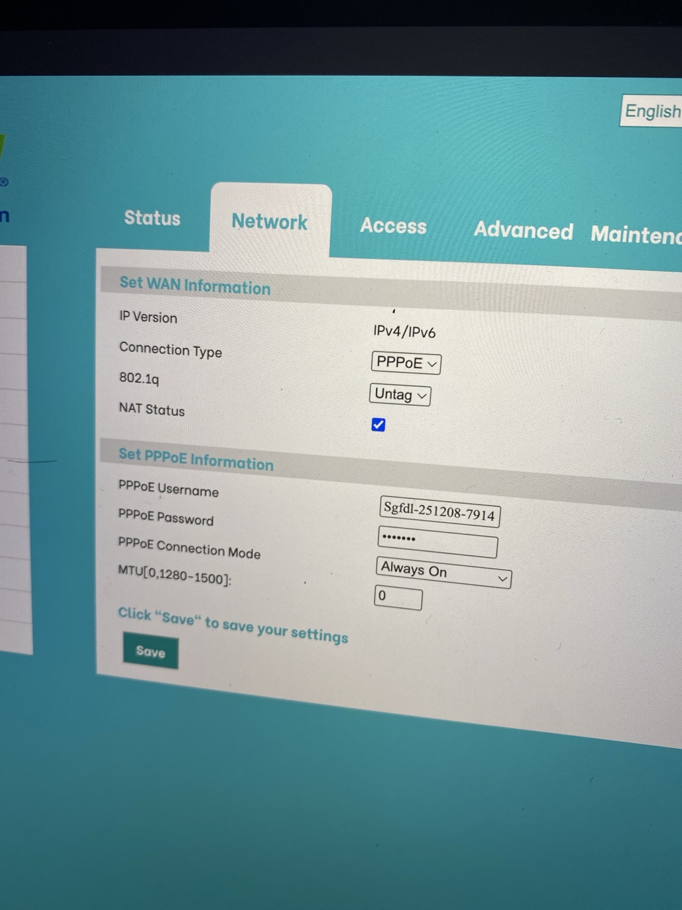
>
> Nhập xong rồi sao bạn

> 

---

### 🤖 ChatGPT `gpt-5-6-thinking` · 2026-09-15 19:55:32

Đúng rồi anh, màn hình này nhập như vậy là ổn.

Giờ anh làm tiếp:

1. Kiểm tra lại password đúng **`aev7914`** — toàn bộ chữ thường.
2. Giữ nguyên:
 - `PPPoE`
 - `Untag`
 - NAT ✅
 - `Always On`
 - MTU `0`
3. Bấm **Save**.
4. Chờ khoảng **30–60 giây**.
5. Vào **Status → Device Info** rồi kéo xuống phần **WAN Status** và bấm **Refresh**.

Nếu thành công anh sẽ thấy:
- `Status: Connected`
- `IP Address`: có địa chỉ IP
- `Default Gateway`: có IP
- `DNS`: có thông tin

Nếu vẫn là **Not Connected / N/A**, anh chụp đúng phần **WAN Status** gửi em. Lúc đó em sẽ xác định tiếp là sai tài khoản PPPoE, cần Reconnect, hay còn thiếu cấu hình phía FPT.

---

> ### 👤 User · 2026-09-15 19:56:19
>
>
> 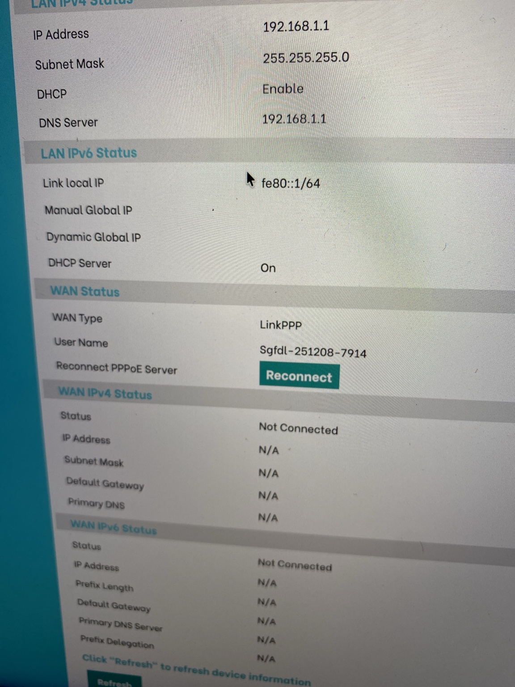

> 

---

### 🤖 ChatGPT `gpt-5-6-thinking` · 2026-09-15 19:56:37

Ảnh này xác nhận modem đã lưu đúng **PPPoE Username**, nhưng **PPPoE vẫn chưa kết nối**:

- WAN Type: `LinkPPP`
- Username: `Sgfdl-251208-7914`
- Status: **Not Connected**
- IP/Gateway/DNS: `N/A`

Anh làm tiếp theo thứ tự này:

1. Bấm **Reconnect** ngay trên màn hình.
2. Chờ khoảng **30–60 giây**, rồi bấm **Refresh** phía dưới.
3. Nếu vẫn `Not Connected`, vào **Status → System Log** và chụp phần log mới nhất gửi em.

Trong log mình sẽ phân biệt được:
- Có `authentication failed`, `PAP/CHAP failed` → sai **username/password** hoặc tài khoản PPPoE chưa được chấp nhận.
- Có `timeout`, `PADO timeout`, không tìm được PPPoE server → khả năng **profile WAN/VLAN/provisioning của FPT** chưa được khôi phục sau reset.
- Không có log PPPoE gì → modem có thể chưa thực sự khởi tạo phiên WAN.

Anh cũng kiểm tra lại **password đúng `aev7914` toàn bộ chữ thường** và username đúng tuyệt đối như FPT cung cấp.

Nếu Reconnect vẫn không lên thì **đừng reset modem thêm lần nữa**. Khi đó khả năng cao FPT cần **đẩy lại profile WAN hoặc clear/reset phiên PPPoE từ hệ thống**. Anh chỉ cần nói:

> “Modem AX3000HV2 đã O5, em nhập đúng PPPoE nhưng WAN vẫn Not Connected, không nhận IP. Nhờ kiểm tra authentication, clear session và provision lại WAN giúp em.”

Anh gửi em ảnh **Status → System Log** là em đọc tiếp được ngay lỗi nằm ở mật khẩu hay ở phía FPT.

---

> ### 👤 User · 2026-09-15 20:19:52
>
>
> 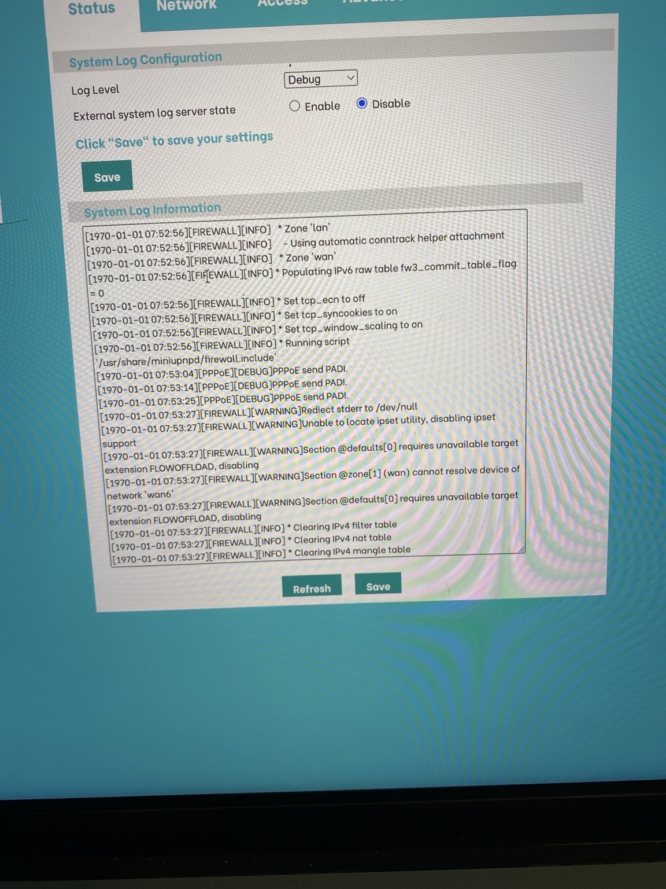

> 

---

### 🤖 ChatGPT `gpt-5-6-thinking` · 2026-09-15 20:20:11

Em xem log rồi anh. Lỗi giờ **không nằm ở username/password PPPoE**.

Dòng quan trọng nhất là:

> `PPPoE send PADI`

và nó lặp lại nhiều lần nhưng **không có `PADO` trả về**.

Điều này nghĩa là modem đang phát yêu cầu tìm PPPoE Server nhưng **phía mạng FPT chưa trả lời**. Tức là kết nối còn chưa tới bước kiểm tra tài khoản/mật khẩu.

Vì trước đó GPON của anh đã **Up / O5 / Rx khoảng -16 dBm**, đường quang vật lý vẫn ổn. Khả năng cao sau Factory Reset modem bị mất một phần cấu hình WAN phía FPT, thường liên quan đến **VLAN/service profile/provisioning của ONT**.

Các cảnh báo như `wan6 cannot resolve device` cũng là hệ quả vì WAN chưa được tạo thành công. Việc log hiện ngày `1970-01-01` là do modem chưa đồng bộ thời gian qua Internet.

### Bây giờ anh không cần thử password nữa

Giữ nguyên username/password FPT đã cung cấp. **Đừng tự đoán VLAN ID** vì VLAN có thể phụ thuộc cấu hình đường truyền.

Anh gọi FPT `1900 6600` hoặc báo qua Hi FPT và nói chính xác câu này:

> “Em vừa factory reset modem AX3000HV2. GPON đang Up, ONU O5 nhưng PPPoE không lên. System Log chỉ lặp `PPPoE send PADI`, không nhận được PADO. Nhờ kỹ thuật kiểm tra và provision lại WAN, VLAN/service profile cho ONT giúp em.”

Đây là thông tin kỹ thuật khá rõ, kỹ thuật FPT sẽ hiểu ngay vấn đề.

**Nếu họ hỏi modem có nhận quang không:** nói `ONU O5`, Rx khoảng `-16 dBm`.

Nếu anh muốn tự kiểm tra thêm trước khi gọi FPT, em có thể hướng dẫn anh xem **Network → Internet → 802.1q** và xác định xem modem hiện có yêu cầu **Tag/VLAN ID** hay không, nhưng **chưa nên đổi gì** cho đến khi biết VLAN chính xác.

---

> ### 👤 User · 2026-09-15 20:44:30
>
> Có thể xữ lý mà không cần gọi không

---

### 🤖 ChatGPT `gpt-5-6-thinking` · 2026-09-15 20:45:00

Có anh, mình vẫn còn vài cách xử lý **không cần gọi tổng đài**. Nhưng với log hiện tại `PPPoE send PADI` lặp lại mà không có `PADO`, em sẽ không khuyên anh thử VLAN lung tung.

Anh làm đúng thứ tự này:

1. Giữ nguyên **Network → Internet**:
 - Connection Type: `PPPoE`
 - 802.1q: `Untag`
 - NAT: bật
 - Username: tài khoản FPT anh vừa nhập
 - Password: `aev7914`
 - Connection Mode: `Always On`
 - MTU: `0`
 - Bấm **Save**

 Đây cũng là cấu hình WAN mà tài liệu AX3000 của FPT hướng dẫn: PPPoE và `Untag`. ([FPT Telecom](https://fpt.vn/storage/upload/files/documents/huong-dan-cai-dat-va-cau-hinh-ax3000hi.pdf?utm_source=chatgpt.com)) 

2. Vào **Maintenance → SysRestart** và chọn **Restart/Reboot**, tuyệt đối không chọn Factory Reset nữa. Hoặc tắt nguồn modem khoảng 30–60 giây rồi bật lại.

3. Chờ modem lên:
 - GPON: `Up`
 - ONU: `O5`

 Sau đó chờ thêm khoảng **3–5 phút**, vào **Status → Device Info → Reconnect**, rồi **Refresh**.

4. Nếu vẫn `Not Connected`, mở **Hi FPT → Internet → Quản lý Modem → Khởi động lại Modem**. FPT có hỗ trợ khởi động modem từ xa ngay trong Hi FPT. ([Hi FPT](https://hi.fpt.vn/support/quan-ly-internet/lam-the-nao-de-khoi-dong-lai-modem-hoac-bo-phat?utm_source=chatgpt.com)) 

Nếu sau tất cả các bước trên log vẫn chỉ có:

`PPPoE send PADI` 
`PPPoE send PADI` 
`PPPoE send PADI`

mà **không xuất hiện PADO**, thì gần như không còn thao tác nào trong giao diện `192.168.1.1` để tự sửa an toàn nữa. Lúc đó vấn đề nhiều khả năng nằm ở **service profile/provisioning phía FPT**, không phải password.

Nhưng anh vẫn **không cần gọi điện**: có thể vào **Hi FPT/Zalo Mini App → Hỗ trợ kỹ thuật → tạo yêu cầu**, ghi:

> “AX3000HV2 vừa factory reset. GPON Up, ONU O5. PPPoE đã nhập đúng nhưng log chỉ `send PADI`, không nhận PADO. Nhờ provision lại WAN/service profile từ xa.”

FPT có hỗ trợ gửi yêu cầu kỹ thuật trực tiếp qua Hi FPT/Zalo. ([FPT Telecom](https://fpt.vn/tin-tuc/mini-app-hi-fpt-da-chinh-thuc-co-mat-tren-zalo-9762.html?utm_source=chatgpt.com)) 

**Em khuyên chưa chuyển `802.1q` từ Untag sang Tag**, vì tài liệu FPT cho cấu hình này đang dùng Untag; nhập VLAN ngẫu nhiên có thể làm tình trạng khó xử lý hơn.

---

*43 messages · 125 nodes*
