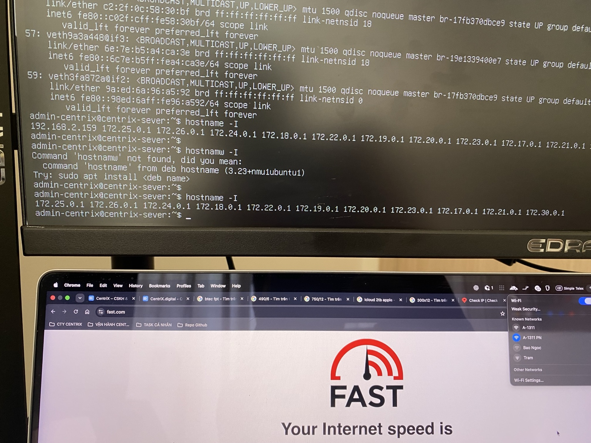
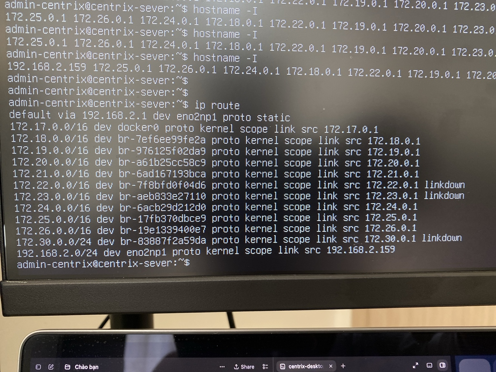
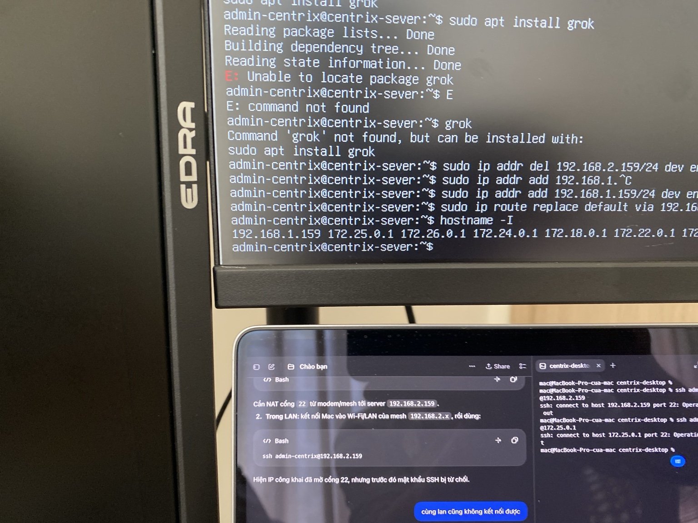
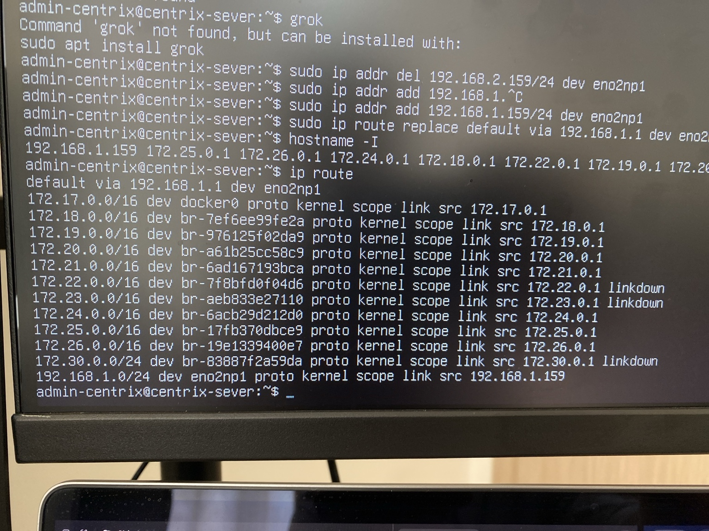

# Hướng dẫn kết nối Linux Server

> **Model:** `gpt-5-6-thinking` · **Created:** 2026-09-16 12:28:42 · **Updated:** 2026-09-19 12:15:21
> **ID:** `6aaa2908-779c-83ec-ad68-0cbcf0ef8812`

<style>
blockquote {
  background-color: rgba(59, 130, 246, 0.08) !important;
  border-left: 4px solid #3b82f6 !important;
  padding: 12px 18px !important;
  border-radius: 8px !important;
  margin: 16px 0 !important;
  color: inherit !important;
}
blockquote h3 {
  margin-top: 0 !important;
  color: #60a5fa !important;
}
</style>

---

> ### 👤 User · 2026-09-16 12:29:00
>
> Chào bạn mình cần hướng dẫn kết nối vào linux sever 24

---

### 🤖 ChatGPT `gpt-5-6-thinking` · 2026-09-16 12:29:06

Chào anh. Nếu anh đang nói đến **Ubuntu Server 24.04 LTS**, cách phổ biến nhất để kết nối từ máy Windows vào server là qua **SSH**.

Anh cần 3 thông tin từ server:

- **IP server**: ví dụ `103.123.45.67`
- **Username**: thường là `root`, `ubuntu`, hoặc user được nhà cung cấp tạo
- **Password** hoặc **SSH Private Key**

### 1. Kết nối từ Windows bằng PowerShell

Mở **PowerShell** hoặc **Windows Terminal**, nhập:

```bash
ssh root@IP_SERVER
```

Ví dụ:

```bash
ssh root@103.123.45.67
```

Nếu username là `ubuntu`:

```bash
ssh ubuntu@103.123.45.67
```

Lần đầu kết nối sẽ hiện:

```text
Are you sure you want to continue connecting (yes/no/[fingerprint])?
```

Nhập:

```text
yes
```

Sau đó nhập mật khẩu.

**Lưu ý:** Khi gõ password trên SSH, màn hình **không hiện dấu `*` hay ký tự nào**, nhưng mật khẩu vẫn đang được nhập. Nhập xong nhấn **Enter**.

---

### 2. Nếu SSH dùng port khác 22

Ví dụ server dùng port `2222`:

```bash
ssh root@103.123.45.67 -p 2222
```

---

### 3. Nếu anh có file SSH Key

Ví dụ file:

```text
server-key.pem
```

thì dùng:

```bash
ssh -i "C:\Users\Loc\Downloads\server-key.pem" root@103.123.45.67
```

Hoặc:

```bash
ssh -i "C:\Users\Loc\Downloads\server-key.pem" ubuntu@103.123.45.67
```

---

### 4. Sau khi đăng nhập thành công

Anh sẽ thấy dạng:

```text
Welcome to Ubuntu 24.04 LTS

root@server:~#
```

hoặc:

```text
ubuntu@server:~$
```

Có thể kiểm tra phiên bản Ubuntu:

```bash
lsb_release -a
```

Kiểm tra IP:

```bash
ip addr
```

Kiểm tra tài nguyên:

```bash
free -h
```

```bash
df -h
```

```bash
lscpu
```

Và cập nhật server:

```bash
sudo apt update && sudo apt upgrade -y
```

Nếu anh gửi cho mình **IP server + ảnh trang thông tin VPS/server** (anh có thể che password), mình có thể chỉ anh **chính xác câu lệnh cần nhập từng bước** để kết nối vào Ubuntu Server 24.04.

---

> ### 👤 User · 2026-09-16 12:29:18
>
> Mình cần tìm ip trên linux

---

### 🤖 ChatGPT `gpt-5-6-thinking` · 2026-09-16 12:29:23

Anh có thể tìm IP trên Linux bằng các lệnh sau:

### Xem nhanh IP nội bộ

```bash
hostname -I
```

Ví dụ kết quả:

```text
192.168.1.120
```

Hoặc xem đầy đủ:

```bash
ip addr
```

Tìm dòng dạng:

```text
inet 192.168.1.120/24
```

Trong card mạng như `eth0`, `ens18`, `enp3s0`...

### Xem IP đang dùng để ra Internet

```bash
ip route get 1.1.1.1
```

Kết quả có thể như:

```text
1.1.1.1 via 192.168.1.1 dev ens18 src 192.168.1.120
```

Thì IP máy Linux là:

```text
192.168.1.120
```

### Xem IP Public

Nếu máy Linux có Internet:

```bash
curl ifconfig.me
```

hoặc:

```bash
curl -4 ifconfig.me
```

Ví dụ:

```text
113.xxx.xxx.xxx
```

Nếu mục đích của anh là **SSH từ máy khác vào Linux**, anh chạy giúp mình:

```bash
hostname -I
```

và

```bash
ip addr
```

rồi gửi ảnh kết quả cho mình, mình sẽ chỉ anh **IP nào cần dùng để kết nối**.

---

> ### 👤 User · 2026-09-16 12:37:36
>
>
> 

> 

---

### 🤖 ChatGPT `gpt-5-6-thinking` · 2026-09-16 12:37:44

Anh xem được rồi. Trong ảnh có một điểm rất quan trọng:

Lần đầu anh chạy:

```bash
hostname -I
```

máy trả về:

```text
192.168.2.159
172.25.0.1
172.26.0.1
172.24.0.1
172.18.0.1
...
```

**IP mạng LAN của server là `192.168.2.159`.** Các IP `172.x.x.x` phía sau chủ yếu là mạng nội bộ do **Docker** tạo ra, anh không cần dùng chúng để SSH từ máy Mac.

Nếu MacBook và server đang cùng mạng, thử trên Terminal của Mac:

```bash
ssh admin-centrix@192.168.2.159
```

Sau đó nhập mật khẩu của user `admin-centrix`.

Tuy nhiên, anh lưu ý: ở lần chạy `hostname -I` cuối cùng trong ảnh, em thấy **`192.168.2.159` đã biến mất**, chỉ còn:

```text
172.25.0.1
172.26.0.1
172.24.0.1
...
```

Điều này cho thấy card mạng chính của Ubuntu **có thể vừa bị mất IP LAN / mất kết nối mạng**.

Anh chạy tiếp 2 lệnh này trên server:

```bash
ip addr
```

và:

```bash
ip route
```

Đặc biệt lệnh này sẽ cho biết card mạng nào đang dùng để ra ngoài:

```bash
ip route get 1.1.1.1
```

Nếu mạng bình thường, kết quả sẽ có dạng:

```text
1.1.1.1 via 192.168.2.1 dev eno1 src 192.168.2.159
```

Trong đó:

- `192.168.2.1` = modem/router
- `eno1` = card LAN
- **`192.168.2.159` = IP server**

Anh gửi em ảnh kết quả của:

```bash
ip route
```

và

```bash
ip addr
```

em chỉ ngay cho anh **card mạng vật lý nào và IP hiện tại của server**, đồng thời nếu đang mất IP thì em hướng dẫn anh lấy lại IP luôn.

---

> ### 👤 User · 2026-09-16 12:39:07
>
> Không có 159 nữa

---

### 🤖 ChatGPT `gpt-5-6-thinking` · 2026-09-16 12:39:18

Đúng anh. Nếu `192.168.2.159` **không còn xuất hiện** và `hostname -I` chỉ còn các IP `172.x.x.x`, thì card mạng LAN của Ubuntu hiện **không có IPv4**. Các IP `172.x` anh thấy là mạng Docker.

Nếu anh đang thao tác trực tiếp trên màn hình server như ảnh thì xử lý khá an toàn. Anh làm lần lượt:

```bash
ip -br addr
```

Anh sẽ thấy dạng:

```text
lo UNKNOWN 127.0.0.1/8
eno1 UP
docker0 UP 172.17.0.1/16
br-xxxx UP 172.x.x.x/16
```

Tên như `eno1`, `enp3s0`, `ens18`, `eth0` thường là **card mạng thật**. Nếu nó ghi `UP` nhưng **không có `192.168.x.x`** thì đúng là chưa được cấp IP.

### Thử lấy lại IP tự động

Chạy:

```bash
sudo netplan apply
```

sau đó:

```bash
sudo systemctl restart systemd-networkd
```

Đợi khoảng 5–10 giây rồi kiểm tra:

```bash
hostname -I
```

Nếu vẫn chỉ có `172.x.x.x`, chạy:

```bash
ip route
```

và:

```bash
ls /etc/netplan
```

sau đó:

```bash
sudo cat /etc/netplan/*.yaml
```

**Anh gửi em ảnh kết quả 3 lệnh này:**

```bash
ip -br addr
```

```bash
ip route
```

```bash
sudo cat /etc/netplan/*.yaml
```

Em sẽ chỉ cho anh chính xác phải sửa dòng nào.

Có khả năng cao do anh vừa **reset modem FPT**, mạng trước đây là `192.168.2.x` nhưng modem sau reset đang chuyển sang một dải khác, ví dụ `192.168.1.x`. Khi đó server cần lấy lại IP mới hoặc mình đặt lại IP tĩnh cho server.

---

> ### 👤 User · 2026-09-16 12:41:30
>
>
> 

> 

---

### 🤖 ChatGPT `gpt-5-6-thinking` · 2026-09-16 12:41:45

Có rồi anh — ở ảnh mới này **IP `192.168.2.159` đã hoạt động trở lại**.

Thông tin hiện tại của server:

- **IP server:** `192.168.2.159`
- **Gateway:** `192.168.2.1`
- **Card mạng:** `eno2np1`
- **Subnet:** `192.168.2.0/24`
- Cấu hình đang là **static IP** (`proto static`)

Dòng quan trọng là:

```text
default via 192.168.2.1 dev eno2np1 proto static
```

và:

```text
192.168.2.0/24 dev eno2np1 proto kernel scope link src 192.168.2.159
```

### Bây giờ anh kết nối từ MacBook

Mở Terminal trên Mac rồi kiểm tra trước:

```bash
ping 192.168.2.159
```

Nếu có phản hồi như:

```text
64 bytes from 192.168.2.159
```

thì SSH:

```bash
ssh admin-centrix@192.168.2.159
```

Lần đầu nếu hỏi:

```text
Are you sure you want to continue connecting?
```

nhập:

```text
yes
```

rồi nhập password của `admin-centrix`.

Nếu anh muốn kiểm tra SSH trên server có đang chạy không thì dùng:

```bash
sudo systemctl status ssh
```

Nếu chưa chạy:

```bash
sudo systemctl enable --now ssh
```

**Hiện tại phần IP server của anh đã đúng rồi: `192.168.2.159`.** Các địa chỉ `172.x.x.x` phía dưới là Docker, mình bỏ qua.

---

> ### 👤 User · 2026-09-16 12:42:14
>
> PS C:\Users\Admin> ping 192.168.2.159ping 192.168.2.159ping 192.168.2.159
> Ping request could not find host 192.168.2.159ping. Please check the name and try again.
> PS C:\Users\Admin>

---

### 🤖 ChatGPT `gpt-5-6-thinking` · 2026-09-16 12:42:23

Anh nhập bị dính lệnh 3 lần nên PowerShell hiểu `192.168.2.159ping` là tên host.

Anh nhập lại đúng như này thôi:

```powershell
ping 192.168.2.159
```

Nếu thấy kiểu:

```text
Reply from 192.168.2.159: bytes=32 time<1ms TTL=64
```

thì mạng tới server đang thông.

Sau đó SSH:

```powershell
ssh admin-centrix@192.168.2.159
```

Nếu `ping 192.168.2.159` vẫn báo `Request timed out` hoặc `Destination host unreachable`, gửi anh kết quả lệnh này trên Windows:

```powershell
ipconfig
```

Em sẽ xem máy Windows có đang cùng dải `192.168.2.x` với server không.

---

> ### 👤 User · 2026-09-16 12:42:38
>
> PS C:\Users\Admin> ping 192.168.2.159
>
> Pinging 192.168.2.159 with 32 bytes of data:
> Request timed out.

---

### 🤖 ChatGPT `gpt-5-6-thinking` · 2026-09-16 12:42:56

Anh, `Request timed out` chưa chắc server mất mạng — có thể Windows đang khác dải mạng, hoặc ICMP bị chặn.

Anh kiểm tra theo thứ tự này:

1. Trên Windows chạy:

```powershell
ipconfig
```

Tìm phần card mạng đang dùng và xem:

```text
IPv4 Address.....: 192.168.x.x
Default Gateway....: 192.168.x.1
```

Nếu Windows đang là kiểu:

```text
192.168.1.xxx
```

trong khi server là:

```text
192.168.2.159
```

thì **hai máy đang khác subnet**, nên thường sẽ không kết nối trực tiếp được.

2. Kiểm tra SSH trực tiếp, vì có trường hợp ping bị chặn nhưng SSH vẫn chạy:

```powershell
Test-NetConnection 192.168.2.159 -Port 22
```

Nếu thấy:

```text
TcpTestSucceeded: True
```

thì kết nối luôn:

```powershell
ssh admin-centrix@192.168.2.159
```

3. Trên Linux server, kiểm tra server có đi được tới modem không:

```bash
ping -c 4 192.168.2.1
```

Nếu trả lời bình thường thì card LAN server đang ổn.

Sau đó kiểm tra SSH:

```bash
sudo systemctl status ssh
```

và:

```bash
sudo ss -tlnp | grep:22
```

Nếu SSH chưa chạy:

```bash
sudo systemctl enable --now ssh
```

Anh gửi em kết quả **`ipconfig` trên Windows** trước. Em nghi nhiều nhất là sau khi anh reset modem FPT, máy Windows đang ở dải khác còn Linux vẫn đang giữ IP tĩnh `192.168.2.159`.

---

> ### 👤 User · 2026-09-16 12:43:31
>
> Windows IP Configuration
>
>
> Unknown adapter Tailscale:
>
>  Connection-specific DNS Suffix.:
>  Link-local IPv6 Address.....: fe80::97ca:c2ad:53bd:8a63%14
>  Autoconfiguration IPv4 Address..: 169.254.83.107
>  Subnet Mask...........: 255.255.0.0
>  Default Gateway.........:
>
> Ethernet adapter vEthernet (Default Switch):
>
>  Connection-specific DNS Suffix.:
>  Link-local IPv6 Address.....: fe80::b2be:3f18:2911:ad49%23
>  IPv4 Address...........: 172.28.240.1
>  Subnet Mask...........: 255.255.240.0
>  Default Gateway.........:
>
> Ethernet adapter Ethernet:
>
>  Connection-specific DNS Suffix.: fpt
>  IPv6 Address...........: 2405:4800:5f37:2400::f12
>  IPv6 Address...........: 2405:4800:5f37:2400:96c3:9784:17fe:d48a
>  Temporary IPv6 Address......: 2405:4800:5f37:2400:5065:afd9:3a42:d5db
>  Link-local IPv6 Address.....: fe80::bfb3:b80a:447f:9acf%10
>  IPv4 Address...........: 192.168.1.223
>  Subnet Mask...........: 255.255.255.0
>  Default Gateway.........: fe80::1%10
>  192.168.1.1
>
> Unknown adapter Local Area Connection:
>
>  Media State...........: Media disconnected
>  Connection-specific DNS Suffix.:
> PS C:\Users\Admin>
>

---

### 🤖 ChatGPT `gpt-5-6-thinking` · 2026-09-16 12:43:52

Đúng nguyên nhân rồi anh.

**Windows đang ở mạng:**

```text
IP: 192.168.1.223
Gateway: 192.168.1.1
Subnet: 255.255.255.0
```

Trong khi Linux Server hiện vẫn giữ IP tĩnh:

```text
IP: 192.168.2.159
Gateway: 192.168.2.1
Card: eno2np1
```

Hai máy đang ở **2 dải mạng khác nhau**, nên Windows không ping được server. Khả năng cao sau khi anh reset modem FPT, modem đã đổi từ `192.168.2.1` về mặc định `192.168.1.1`, nhưng server vẫn giữ cấu hình IP tĩnh cũ.

### Cách sửa nhanh trên Linux Server

Anh đang có màn hình trực tiếp của Linux nên trước tiên thử chuyển server sang `192.168.1.159`.

Trước hết từ Windows kiểm tra IP này có đang được dùng không:

```powershell
ping 192.168.1.159
```

Nếu không có máy nào trả lời, trên Linux chạy:

```bash
sudo ip addr del 192.168.2.159/24 dev eno2np1
```

Sau đó:

```bash
sudo ip addr add 192.168.1.159/24 dev eno2np1
```

Đổi gateway:

```bash
sudo ip route replace default via 192.168.1.1 dev eno2np1
```

Kiểm tra:

```bash
ip route
```

Anh cần thấy:

```text
default via 192.168.1.1 dev eno2np1
192.168.1.0/24 dev eno2np1 scope link src 192.168.1.159
```

Sau đó thử Internet:

```bash
ping -c 4 192.168.1.1
```

và:

```bash
ping -c 4 1.1.1.1
```

Rồi trên Windows:

```powershell
ping 192.168.1.159
```

Nếu ping được thì SSH:

```powershell
ssh admin-centrix@192.168.1.159
```

**Lưu ý:** cách trên chỉ là đổi **tạm thời**, reboot server có thể quay lại `192.168.2.159`.

Sau khi anh kết nối được, mình sẽ sửa Netplan để cố định:

```text
192.168.1.159
Gateway 192.168.1.1
```

Anh có thể gửi em kết quả:

```bash
sudo cat /etc/netplan/*.yaml
```

Em sẽ viết chính xác file cấu hình Netplan cho anh, không cần tự đoán YAML.

---

> ### 👤 User · 2026-09-16 12:44:28
>
> PS C:\Users\Admin> ping 192.168.1.159
>
> Pinging 192.168.1.159 with 32 bytes of data:
> Reply from 192.168.1.223: Destination host unreachable.
> Request timed out.
> Reply from 192.168.1.223: Destination host unreachable.
> Reply from 192.168.1.223: Destination host unreachable.
>
> Ping statistics for 192.168.1.159:
>  Packets: Sent = 4, Received = 3, Lost = 1 (25% loss),
> PS C:\Users\Admin>

---

### 🤖 ChatGPT `gpt-5-6-thinking` · 2026-09-16 12:44:40

Đúng rồi anh. Kết quả này cho thấy **`192.168.1.159` hiện không có thiết bị phản hồi**, nên mình có thể thử dùng IP này cho Linux Server.

Dòng:

```text
Reply from 192.168.1.223: Destination host unreachable.
```

là **máy Windows `192.168.1.223` tự báo không tìm thấy thiết bị `.159`**, chứ không phải `.159` đang trả lời.

Trên màn hình Linux Server, anh chạy lần lượt:

```bash
sudo ip addr del 192.168.2.159/24 dev eno2np1
```

Sau đó:

```bash
sudo ip addr add 192.168.1.159/24 dev eno2np1
```

Đổi gateway về modem FPT hiện tại:

```bash
sudo ip route replace default via 192.168.1.1 dev eno2np1
```

Kiểm tra:

```bash
hostname -I
```

Anh phải thấy:

```text
192.168.1.159
```

và kiểm tra route:

```bash
ip route
```

Phần cuối nên có:

```text
default via 192.168.1.1 dev eno2np1
192.168.1.0/24 dev eno2np1 scope link src 192.168.1.159
```

Sau đó trên **Linux** thử:

```bash
ping -c 4 192.168.1.1
```

Nếu được, trên **Windows** chạy lại:

```powershell
ping 192.168.1.159
```

Rồi thử SSH:

```powershell
ssh admin-centrix@192.168.1.159
```

Nếu SSH vào được thì coi như mạng đã sửa xong phần tạm thời. Sau đó anh gửi em kết quả:

```bash
sudo cat /etc/netplan/*.yaml
```

Em sẽ hướng dẫn anh đổi **vĩnh viễn từ `192.168.2.159` → `192.168.1.159`**, để restart server không bị quay lại IP cũ.

---

> ### 👤 User · 2026-09-16 12:52:07
>
>
> 

> 

---

### 🤖 ChatGPT `gpt-5-6-thinking` · 2026-09-16 12:52:15

Được rồi anh, ảnh này cho thấy **server đã nhận IP mới thành công**:

```text
192.168.1.159
```

Dòng `hostname -I` đã xuất hiện `192.168.1.159`, nên phần đổi IP từ `192.168.2.159` sang `192.168.1.159` đã OK.

Bây giờ trên Linux anh chạy:

```bash
ip route
```

Em cần thấy gần giống:

```text
default via 192.168.1.1 dev eno2np1
192.168.1.0/24 dev eno2np1 scope link src 192.168.1.159
```

Sau đó kiểm tra modem:

```bash
ping -c 4 192.168.1.1
```

Nếu có reply thì kiểm tra Internet:

```bash
ping -c 4 1.1.1.1
```

### Sau đó quay lại Windows

Chạy:

```powershell
ping 192.168.1.159
```

Nếu được reply thì thử SSH luôn:

```powershell
ssh admin-centrix@192.168.1.159
```

Nếu **ping được nhưng SSH không vào được**, trên Linux chạy:

```bash
sudo systemctl status ssh
```

Nếu SSH chưa chạy:

```bash
sudo systemctl enable --now ssh
```

Kiểm tra port 22:

```bash
sudo ss -tlnp | grep:22
```

Sau khi kết nối được, mình còn **1 bước quan trọng**: hiện tại `192.168.1.159` mới là thay đổi tạm thời. Restart Linux có thể quay về `192.168.2.159`.

Anh chạy cho em:

```bash
sudo cat /etc/netplan/*.yaml
```

rồi chụp ảnh gửi em. Em sẽ sửa cấu hình cố định thành **`192.168.1.159` + gateway `192.168.1.1`** cho anh.

---

> ### 👤 User · 2026-09-16 12:52:58
>
>
> 

> 

---

### 🤖 ChatGPT `gpt-5-6-thinking` · 2026-09-16 12:53:08

Đúng rồi anh, **phần mạng trên Linux hiện đã đúng**.

Ảnh cho thấy:

```text
default via 192.168.1.1 dev eno2np1
```

và:

```text
192.168.1.0/24 dev eno2np1... src 192.168.1.159
```

Tức là hiện tại:

- Server Linux: **192.168.1.159**
- Windows: **192.168.1.223**
- Gateway: **192.168.1.1**
- Card mạng Linux: **eno2np1**

Hai máy giờ đã **cùng subnet `192.168.1.x`**.

### Bây giờ trên Windows chạy

```powershell
ping 192.168.1.159
```

Nếu thấy:

```text
Reply from 192.168.1.159...
```

thì thử SSH:

```powershell
ssh admin-centrix@192.168.1.159
```

Nếu ping vẫn không được, trên Linux chạy:

```bash
ping -c 4 192.168.1.223
```

và:

```bash
sudo systemctl status ssh
```

Nếu SSH chưa chạy:

```bash
sudo systemctl enable --now ssh
```

Sau đó kiểm tra port 22:

```bash
sudo ss -tlnp | grep:22
```

### Quan trọng

IP `192.168.1.159` hiện anh vừa cấu hình bằng lệnh `ip`, nên **chỉ là tạm thời**. Reboot server có thể lại quay về `192.168.2.159`.

Sau khi thử kết nối thành công, trên Linux chạy:

```bash
sudo cat /etc/netplan/*.yaml
```

Chụp kết quả gửi em. Em sẽ chỉ anh sửa Netplan để **cố định `192.168.1.159` vĩnh viễn** mà không làm ảnh hưởng Docker.

---

> ### 👤 User · 2026-09-16 12:54:01
>
> Đã đăng nhập được

---

### 🤖 ChatGPT `gpt-5-6-thinking` · 2026-09-16 12:54:10

Tốt rồi anh, vậy kết nối SSH đã hoạt động bình thường với IP mới `192.168.1.159`.

Bước tiếp theo nên làm là **cố định IP này**, vì hiện tại anh mới đổi bằng lệnh `ip`, restart server có thể quay lại `192.168.2.159`.

Anh chạy:

```bash
sudo cat /etc/netplan/*.yaml
```

Rồi gửi em nội dung hiện ra. Em sẽ viết lại chính xác cấu hình để giữ cố định:

```text
IP: 192.168.1.159
Gateway: 192.168.1.1
Card mạng: eno2np1
```

và không ảnh hưởng các mạng Docker `172.x.x.x`.

---

> ### 👤 User · 2026-09-16 13:02:09
>
> Learn more about enabling ESM Apps service at https://ubuntu.com/esm
>
>
> Last login: Tue Sep 15 10:45:52 2026 from 192.168.2.21
> admin-centrix@centrix-sever:~$ sudo cat /etc/netplan/*.yaml
> [sudo] password for admin-centrix:
> network:
>  version: 2
>  ethernets:
>  eno2np1:
>  dhcp4: false
>  addresses:
>  - 192.168.2.159/24
>  routes:
>  - to: default
>  via: 192.168.2.1
>  nameservers:
>  addresses:
>  - 192.168.2.1
>  - 8.8.8.8
>  search:
>  - lan
> admin-centrix@centrix-sever:~$

---

### 🤖 ChatGPT `gpt-5-6-thinking` · 2026-09-16 13:02:24

Đúng rồi anh, nguyên nhân đã rõ: **Netplan vẫn đang lưu cấu hình cũ `192.168.2.159`**, còn `192.168.1.159` lúc nãy mình chỉ đổi tạm thời bằng lệnh `ip`.

Thông báo `ESM Apps` phía trên không liên quan, có thể bỏ qua.

Mình cần đổi Netplan thành:

```text
IP: 192.168.1.159/24
Gateway: 192.168.1.1
DNS: 192.168.1.1, 8.8.8.8
Card: eno2np1
```

Trước tiên chạy để xem tên file:

```bash
ls -l /etc/netplan/
```

Anh sẽ thấy kiểu như:

```text
50-cloud-init.yaml
```

Sau đó mở đúng file đó, ví dụ:

```bash
sudo nano /etc/netplan/50-cloud-init.yaml
```

Thay toàn bộ nội dung thành:

```yaml
network:
 version: 2
 ethernets:
 eno2np1:
 dhcp4: false
 addresses:
 - 192.168.1.159/24
 routes:
 - to: default
 via: 192.168.1.1
 nameservers:
 addresses:
 - 192.168.1.1
 - 8.8.8.8
 search:
 - lan
```

Trong `nano`:

```text
Ctrl + O
Enter
Ctrl + X
```

### Kiểm tra trước khi áp dụng

Rất nên chạy:

```bash
sudo netplan generate
```

Nếu **không hiện lỗi gì** thì YAML hợp lệ.

Vì anh đang SSH từ xa, dùng:

```bash
sudo netplan try
```

thay vì `sudo netplan apply`.

Nó sẽ hỏi xác nhận. Nếu mạng vẫn hoạt động, nhấn:

```text
Enter
```

để giữ cấu hình mới.

Sau đó kiểm tra:

```bash
ip route
```

phải có:

```text
default via 192.168.1.1 dev eno2np1
192.168.1.0/24 dev eno2np1... src 192.168.1.159
```

Và:

```bash
hostname -I
```

phải còn:

```text
192.168.1.159
```

Cuối cùng test:

```bash
ping -c 4 192.168.1.1
```

```bash
ping -c 4 1.1.1.1
```

```bash
ping -c 4 google.com
```

Nếu cả ba đều chạy thì **IP `192.168.1.159` đã được cố định vĩnh viễn**. Restart server sau này vẫn giữ IP này.

Nếu anh gửi kết quả của:

```bash
ls -l /etc/netplan/
```

em chỉ luôn cho anh **chính xác file nào cần sửa**, tránh đụng nhầm file.

---

> ### 👤 User · 2026-09-16 13:02:56
>
> admin-centrix@centrix-sever:~$ ls -l /etc/netplan/
> total 8
> -rw------- 1 root root 288 Sep 14 08:05 50-cloud-init.yaml
> -rw------- 1 root root 66 Jul 20 10:38 50-cloud-init.yaml.bak-20260914080510
> admin-centrix@centrix-sever:~$

---

### 🤖 ChatGPT `gpt-5-6-thinking` · 2026-09-16 13:03:10

Đúng file rồi anh. File đang được dùng là:

```bash
/etc/netplan/50-cloud-init.yaml
```

Còn file:

```bash
50-cloud-init.yaml.bak-20260914080510
```

chỉ là **file backup**, không ảnh hưởng cấu hình hiện tại.

Anh làm như sau.

### 1. Backup thêm một bản trước khi sửa

```bash
sudo cp /etc/netplan/50-cloud-init.yaml /etc/netplan/50-cloud-init.yaml.bak-before-1921681
```

### 2. Mở file cấu hình

```bash
sudo nano /etc/netplan/50-cloud-init.yaml
```

Xóa nội dung cũ và thay bằng đúng đoạn này:

```yaml
network:
 version: 2
 ethernets:
 eno2np1:
 dhcp4: false
 addresses:
 - 192.168.1.159/24
 routes:
 - to: default
 via: 192.168.1.1
 nameservers:
 addresses:
 - 192.168.1.1
 - 8.8.8.8
 search:
 - lan
```

Lưu bằng:

```text
Ctrl + O
Enter
Ctrl + X
```

### 3. Kiểm tra cú pháp

Chạy:

```bash
sudo netplan generate
```

Nếu **không báo lỗi gì** là tốt.

Sau đó vì anh đang SSH vào server, em khuyên dùng:

```bash
sudo netplan try
```

Nếu hiện dạng:

```text
Do you want to keep these settings?
Press ENTER before the timeout to accept the new configuration
```

và SSH vẫn hoạt động, anh **nhấn Enter**.

### 4. Kiểm tra lại

```bash
hostname -I
```

Phải có:

```text
192.168.1.159
```

Sau đó:

```bash
ip route
```

Phải có hai dòng quan trọng gần giống:

```text
default via 192.168.1.1 dev eno2np1
192.168.1.0/24 dev eno2np1 proto kernel scope link src 192.168.1.159
```

Test Internet:

```bash
ping -c 4 192.168.1.1
```

```bash
ping -c 4 1.1.1.1
```

```bash
ping -c 4 google.com
```

Nếu cả ba đều OK thì cấu hình hoàn tất.

Sau đó em khuyên anh **reboot một lần để xác nhận IP thực sự giữ cố định**:

```bash
sudo reboot
```

Đợi khoảng 1–2 phút rồi từ Windows:

```powershell
ping 192.168.1.159
```

và:

```powershell
ssh admin-centrix@192.168.1.159
```

Nếu vào lại được sau reboot thì **`192.168.1.159` đã được cố định thành công**.

---


*28 messages · 45 nodes*
