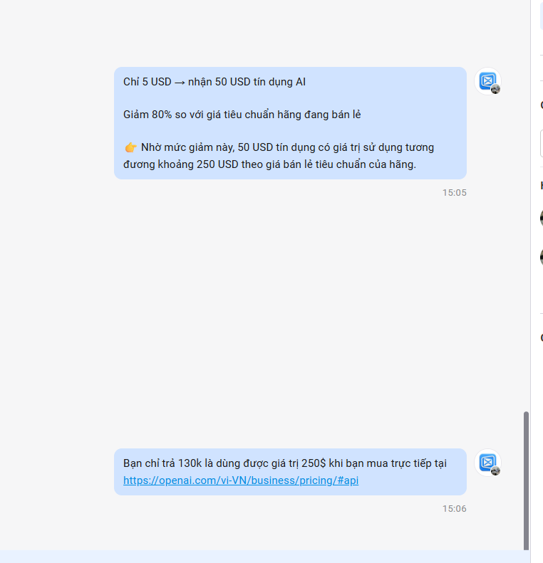

# Viết thông điệp ưu đãi API

> **Model:** `gpt-5-6-thinking` · **Created:** 2026-09-16 21:48:18 · **Updated:** 2026-09-17 15:06:48
> **ID:** `6aaaac30-bb00-83ec-9fc8-f3b559960127`

---

> ### 👤 User · 2026-09-16 21:49:03
>
> TRả 5$ nhận được 50$ sử dụng api của ChatGPT và được giảm thêm 80% bảng giá model thì nói thế nào để cho khách hiểu lợi bạn

---

### 🤖 ChatGPT `gpt-5-6-thinking` · 2026-09-16 21:49:13

Anh nên **quy đổi lợi ích ra con số cụ thể**, khách sẽ hiểu nhanh hơn nhiều:

:::writing{variant="social_post" id="58321" title="Thông điệp ưu đãi API"}
🔥 **Chỉ 5 USD – nhận ngay sức mạnh sử dụng tương đương 250 USD!**

Bạn chỉ cần trả **5 USD** để nhận:

💰 **50 USD tín dụng API** – gấp **10 lần** số tiền bỏ ra 
⚡ **Giảm thêm đến 80% giá sử dụng model** so với bảng giá tiêu chuẩn

Điều đó có nghĩa:

**50 USD tín dụng × mức giá chỉ còn 20% = sức mua tương đương khoảng 250 USD theo giá tiêu chuẩn.**

👉 **Bỏ ra 5 USD → nhận 50 USD credit → sử dụng tương đương khoảng 250 USD giá API tiêu chuẩn.**

**Tối đa hóa chi phí AI – dùng nhiều hơn, trả ít hơn.**
:::

Nếu **50 USD credit thực sự được áp dụng đồng thời với mức giảm 80%**, thì điểm mạnh nhất anh nên quảng cáo là **“5 USD đổi lấy sức mua tương đương 250 USD”**, tức giá trị sử dụng lý thuyết **gấp 50 lần số tiền khách bỏ ra**. Cách này dễ hiểu hơn nhiều so với chỉ nói “tặng 50 USD + giảm 80%”.

---

> ### 👤 User · 2026-09-17 15:04:08
>
> mình cần ngắn gọn dễ hiểu

---

### 🤖 ChatGPT `gpt-5-6-thinking` · 2026-09-17 15:04:12

:::writing{variant="social_post" id="64127" title="Thông điệp ngắn"}
Chỉ **5 USD** → nhận **50 USD tín dụng API** 
+ **giảm thêm 80% giá model**.

👉 Tương đương sức dùng khoảng **250 USD** theo giá tiêu chuẩn.
:::

---

> ### 👤 User · 2026-09-17 15:04:21
>
> Làm rõ ưu đãi 250 USD tương đương

---

### 🤖 ChatGPT `gpt-5-6-thinking` · 2026-09-17 15:04:28

:::writing{variant="social_post" id="64127" title="Thông điệp ngắn"}
Chỉ **5 USD** → nhận **50 USD tín dụng API** 
+ **giảm 80% giá model**.

👉 Vì giá chỉ còn **20%**, nên **50 USD tín dụng có sức dùng tương đương khoảng 250 USD** theo bảng giá tiêu chuẩn.
:::

Nếu muốn, mình có thể rút tiếp thành **1 câu bán hàng cực ngắn**.

---

> ### 👤 User · 2026-09-17 15:04:43
>
> giá tiêu chuẩn và hãng đang bán lẻ

---

### 🤖 ChatGPT `gpt-5-6-thinking` · 2026-09-17 15:04:49

:::writing{variant="social_post" id="64127" title="Thông điệp ngắn"}
Chỉ **5 USD** → nhận **50 USD tín dụng API** 
+ **giảm 80% so với giá tiêu chuẩn hãng đang bán lẻ**.

👉 Tức **50 USD tín dụng có sức dùng tương đương khoảng 250 USD** theo giá bán lẻ của hãng.
:::

---

> ### 👤 User · 2026-09-17 15:05:03
>
> Chỉ **5 USD** → nhận **50 USD tín dụng AI**
>
> - **giảm 80% so với giá tiêu chuẩn hãng đang bán lẻ**.
>
> 👉 Tức **50 USD tín dụng có sức dùng tương đương khoảng 250 USD** theo giá bán lẻ của hãng.

---

### 🤖 ChatGPT `gpt-5-6-thinking` · 2026-09-17 15:05:09

Anh có thể viết gọn và rõ hơn như này:

:::writing{variant="social_post" id="64127" title="Ưu đãi tín dụng AI"}
Chỉ **5 USD** → nhận **50 USD tín dụng AI**

- **Giảm 80% so với giá tiêu chuẩn hãng đang bán lẻ**

👉 Nhờ mức giảm này, **50 USD tín dụng có giá trị sử dụng tương đương khoảng 250 USD** theo giá bán lẻ tiêu chuẩn của hãng.
:::

Em có thể viết thêm một bản **ngắn hơn, kiểu headline quảng cáo** nếu anh muốn.

---

> ### 👤 User · 2026-09-17 15:06:31
>
>
> 

> 

---

### 🤖 ChatGPT `gpt-5-6-thinking` · 2026-09-17 15:06:43

Anh có thể viết rõ và tự nhiên hơn như này:

**Bạn chỉ trả 130.000đ nhưng nhận giá trị sử dụng tương đương khoảng 250 USD nếu tính theo giá bán lẻ tiêu chuẩn của hãng.**

Hoặc mạnh hơn một chút:

**Chỉ 130.000đ → giá trị sử dụng tương đương khoảng 250 USD theo giá niêm yết trực tiếp của hãng.**

---

*12 messages · 19 nodes*
