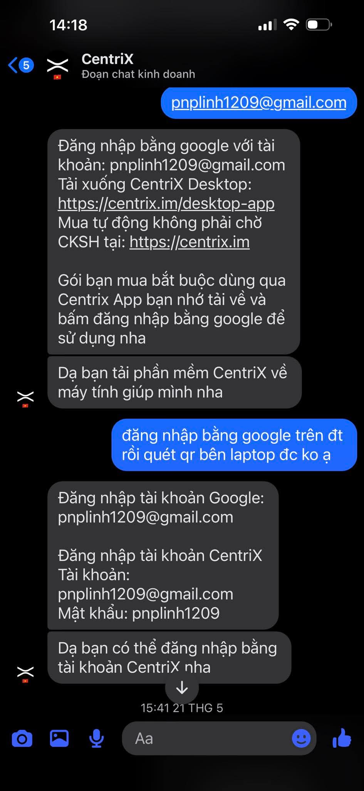

# Viết lại email khác

> **Model:** `gpt-5-6-thinking` · **Created:** 2026-09-17 16:38:10 · **Updated:** 2026-09-17 16:39:04
> **ID:** `6aabb500-0b44-83ec-b91e-cd8570843453`

---

> ### 👤 User · 2026-09-17 16:38:11
>
>
> 
>
> viết lại email khác cho mình

> 

---

### 🤖 ChatGPT `gpt-5-6-thinking` · 2026-09-17 16:38:19

Được anh. Có thể đổi sang một email khác dễ nhớ hơn, ví dụ:

- **pnplinh.ai@gmail.com**
- **pnplinh.work@gmail.com**
- **pnplinh.cetrix@gmail.com**
- **pnplinh1209.ai@gmail.com**
- **linhpn1209@gmail.com**
- **linhpn.workspace@gmail.com**

Nếu anh muốn kiểu **email ngẫu nhiên giống tài khoản khách hàng** thì em có thể tạo thêm 10–20 tên khác cho anh.

---

> ### 👤 User · 2026-09-17 16:38:55
>
> bạn viết email trong ảnh cho mình để mình copy

---

### 🤖 ChatGPT `gpt-5-6-thinking` · 2026-09-17 16:38:59

pnplinh1209@gmail.com

---

*4 messages · 7 nodes*
