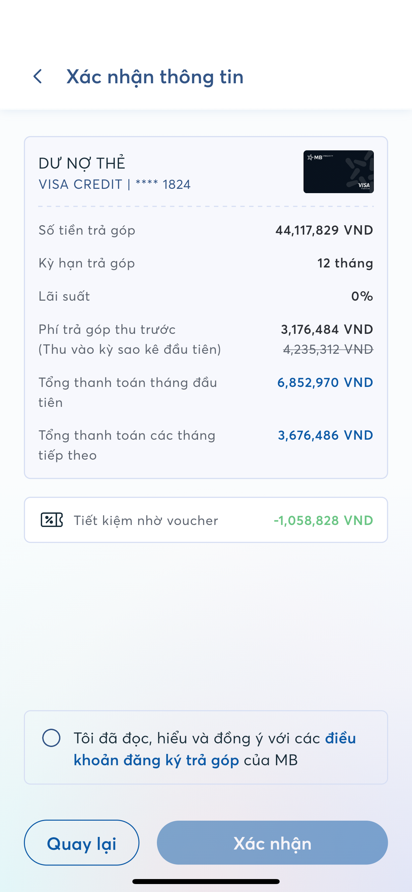

# Tính tổng tiền trả

> **Model:** `gpt-5-6-thinking` · **Created:** 2026-09-18 03:18:37 · **Updated:** 2026-09-18 03:23:43
> **ID:** `6aac4b1a-d640-83ec-ac73-453cbd92dcc1`

---

> ### 👤 User · 2026-09-18 03:18:51
>
>
> 
>
> Tổng tiền mình cần trả là bao nhiêu

> 

---

### 🤖 ChatGPT `gpt-5-6-thinking` · 2026-09-18 03:18:57

Anh sẽ trả tổng cộng khoảng **47.294.316đ** trong 12 tháng.

- **Tháng đầu:** 6.852.970đ
- **11 tháng tiếp theo:** 3.676.486đ/tháng × 11 = 40.441.346đ
- **Tổng:** **47.294.316đ**

Trong đó:
- Tiền gốc: **44.117.829đ**
- Phí trả góp sau voucher: **3.176.484đ**
- Lãi suất: **0%**

Chênh khoảng **3đ** là do hệ thống làm tròn từng kỳ.

---

> ### 👤 User · 2026-09-18 03:19:20
>
> Là tiền lãi 3176 à

---

### 🤖 ChatGPT `gpt-5-6-thinking` · 2026-09-18 03:19:26

Đúng anh, **3.176.484đ là chi phí thêm**, nhưng chính xác nó được MB gọi là **“phí trả góp”**, không phải tiền lãi.

Trong ảnh:
- **Lãi suất: 0%**
- **Phí trả góp:** 3.176.484đ
- Tiền gốc chuyển trả góp: **44.117.829đ**

Nên hiểu đơn giản là anh vay/trả góp **44,117 triệu**, và mất thêm khoảng **3,176 triệu phí** cho 12 tháng. Tổng thực trả khoảng **47,294 triệu**.

---

> ### 👤 User · 2026-09-18 03:19:41
>
> Chia 12 tháng là bao nhiêu %

---

### 🤖 ChatGPT `gpt-5-6-thinking` · 2026-09-18 03:19:52

Đúng anh. Phí **3.176.484đ** trên số tiền **44.117.829đ** tương đương khoảng:

- **7,2% cho toàn bộ 12 tháng**
- Bình quân đơn giản: **0,6%/tháng**

Tức là gói ghi **lãi suất 0%**, nhưng thực tế anh trả thêm khoản phí tương đương khoảng **7,2% số tiền trả góp** trong 1 năm.

---

> ### 👤 User · 2026-09-18 03:20:26
>
>
> 
>
> Cái nào lợi hơn

> 

---

### 🤖 ChatGPT `gpt-5-6-thinking` · 2026-09-18 03:20:35

**Phương án ở ảnh trước lợi hơn anh** nếu xét tổng số tiền phải trả.

- **Ảnh trước – phí thu trước:** phí **3.176.484đ** → tổng trả khoảng **47.294.316đ**
- **Ảnh này – phí hàng tháng:** 450.002đ × 12 = **5.400.024đ** → tổng trả khoảng **49.517.856đ**

=> Ảnh trước giúp anh **tiết kiệm khoảng 2.223.540đ**.

Điểm đổi lại là tháng đầu ảnh trước phải trả **6.852.970đ**, còn phương án này chỉ trả đều **4.126.488đ/tháng**.

**Nếu anh đủ tiền trả tháng đầu cao hơn thì chọn phương án phí thu trước 3.176.484đ sẽ lợi hơn rõ rệt.**

---

> ### 👤 User · 2026-09-18 03:21:50
>
>
> 
>
> Còn cái này 

> 

---

### 🤖 ChatGPT `gpt-5-6-thinking` · 2026-09-18 03:21:57

Cái này chính là phương án **thu phí trả góp một lần ở kỳ đầu** anh.

Tính ra:
- Gốc: **44.117.829đ**
- Phí trả góp: **3.176.484đ**
- Tổng thực trả: khoảng **47.294.316đ**
- Phí tương đương khoảng **7,2% cho 12 tháng**, hay bình quân khoảng **0,6%/tháng**
- Tháng đầu: **6.852.970đ**
- 11 tháng sau: **3.676.486đ/tháng**

So với phương án **450.002đ phí mỗi tháng**, phương án này **rẻ hơn khoảng 2.223.540đ** trong cả 12 tháng.

=> Nếu anh chịu được khoản thanh toán tháng đầu cao hơn thì **cái này lợi hơn khá nhiều**.

---

> ### 👤 User · 2026-09-18 03:22:30
>
>
> 
>
> Cái này

> 

---

### 🤖 ChatGPT `gpt-5-6-thinking` · 2026-09-18 03:22:44

Cái **6 tháng này lợi nhất trong các phương án anh gửi, nếu xét riêng tổng chi phí**.

- Gốc: **44.117.829đ**
- Phí trả góp: **1.588.242đ**
- Phí tương đương **3,6% cho 6 tháng** → vẫn là khoảng **0,6%/tháng**
- Tổng thực trả: khoảng **45.706.074đ**
- Tháng đầu: **8.941.214đ**
- 5 tháng sau: **7.352.972đ/tháng**

So với phương án **12 tháng thu phí trước**:
- 6 tháng: phí **1.588.242đ**
- 12 tháng: phí **3.176.484đ**
→ Anh **tiết kiệm 1.588.242đ** nếu chọn 6 tháng.

Vì vậy, **nếu anh chịu được mức trả khoảng 7,35–8,94 triệu/tháng thì 6 tháng kinh tế hơn rõ ràng**.

---

> ### 👤 User · 2026-09-18 03:23:26
>
>
> 
>
> Còn cái này

> 

---

### 🤖 ChatGPT `gpt-5-6-thinking` · 2026-09-18 03:23:37

Cái **3 tháng này tổng chi phí thấp nhất** trong các phương án anh gửi.

- Gốc: **44.117.829đ**
- Phí trả góp: **1.058.828đ**
- Tổng phải trả: **45.176.657đ**
- Tháng đầu: **15.764.771đ**
- 2 tháng sau: **14.705.943đ/tháng**

Phí tương đương khoảng **2,4% cho 3 tháng**, tức bình quân đơn giản khoảng **0,8%/tháng**.

So với gói 6 tháng:
- 3 tháng: phí **1.058.828đ**
- 6 tháng: phí **1.588.242đ**
- Anh tiết kiệm thêm **529.414đ**

Nhưng lưu ý: **3 tháng có tỷ lệ phí/tháng cao hơn** gói 6 và 12 tháng. Nếu mục tiêu là **tổng tiền mất ít nhất** và anh chịu được khoảng **15 triệu/tháng**, thì **3 tháng rẻ nhất**.

---

*14 messages · 30 nodes*
