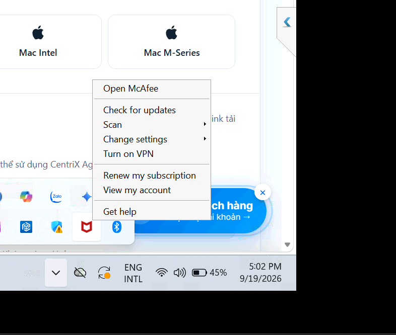

# Tắt McAfee

> **Model:** `gpt-5-6-thinking` · **Created:** 2026-09-19 17:02:43 · **Updated:** 2026-09-19 17:03:02
> **ID:** `6aae5dc1-35a0-83ec-be42-89ed89cbbaf4`

---

> ### 👤 User · 2026-09-19 17:02:46
>
>
> 
>
> làm sao để tắt

> 

---

### 🤖 ChatGPT `gpt-5-6-thinking` · 2026-09-19 17:02:53

Anh đang mở menu của **McAfee**. McAfee thường **không có nút Exit/Tắt hoàn toàn** ngay ở menu này vì nó chạy nền như phần mềm bảo mật.

Nếu anh muốn **tạm tắt McAfee**:

1. Bấm **Open McAfee**.
2. Vào **My Protection**.
3. Chọn **Real-Time Scanning** → **Turn Off**.
4. Chọn thời gian muốn tắt, ví dụ **Until I restart my PC**.
5. Nếu cần, vào **Firewall** → **Turn Off** luôn.

Nếu mục đích là **không cho McAfee tự chạy khi mở máy**, nhấn `Ctrl + Shift + Esc` → **Startup apps** → tìm **McAfee / McAfee WebAdvisor** → **Disable**.

Còn nếu anh **không dùng McAfee nữa**, cách sạch nhất là:

**Settings → Apps → Installed apps → McAfee → ⋯ → Uninstall**

Sau khi gỡ, **Windows Security / Microsoft Defender** thường sẽ tự bật lại để bảo vệ máy.

Nếu anh muốn **tắt hẳn McAfee nhưng không gỡ cài đặt**, em có thể chỉ anh cách tắt toàn bộ service chạy nền của nó.

---

*2 messages · 4 nodes*
