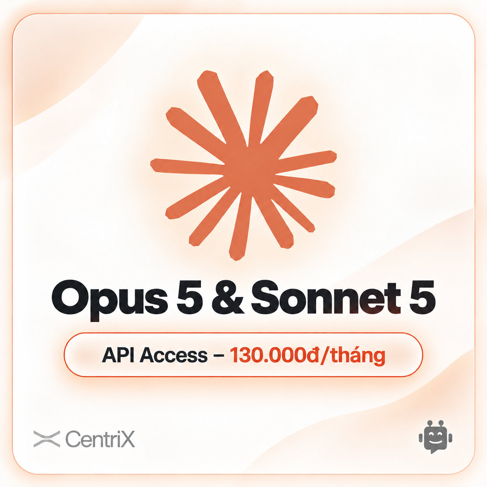
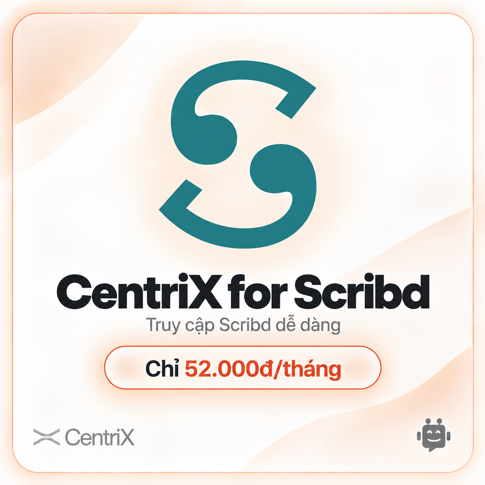
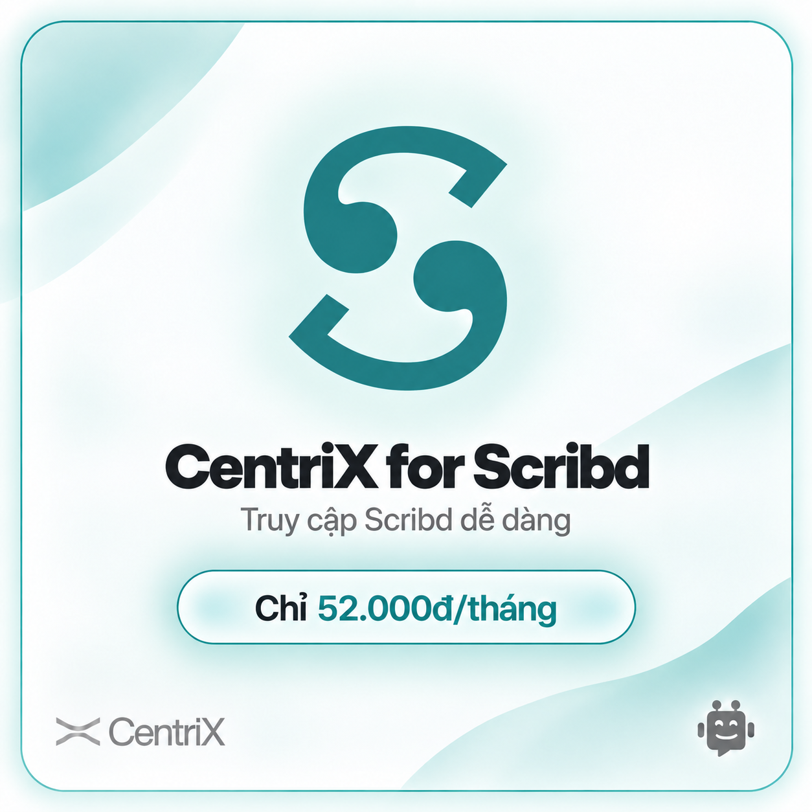
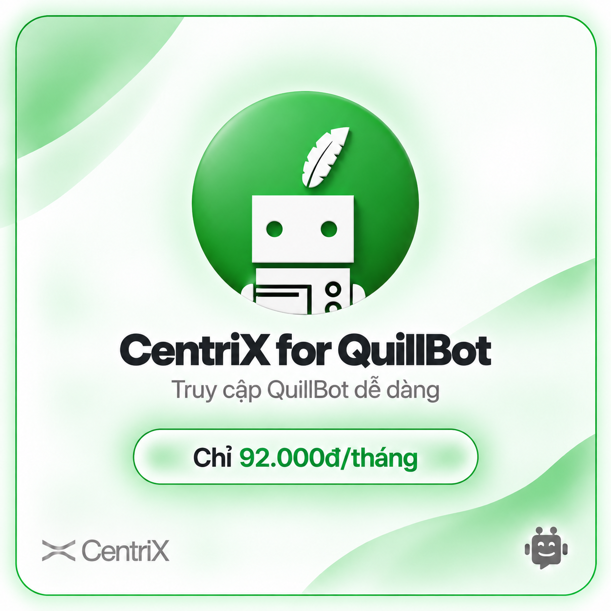
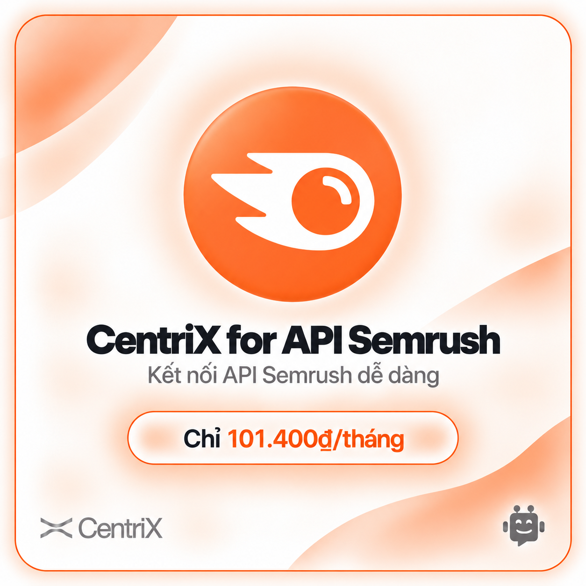
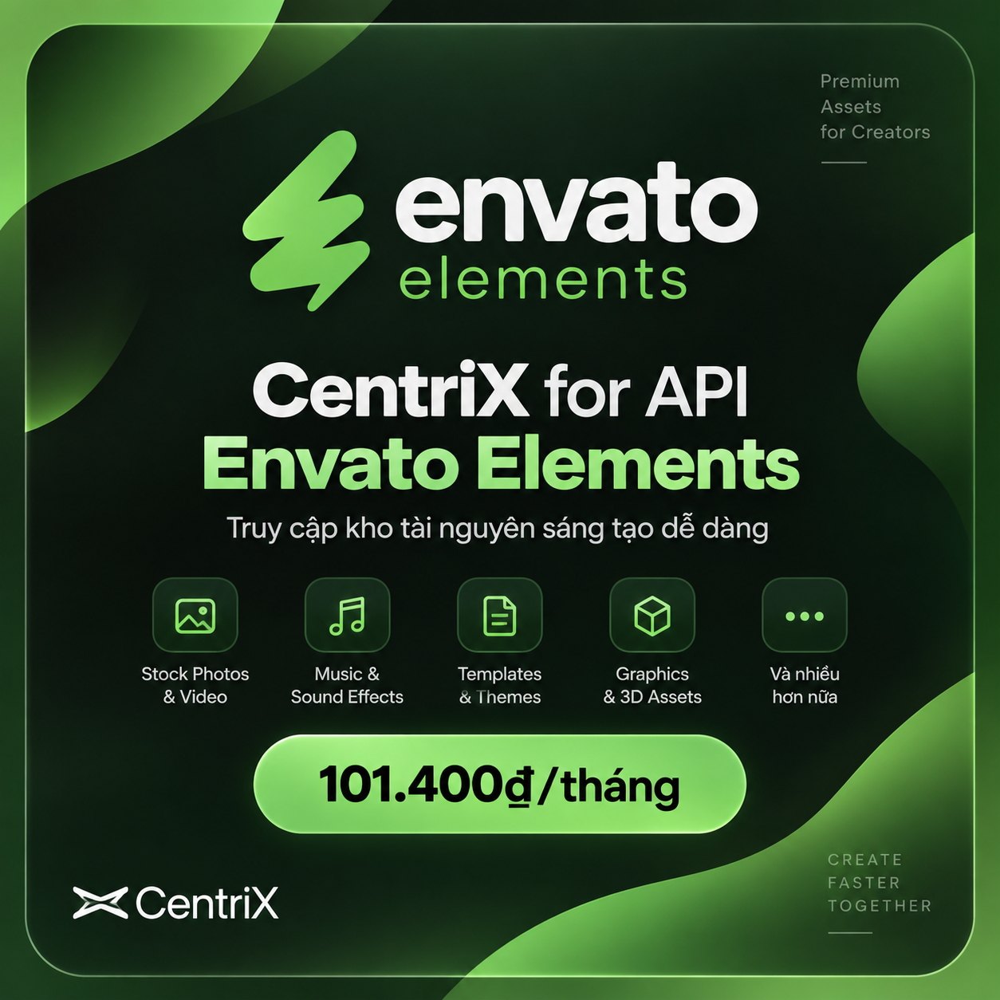
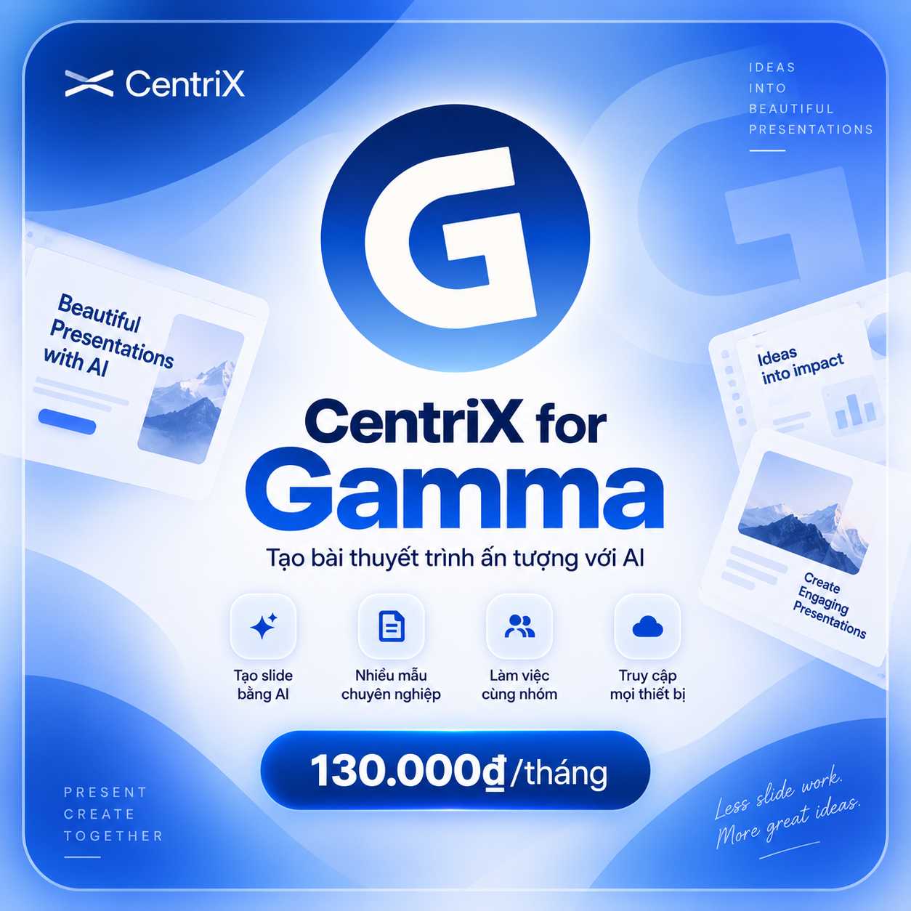

# Tạo hình ảnh CentriX

> **Model:** `gpt-5-6-thinking` · **Created:** 2026-09-19 18:45:29 · **Updated:** 2026-09-19 20:47:10
> **ID:** `6aae75d6-a2c8-83ec-8e42-016ce908349f`

---

> ### 👤 User · 2026-09-19 18:47:12
>
>
> 
>
>
> 
>
> @Tạo hình ảnh Vễ cho mình dịch vụ CentriX for Scribd, giá 52k/tháng

> 

> 

---

### 🔧 Tool · 2026-09-19 18:47:17

Tool output

---

### 🔧 Tool · 2026-09-19 18:48:05

Tool output

Model caption: Square promotional graphic card, clean modern minimal design, like a SaaS/subscription ad. Overall scene: a square, rounded-corner card with soft peach/orange accents and very light cream/white background, with gentle gradient blobs in corners, subtle drop shadows and glow, centered layout, modern sans-serif typography, and a large teal Scribd-like logo mark at top. The style is flat/clean vector/graphic design, similar to a tech ad or UI card. 

Top/overall: white-to-very-light-cream background with soft warm peach/orange gradient swooshes/curves in the corners (a large pale peach curved shape in the upper-left area and soft curved shape in the lower-right), thin rounded border stroke in orange/peach around the whole card, and a soft ambient peach glow/shadow behind central elements.

Center: a huge stylized Scribd-like “S” logo in teal/blue-green (teal) near the top center (large, thick, smooth curved “S” composed of two comma-like shapes and arcs). The logo sits with a soft warm glow/halo behind it, on the light cream background.

Main title: below the logo, very large bold black/dark charcoal sans-serif text reading “CentriX for Scribd” (heavy weight, clean geometric sans-serif), centered.

Subtitle: beneath the title, smaller medium-gray sans-serif text centered: “Truy cập Scribd dễ dàng” (Vietnamese), spaced nicely and lighter weight.

Feature/price badge: centered below subtitle is a rounded pill/outlined button-style panel with a subtle inner glow and orange border/outline, slightly raised/soft shadow. Inside it, text: left part in dark charcoal “Chỉ ” and then bright orange/red-orange “52.000đ/tháng” (bold, large, the price emphasized). The pill has a soft peach background glow and the orange/red text stands out; the word “Chỉ” is darker/blackish, and “52.000đ/tháng” is vivid orange-red.

Bottom left: a small CentriX mark/logo and text in muted gray: a simple abstract “X”-like arc/swoosh icon followed by the word “CentriX” (sans-serif, gray), placed near the lower-left corner inside the card.

Bottom right: a small friendly robot/chatbot icon in gray, with a smiling face and rounded head/antennae-like dots, resembling a chat assistant, placed near the lower-right corner.

Layout details: everything is centered and symmetrical, with the main headline and price in the vertical center area, large negative space, soft shadows and glows, rounded corners on the card and the pill, minimalistic UI-ad aesthetic, no people, no additional text.<|has_watermark|><|has_borders|>

---

### 🔧 Tool · 2026-09-19 18:48:07

Tool output

Generated images from the last `image_gen.text2im` call were saved at:
- /mnt/data/ghostwriter_images/generated/square_promotional_graphic_card_clean_modern_mini_1.png (wxh = 1254 x 1254, exact aspect ratio 1:1, close to aspect ratio 1:1)

You can visually inspect the generated image directly in the tool result above. Only reopen the saved path if you need programmatic processing or want to pass the image into another tool call.

---

> ### 👤 User · 2026-09-19 19:39:02
>
> Size chữ có quá to không bạn

---

### 🤖 ChatGPT `gpt-5-6-thinking` · 2026-09-19 19:39:10

Dạ, em thấy **chữ đang hơi to**, nhất là dòng **“CentriX for Scribd”**. Nó chiếm quá nhiều chiều ngang nên tổng thể hơi nặng và làm phần logo + giá bị bí.

Em đề xuất:
- **“CentriX for Scribd”**: giảm khoảng **12–15%**
- **“52.000đ/tháng”**: giảm khoảng **5–8%**
- Dòng **“Truy cập Scribd dễ dàng”**: kích thước hiện tại ổn
- Logo Scribd: có thể giảm nhẹ **5–10%** để bố cục thoáng hơn

Sau khi giảm, ảnh sẽ trông **cao cấp và cân đối hơn**, gần phong cách poster Opus 5 mẫu anh gửi ban đầu.

---

> ### 👤 User · 2026-09-19 20:29:37
>
> 1. **“CentriX for Scribd”**: giảm khoảng **12–15%** 
> 2. **“52.000đ/tháng”**: giảm khoảng **5–8%** 
> 3. Dòng **“Truy cập Scribd dễ dàng”**: kích thước hiện tại ổn 
> 4. Logo Scribd: có thể giảm nhẹ **5–10%** để bố cục thoáng hơn
> 5. Màu nền phải dùng màu của Scribd làm chủ đạo@Tạo hình ảnh 

---

### 🔧 Tool · 2026-09-19 20:29:40

Tool output

---

### 🔧 Tool · 2026-09-19 20:30:33

Tool output

Model caption: A clean, modern promotional graphic / banner card in a teal/white minimalist style, matching the original layout but updated with Scribd’s teal color palette and slightly reduced element sizes, with rounded corners and soft gradients. Overall scene: a square (1:1) advertisement image with a light, airy background, centered composition, modern sans‑serif typography, teal/white/gray color scheme, soft shadows and glows, and smooth abstract curved shapes in the corners, like a product subscription card. No people; purely graphic/typography/logo design. The card has rounded rectangle border with thin teal outline and soft outer glow, subtle abstract wave/curve shapes in the background (top-left and bottom-right) in pale teal/seafoam gradients, giving a smooth, premium tech feel. Visual hierarchy: big Scribd-like logo at top center, title text under it, subtitle, then a rounded pill price button, and small brand marks at bottom corners.

Top/center: a large Scribd-like emblem (teal/dark-cyan logo) — an abstract “S”-like swirl/curved mark with two circular/comma-like blobs forming an S shape, centered and slightly smaller than before compared to the earlier version, with a soft faint glow/halo behind it. The logo color is deep teal (#1f7f7f/teal-ish), crisp vector look, minimal flat style.

Background: mostly off-white/very pale mint, with subtle gradient and translucent curved shapes/waves in the upper left and lower right corners, pale teal overlays, very smooth blur-like gradient. The card is framed by a thin rounded border in teal, with a soft shadow/glow outside the card edges. The interior feels clean with lots of whitespace and gentle teal lighting, with abstract swooshes in the corners.

Center text: below the logo, a bold, dark charcoal/blackish sans-serif heading: “CentriX for Scribd” (large but smaller than original image A, about 12–15% smaller relative size, centered). Typeface is modern geometric/rounded sans-serif, heavy weight, with slight letter spacing tight, centered. Directly beneath it, a smaller mid-gray subtitle: “Truy cập Scribd dễ dàng” (same size as original, medium/light weight, centered).

Below that: a rounded pill-shaped button/label centered, with a thin teal outline and a very light cyan gradient fill and subtle inner glow/shadow. Inside the pill, left text in dark/near-black: “Chỉ” and then the price in teal: “52.000đ/tháng”. The number and currency part “52.000đ/tháng” is teal/blue-green, and “Chỉ” is darker, all in clean sans-serif; overall slightly smaller than original price text (reduced ~5–8%) to match the new spacing. The pill has soft drop shadow/glow, giving a floating button effect.

Bottom left: a minimalist CentriX brand mark and wordmark in light gray: a small abstract “X”-like emblem (two curved strokes forming an X or wave) followed by “CentriX” in light gray sans-serif. Bottom right: a small gray chatbot/robot icon with a rounded square/robot face and antennae nodes, smiling face, minimal flat icon style. Both sit near the bottom corners inside the card, with plenty of breathing room.

No other text. The layout is centered vertically: logo at upper center, title and subtitle mid, button lower center, and the small logos at bottom corners. Clean, high-resolution, flat vector/graphic design with soft gradients, teal accents, and subtle vignette-like lightness; no photograph, no people.<|has_watermark|><|has_borders|>

---

### 🔧 Tool · 2026-09-19 20:30:35

Tool output

Generated images from the last `image_gen.text2im` call were saved at:
- /mnt/data/ghostwriter_images/generated/a_clean_modern_promotional_graphic_banner_card_1.png (wxh = 1254 x 1254, exact aspect ratio 1:1, close to aspect ratio 1:1)

You can visually inspect the generated image directly in the tool result above. Only reopen the saved path if you need programmatic processing or want to pass the image into another tool call.

---

> ### 👤 User · 2026-09-19 20:33:37
>
>
> 
>
> 1. **“CentriX for** Quillbot**”**: giảm khoảng **12–15%** 
> 2. **“52.000đ/tháng”**: giảm khoảng **5–8%** 
> 3. Dòng **“Truy cập Scribd dễ dàng”**: kích thước hiện tại ổn 
> 4. Logo Scribd: có thể giảm nhẹ **5–10%** để bố cục thoáng hơn
> 5. Màu nền phải dùng màu của Scribd làm chủ đạo@Tạo hình ảnh 
> 6. giá 92k/tháng
> 7.

> 

---

### 🔧 Tool · 2026-09-19 20:33:41

Tool output

---

### 🔧 Tool · 2026-09-19 20:34:36

Tool output

Model caption: A clean minimalist promotional graphic / ad card in a flat + soft 3D/gradient style, centered composition, green/white theme, modern UI/marketing aesthetic, like a SaaS subscription banner. Overall scene: a square poster/card with rounded corners and subtle drop glow, soft green gradient background with abstract curved shapes, centered QuillBot-style mascot icon, bold headline, Vietnamese subtitle, a rounded price button, and small brand/chatbot icons in the corners, matching the style of the reference Scribd card but adapted for QuillBot. The layout is symmetrical and spacious, with a light green-white palette, crisp sans-serif typography, and smooth gradients/shadows.

Top-to-bottom and element details:

- Background: very light off-white/very pale mint with soft green gradients and blurry curved wave-like shapes: a large translucent rounded swoosh/curved gradient in the top-left corner, and another soft curved green swoosh in the bottom-right area, with gentle vignette/airbrush glow around the central circle; overall airy, minimal, with a faint green rim and a rounded rectangle border around the whole card. The border is a thin green line with rounded corners and a soft outer glow/shadow, giving a premium card look.

- Center top: a large circular green emblem in the upper center, like the QuillBot robot icon:
 - A deep-to-medium green circular badge with subtle shading/gradient, appearing slightly 3D/embossed.
 - Inside: a simplified white robot head/upper torso: rectangular head with two circular eye holes (greenish/negative-space eyes), a lower torso/robot chest with simple line details (horizontal/vertical panel strokes and circular button-like shapes), and a white feather/quill sticking up at the top-right area of the head (feather is white with a small dark line/shaft detail and feather teeth). The robot is centered and crisp, with a soft glow/halo around the circle.

- Below the icon, the main headline in the center: “CentriX for QuillBot” in a bold, modern sans-serif (heavy weight), dark charcoal/near-black. Spacing is generous, with “CentriX” capital X, and “for QuillBot” following, all on one line or visually centered as a single title block.

- Subtitle beneath in medium gray: “Truy cập QuillBot dễ dàng” (Vietnamese), in a clean sans-serif, lighter weight, centered.

- Price callout: a large rounded pill/button centered under the subtitle, with a thin green outline and subtle inner glow/shadow. The interior is very light/whitish-green with a soft green bloom. Text inside: “Chỉ 92.000đ/tháng” where “Chỉ” is in dark charcoal/black-ish and “92.000đ/tháng” is in bright QuillBot-like green. Font is clean, semi-bold, large and readable, with the price segment emphasized in green. The pill has a soft shadow/blur glow beneath it.

- Bottom left corner: a grey CentriX wordmark and simple abstract symbol (an “X”-like or wave/X mark) to the left, reading “CentriX” in muted gray; located near the bottom-left margin inside the rounded card.

- Bottom right corner: a small friendly chatbot/robot icon in gray with a smiling face, two little antenna/bump circles, and rounded body/ears—similar to a chat assistant symbol—placed near the bottom-right inside the card.

- No additional text. The composition includes soft, curved green accent shapes in the corners (top-left and bottom-right) with smooth gradient blends, minimal noise, crisp vector-like rendering, and strong central alignment. The overall look is a premium app/service subscription ad, consistent with QuillBot’s green brand color and CentriX styling.<|has_watermark|>

---

### 🔧 Tool · 2026-09-19 20:34:38

Tool output

Generated images from the last `image_gen.text2im` call were saved at:
- /mnt/data/ghostwriter_images/generated/a_clean_minimalist_promotional_graphic_ad_card_i_1.png (wxh = 1254 x 1254, exact aspect ratio 1:1, close to aspect ratio 1:1)

You can visually inspect the generated image directly in the tool result above. Only reopen the saved path if you need programmatic processing or want to pass the image into another tool call.

---

> ### 👤 User · 2026-09-19 20:36:24
>
>
> 
>
> 1. **“CentriX for** API Semrush**”**: giảm khoảng **12–15%** 
> 2. Màu nền phải dùng màu của logo làm chủ đạo@Tạo hình ảnh 
> 3. Giá **101.400₫** /tháng

> 

---

### 🔧 Tool · 2026-09-19 20:36:28

Tool output

---

### 🔧 Tool · 2026-09-19 20:37:33

Tool output

Model caption: Square/oriented graphic design promotional card, clean modern UI style, no humans, flat+soft 3D-ish gradients, minimal layout, like a marketing banner. Overall scene: a single square image (1:1) with rounded corners and a soft orange/white theme, modern sans-serif typography, soft shadows and glows, with a central large circular logo, headline, subtitle, a pill price badge, and small brand elements at bottom corners. Background is creamy white with subtle orange gradient blobs/waves and a thin orange rounded border; lots of airy whitespace and gentle vignette/glow around the main elements, matching the style of a CentriX product/service card. 

Top/whole canvas: rounded rectangle card with a thin orange outline stroke, soft orange outer glow, with abstract curved gradient shapes in the corners (upper left swoosh/arc gradient, and lower right swoosh/arc gradient) in pale orange/peach tones, giving a smooth, airy background. 

Centered near the top-middle is a large orange circular icon badge: an orange circle with a white Semrush-like comet/eye logo (a stylized comet or speed-meteor shape with a circular “eye”/lens on the right and a highlight curve inside), rendered flat white on an orange gradient circle, with subtle lighting/shading and a soft halo glow around the circle. The icon is crisp, high-contrast, and centered. 

Below the icon: a bold, dark charcoal/near-black headline in large sans-serif: “CentriX for API Semrush” (clean geometric/rounded sans-serif look, heavy weight). Under that, a smaller medium-gray subtitle: “Kết nối API Semrush dễ dàng” (Vietnamese text, lighter weight, centered). 

Under the subtitle: a prominent rounded pill-shaped button/price badge centered, with a thin orange outline, light orange/white fill with glow/soft inner highlight, and subtle shadow/glow. Inside the pill: left part text “Chỉ” in dark charcoal/black, and the price “101.400₫/tháng” in bright orange/orange-red (the numerical and currency/period and “/tháng” in the same orange accent). The font is modern sans-serif, large and centered within the pill, with the orange part emphasized. 

Bottom left corner: a small gray CentriX brand mark: an abstract “X”-like swoosh icon and the word “CentriX” in gray, clean sans-serif, aligned near the bottom-left margin. 

Bottom right corner: a small cute robot/chatbot icon in gray (rounded robot head with smiling face, antenna dots, and a chat-bubble-like body), positioned near the bottom-right margin. 

The overall palette is white/cream background with orange gradients and gray typography, soft shadows and glows, minimal clean composition, consistent spacing and hierarchy, with no additional text besides the ones listed.<|has_watermark|><|has_borders|>

---

### 🔧 Tool · 2026-09-19 20:37:34

Tool output

Generated images from the last `image_gen.text2im` call were saved at:
- /mnt/data/ghostwriter_images/generated/square_oriented_graphic_design_promotional_card_c_1.png (wxh = 1254 x 1254, exact aspect ratio 1:1, close to aspect ratio 1:1)

You can visually inspect the generated image directly in the tool result above. Only reopen the saved path if you need programmatic processing or want to pass the image into another tool call.

---

> ### 👤 User · 2026-09-19 20:38:02
>
> 1. **“CentriX for API** Envato Elements**”**: giảm khoảng **12–15%** 
> 2. Màu nền phải dùng màu của logo làm chủ đạo@Tạo hình ảnh 
> 3. Giá **101.400₫** /tháng

---

### 🔧 Tool · 2026-09-19 20:38:42

Tool output

---

> ### 👤 User · 2026-09-19 20:46:11
>
>
> 
>
> 1. **“CentriX for** Gamma**”**: giảm khoảng **12–15%** 
> 2. Màu nền phải dùng màu của logo làm chủ đạo@Tạo hình ảnh 
> 3. Giá **130.000₫** /tháng 

> 

---

### 🔧 Tool · 2026-09-19 20:46:59

Tool output

---

*22 messages · 36 nodes*
