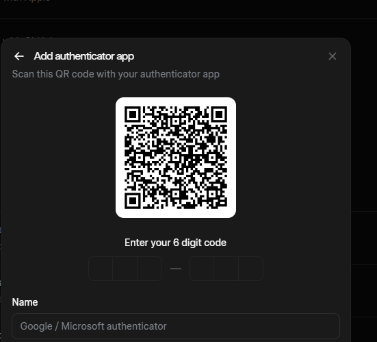

# Đọc mã QR

> **Model:** `gpt-5-6-thinking` · **Created:** 2026-09-20 16:24:11 · **Updated:** 2026-09-20 16:24:37
> **ID:** `6aafa63a-2efc-83ec-9e89-442461e3315f`

<style>
blockquote {
  background-color: rgba(59, 130, 246, 0.08) !important;
  border-left: 4px solid #3b82f6 !important;
  padding: 12px 18px !important;
  border-radius: 8px !important;
  margin: 16px 0 !important;
  color: inherit !important;
}
blockquote h3 {
  margin-top: 0 !important;
  color: #60a5fa !important;
}
</style>

---

> ### 👤 User · 2026-09-20 16:24:12
>
>
> 
>
> đọc QR 

> 

---

### 🤖 ChatGPT `gpt-5-6-thinking` · 2026-09-20 16:24:29

Anh, QR này là mã thiết lập **TOTP/Authenticator** cho:

- **Dịch vụ:** xAI
- **Tài khoản:** `grokcentrix@signs.onmicrosoft.com`
- **Secret key:** `45RIF66QRZPETXD5R3NYI2G3KU5EYIRD`

Chuỗi QR đầy đủ là:

```text
otpauth://totp/%22xAI%22:grokcentrix%40signs.onmicrosoft.com?secret=45RIF66QRZPETXD5R3NYI2G3KU5EYIRD&issuer=%22xAI%22
```

⚠️ **Secret key này tương đương chìa khóa 2FA**, ai có nó cũng có thể tạo mã 6 số. Anh không nên chia sẻ ảnh QR hoặc secret này cho người khác.

---


*2 messages · 7 nodes*
