# CentriX App User 3.6.16 — Full diagrams

Mở file này bằng viewer hỗ trợ Mermaid (GitHub, VS Code Markdown Preview Mermaid, Obsidian, …).

---

## 1. System overview (end-to-end)

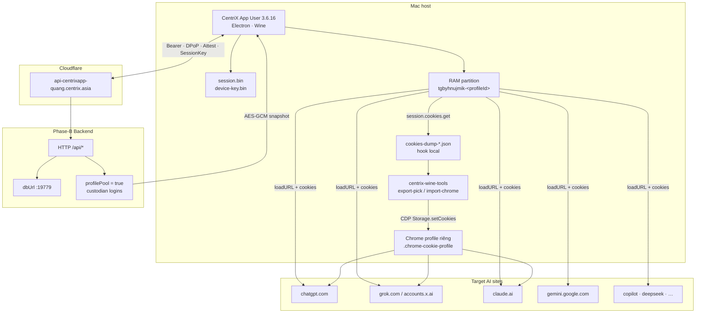

---

## 2. app.asar monorepo map

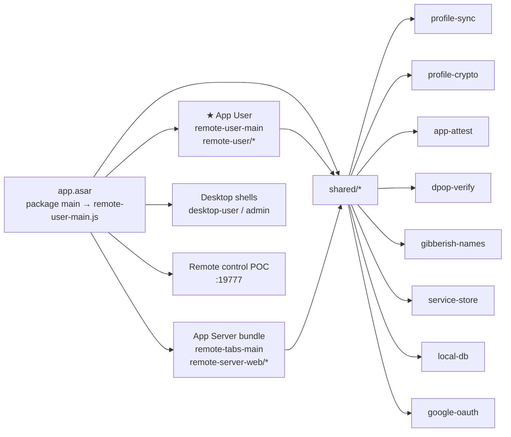

---

## 3. App User process architecture

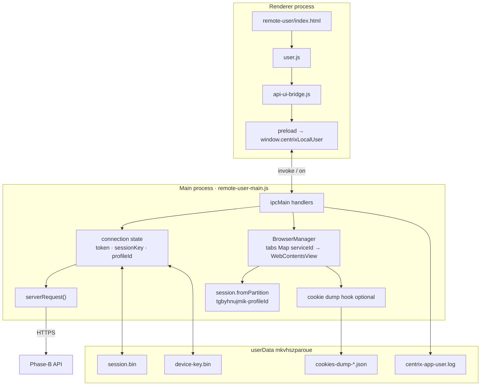

---

## 4. Auth + connect sequence

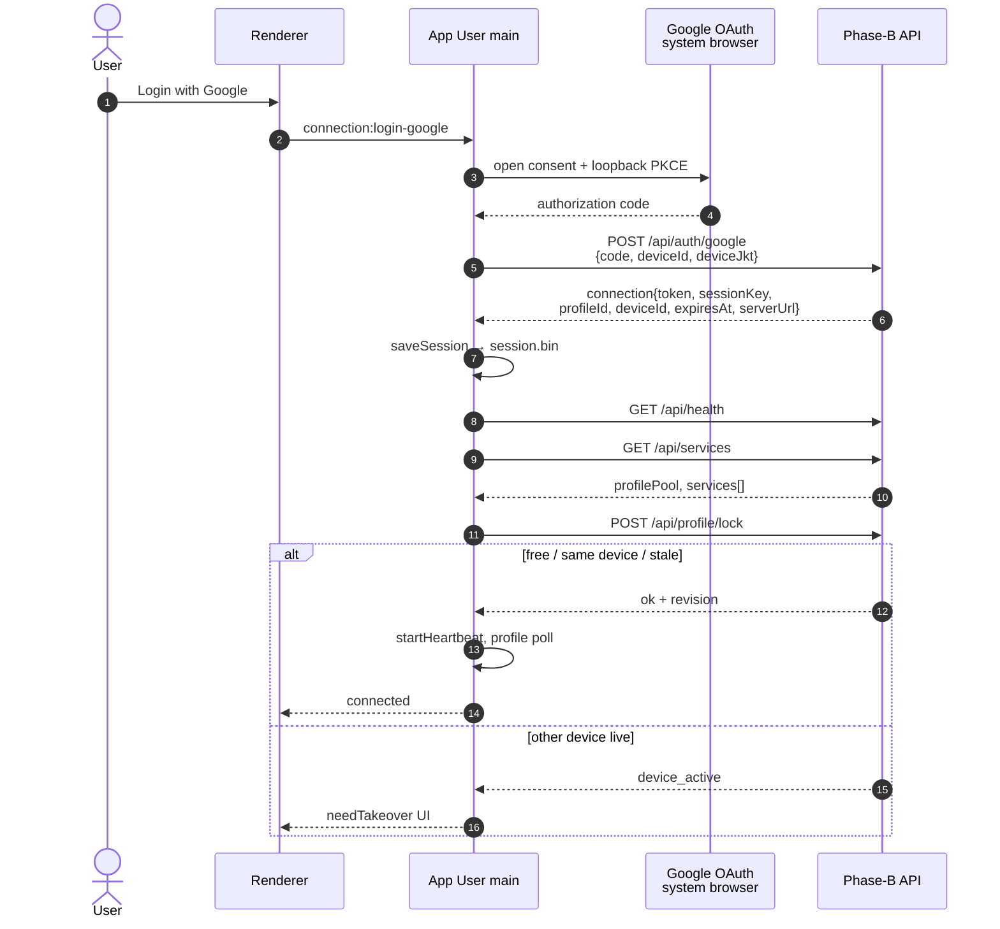

---

## 5. Open service + pool cookie load

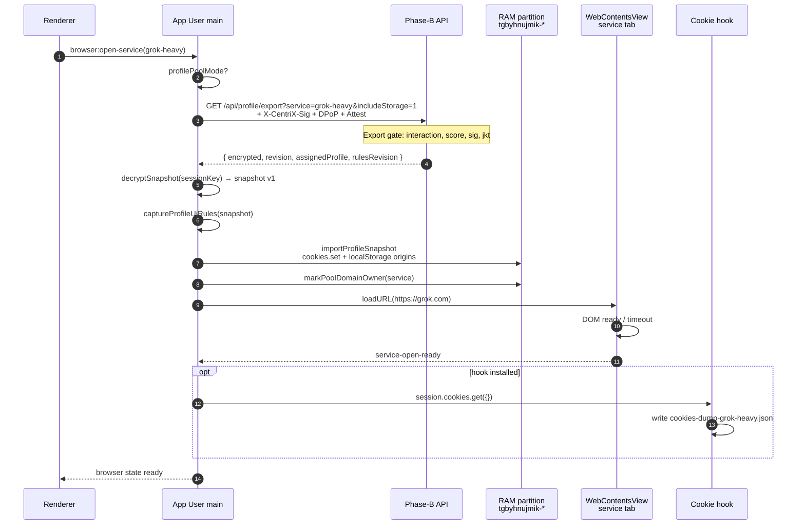

---

## 6. Snapshot data model

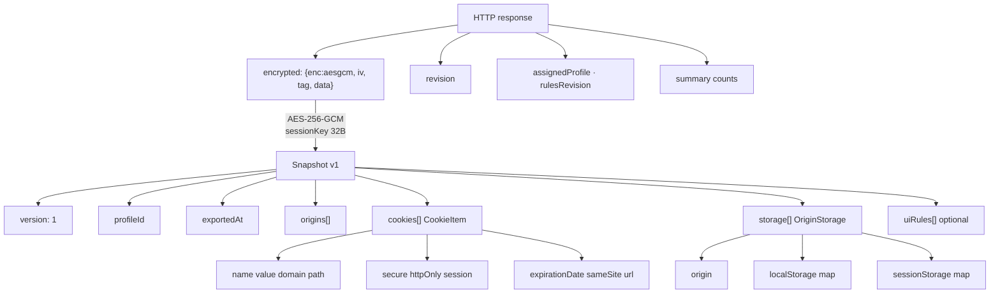

---

## 7. Lock / takeover full sequence

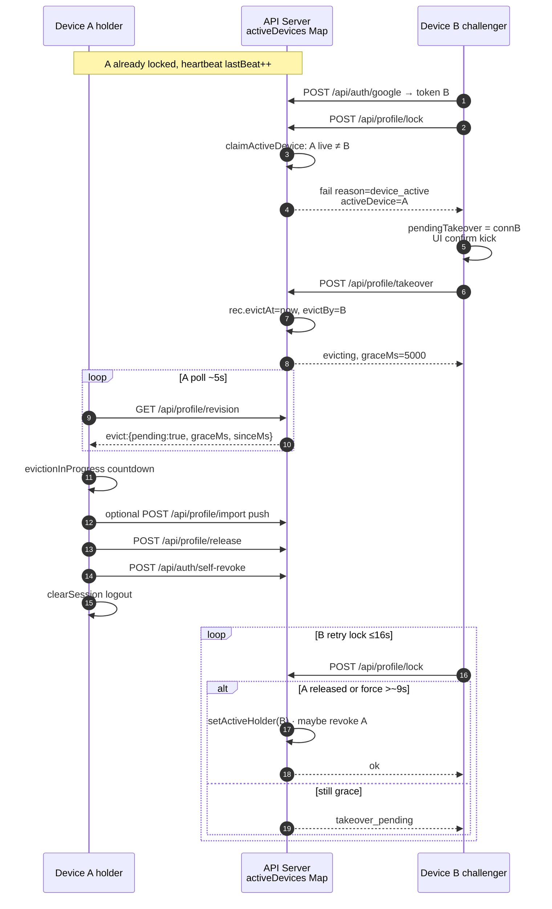

### Takeover state machine

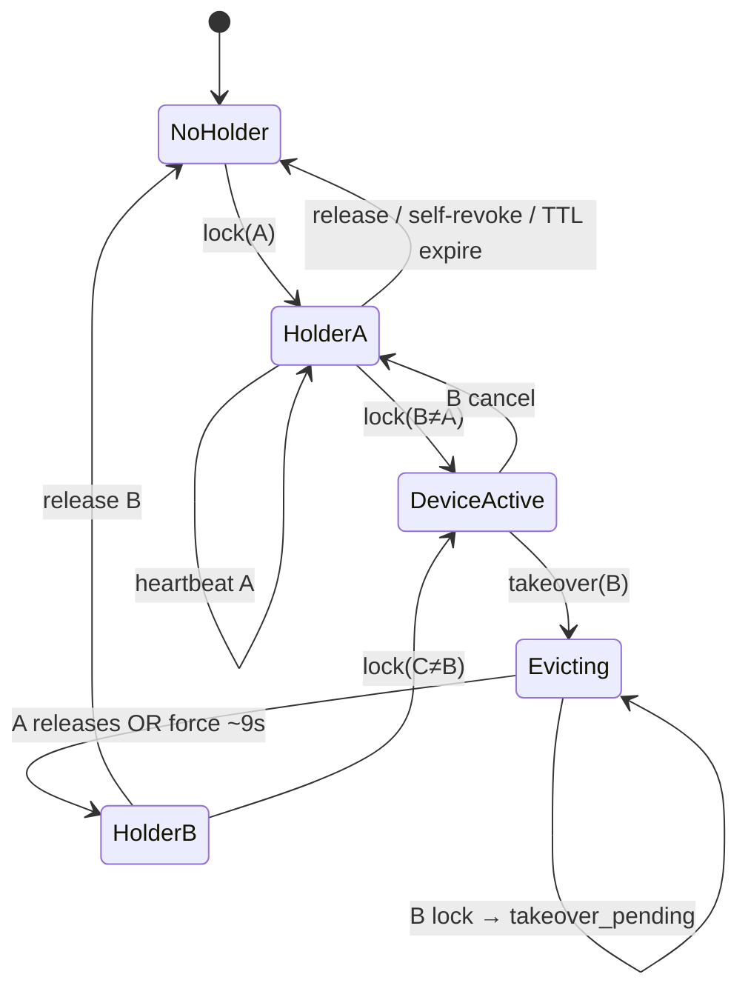

---

## 8. Request security layers

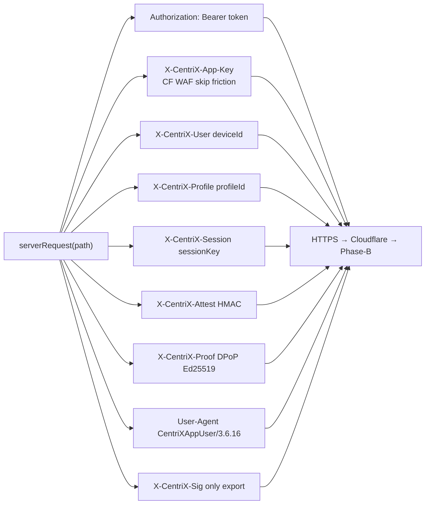

---

## 9. Cookie path: API → disk → Chrome

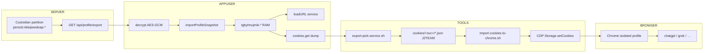

---

## 10. IPC map (App User)

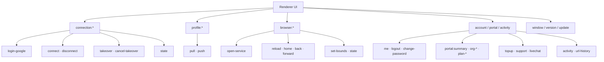

---

## 11. Partition & same-domain collision

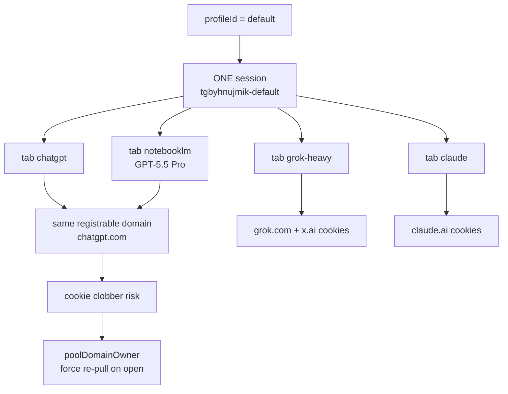

---

## 12. Export gate (server)

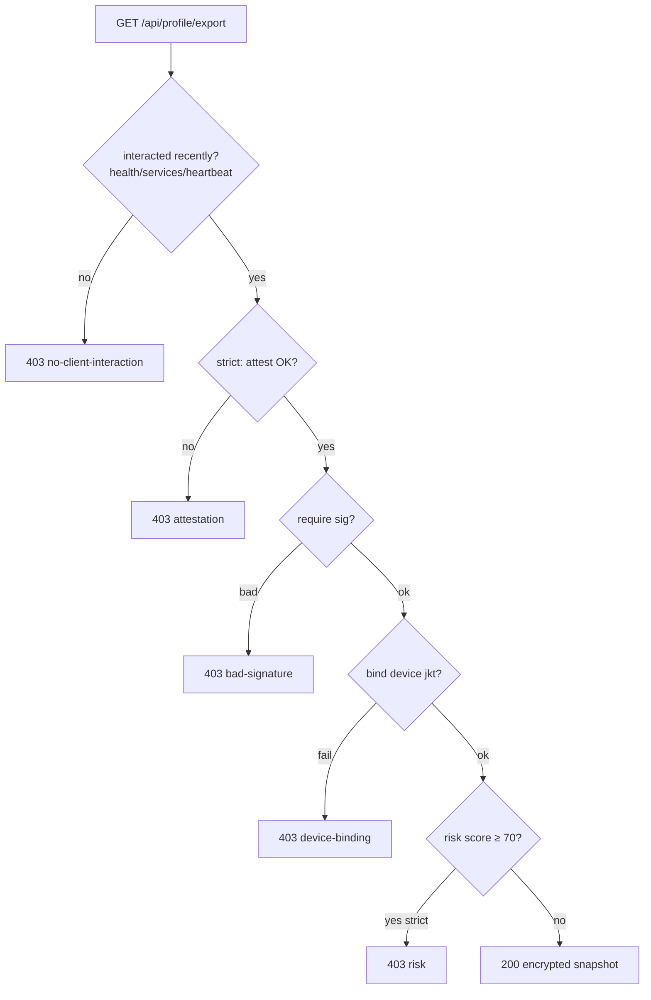

---

## 13. Tooling integration (this repo)

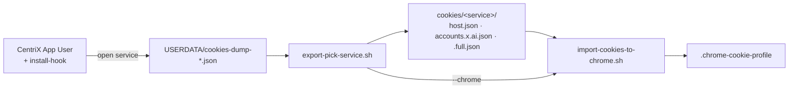

---

## 14. Default service catalog

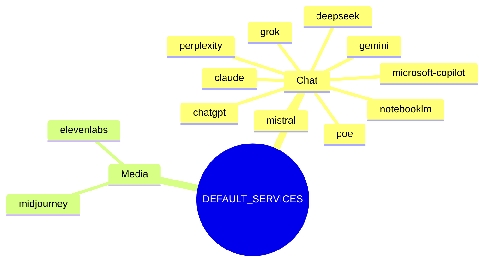

---

## 15. C4-style containers

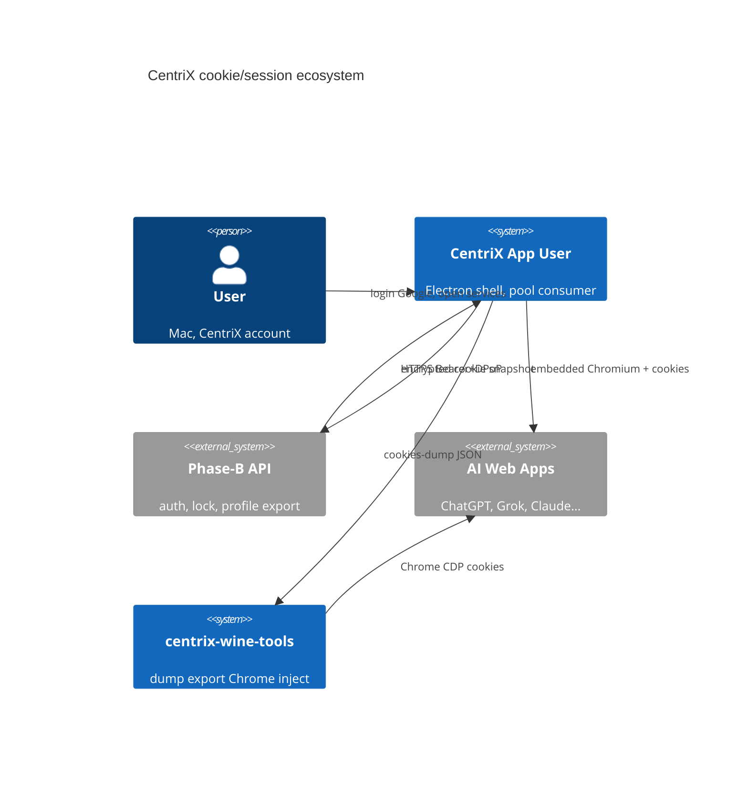

> Note: C4 may need a Mermaid C4 plugin; if preview fails, use diagrams 1–14.

---

## File index

| # | Diagram |
|---|---------|
| 1 | System overview |
| 2 | asar monorepo |
| 3 | Process architecture |
| 4 | Auth + connect |
| 5 | Open service + pool |
| 6 | Snapshot model |
| 7 | Lock/takeover + state machine |
| 8 | Request headers |
| 9 | Cookie pipeline to Chrome |
| 10 | IPC map |
| 11 | Partition collision |
| 12 | Export gate |
| 13 | Repo tools |
| 14 | Service catalog mindmap |
| 15 | C4 context |
